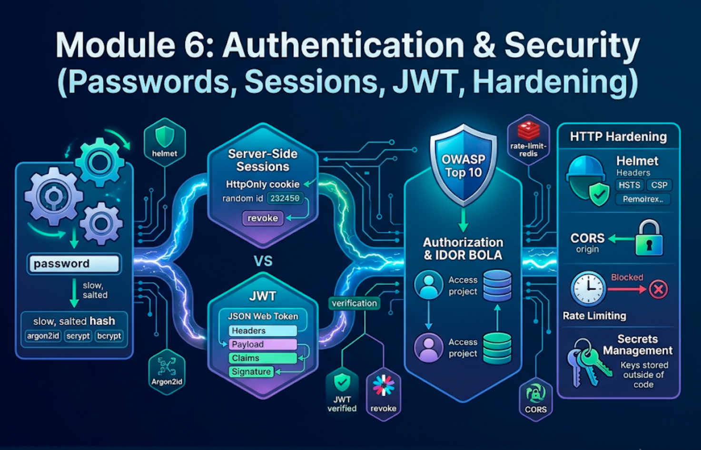

# Module 6: Authentication & Security (Passwords, Sessions, JWT, Hardening)



## Words you will meet in this module

| Word                       | Simple meaning                                                                                                    |
| -------------------------- | ----------------------------------------------------------------------------------------------------------------- |
| **Authentication (AuthN)** | **Who are you?** Proving identity (password, passkey, OAuth login).                                               |
| **Authorization (AuthZ)**  | **What are you allowed to do?** Checking permissions on each action.                                              |
| **Hash**                   | A one-way fingerprint of data. You cannot turn it back into the original.                                         |
| **Salt**                   | Random data mixed into each password before hashing, so equal passwords get different hashes.                     |
| **Session**                | Server-side record that says "this browser is logged in as user 7". The browser holds only a random ID.           |
| **JWT**                    | JSON Web Token: a signed token that **carries** claims (user id, expiry) inside it.                               |
| **Cookie flags**           | `HttpOnly`, `Secure`, `SameSite`: attributes that control who can read or send a cookie.                          |
| **IDOR / BOLA**            | Insecure Direct Object Reference / Broken Object Level Authorization: changing an ID to read someone else's data. |
| **RBAC**                   | Role-Based Access Control: permissions attached to roles (`member`, `admin`).                                     |
| **CSRF**                   | A malicious site makes your browser send an authenticated request you did not intend.                             |
| **SSRF**                   | Server-Side Request Forgery: tricking your server into calling internal URLs.                                     |
| **Rate limiting**          | Capping how many requests a client can make in a time window.                                                     |
| **OAuth 2.0 / OIDC**       | Standard protocols for "Sign in with Google/GitHub" without handling the password yourself.                       |

## 6.1 The Security Mindset and the Big Risks

**Assume every input is hostile and every dependency could fail.** Security is not a feature you add at the end. It is many small decisions in every layer. The most common serious API problems, in the spirit of the OWASP API Security Top 10:

| Risk                                    | What it means                                                         | Where you defend (this module) |
| --------------------------------------- | --------------------------------------------------------------------- | ------------------------------ |
| **Broken object level authorization**   | User A reads or edits user B's records by changing an ID              | Topic 6.5                      |
| **Broken authentication**               | Weak passwords, no rate limit, leaky sessions or tokens               | Topics 6.2 to 6.4, 6.7         |
| **Broken function level authorization** | A normal user calls an admin endpoint                                 | Topic 6.5                      |
| **Mass assignment / excessive data**    | Clients set fields they should not, or receive fields they should not | Module 4 (Zod) and Topic 6.5   |
| **Injection**                           | SQL, command, NoSQL, path traversal                                   | Module 3, 5 and Topic 6.6      |
| **SSRF**                                | Server fetches attacker-chosen URLs                                   | Topic 6.6                      |
| **Unrestricted resource use**           | No rate limits, huge bodies, expensive queries                        | Topic 6.7                      |
| **Security misconfiguration**           | Debug on, default credentials, open CORS, missing headers             | Topics 6.7 and 6.8             |
| **Vulnerable dependencies**             | Known-bad or malicious packages                                       | Module 1 and Topic 6.8         |

Background reading in this blog: [Authentication and Security in System Design](system-design/auth-and-security), [CSRF](vulnerabilities/csrf), [JWT vulnerabilities](vulnerabilities/jwt), [Prototype Pollution](vulnerabilities/prototype-pollution) and [HTTP Request Smuggling](vulnerabilities/http-request-smuggling).

## 6.2 Password Storage

### What never to do

| Approach                   | Why it fails                                                                   |
| -------------------------- | ------------------------------------------------------------------------------ |
| Store plain text           | One database leak exposes every account (and the same password on other sites) |
| Encrypt passwords          | Encryption is reversible. If the key leaks, so does everything                 |
| Plain `SHA-256` or `MD5`   | **Too fast.** Attackers test billions of guesses per second on a GPU           |
| Hash without a unique salt | Identical passwords share hashes, and precomputed "rainbow tables" work        |

### What to do: a slow, salted, memory-hard hash

Password hashing must be **deliberately slow and memory-hungry**, so each guess costs the attacker real resources. Use one of these, in this order of preference:

| Algorithm    | Notes                                                                                                                      |
| ------------ | -------------------------------------------------------------------------------------------------------------------------- |
| **Argon2id** | The modern recommendation. Memory-hard. OWASP's minimum guidance is about 19 MiB memory, 2 iterations, 1 lane. Tune upward |
| **scrypt**   | Memory-hard, **built into Node's `node:crypto`**. A good choice with no extra dependency                                   |
| **bcrypt**   | Older but still acceptable (cost 10+). Truncates input at **72 bytes**, so long passwords are partly ignored               |

Tune the cost so one hash takes roughly **100 to 250 ms** on your production hardware, and store the **parameters inside the hash string** so you can raise them later.

### Option 1: scrypt with only built-ins (Node)

```ts
// src/auth/password.ts
import { scrypt as scryptCb, randomBytes, timingSafeEqual } from 'node:crypto';
import { promisify } from 'node:util';

const scrypt = promisify(scryptCb) as (
  password: string,
  salt: Buffer,
  keylen: number,
  options: { N: number; r: number; p: number; maxmem: number },
) => Promise<Buffer>;

const N = 2 ** 16,
  R = 8,
  P = 2; // about 64 MiB of memory per hash
const MAXMEM = 128 * 1024 * 1024;

export async function hashPassword(password: string): Promise<string> {
  const salt = randomBytes(16); // unique random salt per password
  const key = await scrypt(password.normalize('NFKC'), salt, 64, {
    N,
    r: R,
    p: P,
    maxmem: MAXMEM,
  });
  return [
    'scrypt',
    N,
    R,
    P,
    salt.toString('base64'),
    key.toString('base64'),
  ].join('$');
}

export async function verifyPassword(
  password: string,
  stored: string,
): Promise<boolean> {
  const [alg, n, r, p, saltB64, keyB64] = stored.split('$');
  if (alg !== 'scrypt') return false;
  const expected = Buffer.from(keyB64, 'base64');
  const key = await scrypt(
    password.normalize('NFKC'),
    Buffer.from(saltB64, 'base64'),
    expected.length,
    {
      N: Number(n),
      r: Number(r),
      p: Number(p),
      maxmem: MAXMEM,
    },
  );
  return timingSafeEqual(key, expected); // constant-time comparison
}
```

`scrypt` runs on the **libuv thread pool** (Module 2), uses a lot of memory and CPU per call, and only 4 run at once, so login endpoints **must be rate limited** (Topic 6.7) or they become a denial-of-service target.

### Option 2: Bun's built-in

```ts
const hash = await Bun.password.hash(password); // argon2id by default
const ok = await Bun.password.verify(password, hash); // also verifies bcrypt hashes
```

(Node packages such as `argon2` or `@node-rs/argon2` offer Argon2id on Node. Recent Node and Bun releases are also adding `argon2` to `node:crypto`, so check the docs for your version.)

### Password policy that actually helps

- **Minimum length 12**, allow **long passphrases** (64+ characters). Do not force silly composition rules ("one symbol, one capital").
- Check new passwords against **breached-password lists** (the Have I Been Pwned range API uses k-anonymity, so you never send the password).
- Do not force periodic rotation. Do force it after a suspected breach.
- Offer **MFA** (TOTP app or passkeys). It stops most account takeovers.
- **Rehash on login** if the stored parameters are weaker than your current ones.

### Login hygiene

- Return one **generic message** for both "unknown email" and "wrong password" (`Invalid email or password`).
- Make the response **time similar** for unknown users by verifying against a dummy hash, so attackers cannot enumerate accounts through timing.
- **Rate limit** by IP and by account.
- Password reset tokens: random 32 bytes, **store only a hash**, expire in 15 to 60 minutes, **single use**, and invalidate all sessions after a reset.

#### Interview traps

- "Why not SHA-256 for passwords?" It is designed to be fast, so attackers can try billions of guesses per second. Password hashes must be slow and memory-hard (argon2id, scrypt, bcrypt).
- "What does the salt do?" It makes every hash unique even for identical passwords and defeats precomputed rainbow tables. It is stored next to the hash and is not secret.
- "Hashing vs. encryption?" Hashing is one-way and used to verify. Encryption is two-way and used when you must recover the data. Passwords should never be recoverable.
- "bcrypt gotcha?" It only uses the first 72 bytes of the password.

## 6.3 Sessions vs. JWT

### Server-side sessions

```
 1. POST /login  {email, password}   ─────────────────────►  server verifies password
 2. server creates a random session ID, stores  id → user  in the DB / Redis
 3. ◄───────────  Set-Cookie: sid=<random>; HttpOnly; Secure; SameSite=Lax
 4. every later request: the browser sends the cookie automatically
 5. server looks up the session ID → knows the user
 6. POST /logout: server DELETES the session. Instantly invalid.
```

The cookie holds **only an unguessable random ID**. All data and control stay on the server.

### JWT (JSON Web Token)

A JWT is `header.payload.signature`, three base64url parts. The payload (`{ "sub": 7, "exp": 1767225600 }`) is **readable by anyone** (it is encoded, not encrypted), but the **signature** proves it was not changed. The server verifies the signature and needs no database lookup.

### Comparison

| Question                                     | Server-side session                                 | JWT (stateless)                                                                  |
| -------------------------------------------- | --------------------------------------------------- | -------------------------------------------------------------------------------- |
| State stored on the server                   | Yes (DB or Redis)                                   | No                                                                               |
| **Revoke immediately** (logout, ban, stolen) | **Easy:** delete the row                            | **Hard:** valid until `exp` unless you add a blocklist (which is state again)    |
| Scaling across instances                     | Needs a shared store                                | Any instance can verify with the key                                             |
| Size per request                             | Tiny cookie                                         | Larger token                                                                     |
| Data in the token                            | None                                                | Claims (go stale until expiry. Never put secrets in them)                        |
| Typical pitfalls                             | Fixation, missing flags                             | `alg: none`, weak secrets, storing in `localStorage`, no revocation, long expiry |
| Best for                                     | **First-party web apps and SPAs with your own API** | Service-to-service, mobile apps, short-lived delegation                          |

### Recommendation

For a React app talking to your own API, use **server-side sessions in an `HttpOnly` cookie**. It is simpler, revocable, and keeps tokens away from JavaScript. If you do use JWTs:

- Keep **access tokens short-lived** (5 to 15 minutes).
- Use a **refresh token** that is long-lived, **stored hashed in the database**, delivered in an `HttpOnly` cookie, **rotated on every use**, and revocable.
- **Pin the algorithm** when verifying (never trust the token's own `alg` header). Use strong keys.
- **Never** store tokens in `localStorage` (any XSS steals them).

### Cookie flags

| Attribute             | Effect                                                                                        |
| --------------------- | --------------------------------------------------------------------------------------------- |
| `HttpOnly`            | JavaScript cannot read the cookie. Blocks token theft via XSS                                 |
| `Secure`              | Sent only over HTTPS                                                                          |
| `SameSite=Lax`        | Not sent on cross-site subrequests (a big CSRF reduction), but sent on normal link navigation |
| `SameSite=Strict`     | Never sent cross-site, even on link clicks                                                    |
| `SameSite=None`       | Sent everywhere. Requires `Secure`. Needed only for true cross-site embedding                 |
| `Path`, `Max-Age`     | Scope and lifetime                                                                            |
| `__Host-` name prefix | Forces `Secure`, `Path=/`, no `Domain`. Strongest binding to your exact host                  |

Default cookie names such as `connect.sid` reveal your stack to scanners (see [Identifying Tech Stacks via Session Tokens](session-token)). Using your own neutral name is a small hardening step, not a security control by itself.

#### Interview traps

- "Sessions vs. JWT?" Sessions: state on the server, trivially revocable, ideal for first-party web. JWT: stateless and portable, but hard to revoke and easy to misuse.
- "Is a JWT encrypted?" A normal (JWS) JWT is only **signed**. Anyone can read the payload. Do not put secrets in it.
- "Where should the browser keep the session?" In an `HttpOnly`, `Secure`, `SameSite` cookie, so scripts cannot steal it.
- "What is session fixation?" An attacker sets a known session ID before login and reuses it after the victim logs in. Prevent it by **issuing a fresh session on login**.

## 6.4 Implementing Session Auth in Express with Postgres

### Migration 002: users and sessions

```sql
-- migrations/002_users_and_sessions.sql
CREATE TABLE users (
  id            INTEGER GENERATED ALWAYS AS IDENTITY PRIMARY KEY,
  email         TEXT NOT NULL,
  name          TEXT NOT NULL CHECK (length(name) BETWEEN 1 AND 100),
  password_hash TEXT NOT NULL,
  role          TEXT NOT NULL DEFAULT 'member' CHECK (role IN ('member', 'admin')),
  created_at    TIMESTAMPTZ NOT NULL DEFAULT now()
);
CREATE UNIQUE INDEX users_email_lower_idx ON users (lower(email));      -- case-insensitive uniqueness

CREATE TABLE sessions (
  id_hash     TEXT PRIMARY KEY,                    -- SHA-256 of the token, never the token itself
  user_id     INTEGER NOT NULL REFERENCES users(id) ON DELETE CASCADE,
  expires_at  TIMESTAMPTZ NOT NULL,
  created_at  TIMESTAMPTZ NOT NULL DEFAULT now(),
  user_agent  TEXT,
  ip          INET
);
CREATE INDEX sessions_user_idx ON sessions (user_id);
CREATE INDEX sessions_expires_idx ON sessions (expires_at);

-- expand step: nullable first. A later migration sets NOT NULL after the data is fixed.
ALTER TABLE projects ADD COLUMN owner_id INTEGER REFERENCES users(id) ON DELETE CASCADE;
CREATE INDEX projects_owner_idx ON projects (owner_id);
```

**Store only the hash of the session token.** If the database leaks, the attacker gets hashes that cannot be used as cookies. (A fast hash like SHA-256 is fine here, because the token is 256 bits of randomness, not a human-chosen password.)

### Session helpers

```ts
// src/auth/sessions.ts
import { randomBytes, createHash } from 'node:crypto';
import { pool } from '../db/pool.ts';

export const COOKIE_NAME = 'tf_sid';
export const SESSION_TTL_MS = 7 * 24 * 60 * 60 * 1000;

const sha256 = (value: string) =>
  createHash('sha256').update(value).digest('hex');

export async function createSession(
  userId: number,
  meta: { ip?: string; userAgent?: string },
) {
  const token = randomBytes(32).toString('base64url'); // 256 bits, unguessable
  await pool.query(
    `INSERT INTO sessions (id_hash, user_id, expires_at, user_agent, ip) VALUES ($1, $2, $3, $4, $5)`,
    [
      sha256(token),
      userId,
      new Date(Date.now() + SESSION_TTL_MS),
      meta.userAgent ?? null,
      meta.ip ?? null,
    ],
  );
  return token;
}

export async function getSessionUser(token: string) {
  const { rows } = await pool.query(
    `SELECT u.id, u.email, u.name, u.role
       FROM sessions s JOIN users u ON u.id = s.user_id
      WHERE s.id_hash = $1 AND s.expires_at > now()`,
    [sha256(token)],
  );
  return rows[0] as
    | { id: number; email: string; name: string; role: 'member' | 'admin' }
    | undefined;
}

export const destroySession = (token: string) =>
  pool.query('DELETE FROM sessions WHERE id_hash = $1', [sha256(token)]);

export const destroyAllSessions = (userId: number) =>
  pool.query('DELETE FROM sessions WHERE user_id = $1', [userId]); // after password change or "log out everywhere"

// housekeeping: run periodically (a job, Module 7)
export const purgeExpiredSessions = () =>
  pool.query('DELETE FROM sessions WHERE expires_at < now()');
```

### Cookie helpers and middleware

```ts
// src/auth/cookies.ts
import type { Response, CookieOptions } from 'express';
import { env } from '../env.ts';
import { COOKIE_NAME, SESSION_TTL_MS } from './sessions.ts';

const options: CookieOptions = {
  httpOnly: true,
  secure: env.NODE_ENV === 'production', // HTTPS only in production
  sameSite: 'lax',
  path: '/',
};

export const setSessionCookie = (res: Response, token: string) =>
  res.cookie(COOKIE_NAME, token, { ...options, maxAge: SESSION_TTL_MS });

export const clearSessionCookie = (res: Response) =>
  res.clearCookie(COOKIE_NAME, options);
```

```ts
// src/types/express.d.ts       (a type-only file. Node never executes it)
import 'express';
declare module 'express-serve-static-core' {
  interface Request {
    user?: {
      id: number;
      email: string;
      name: string;
      role: 'member' | 'admin';
    };
  }
}
```

```ts
// src/middleware/auth.ts
import type { RequestHandler } from 'express';
import { AppError } from '../lib/errors.ts';
import { COOKIE_NAME, getSessionUser } from '../auth/sessions.ts';

export const loadUser: RequestHandler = async (req, _res, next) => {
  const token = req.cookies?.[COOKIE_NAME];
  if (typeof token === 'string') req.user = await getSessionUser(token);
  next();
};

export const requireAuth: RequestHandler = (req, _res, next) => {
  if (!req.user)
    throw new AppError('Authentication required', 401, 'UNAUTHENTICATED');
  next();
};

export const requireRole =
  (role: 'admin'): RequestHandler =>
  (req, _res, next) => {
    if (req.user?.role !== role)
      throw new AppError('Forbidden', 403, 'FORBIDDEN');
    next();
  };
```

### The auth routes

```ts
// src/routes/auth.ts
import { Router } from 'express';
import { z } from 'zod';
import { pool } from '../db/pool.ts';
import { hashPassword, verifyPassword } from '../auth/password.ts';
import {
  createSession,
  destroySession,
  COOKIE_NAME,
} from '../auth/sessions.ts';
import { setSessionCookie, clearSessionCookie } from '../auth/cookies.ts';
import { requireAuth } from '../middleware/auth.ts';
import { AppError } from '../lib/errors.ts';
import { loginLimiter } from '../middleware/rateLimit.ts';

export const authRouter = Router();

const Register = z.object({
  email: z.string().trim().toLowerCase().email().max(254),
  name: z.string().trim().min(1).max(100),
  password: z.string().min(12).max(128), // allow long passphrases
});
const Login = z.object({
  email: z.string().trim().toLowerCase().email(),
  password: z.string().min(1).max(128),
});

const DUMMY_HASH = await hashPassword('not-a-real-password'); // for equalizing timing on unknown emails

authRouter.post('/register', loginLimiter, async (req, res) => {
  const { email, name, password } = Register.parse(req.body); // whitelist: no "role" can be injected
  try {
    const { rows } = await pool.query(
      `INSERT INTO users (email, name, password_hash) VALUES ($1, $2, $3) RETURNING id, email, name, role`,
      [email, name, await hashPassword(password)],
    );
    const token = await createSession(rows[0].id, {
      ip: req.ip,
      userAgent: req.get('user-agent'),
    });
    setSessionCookie(res, token);
    res.status(201).json(rows[0]);
  } catch (err: any) {
    if (err.code === '23505')
      throw new AppError('Email already registered', 409, 'EMAIL_TAKEN');
    throw err;
  }
});

authRouter.post('/login', loginLimiter, async (req, res) => {
  const { email, password } = Login.parse(req.body);
  const { rows } = await pool.query(
    'SELECT id, email, name, role, password_hash FROM users WHERE lower(email) = $1',
    [email],
  );
  const user = rows[0];
  const ok = await verifyPassword(password, user?.password_hash ?? DUMMY_HASH); // always do the work
  if (!user || !ok)
    throw new AppError('Invalid email or password', 401, 'BAD_CREDENTIALS');

  const old = req.cookies?.[COOKIE_NAME];
  if (typeof old === 'string') await destroySession(old); // never reuse a pre-login session
  const token = await createSession(user.id, {
    ip: req.ip,
    userAgent: req.get('user-agent'),
  });
  setSessionCookie(res, token);
  res.json({
    id: user.id,
    email: user.email,
    name: user.name,
    role: user.role,
  });
});

authRouter.post('/logout', async (req, res) => {
  const token = req.cookies?.[COOKIE_NAME];
  if (typeof token === 'string') await destroySession(token);
  clearSessionCookie(res);
  res.status(204).end();
});

authRouter.get('/me', requireAuth, (req, res) => {
  res.json(req.user); // React's useAuth() calls this
});
```

Wire it up in `createApp()`: `app.use(cookieParser())`, `app.use(loadUser)`, `app.use("/api/auth", authRouter)`, and add `requireAuth` to the project and task routes. (`npm install cookie-parser helmet express-rate-limit` and `-D @types/cookie-parser`.)

### CSRF protection for cookie auth

Because the browser attaches cookies automatically, a malicious site could try to make a logged-in user's browser send a request to your API. Layers of defense (see [CSRF](vulnerabilities/csrf)):

1. **`SameSite=Lax`** cookies (already set). Cross-site `POST`/`PATCH`/`DELETE` requests do not carry the cookie.
2. **CORS** locked to your exact front-end origin, and only accept **`application/json`** bodies. Browsers cannot send JSON cross-site without a CORS preflight.
3. An explicit **Origin check** for state-changing requests:

```ts
import type { RequestHandler } from 'express';
import { env } from '../env.ts';

export const checkOrigin: RequestHandler = (req, _res, next) => {
  if (['GET', 'HEAD', 'OPTIONS'].includes(req.method)) return next();
  const origin = req.get('origin');
  if (origin && origin !== env.CORS_ORIGIN)
    throw new AppError('Bad origin', 403, 'BAD_ORIGIN');
  next();
};
```

If you must support classic form posts or `SameSite=None`, add a **CSRF token** (double-submit or synchronizer pattern).

#### Interview traps

- "Why store the hash of the session token instead of the token?" So a database leak does not hand attackers working sessions.
- "Why verify against a dummy hash for an unknown email?" To keep response time the same, so attackers cannot discover which emails are registered by measuring timing.
- "How does `SameSite=Lax` help against CSRF?" The cookie is not attached to cross-site subrequests like `fetch` or form POSTs from another origin, which removes the main attack path.
- "What do you do after a password change?" Delete every other session for that user, so a stolen session stops working.

## 6.5 Authorization: Broken Access Control

**Authentication says who you are. Authorization says what you may touch.** The most common API vulnerability is forgetting the second step.

### IDOR / BOLA: the classic bug

```ts
// VULNERABLE: any logged-in user can read ANY task by guessing ids
tasksRouter.get('/tasks/:id', requireAuth, async (req, res) => {
  const { rows } = await pool.query('SELECT * FROM tasks WHERE id = $1', [
    req.params.id,
  ]);
  res.json(rows[0]); // user 7 asks for /tasks/1, which belongs to user 3
});
```

**Fix: scope every query to the caller.** The ownership check is part of the query itself:

```ts
// SAFE: tasks only through projects the user owns
const { rows } = await pool.query(
  `SELECT t.id, t.project_id AS "projectId", t.title, t.status, t.version
     FROM tasks t JOIN projects p ON p.id = t.project_id
    WHERE t.id = $1 AND p.owner_id = $2`,
  [id, req.user!.id],
);
if (!rows[0]) throw new AppError('Task not found', 404, 'TASK_NOT_FOUND'); // 404, not 403: do not reveal that it exists

// SAFE update: ownership enforced inside the UPDATE
await pool.query(
  `UPDATE tasks t SET status = $3, version = t.version + 1, updated_at = now()
     FROM projects p
    WHERE t.id = $1 AND p.id = t.project_id AND p.owner_id = $2
    RETURNING t.id`,
  [id, req.user!.id, status],
);
```

Do this in **every** repository function that touches user-owned data, passing the `userId` explicitly. Random UUIDs instead of sequential integer IDs make guessing harder, but they are **not** authorization. Check ownership regardless.

### Roles (RBAC) and function-level checks

```ts
adminRouter.use(requireAuth, requireRole('admin')); // everything under /api/admin needs an admin
adminRouter.get('/users', listUsers);
```

| Principle                            | In practice                                                                                   |
| ------------------------------------ | --------------------------------------------------------------------------------------------- |
| **Deny by default**                  | Routes require auth unless explicitly public (`/healthz`, `/auth/login`)                      |
| **Check on the server, every time**  | UI hiding is not security                                                                     |
| **Centralize policy**                | A function like `canEditProject(user, project)` used by all callers, not scattered `if`s      |
| **Least privilege**                  | Give the minimum role needed. Make admin actions rare and audited                             |
| **Never trust client-sent identity** | Take `userId` from the **session**, never from the body or URL for "my" resources             |
| **Whitelist response fields**        | Select only needed columns. Never return `password_hash`, internal flags or other users' data |
| **Test the negative cases**          | A test where user B tries to read user A's task must return 404 (Module 7)                    |

### Mass assignment, again

```ts
// VULNERABLE: copies whatever the client sends
await pool.query('UPDATE users SET ... ', Object.values(req.body)); // body: { "role": "admin" }

// SAFE: parse with a schema that lists only what the user may change
const Profile = z.object({ name: z.string().trim().min(1).max(100) }); // no role, no email, no id
```

#### Interview traps

- "What is IDOR / BOLA and how do you prevent it?" Accessing another user's object by changing an identifier. Prevent it by enforcing ownership or permission in **every** data access (scope the query by the authenticated user), not just authenticating.
- "401 or 403 for a resource that belongs to someone else?" Often `404`, so you do not confirm the resource exists. Use `403` when the resource is known to the user but the action is not allowed.
- "Where do you get the user id for 'my tasks'?" From the verified session, never from client-supplied parameters.

## 6.6 Input Threats Beyond SQL

| Threat                      | Example                                                           | Defense                                                                                                                                                          |
| --------------------------- | ----------------------------------------------------------------- | ---------------------------------------------------------------------------------------------------------------------------------------------------------------- |
| **SQL injection**           | `' OR 1=1 --`                                                     | Parameterized queries, identifier whitelists (Module 5)                                                                                                          |
| **NoSQL injection**         | JSON body `{ "email": { "$ne": null } }` against MongoDB          | Validate types with a schema so an object cannot appear where a string is expected                                                                               |
| **Command injection**       | `exec("convert " + name)`                                         | `execFile` with an args array, never a shell (Module 3)                                                                                                          |
| **Path traversal**          | `../../etc/passwd`                                                | Resolve and verify inside a base directory (Module 3)                                                                                                            |
| **Prototype pollution**     | `{"__proto__": {"isAdmin": true}}` merged into an object          | Schema parsing, avoid deep-merging untrusted input, `Object.create(null)`. See [Prototype Pollution](vulnerabilities/prototype-pollution)                        |
| **SSRF**                    | `POST /import {"url": "http://169.254.169.254/latest/meta-data"}` | See below                                                                                                                                                        |
| **ReDoS**                   | A regex that backtracks catastrophically on `aaaa…!`              | Simple patterns, input length limits, avoid nested quantifiers                                                                                                   |
| **Header / Host injection** | Trusting `Host` or `X-Forwarded-Host` to build links              | Use a configured base URL. See [Host Header attacks](vulnerabilities/host-header)                                                                                |
| **File upload abuse**       | A `.html` or `.exe` disguised as an image, a 5 GB upload          | Size limits, check content (magic bytes) not just the extension, random names, store outside the web root or in object storage, serve with a safe `Content-Type` |
| **Open redirect**           | `/login?next=https://evil.example`                                | Redirect only to relative same-origin paths                                                                                                                      |
| **Verbose errors**          | Stack traces in 500 responses                                     | Generic message to the client, details in server logs (Module 4)                                                                                                 |

### SSRF in practice

If your server fetches a URL the user supplies (webhooks, "import from URL", avatar by link), the attacker can aim it at **internal services** or the **cloud metadata endpoint** that hands out credentials.

```ts
import { lookup } from 'node:dns/promises';
import net from 'node:net';

function isPrivate(ip: string) {
  return net.isIP(ip) === 4
    ? /^(10\.|127\.|169\.254\.|192\.168\.|172\.(1[6-9]|2\d|3[01])\.|0\.)/.test(
        ip,
      )
    : /^(::1|fc|fd|fe80)/i.test(ip); // basic IPv6 private ranges
}

export async function safeFetch(rawUrl: string) {
  const url = new URL(rawUrl);
  if (!['https:'].includes(url.protocol))
    throw new AppError('Only https URLs are allowed', 422, 'BAD_URL');
  const { address } = await lookup(url.hostname);
  if (isPrivate(address)) throw new AppError('URL not allowed', 422, 'BAD_URL');
  return fetch(url, { redirect: 'error', signal: AbortSignal.timeout(5000) }); // do not follow redirects blindly
}
```

This blocks the obvious cases, but DNS can change between the check and the request (**DNS rebinding**). The robust fix is an **allowlist of approved hosts**, running fetches from an isolated network segment with no access to internal services, and blocking the metadata endpoint at the infrastructure level.

## 6.7 HTTP Hardening: Helmet, CORS, Rate Limits and Timeouts

### Security headers with Helmet

```ts
import helmet from 'helmet';
app.use(helmet()); // sets Content-Security-Policy, Strict-Transport-Security (HSTS), X-Content-Type-Options,
// Referrer-Policy, X-Frame-Options / frame-ancestors, and removes X-Powered-By
```

For a JSON API many CSP rules matter less, but the headers are cheap and protect any HTML or error pages you serve. See [Clickjacking](vulnerabilities/clickjacking) for `frame-ancestors`.

### CORS done right

**CORS** is a browser rule: a page from origin A may only read responses from origin B if B's server allows it with `Access-Control-Allow-*` headers. It protects **users' browsers**, not your server (curl and attackers' servers ignore it).

```ts
import cors from 'cors';
app.use(
  cors({
    origin: env.CORS_ORIGIN, // an exact origin or a fixed list. NEVER reflect any Origin back
    credentials: true, // allow the session cookie
    methods: ['GET', 'POST', 'PATCH', 'DELETE'],
    exposedHeaders: ['X-Total-Count'],
    maxAge: 600, // cache the preflight for 10 minutes
  }),
);
```

| Mistake                                          | Result                                                                    |
| ------------------------------------------------ | ------------------------------------------------------------------------- |
| `origin: "*"` together with cookies              | Browsers reject it. Do not "fix" it by reflecting the request's `Origin`  |
| Reflecting any `Origin` with `credentials: true` | **Any website can read your users' data**                                 |
| Believing CORS stops attackers                   | It only governs browsers. Always authenticate and authorize on the server |

### Rate limiting

```ts
// src/middleware/rateLimit.ts
import rateLimit from 'express-rate-limit';

export const loginLimiter = rateLimit({
  windowMs: 15 * 60 * 1000, // 15 minutes
  limit: 10, // 10 attempts per window per IP
  standardHeaders: true, // send RateLimit-* headers
  legacyHeaders: false,
  message: {
    error: {
      code: 'RATE_LIMITED',
      message: 'Too many attempts. Try again later.',
    },
  },
});

export const apiLimiter = rateLimit({
  windowMs: 60_000,
  limit: 300,
  standardHeaders: true,
  legacyHeaders: false,
});
```

```ts
app.set('trust proxy', 1); // behind one proxy, otherwise every client looks like the proxy's IP
app.use('/api', apiLimiter);
```

Facts to know:

- The default store is **in memory per process**, so with several instances each has its own counters. Use a **Redis store** (`rate-limit-redis`) for a shared limit.
- Limit **per IP and per account** (many users can share one IP behind a NAT, and attackers can rotate IPs).
- Return **`429`** with `Retry-After`. For deeper algorithms (token bucket, sliding window) see [Rate Limiting](system-design/rate-limiting) and [Rate Limiter Design](system-design/rate-limiter-design).

### Timeouts and limits protect you from slow attackers

```ts
const server = app.listen(env.PORT);
server.requestTimeout = 30_000; // total time allowed to receive a request
server.headersTimeout = 20_000; // time allowed to receive headers (Slowloris defense)
server.keepAliveTimeout = 65_000; // must be longer than your load balancer's idle timeout
app.use(express.json({ limit: '100kb' })); // body size limit
```

### HTTPS

Terminate TLS at a reverse proxy or load balancer (nginx, Caddy, a cloud LB) and redirect HTTP to HTTPS. Send **HSTS** (`helmet` does). Use `Secure` cookies in production.

## 6.8 Secrets, Configuration and Dependencies

| Practice                                                                               | Why                                                                        |
| -------------------------------------------------------------------------------------- | -------------------------------------------------------------------------- |
| **Never commit secrets.** `.env` in `.gitignore`. Scan with gitleaks / secret scanning | A secret in Git history is compromised forever. Rotate it                  |
| Use a **secret manager** (cloud provider's, Vault, Doppler) in production              | Central access control, audit logs, rotation                               |
| **Validate** secrets at startup (length, presence)                                     | Fail fast (Module 3)                                                       |
| **Rotate** keys and support two valid keys during rotation                             | A leak becomes a limited event                                             |
| **Least-privilege database user**                                                      | The app role cannot `DROP` or `CREATE`. Use a separate role for migrations |
| **Never log** passwords, tokens, cookies, full card numbers                            | Logs leak. Redact (Module 8)                                               |
| Run the process as a **non-root** user in containers                                   | Limits what a compromise can do                                            |
| Keep **dependencies lean and updated**                                                 | Most real-world breaches arrive through the supply chain (Module 1)        |
| `npm audit` and automated update PRs; review new dependencies                          | Catch known issues early                                                   |

Recent Node releases also include an opt-in **permission model** (`node --permission --allow-fs-read=... --allow-net`, with network control added in newer versions) that restricts what a process may access. Treat it as an extra layer of defense in depth and check the docs for the flags your Node version supports.

## 6.9 OAuth 2.0 and OIDC ("Sign in with Google")

Letting a trusted provider authenticate your users means you never handle their password, and you get MFA for free. The modern flow is the **Authorization Code flow with PKCE**:

```
 Browser                    Your API                     Google (identity provider)
    │── click "Sign in" ────────►│
    │◄─ redirect to Google ──────│   (with client_id, redirect_uri, state, code_challenge)
    │──────────────── user signs in and consents ─────────────►│
    │◄─────────── redirect back to your API with ?code=...&state=... ──────────────│
    │                            │── POST code + code_verifier ─────────►│
    │                            │◄──── ID token + access token ─────────│
    │                            │  verify token (signature, issuer, audience, nonce)
    │◄─ Set-Cookie: your own session ──│
```

| Concept                    | Why it matters                                                           |
| -------------------------- | ------------------------------------------------------------------------ |
| **`state`**                | A random value checked on return. Prevents CSRF on the login flow        |
| **PKCE (`code_verifier`)** | Proves the app that started the flow is the one finishing it             |
| **`nonce`** in ID token    | Prevents replay of ID tokens                                             |
| **Exact `redirect_uri`**   | Must match a registered value, or codes can be stolen                    |
| **Verify the ID token**    | Signature, `iss`, `aud`, `exp`, `nonce`. Never trust an unverified token |

**Do not hand-roll this.** Use a maintained library (for example `openid-client`, Auth.js or Better Auth) and finish by creating **your own session** as in Topic 6.4. OAuth is for **login** (identity), and the resulting session is how your API recognizes the user afterward. Details are in [Authentication and Security in System Design](system-design/auth-and-security).

#### Interview traps

- "OAuth vs. OIDC?" OAuth 2.0 is about **authorization** (delegated access). OpenID Connect adds an **identity layer** (the ID token) on top, which is what login needs.
- "Why `state` and PKCE?" `state` defends the redirect against CSRF. PKCE binds the authorization code to the client that requested it, so a stolen code is useless.
- "Is a CORS policy a security control for my API?" It protects browsers' users from other origins reading responses. It does nothing against non-browser clients, so it never replaces authentication and authorization.

#### Tricky questions and answers

###### Q1 [SDE-2]: A user complains that after changing their password, a stolen laptop can still access their account. What did the system miss?

**Answer:** It did not invalidate existing sessions on password change. With server-side sessions, delete **all** sessions for that user (except possibly the current one, re-issued fresh) in the same transaction as the password update. With JWTs, this is exactly the revocation weakness: the tokens stay valid until they expire unless you track a per-user token version or a blocklist, which is why short access-token lifetimes and refresh-token rotation matter.

###### Q2 [SDE-3]: Walk through how you would find and fix a BOLA vulnerability across a 60-endpoint API.

**Answer:** Inventory every endpoint that takes an object identifier (path, query or body). For each, ask: "what stops user B from using user A's ID?" Search the code for queries that filter by ID alone. Fix by passing the authenticated user into the repository and enforcing ownership **inside the SQL** (`JOIN ... WHERE owner_id = $user`), returning 404 for non-owned objects. Then add an automated **negative test per endpoint** (a second user attempts each operation and must fail), and consider a shared authorization helper or database row-level security so new endpoints are safe by default.

###### Q3 [SDE-2]: Your login endpoint is slow under load and CPU is saturated. Is it a bug?

**Answer:** Probably intended: password hashing is deliberately expensive and runs on the thread pool, which has only 4 threads by default, so concurrent logins queue. Do not weaken the hash. Instead, **rate-limit** login, add CAPTCHA or proof-of-work for suspicious traffic, scale out the number of instances, consider raising `UV_THREADPOOL_SIZE` to match cores, and keep expensive hashing off any hot path (verify once per login and then rely on the session).

---

## Hands-On Lab: Secure the TaskFlow API

```
1. Add migrations/002_users_and_sessions.sql and run the migrator.
2. Implement password.ts (scrypt). Write a quick script that hashes the same
   password twice and shows that the two hashes differ. Measure how long one hash
   takes (aim for roughly 100-250 ms) and tune N.
3. Implement sessions.ts, cookies.ts, auth.ts middleware and routes/auth.ts.
   Add cookie-parser, helmet and the rate limiters.
4. Register and log in with curl, saving cookies:
     curl -i -c jar.txt -X POST localhost:3000/api/auth/register -H "content-type: application/json" -d '{...}'
     curl -i -b jar.txt localhost:3000/api/auth/me
   Look at the Set-Cookie header. Which flags are present?
5. Require auth on all project and task routes. Make projects.owner_id NOT NULL
   in a new migration (003) after backfilling dev data.
6. Scope every task and project query to req.user.id (JOIN projects ... owner_id).
   Create two users. As user B try to GET/PATCH/DELETE user A's task. All must be 404.
7. Try attacks on your own API and confirm each fails:
     - SQL injection in the ?q= filter
     - POST /auth/register with "role":"admin" (must be ignored)
     - 11 wrong logins in a row (must hit 429)
     - A request with Origin: https://evil.example doing a PATCH
     - A 2 MB JSON body (must be 413)
8. Add a "log out everywhere" endpoint and a change-password endpoint that deletes
   all other sessions. Verify an old cookie stops working.
9. Wire the React TaskFlow app: login form → POST /api/auth/login, useAuth() →
   GET /api/auth/me, fetch with credentials: "include", Vite proxy for /api.
   Confirm the cookie is HttpOnly (document.cookie must not show it).
10. Run npm audit and read the output. Add a gitleaks (or similar) check to CI later.
11. Replace scrypt with Bun.password.hash on Bun. Does the rest of the app change?
```

Questions to answer for yourself:

- Where did you decide to return 404 instead of 403, and why?
- What would an attacker gain from the `sessions` table if your database leaked?
- Which of your protections would still work if the attacker used curl instead of a browser?

---

## Module 6 Cheat Sheet

| Concept               | One-line interview answer                                                                                 |
| --------------------- | --------------------------------------------------------------------------------------------------------- |
| AuthN vs. AuthZ       | Who you are vs. what you may do. Most real bugs are missing authorization.                                |
| Password storage      | Slow, salted, memory-hard hash: argon2id, scrypt or bcrypt. Never SHA-256 or encryption.                  |
| Salt                  | Unique random value per password. Defeats rainbow tables. Not secret.                                     |
| Tuning the hash       | About 100 to 250 ms per hash. Store parameters in the hash string and rehash when you strengthen.         |
| Login hygiene         | Generic error, constant-ish timing (dummy hash), rate limits, MFA, breached-password check.               |
| Sessions              | Random ID in a cookie, state on the server. Easy to revoke. Best for first-party web.                     |
| JWT                   | Signed (not encrypted) claims. Stateless but hard to revoke. Short-lived access plus rotating refresh.    |
| Session token storage | Store only the **hash** of the token in the database.                                                     |
| Cookie flags          | `HttpOnly` (no JS), `Secure` (HTTPS), `SameSite=Lax/Strict` (CSRF), `__Host-` prefix.                     |
| Session fixation      | Issue a fresh session on login.                                                                           |
| CSRF defenses         | `SameSite`, strict CORS, JSON-only bodies, Origin check, CSRF token where needed.                         |
| IDOR / BOLA           | Enforce ownership in every query (`WHERE owner_id = $user`). Return 404.                                  |
| RBAC                  | Roles and a `requireRole` check on the server. Deny by default. Least privilege.                          |
| Mass assignment       | Parse with a whitelist schema. Never copy `req.body` into a query or model.                               |
| SSRF                  | Allowlist hosts, block private and metadata IPs, no blind redirects, isolate the network.                 |
| CORS                  | A browser protection. Exact origins, never reflect Origin with credentials. Not an auth control.          |
| Rate limiting         | Per IP and per account, shared store (Redis) across instances, `429` + `Retry-After`.                     |
| Helmet                | Sets security headers (CSP, HSTS, nosniff, frame protections).                                            |
| Server timeouts       | `requestTimeout`, `headersTimeout`, `keepAliveTimeout` > LB idle timeout, body size limits.               |
| Secrets               | Never in Git. Secret manager, rotation, least-privilege DB roles, no secrets in logs.                     |
| OAuth / OIDC          | Authorization Code + PKCE, `state`, `nonce`, verify ID token. Use a library, then issue your own session. |
