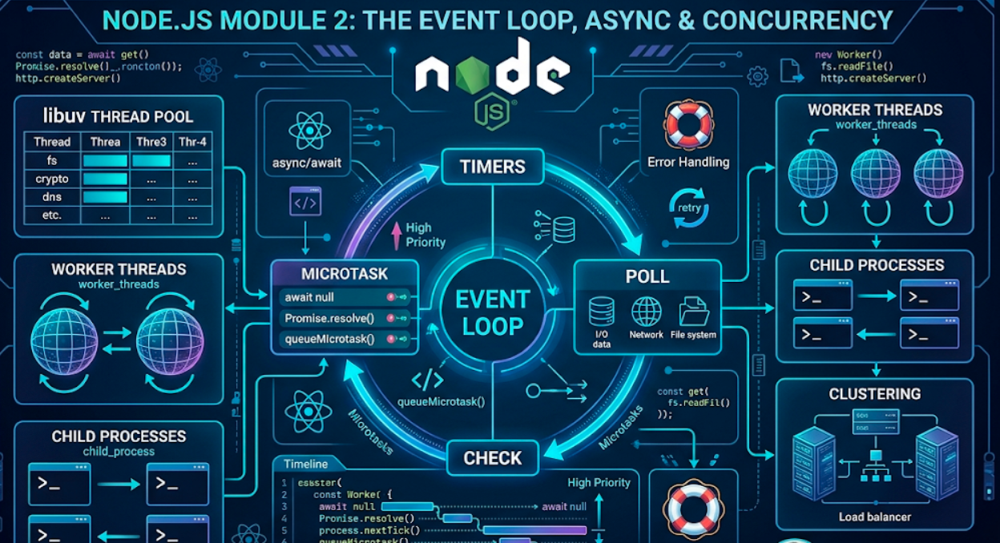

# Module 2: The Event Loop, Async & Concurrency



## Words you will meet in this module

| Word                   | Simple meaning                                                                                      |
| ---------------------- | --------------------------------------------------------------------------------------------------- |
| **Blocking**           | Code that makes the thread wait until it finishes. Nothing else runs meanwhile.                     |
| **Non-blocking**       | Code that starts an operation and returns immediately. A callback or promise delivers the result.   |
| **Call stack**         | Where the currently running function calls are stacked. JavaScript runs one at a time.              |
| **Event loop**         | The loop that picks finished work and runs its callbacks when the call stack is empty.              |
| **Callback**           | A function you hand over to be called later.                                                        |
| **Microtask**          | A very high-priority task: a Promise reaction or `queueMicrotask`. Runs before the loop moves on.   |
| **`process.nextTick`** | A Node-only queue that runs **even before** promise microtasks.                                     |
| **Thread pool**        | A small set of background threads (default **4**) libuv uses for file system, crypto, DNS and zlib. |
| **CPU-bound**          | Work limited by processor speed: hashing, image resizing, big loops.                                |
| **I/O-bound**          | Work limited by waiting: database, network, disk.                                                   |
| **Worker thread**      | A separate JavaScript thread with its own event loop, for CPU-heavy work.                           |
| **Backpressure**       | A slow consumer telling a fast producer to slow down. (Module 3.)                                   |

## 2.1 Blocking vs. Non-Blocking

### The restaurant analogy

Picture a restaurant with **one waiter** (your JavaScript thread).

- **Blocking waiter:** takes an order, walks to the kitchen, **stands there** until the food is ready, carries it out, and only then visits the next table. Ten tables means ten long waits.
- **Non-blocking waiter:** takes an order, hands it to the kitchen, and **immediately goes to the next table**. When the kitchen rings the bell, the waiter delivers that dish. One waiter serves many tables.

Node.js is the second waiter. The kitchen is the operating system and libuv's thread pool.

### The same task, two ways

```js
import { readFileSync } from 'node:fs';
import { readFile } from 'node:fs/promises';

// BLOCKING: the thread is frozen until the file is read
const a = readFileSync('big.log', 'utf8');
console.log('done reading'); // every other request waits

// NON-BLOCKING: start the read, keep working
const pending = readFile('big.log', 'utf8');
console.log('started reading'); // runs immediately
const b = await pending; // the thread was free in the meantime
```

In a **server**, the difference is everything. With `readFileSync` inside a request handler, while one request reads a file, all other users are frozen.

### Which work is which?

| Type          | Examples                                                                                    | How Node handles it                                                    |
| ------------- | ------------------------------------------------------------------------------------------- | ---------------------------------------------------------------------- |
| **I/O-bound** | DB queries, HTTP calls, reading files, waiting for sockets                                  | Excellent. The thread is free while waiting.                           |
| **CPU-bound** | `bcrypt` loops, parsing a 200 MB JSON, image or video processing, sorting millions of items | Poor on the main thread. It blocks everything. Offload it (Topic 2.6). |

A **rule of thumb**: do not run anything on the main thread that takes more than a few milliseconds of pure CPU time.

#### Interview traps

- "What does non-blocking mean?" The call returns right away and delivers the result later (callback or promise). The thread is free to do other work.
- "Is `async` the same as non-blocking?" No. An `async` function that does a big CPU loop still blocks. `async` only changes how results are delivered, not where the work runs.
- "Does `await` block the thread?" No. It pauses **that function** and lets the event loop run other things. The thread stays free.

## 2.2 The Event Loop in Detail

### The pieces

```
 ┌───────────────────────┐
 │   Your JS (call stack)│   runs one function at a time, to completion
 └──────────┬────────────┘
            │ calls async APIs (fs, http, timers, ...)
            ▼
 ┌───────────────────────┐        ┌──────────────────────────────┐
 │ Node APIs / libuv     │───────►│ OS kernel (network sockets)   │
 │                       │───────►│ Thread pool (4 threads):      │
 │                       │        │   fs, dns.lookup, crypto, zlib│
 └──────────┬────────────┘        └──────────────────────────────┘
            │ when an operation finishes, its callback is queued
            ▼
 ┌───────────────────────┐
 │ Event loop            │   when the call stack is empty, take the next
 │                       │   callback and run it
 └───────────────────────┘
```

Two kinds of waiting happen underneath:

- **Network I/O** (sockets, HTTP) uses the OS's own asynchronous mechanisms (epoll on Linux, kqueue on macOS, IOCP on Windows). No thread is needed per connection. This is why one Node process can hold tens of thousands of idle connections.
- **File system, `dns.lookup`, crypto (`scrypt`, `pbkdf2`, `randomBytes`) and `zlib`** have no async OS interface, so libuv runs them on its **thread pool**. The default pool size is **4** (`UV_THREADPOOL_SIZE` changes it). Five slow `scrypt` calls at once means the fifth waits.

### The phases of one loop iteration

```
   ┌──────────────────────────────┐
┌─►│ 1. timers                    │  run callbacks of expired setTimeout / setInterval
│  └──────────────┬───────────────┘
│  ┌──────────────▼───────────────┐
│  │ 2. pending callbacks         │  some deferred system callbacks (e.g. certain TCP errors)
│  └──────────────┬───────────────┘
│  ┌──────────────▼───────────────┐
│  │ 3. idle, prepare             │  internal use
│  └──────────────┬───────────────┘
│  ┌──────────────▼───────────────┐   waits here for I/O if nothing else is due.
│  │ 4. poll                      │◄─ runs I/O callbacks: finished reads, new requests, data
│  └──────────────┬───────────────┘
│  ┌──────────────▼───────────────┐
│  │ 5. check                     │  run setImmediate callbacks
│  └──────────────┬───────────────┘
│  ┌──────────────▼───────────────┐
└──┤ 6. close callbacks           │  socket.on("close"), etc.
   └──────────────────────────────┘

 After EVERY individual callback (in any phase):
   1) drain the process.nextTick queue completely
   2) drain the Promise microtask queue completely
```

### The two priority queues between callbacks

| Queue                        | Filled by                                        | Runs                                         |
| ---------------------------- | ------------------------------------------------ | -------------------------------------------- |
| **`process.nextTick` queue** | `process.nextTick(fn)`                           | **First**, right after the current operation |
| **Promise microtask queue**  | `.then`, `await` continuations, `queueMicrotask` | **Second**, right after the nextTick queue   |

Both are drained **completely** before the loop proceeds. That has a consequence: a recursive `nextTick` or an endless chain of resolved promises can **starve** the event loop (I/O never gets a turn).

### What keeps Node alive

Node exits when there is **nothing left to wait for**: no timers, no open sockets or servers, no pending I/O. A listening HTTP server keeps the loop alive indefinitely. Calling `timer.unref()` tells Node not to wait for a timer just to keep the process running.

> **Bun note:** Bun uses a different engine and its own event loop implementation, but it follows the same model (call stack, microtasks, `nextTick`, timers, `setImmediate`) and matches Node's behavior for ordinary code. Rely on the _documented_ guarantees, not on exotic ordering corner cases, in either runtime.

#### Interview traps

- "Explain the event loop in one sentence." A loop that, whenever the call stack is empty, takes the next finished callback from its queues (in phase order, with `nextTick` and microtasks drained between callbacks) and runs it.
- "Where do `fs.readFile` callbacks run?" The read happens on the libuv thread pool. When it finishes, the callback is queued for the **poll** phase.
- "What is the thread pool for?" Operations without non-blocking OS support: file system, DNS lookup, some crypto, zlib. Not network sockets.
- "Can I starve the event loop without a CPU-heavy loop?" Yes: a recursive `process.nextTick` or an endless promise chain never lets the loop reach the poll phase.

## 2.3 Ordering Puzzles: `nextTick`, Promises, Timers

These are favorite interview questions. Work out the answer first, then run it.

### Puzzle 1 (save as `puzzle.cjs` to run it as CommonJS)

```js
console.log('1 start');

setTimeout(() => console.log('2 timeout'), 0);
setImmediate(() => console.log('3 immediate'));
process.nextTick(() => console.log('4 nextTick'));
Promise.resolve().then(() => console.log('5 promise'));
queueMicrotask(() => console.log('6 microtask'));

(async () => {
  console.log('7 async start'); // the async function body runs synchronously until the first await
  await null;
  console.log('8 after await'); // continuation is a microtask
})();

console.log('9 end');
```

**Answer:**

```
1 start
7 async start
9 end            ← all synchronous code first
4 nextTick       ← nextTick queue
5 promise        ← then the microtask queue, in the order queued:
6 microtask         (5 was queued first, then 6, then 8 when the async function reached await)
8 after await
2 timeout        ← event loop begins
3 immediate         (2 and 3 may swap in the main module. See below)
```

### `setTimeout(fn, 0)` vs. `setImmediate`

From the **main module**, the order of `timeout` and `immediate` is **not guaranteed** (it depends on how fast the process reaches the loop, as the timer needs at least 1 ms). Inside an **I/O callback**, `setImmediate` is **always first**, because after the poll phase the loop goes straight to the check phase, before timers:

```js
import fs from 'node:fs';

fs.readFile(import.meta.filename, () => {
  setTimeout(() => console.log('timeout'), 0);
  setImmediate(() => console.log('immediate'));
});
// Always: immediate, then timeout
```

### ES module gotcha

The puzzle above is deliberately CommonJS. In an **ES module**, the top-level code itself runs inside a microtask-like context, so promise callbacks can run **before** `process.nextTick` callbacks queued from top-level code. Same code, different order, depending on `.cjs` vs `.mjs`. The practical lesson: never write programs that depend on `nextTick`-versus-promise ordering.

### When to use which

| API                 | Use for                                                                                         |
| ------------------- | ----------------------------------------------------------------------------------------------- |
| `Promise` / `async` | Normal asynchronous code. Always the default.                                                   |
| `queueMicrotask`    | Run something right after the current code, before I/O.                                         |
| `process.nextTick`  | Rare: finish setup (like attaching event listeners) before an emitter fires. Avoid in app code. |
| `setImmediate`      | Yield to the loop so I/O can proceed (break up a long job into chunks).                         |
| `setTimeout`        | Run after a delay.                                                                              |

### Breaking up a long job (so it does not starve the loop)

```js
async function processAll(items) {
  for (let i = 0; i < items.length; i++) {
    heavyStep(items[i]);
    if (i % 100 === 0) {
      await new Promise((resolve) => setImmediate(resolve)); // let I/O breathe
    }
  }
}
```

(For truly heavy work, prefer a worker thread. See Topic 2.6.)

#### Tricky question and answer

###### Q1 [SDE-2]: What does this print, and why?

```js
setTimeout(() => console.log('A'), 0);
Promise.resolve()
  .then(() => {
    console.log('B');
    process.nextTick(() => console.log('C'));
  })
  .then(() => console.log('D'));
process.nextTick(() => console.log('E'));
console.log('F');
```

**Answer:** `F E B D C A`. Synchronous `F` first. Then the `nextTick` queue: `E`. Then microtasks: `B` runs, and during it queues a `nextTick` (`C`). **The microtask queue is drained completely before the nextTick queue is looked at again**, so the chained `.then` logs `D` first. Then `C`. Finally the timer phase prints `A`. (If you run this as an ES module, the first step may differ: promise reactions can run before `E`.)

## 2.4 Async Patterns: Callbacks, Promises, `async` / `await`

### The evolution

```js
// 1. Callbacks (error-first convention). Nesting becomes "callback hell".
fs.readFile('a.txt', 'utf8', (err, a) => {
  if (err) return handle(err);
  fs.readFile('b.txt', 'utf8', (err, b) => {
    if (err) return handle(err);
    console.log(a + b);
  });
});

// 2. Promises: chainable, one error path
readFile('a.txt', 'utf8')
  .then((a) => readFile('b.txt', 'utf8').then((b) => a + b))
  .catch(handle);

// 3. async / await: reads like synchronous code. The modern default.
try {
  const a = await readFile('a.txt', 'utf8');
  const b = await readFile('b.txt', 'utf8');
  console.log(a + b);
} catch (err) {
  handle(err);
}
```

Old callback APIs convert with `util.promisify`. Most core modules already have a promise version: `node:fs/promises`, `node:timers/promises`, `node:dns/promises`, `node:stream/promises`.

```js
import { setTimeout as sleep } from 'node:timers/promises';
await sleep(1000);
```

### The most common performance mistake: sequential `await`

```js
// SLOW: three independent requests one after another (total = a + b + c)
const user = await getUser(id);
const orders = await getOrders(id);
const reviews = await getReviews(id);

// FAST: start them together (total = the slowest one)
const [user, orders, reviews] = await Promise.all([
  getUser(id),
  getOrders(id),
  getReviews(id),
]);
```

Do the same for a **list**:

```js
// SLOW: one by one
for (const id of ids) results.push(await fetchItem(id));

// FAST but UNBOUNDED: 10,000 requests at once can overwhelm the API, the DB or your sockets
const results = await Promise.all(ids.map(fetchItem));

// BEST for big lists: bounded concurrency (see below)
```

Use `await` in a loop **only** when each step depends on the previous result, or order and rate really matter.

### Promise combinators

| Method               | Resolves when                      | Rejects when                   | Use                                     |
| -------------------- | ---------------------------------- | ------------------------------ | --------------------------------------- |
| `Promise.all([...])` | **All** succeed (array of results) | **Any** fails (fast-fail)      | Independent tasks that all must succeed |
| `Promise.allSettled` | All finish, success or failure     | Never                          | "Try all, report each result"           |
| `Promise.race`       | The **first** settles              | The first settles with failure | Timeouts                                |
| `Promise.any`        | The first **success**              | All fail (`AggregateError`)    | "Fastest replica wins"                  |

### Bounded concurrency in 15 lines

```js
export async function mapLimit(items, limit, fn) {
  const results = new Array(items.length);
  let next = 0;

  async function worker() {
    while (true) {
      const i = next++; // safe: JS is single-threaded between awaits
      if (i >= items.length) return;
      results[i] = await fn(items[i], i);
    }
  }

  await Promise.all(
    Array.from({ length: Math.min(limit, items.length) }, worker),
  );
  return results;
}

// at most 5 requests in flight at any moment
const pages = await mapLimit(urls, 5, (u) => fetch(u).then((r) => r.json()));
```

(Libraries like `p-limit` do the same with more features.)

### Timeouts and cancellation

Never call an external service without a timeout. A hung call can hold a request, a connection and memory forever.

```js
const res = await fetch(url, { signal: AbortSignal.timeout(3000) }); // aborts after 3 s

// Combine a timeout with a user-cancel signal
const ctrl = new AbortController();
const signal = AbortSignal.any([ctrl.signal, AbortSignal.timeout(3000)]);
```

### `async` function facts

- An `async` function **always returns a Promise**. Throwing inside it rejects that promise.
- Forgetting `await` gives you a pending Promise instead of the value. It is a classic bug (`if (await isAdmin(user))` vs `if (isAdmin(user))`, which is always truthy).
- `return await` inside `try / catch` matters: `return promise` leaves the catch block before the rejection happens.

#### Interview traps

- "`Promise.all` vs `Promise.allSettled`?" `all` fails fast on the first rejection. `allSettled` waits for everything and reports each outcome.
- "Why is `forEach(async ...)` a bug?" `forEach` ignores returned promises, so you cannot `await` the whole thing, and errors are lost. Use a `for...of` loop or `Promise.all(arr.map(...))`.
- "What does `Promise.race` do to the losing promises?" Nothing. They keep running. Use `AbortSignal` to actually cancel work.

#### Tricky question and answer

###### Q2 [SDE-2]: Your endpoint takes 6 seconds. It calls three independent services one after another, 2 s each. What is the fix, and what new risk does it create?

**Answer:** Run the independent calls concurrently with `Promise.all`, cutting the time to about 2 s. The new risks: if one fails, `Promise.all` rejects immediately while the others keep running (use `allSettled` if partial results are acceptable and abort in-flight work with `AbortSignal`), and firing many calls at once can exceed the downstream's rate limit or your connection pool, so cap concurrency for large fan-outs.

## 2.5 Error Handling That Does Not Crash Production

### Two kinds of errors

| Kind            | Examples                                                     | Right response                                                    |
| --------------- | ------------------------------------------------------------ | ----------------------------------------------------------------- |
| **Operational** | DB down, network timeout, invalid user input, file not found | Expected. Handle it: retry, return a 4xx/5xx, show a message.     |
| **Programmer**  | `undefined.foo`, wrong argument type, logic bug              | A bug. Log it, fix the code. The process state may be unreliable. |

### Handling errors in each style

```js
// async/await: try / catch
try {
  const data = await readFile(path, 'utf8');
} catch (err) {
  if (err.code === 'ENOENT') return defaultConfig; // handle what you expect
  throw err; // rethrow everything else
}

// Promise chains: always end with .catch
doThing().then(use).catch(handle);

// Event emitters: ALWAYS handle "error"
stream.on('error', handle); // an unhandled 'error' event throws and can crash the process
```

### Custom errors with context

```js
export class AppError extends Error {
  constructor(message, { status = 500, code = 'INTERNAL', cause } = {}) {
    super(message, { cause }); // `cause` keeps the original error and stack
    this.name = 'AppError';
    this.status = status;
    this.code = code;
  }
}

throw new AppError('Task not found', { status: 404, code: 'TASK_NOT_FOUND' });
```

You will turn these into HTTP responses in a single error-handling middleware in Module 4.

### The last line of defense

```js
process.on('unhandledRejection', (reason) => {
  console.error('Unhandled rejection:', reason);
  process.exit(1); // since Node 15 the default is to throw and crash
});

process.on('uncaughtException', (err) => {
  console.error('Uncaught exception:', err);
  process.exit(1); // state is unknown: log, then exit
});
```

**Do not** use these handlers to "keep the server alive." After an uncaught exception the process may hold half-finished state. The safe pattern is: **log it, then exit, and let a process manager (Docker, Kubernetes, systemd) restart a fresh process.** Make sure the process can be restarted safely, which is why services should be stateless and requests idempotent where possible.

### Retry with backoff (for operational errors)

```js
import { setTimeout as sleep } from 'node:timers/promises';

export async function retry(fn, { retries = 3, baseMs = 200 } = {}) {
  for (let attempt = 0; ; attempt++) {
    try {
      return await fn();
    } catch (err) {
      if (attempt >= retries) throw err;
      const delay = baseMs * 2 ** attempt + Math.random() * 100; // exponential backoff + jitter
      await sleep(delay);
    }
  }
}
```

Retry only **idempotent** operations or those with an idempotency key. Retrying "charge the card" without one can charge twice. See [Circuit Breaker](system-design/circuit-breaker) for how to stop hammering a failing dependency.

#### Interview traps

- "What happens on an unhandled promise rejection in modern Node?" It is raised as an uncaught exception and the process **exits with a non-zero code** by default (since Node 15). Older versions only warned.
- "Should I catch `uncaughtException` and continue?" No. Log and exit. The process is in an unknown state.
- "Why does an `EventEmitter` crash the process with no `try/catch` helping?" An `error` event with no listener is thrown asynchronously from the emitter. A surrounding `try/catch` never sees it. Attach an `error` listener.

## 2.6 Never Block the Loop: Worker Threads and Child Processes

### See the problem

```js
// server.js
import http from 'node:http';

const fib = (n) => (n < 2 ? n : fib(n - 1) + fib(n - 2)); // deliberately slow CPU work

http
  .createServer((req, res) => {
    if (req.url === '/fib') return res.end(String(fib(42))); // takes seconds
    res.end('pong');
  })
  .listen(3000);
```

Request `/fib` in one terminal, then immediately `curl localhost:3000/ping` in another. **`/ping` hangs** until `fib` finishes. One CPU-bound request froze every user.

### Fix 1: Worker threads

A **worker thread** runs JavaScript on a separate OS thread with its own event loop and memory (communicating by messages).

```js
// fib-worker.js
import { parentPort, workerData } from 'node:worker_threads';
const fib = (n) => (n < 2 ? n : fib(n - 1) + fib(n - 2));
parentPort.postMessage(fib(workerData));
```

```js
// server.js
import http from 'node:http';
import { Worker } from 'node:worker_threads';

function runFib(n) {
  return new Promise((resolve, reject) => {
    const worker = new Worker(new URL('./fib-worker.js', import.meta.url), {
      workerData: n,
    });
    worker.once('message', resolve);
    worker.once('error', reject);
    worker.once(
      'exit',
      (code) => code !== 0 && reject(new Error(`Worker exited with ${code}`)),
    );
  });
}

http
  .createServer(async (req, res) => {
    if (req.url === '/fib') return res.end(String(await runFib(42))); // main thread stays free
    res.end('pong');
  })
  .listen(3000);
```

Now `/ping` answers instantly while `/fib` computes. Spawning a worker per request is expensive, so real apps use a **worker pool** (the `piscina` package). Workers can also share memory through `SharedArrayBuffer` and `Atomics`.

> **Bun note:** Bun supports the standard Web Worker API: `new Worker(new URL("./worker.ts", import.meta.url))`, with `self.onmessage` / `postMessage` inside the worker. `node:worker_threads` also works.

### Fix 2: Other processes

| Tool                               | What it does                                                             | Use when                                                   |
| ---------------------------------- | ------------------------------------------------------------------------ | ---------------------------------------------------------- |
| **`worker_threads`**               | Threads in the **same process**. Cheap messaging, shared memory possible | CPU-heavy JS tasks (parsing, hashing, compression)         |
| **`child_process`**                | A **separate process**. `spawn`, `execFile`, `fork`                      | Run another program (ffmpeg, git) or isolate risky work    |
| **`cluster`**                      | Several copies of **your server**, sharing one port                      | Use all CPU cores with a plain Node process                |
| **A job queue + workers**          | Work goes into Redis/Postgres and separate worker processes consume it   | Slow or retryable tasks (emails, reports, video). Module 7 |
| **Another service / native addon** | Do the heavy lifting in Rust/Go/C++                                      | Truly performance-critical computation                     |

```js
import cluster from 'node:cluster';
import os from 'node:os';
import http from 'node:http';

if (cluster.isPrimary) {
  for (let i = 0; i < os.availableParallelism(); i++) cluster.fork();
  cluster.on('exit', (worker) => {
    console.log(`worker ${worker.process.pid} died`);
    cluster.fork();
  });
} else {
  http
    .createServer((req, res) => res.end(`handled by ${process.pid}`))
    .listen(3000);
}
```

In modern deployments, the common answer is **not** `cluster` but **running several container replicas** (one process each) behind a load balancer ([Load Balancing](system-design/load-balancing), [Kubernetes](devops/k8s/kubernetes-full-tutorial)). Either way, the application must be **stateless**: session data, caches and uploads belong in Redis, a database or object storage, not in process memory. For how processes and threads differ at the OS level, see the [Operating Systems handbook](operating-systems/operating-systems-interview-handbook).

### Measure the event loop

You cannot fix what you do not measure. Event loop **lag** is the best health signal for a Node service.

```js
import { monitorEventLoopDelay } from 'node:perf_hooks';

const histogram = monitorEventLoopDelay({ resolution: 20 });
histogram.enable();

setInterval(() => {
  console.log({
    p50: (histogram.percentile(50) / 1e6).toFixed(1) + ' ms',
    p99: (histogram.percentile(99) / 1e6).toFixed(1) + ' ms', // values are in nanoseconds
  });
  histogram.reset();
}, 5000).unref();
```

A healthy service shows single-digit milliseconds. When the p99 climbs to hundreds of milliseconds, something is blocking: a sync call, a big `JSON.parse`, a regex, a CPU loop.

### Common accidental blockers

| Blocker                                                | Fix                                                    |
| ------------------------------------------------------ | ------------------------------------------------------ |
| `*Sync` functions in request handlers (`readFileSync`) | Use the promise APIs                                   |
| `JSON.parse` / `JSON.stringify` of huge payloads       | Stream, paginate, or limit body size                   |
| Catastrophic regex backtracking (**ReDoS**)            | Simple patterns, input length limits, safe-regex tools |
| `bcrypt`/`scrypt` with sync variants                   | Use async versions (they run on the thread pool)       |
| Big array sort/map over millions of rows               | Do it in the database, or in a worker                  |
| Crypto in a tight loop                                 | Worker thread or dedicated service                     |

### Request context across `await`: `AsyncLocalStorage`

Passing a request ID through every function is painful. `AsyncLocalStorage` keeps a per-request store that follows the async flow automatically. You will use it for logging in Module 8.

```js
import { AsyncLocalStorage } from 'node:async_hooks';

export const requestContext = new AsyncLocalStorage();

// middleware
app.use((req, res, next) =>
  requestContext.run({ requestId: crypto.randomUUID() }, next),
);

// anywhere deeper, even after many awaits
export function log(message) {
  console.log(requestContext.getStore()?.requestId, message);
}
```

#### Interview traps

- "Is Node.js single-threaded?" The **JavaScript** execution is. Node also has the libuv thread pool (4 threads by default), and you can start worker threads and child processes. Say all three.
- "Worker threads vs. cluster vs. child processes?" Workers: threads in one process for CPU work. Cluster: multiple server processes sharing a port to use all cores. Child processes: separate programs or isolated processes. In containers, you usually scale by replicas instead of `cluster`.
- "How do you scale a Node server across CPU cores?" Run one process per core (cluster, PM2, or container replicas) behind a load balancer, with stateless services.
- "Why did `/ping` hang while `/fib` ran?" One thread runs all JavaScript, and `fib` kept it busy.

#### Tricky questions and answers

###### Q3 [SDE-2]: A hashing endpoint using async `crypto.scrypt` handles 4 requests fine but latency jumps at 20 concurrent requests, even though CPU usage on the machine looks low. Why?

**Answer:** `scrypt` runs on the libuv **thread pool**, which has only **4 threads by default**. With 20 concurrent calls, 16 wait in the queue, and other thread-pool work (file reads, DNS lookups) queues behind them too. The main JS thread is idle, so it looks "fine." Fixes: raise `UV_THREADPOOL_SIZE` (up to a point, and set before the pool is first used), rate-limit the endpoint, use a cheaper work factor where appropriate, or move hashing to a dedicated worker or service.

###### Q4 [SDE-3]: Your service handles 5,000 idle WebSocket connections easily but freezes for 800 ms whenever one user uploads a 150 MB JSON file. Explain and fix.

**Answer:** The WebSocket connections are I/O waits and cost almost nothing. But `JSON.parse` on 150 MB is a synchronous CPU task on the single JS thread, so for 800 ms nothing else runs, and every connection's heartbeat and message handling stalls. Fixes: reject oversize bodies with a size limit, stream and parse incrementally (a streaming JSON/NDJSON parser), upload files to object storage with a presigned URL instead of through the API, or parse inside a worker thread. Track event loop delay so you notice regressions.

---

## Hands-On Lab: Break the Event Loop, Then Fix It

```
1. Create server.js with GET /ping (instant) and GET /fib?n=42 (slow, CPU-bound).
   Start it. In two terminals run: curl localhost:3000/fib?n=42   and   curl localhost:3000/ping
   Observe /ping blocking.
2. Add the event loop delay histogram and log p99 every 5 seconds.
   Watch it spike while /fib runs.
3. Move fib into a worker thread (fib-worker.js). Re-test. Does /ping stay fast?
   Does the p99 stay low?
4. Use autocannon (npx autocannon -c 20 -d 10 http://localhost:3000/ping) while
   /fib?n=40 requests run. Compare req/s before and after the worker fix.
5. Implement mapLimit(items, limit, fn). Test with a fake async task that logs
   "start i" and "end i" with a random delay. Prove that never more than
   `limit` tasks run at once.
6. Write a retry() helper with backoff and jitter. Test it against a function that
   fails twice and then succeeds.
7. Predict the output of Puzzle 1 and the Q1 snippet on paper. Then run them as
   .cjs and as .mjs. Where do the two versions differ?
8. Run the same server with Bun (bun server.js). Does the blocking behavior change?
   (It should not. The model is the same.)
```

Questions to answer for yourself:

- In step 3, why did moving `fib` into a worker not make `fib` itself faster?
- What happens if you send 50 simultaneous `/fib` requests, each starting its own worker? What would you change?
- Which of your two metrics, req/s or p99 event loop delay, better captures "the server feels responsive"?

---

## Module 2 Cheat Sheet

| Concept                               | One-line interview answer                                                                               |
| ------------------------------------- | ------------------------------------------------------------------------------------------------------- |
| Blocking vs. non-blocking             | Blocking holds the thread until done. Non-blocking returns immediately and delivers the result later.   |
| I/O-bound vs. CPU-bound               | Node is great at waiting (I/O). CPU work on the main thread blocks everyone.                            |
| Event loop                            | When the stack is empty, run the next queued callback. Phases: timers → pending → poll → check → close. |
| Between callbacks                     | Drain `process.nextTick`, **then** promise microtasks, completely.                                      |
| Thread pool                           | 4 threads by default for fs, dns.lookup, crypto, zlib. Network I/O uses the OS, not the pool.           |
| `setImmediate` vs. `setTimeout(0)`    | Order unreliable from the main module. Inside an I/O callback, `setImmediate` is always first.          |
| `await`                               | Pauses the function, not the thread.                                                                    |
| Sequential vs. parallel               | Independent calls: `Promise.all`. Big lists: bounded concurrency (`mapLimit` / `p-limit`).              |
| `all` / `allSettled` / `race` / `any` | Fail-fast / report each / first settled / first success.                                                |
| Timeouts                              | `AbortSignal.timeout(ms)` on every outbound call.                                                       |
| `forEach(async …)`                    | A bug. Not awaited. Use `for…of` or `Promise.all(map)`.                                                 |
| Error kinds                           | Operational (handle) vs. programmer (fix, crash). Use `cause` to keep context.                          |
| Unhandled rejection                   | Crashes the process by default (since Node 15). Log, exit, let the orchestrator restart.                |
| `uncaughtException`                   | Log and exit. Never continue running in unknown state.                                                  |
| Worker threads                        | Separate threads in one process for CPU-heavy JS. Use a pool.                                           |
| `cluster` / replicas                  | One process per core, or many container replicas, behind a load balancer. Keep services stateless.      |
| Event loop lag                        | `monitorEventLoopDelay`. Your primary Node health metric.                                               |
| `AsyncLocalStorage`                   | Per-request context that survives `await` (request IDs, user).                                          |
