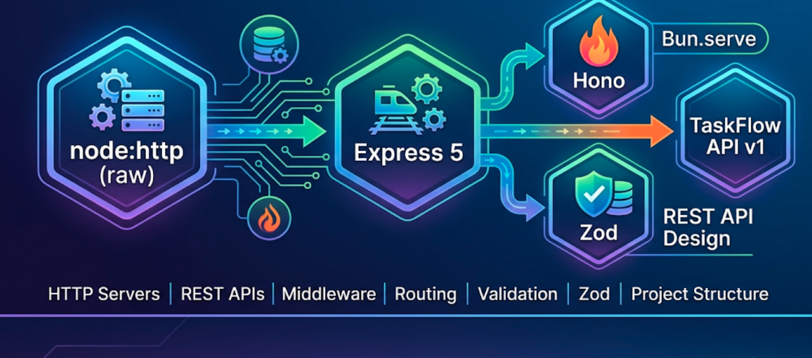

# Module 4: HTTP Servers & REST APIs (Express 5, Hono, Bun.serve)



## Words you will meet in this module

| Word                    | Simple meaning                                                                                    |
| ----------------------- | ------------------------------------------------------------------------------------------------- |
| **API**                 | A set of URLs a program can call to get or change data. Your React app is the client.             |
| **REST**                | A style of API design: URLs name **resources** (nouns), HTTP methods are the actions.             |
| **Route**               | A rule mapping a method + path (`GET /tasks/:id`) to a handler function.                          |
| **Handler**             | The function that receives a request and produces a response.                                     |
| **Middleware**          | A function that runs **before** (or around) handlers: logging, auth, parsing, error handling.     |
| **Request / Response**  | The data the client sends / what the server sends back (status, headers, body).                   |
| **Status code**         | A number telling the client what happened: `200` OK, `404` not found, `500` server error.         |
| **Idempotent**          | Doing it twice has the same effect as doing it once (`PUT`, `DELETE`). `POST` is not.             |
| **Validation**          | Checking that incoming data has the right shape and values before using it.                       |
| **Pagination**          | Returning a large list in pages instead of all at once.                                           |
| **CORS**                | A browser rule about which web origins may call your API (details in Module 6).                   |
| **Web-standard server** | A server written with the standard `Request` and `Response` objects, so it runs on many runtimes. |

## 4.1 HTTP in One Minute

Every API call is an **HTTP request** and an **HTTP response**. (The full story is in [DNS, HTTP and TLS](computer-networks/dns-http-and-tls-the-application-layer).)

```
 REQUEST                                          RESPONSE
 ──────────────────────────────────               ───────────────────────────────
 POST /api/projects/1/tasks HTTP/1.1              HTTP/1.1 201 Created
 Host: localhost:3000                             Content-Type: application/json
 Content-Type: application/json                   Location: /api/tasks/17
 Cookie: sid=...
                                                  { "id": 17, "title": "Buy milk", ... }
 { "title": "Buy milk" }
 ─ method + path ─ headers ─ body ─               ─ status ─ headers ─ body ─
```

| Part        | Purpose                                                                                       |
| ----------- | --------------------------------------------------------------------------------------------- |
| **Method**  | The action: `GET` read, `POST` create, `PUT` replace, `PATCH` partial update, `DELETE` remove |
| **Path**    | Which resource: `/api/tasks/17`                                                               |
| **Query**   | Options: `?status=done&page=2`                                                                |
| **Headers** | Metadata: `Content-Type`, `Authorization`, `Cookie`, `Accept`                                 |
| **Body**    | The payload (JSON) for `POST`, `PUT`, `PATCH`                                                 |

## 4.2 A Raw HTTP Server (and Why Frameworks Exist)

Node's built-in `node:http` is all you strictly need. Writing one by hand shows what a framework does for you.

```js
// raw-server.js
import http from 'node:http';

const tasks = [{ id: 1, title: 'Learn Node', status: 'todo' }];

const server = http.createServer(async (req, res) => {
  const url = new URL(req.url, `http://${req.headers.host}`); // parse path and query

  // helper: send JSON
  const send = (status, data) => {
    res.writeHead(status, { 'Content-Type': 'application/json' });
    res.end(JSON.stringify(data));
  };

  try {
    if (req.method === 'GET' && url.pathname === '/api/tasks') {
      return send(200, tasks);
    }

    if (req.method === 'POST' && url.pathname === '/api/tasks') {
      const chunks = [];
      for await (const chunk of req) chunks.push(chunk); // the request body is a STREAM
      const body = JSON.parse(Buffer.concat(chunks).toString());
      const task = {
        id: tasks.length + 1,
        title: String(body.title ?? ''),
        status: 'todo',
      };
      tasks.push(task);
      return send(201, task);
    }

    send(404, { error: 'Not found' });
  } catch {
    send(400, { error: 'Bad request' });
  }
});

server.listen(3000, () => console.log('http://localhost:3000'));
```

### What this raw version is missing

- Route matching with parameters (`/tasks/:id`) and per-method handlers.
- A **body size limit** (a client can send gigabytes and exhaust memory).
- Content-type checks, proper JSON error handling, a central error handler.
- Reusable middleware (logging, auth, CORS, rate limiting).
- Safer handling of the `Host` header (see [Host Header attacks](vulnerabilities/host-header)).

Frameworks solve all of these. The three you should know in 2026 are **Express**, **Hono** and (on Bun) **`Bun.serve`**.

## 4.3 Express 5

**Express** is the most widely used Node.js web framework: a thin layer over `node:http` with **routing** and **middleware**. Express **5** is the current major version (the first v5 shipped in 2024, and it has been the default on npm since March 2025). It requires **Node.js 18+**.

```bash
npm install express@5
npm install -D typescript @types/node @types/express
```

### Hello, Express

```js
import express from 'express';

const app = express();
app.use(express.json({ limit: '100kb' })); // parse JSON bodies into req.body

app.get('/healthz', (req, res) => {
  res.json({ ok: true }); // sets Content-Type and status 200
});

app.get('/api/tasks/:id', (req, res) => {
  res.json({ id: req.params.id, query: req.query }); // /api/tasks/7?x=1 → { id: "7", query: { x: "1" } }
});

app.post('/api/tasks', (req, res) => {
  res.status(201).json({ received: req.body });
});

app.listen(3000, () => console.log('listening on :3000'));
```

### Middleware: the heart of Express

A **middleware** is a function `(req, res, next)`. Express passes each request through a **chain** of them, in the order you registered them. Each one can read or change the request, send a response (ending the chain), or call `next()` to pass control on.

```
 request ─► [logger] ─► [json parser] ─► [auth] ─► [route handler] ─► response
                                           │
                                           └─ not logged in? send 401 and STOP (no next())
```

```js
// logging middleware
app.use((req, res, next) => {
  const start = performance.now();
  res.on('finish', () => {
    // runs when the response is sent
    console.log(
      `${req.method} ${req.originalUrl} ${res.statusCode} ${(performance.now() - start).toFixed(1)}ms`,
    );
  });
  next(); // forgetting this makes the request hang forever
});

// middleware for specific routes
function requireJson(req, res, next) {
  if (!req.is('application/json'))
    return res.status(415).json({ error: 'Send JSON' });
  next();
}
app.post('/api/tasks', requireJson, handler);
```

**Order matters.** Parsers and security middleware go first, routes next, the 404 handler and the error handler **last**.

### Routers: split by resource

```js
// src/routes/tasks.js
import { Router } from 'express';
export const tasksRouter = Router();

tasksRouter.get('/', listTasks);
tasksRouter.post('/', createTask);
tasksRouter.get('/:id', getTask);
tasksRouter.patch('/:id', updateTask);
tasksRouter.delete('/:id', deleteTask);

// src/app.js
app.use('/api/tasks', tasksRouter); // mounts the router under a prefix
```

### Error handling in Express 5

A middleware with **four** parameters is an **error handler**. In Express 5, a **rejected promise or a thrown error in an `async` handler is forwarded automatically** to it. In Express 4 you needed `try / catch` plus `next(err)` in every handler.

```js
app.get('/api/tasks/:id', async (req, res) => {
  const task = await findTask(req.params.id); // if this throws or rejects → error handler
  if (!task) throw new AppError('Task not found', 404, 'TASK_NOT_FOUND');
  res.json(task);
});

// must be registered LAST, with exactly four parameters
app.use((err, req, res, next) => {
  const status = err.status ?? 500;
  if (status >= 500) console.error(err); // log server faults with the stack
  res.status(status).json({
    error: {
      code: err.code ?? 'INTERNAL',
      message: status >= 500 ? 'Something went wrong' : err.message,
    },
  });
});
```

**Never send internal error messages or stack traces to the client** for 5xx errors. They leak implementation details. Log them server-side instead.

### Express 5: what changed from 4 (the parts that bite)

| Area                 | Express 5 behavior                                                                                                                                                    |
| -------------------- | --------------------------------------------------------------------------------------------------------------------------------------------------------------------- |
| Async errors         | Rejected promises are passed to the error handler automatically                                                                                                       |
| Wildcards            | Must be **named**: `app.get("/files/*splat", ...)`. A bare `*` no longer works                                                                                        |
| Regex in route paths | Removed (route matching uses `path-to-regexp` v8, which closes ReDoS holes)                                                                                           |
| Optional parameters  | Written with braces: `/:id{.:format}`                                                                                                                                 |
| `req.body`           | `undefined` (not `{}`) when no body parser ran. Check before using                                                                                                    |
| `req.query`          | A getter, and the default query parser is the **simple** one (no nested `a[b]=1`). Opt in to nested parsing with `app.set("query parser", "extended")` if you need it |
| Removed legacy APIs  | `res.json(obj, status)`, `res.send(status)`, `app.del()`, and other old signatures                                                                                    |
| Node version         | Node 18 or newer                                                                                                                                                      |

### Other must-know Express features

```js
app.disable('x-powered-by'); // do not advertise "Express"
app.set('trust proxy', 1); // behind one reverse proxy (needed for correct req.ip and secure cookies)
app.use(express.static('public')); // serve static files
res.redirect(302, '/login');
res.cookie('sid', token, { httpOnly: true });
res.download(path);
req.get('User-Agent');
req.ip;
req.cookies; // (cookies need cookie-parser)
```

#### Interview traps

- "What is middleware?" A function that receives the request, the response and `next`. It can modify them, end the response, or call `next()` to continue. The app is a pipeline of middleware.
- "Why does my request hang?" A middleware neither sent a response nor called `next()`.
- "How are errors handled in Express?" Through a four-argument error-handling middleware registered after all routes. In Express 5, async rejections reach it automatically.
- "What does `Cannot set headers after they are sent` mean?" You tried to send a second response, usually a missing `return` after `res.json(...)` followed by more code that also responds.

## 4.4 Hono and `Bun.serve`: Web-Standard Servers

### Why another style?

Express was built before the web platform standardized `Request` and `Response`. Newer servers use those **standard objects** directly. The same code then runs on **Node.js, Bun, Deno, Cloudflare Workers, AWS Lambda and Vercel Edge**.

### Hono

**Hono** is a small, fast, TypeScript-first framework built on web standards.

```bash
npm install hono @hono/node-server @hono/zod-validator zod
```

```ts
// hono-app.ts
import { Hono } from 'hono';
import { serve } from '@hono/node-server';
import { zValidator } from '@hono/zod-validator';
import { z } from 'zod';

const app = new Hono();

app.use('*', async (c, next) => {
  // middleware
  const start = performance.now();
  await next();
  c.header('X-Response-Time', `${(performance.now() - start).toFixed(1)}ms`);
});

app.get('/healthz', (c) => c.json({ ok: true }));

app.get('/api/tasks/:id', (c) => c.json({ id: c.req.param('id') }));

const NewTask = z.object({ title: z.string().trim().min(1).max(200) });

app.post('/api/tasks', zValidator('json', NewTask), (c) => {
  const body = c.req.valid('json'); // typed AND validated
  return c.json({ id: 1, ...body }, 201);
});

app.onError((err, c) => {
  console.error(err);
  return c.json(
    { error: { code: 'INTERNAL', message: 'Something went wrong' } },
    500,
  );
});

serve({ fetch: app.fetch, port: 3000 }); // Node
// On Bun, replace the last line with:  export default { port: 3000, fetch: app.fetch };
```

The handler takes a **context** `c` instead of `(req, res)`, and **returns** a response. Hono's validators give you end-to-end types from the schema to the handler.

### `Bun.serve`: no framework needed

Bun's built-in server speaks `Request` and `Response` natively and has a built-in `routes` table:

```ts
// bun-server.ts   →   bun bun-server.ts
const tasks = [{ id: 1, title: 'Learn Bun', status: 'todo' }];

Bun.serve({
  port: 3000,
  routes: {
    '/healthz': () => Response.json({ ok: true }),
    '/api/tasks': {
      GET: () => Response.json(tasks),
      POST: async (req) => {
        const body = await req.json();
        const task = {
          id: tasks.length + 1,
          title: String(body.title),
          status: 'todo',
        };
        tasks.push(task);
        return Response.json(task, { status: 201 });
      },
    },
    '/api/tasks/:id': (req) => Response.json({ id: req.params.id }),
  },
  fetch() {
    return Response.json({ error: { code: 'NOT_FOUND' } }, { status: 404 }); // fallback
  },
});
```

Bun's release notes list HTTP/2 support in `Bun.serve` in recent 1.4 releases, plus built-in WebSockets (Module 7).

### Choosing a framework

| Framework       | Style                        | Strengths                                                      | Consider when                                   |
| --------------- | ---------------------------- | -------------------------------------------------------------- | ----------------------------------------------- |
| **Express 5**   | `(req, res, next)`, mature   | Huge ecosystem, every tutorial, every middleware, hiring pool  | Default for most teams and interviews           |
| **Hono**        | Web-standard, TS-first       | Tiny, fast, runs everywhere (Node, Bun, Deno, edge)            | Edge deployments, portability, typed validation |
| **Fastify**     | Plugin-based, schema-driven  | Very fast on Node, built-in JSON-schema validation and logging | High-throughput Node services                   |
| **`Bun.serve`** | Web-standard, built into Bun | Zero dependencies, fastest on Bun                              | Bun-only services                               |
| **NestJS**      | Decorators, modules, DI      | Strong structure for large teams (Angular-style)               | Big enterprise codebases                        |

**This series uses Express 5** for the main project because it is the most widely used and most often asked about in interviews. The concepts (routing, middleware, validation, error handling) transfer directly to the others.

#### Interview traps

- "Express vs. Fastify vs. Hono?" Express: the established standard with the largest ecosystem. Fastify: faster, schema-first, Node-focused. Hono: web-standard and portable, great for edge and Bun. Pick by team familiarity, ecosystem needs and deployment target, not benchmarks alone.
- "What is a web-standard handler?" A function from `Request` to `Response`. Because those objects are the same as in the browser's `fetch`, the code is portable across runtimes.

## 4.5 REST API Design

REST organizes an API around **resources** (things), named with **nouns** in the URL, and uses HTTP **methods** as the verbs. A client that knows the pattern can guess the URLs.

| Action                  | Request                      | Success response                         |
| ----------------------- | ---------------------------- | ---------------------------------------- |
| List tasks of a project | `GET /api/projects/1/tasks`  | `200` and an array                       |
| Get one task            | `GET /api/tasks/17`          | `200` and the task                       |
| Create a task           | `POST /api/projects/1/tasks` | `201` + `Location` header + the new task |
| Replace a task          | `PUT /api/tasks/17`          | `200` (or `204`)                         |
| Partially update a task | `PATCH /api/tasks/17`        | `200` and the updated task               |
| Delete a task           | `DELETE /api/tasks/17`       | `204` (no body)                          |

**Naming rules:** plural nouns (`/tasks`, not `/getTasks`), lowercase with hyphens, nesting only one or two levels deep (`/projects/1/tasks`, then `/tasks/17`).

### Methods: safe and idempotent

| Method   | Safe (no change)? | Idempotent (same result if repeated)? | Typical body  |
| -------- | ----------------- | ------------------------------------- | ------------- |
| `GET`    | Yes               | Yes                                   | No            |
| `POST`   | No                | **No** (creates again each time)      | Yes           |
| `PUT`    | No                | Yes (replaces with the same thing)    | Full resource |
| `PATCH`  | No                | Usually yes                           | Only changes  |
| `DELETE` | No                | Yes (still gone)                      | No            |

For non-idempotent operations where retries are possible (payments, orders), support an **`Idempotency-Key`** header: the server stores the result for that key and returns it again instead of repeating the action.

### Status codes: use the right one

| Code  | Meaning               | When                                                          |
| ----- | --------------------- | ------------------------------------------------------------- |
| `200` | OK                    | Successful read or update                                     |
| `201` | Created               | A resource was created (include `Location`)                   |
| `204` | No Content            | Success with no body (delete)                                 |
| `400` | Bad Request           | Malformed request, invalid JSON                               |
| `401` | Unauthorized          | **Not authenticated** (no or bad credentials)                 |
| `403` | Forbidden             | Authenticated but **not allowed**                             |
| `404` | Not Found             | No such resource (also used to hide existence from outsiders) |
| `409` | Conflict              | Duplicate, or the state conflicts (version mismatch)          |
| `422` | Unprocessable Content | Well-formed but **fails validation**                          |
| `429` | Too Many Requests     | Rate limit hit (send `Retry-After`)                           |
| `500` | Internal Server Error | Your bug. Never expose details                                |
| `503` | Service Unavailable   | Overloaded or shutting down                                   |

Never return `200` with `{ "error": ... }` in the body. Clients, proxies and monitoring all rely on the status code.

### One consistent error shape

```json
{
  "error": {
    "code": "VALIDATION_ERROR",
    "message": "Invalid input",
    "details": [
      {
        "path": ["title"],
        "message": "Too small: expected string to have >=1 characters"
      }
    ]
  }
}
```

(There is also a formal standard, **Problem Details** (`application/problem+json`, RFC 9457), with `type`, `title`, `status`, `detail` and `instance` fields. Use it if you want standards compliance. The important thing is to be **consistent**.) A stable machine-readable `code` lets the front end react without parsing messages.

### Pagination, filtering, sorting

```
GET /api/projects/1/tasks?status=todo&q=milk&sort=-createdAt&limit=20&cursor=eyJpZCI6MTd9
```

| Style               | How                                       | Pros                        | Cons                                             |
| ------------------- | ----------------------------------------- | --------------------------- | ------------------------------------------------ |
| **Offset / page**   | `?page=3&limit=20` (`OFFSET 40 LIMIT 20`) | Simple. Jump to any page    | Slow on big tables. Rows shift when data changes |
| **Cursor / keyset** | `?after=<last id>&limit=20`               | Fast on huge tables. Stable | No "jump to page 50". Needs a sortable key       |

Always enforce a **maximum `limit`** (for example 100). Return the total or next cursor in the body or in headers (`X-Total-Count`, `Link`).

### Other practices

- **Version** the API when you must break compatibility: `/api/v1/...`.
- Return the **updated resource** from `POST`/`PATCH` so clients do not need another request.
- Use **ISO 8601 UTC** timestamps (`2026-11-04T10:30:00Z`). Money as integers in minor units (cents), never floats.
- Document it with **OpenAPI** (Swagger). Many frameworks can generate it from your schemas.
- Do not build chatty APIs that force ten calls per screen. Offer endpoints that match the screens' needs.

## 4.6 Validation with Zod

**Never trust the request.** `req.body`, `req.query`, `req.params` and headers are attacker-controlled input. Validate at the **boundary**: the moment data enters your system.

```bash
npm install zod
```

```ts
import { z } from 'zod';

export const NewTask = z.object({
  title: z.string().trim().min(1).max(200),
});

export const PatchTask = z
  .object({
    title: z.string().trim().min(1).max(200).optional(),
    status: z.enum(['todo', 'doing', 'done']).optional(),
  })
  .refine((v) => Object.keys(v).length > 0, {
    message: 'Provide at least one field',
  });

export const ListQuery = z.object({
  status: z.enum(['todo', 'doing', 'done']).optional(),
  q: z.string().trim().max(100).optional(),
  limit: z.coerce.number().int().min(1).max(100).default(20), // query values are strings: coerce
  page: z.coerce.number().int().min(1).default(1),
});

export type NewTaskInput = z.infer<typeof NewTask>; // the TS type comes from the schema
```

Use it in a handler:

```ts
tasksRouter.post('/projects/:projectId/tasks', (req, res) => {
  const input = NewTask.parse(req.body); // throws ZodError if invalid → error middleware → 422
  const task = createTask(Number(req.params.projectId), input);
  res.status(201).location(`/api/tasks/${task.id}`).json(task);
});
```

`parse` **strips unknown keys** by default, which also protects against **mass assignment** (a client sneaking `"isAdmin": true` or `"userId": 99` into a body that you copy straight into the database). Always build your database input from the **parsed** value, never from `req.body`.

#### Interview traps

- "Where should validation happen?" At the edge, as soon as data enters, using a schema. Then the rest of the code works with trusted, typed data.
- "400 or 422 for invalid input?" `400` for syntactically broken requests (bad JSON). `422` for well-formed requests that fail validation rules. Many APIs use `400` for both. Be consistent.
- "What is mass assignment?" Copying request fields into a model or query without a whitelist, so a client can set fields they should not (`role`, `price`, `ownerId`).

## 4.7 Project Structure: Routes, Services, Repositories

### The layers

```
 HTTP ──► [ routes / controllers ] ──► [ services ] ──► [ repositories ] ──► database
          parse, validate,              business rules,    SQL / queries,
          shape the response            authorization      nothing else
```

| Layer                    | Responsibility                                                       | Knows about HTTP? |
| ------------------------ | -------------------------------------------------------------------- | ----------------- |
| **Routes / controllers** | Parse and validate input, call a service, choose status and body     | Yes               |
| **Services**             | Business logic and rules ("a task cannot move to a deleted project") | **No**            |
| **Repositories**         | Talk to the database                                                 | No                |

Services that do not know about `req` and `res` are easy to **test** and **reuse** (from a background job or a CLI).

### Folder structure

```
taskflow-api/
├── src/
│   ├── server.ts            ← starts listening, handles shutdown (Module 8)
│   ├── app.ts               ← createApp(): builds the Express app, NO listen()
│   ├── env.ts               ← validated config (Module 3)
│   ├── lib/
│   │   └── errors.ts        ← AppError
│   ├── middleware/
│   │   └── errorHandler.ts
│   ├── routes/
│   │   ├── index.ts         ← mounts all routers under /api
│   │   ├── projects.ts
│   │   └── tasks.ts
│   ├── services/            ← taskService.ts ...
│   ├── repositories/        ← taskRepo.ts ... (in-memory now, Postgres in Module 5)
│   └── schemas/             ← Zod schemas
├── package.json
└── tsconfig.json
```

**Split `app.ts` from `server.ts`.** `createApp()` returns the app without calling `listen`. Tests can then import the app and call it directly, without opening a port (Module 7).

## TaskFlow API v1: the Code

This is the in-memory first version of the API that the React capstone talks to. Endpoints:

```
GET    /api/projects
GET    /api/projects/:projectId/tasks?status=&q=&page=&limit=
POST   /api/projects/:projectId/tasks
PATCH  /api/tasks/:id
DELETE /api/tasks/:id
```

```ts
// src/lib/errors.ts
export class AppError extends Error {
  status: number;
  code: string;
  details?: unknown;
  constructor(
    message: string,
    status = 500,
    code = 'INTERNAL',
    details?: unknown,
  ) {
    super(message);
    this.name = 'AppError';
    this.status = status;
    this.code = code;
    this.details = details;
  }
}
```

(Notice: no `constructor(public status: number)` shorthand. Node's type stripping does not support TypeScript parameter properties, see Module 1.)

```ts
// src/schemas/tasks.ts
import { z } from 'zod';

export const Status = z.enum(['todo', 'doing', 'done']);
export const NewTask = z.object({ title: z.string().trim().min(1).max(200) });
export const PatchTask = z
  .object({
    title: z.string().trim().min(1).max(200).optional(),
    status: Status.optional(),
  })
  .refine((v) => Object.keys(v).length > 0, {
    message: 'Provide at least one field',
  });
export const ListQuery = z.object({
  status: Status.optional(),
  q: z.string().trim().max(100).optional(),
  limit: z.coerce.number().int().min(1).max(100).default(20),
  page: z.coerce.number().int().min(1).default(1),
});
export type Task = {
  id: number;
  projectId: number;
  title: string;
  status: z.infer<typeof Status>;
};
```

```ts
// src/repositories/taskRepo.ts   (in-memory. Replaced by Postgres in Module 5)
import type { Task } from '../schemas/tasks.ts';

const projects = [
  { id: 1, name: 'Website redesign' },
  { id: 2, name: 'Mobile app' },
];
const tasks = new Map<number, Task>();
let nextId = 1;

export const taskRepo = {
  listProjects: () => projects,
  projectExists: (id: number) => projects.some((p) => p.id === id),

  list(projectId: number, f: { status?: string; q?: string }) {
    return [...tasks.values()].filter(
      (t) =>
        t.projectId === projectId &&
        (!f.status || t.status === f.status) &&
        (!f.q || t.title.toLowerCase().includes(f.q.toLowerCase())),
    );
  },
  get: (id: number) => tasks.get(id),
  create(projectId: number, title: string): Task {
    const task: Task = { id: nextId++, projectId, title, status: 'todo' };
    tasks.set(task.id, task);
    return task;
  },
  update(id: number, patch: Partial<Pick<Task, 'title' | 'status'>>) {
    const current = tasks.get(id);
    if (!current) return undefined;
    const next = { ...current, ...patch };
    tasks.set(id, next);
    return next;
  },
  remove: (id: number) => tasks.delete(id),
};
```

```ts
// src/services/taskService.ts
import { AppError } from '../lib/errors.ts';
import { taskRepo } from '../repositories/taskRepo.ts';

export const taskService = {
  list(
    projectId: number,
    filters: { status?: string; q?: string; page: number; limit: number },
  ) {
    if (!taskRepo.projectExists(projectId))
      throw new AppError('Project not found', 404, 'PROJECT_NOT_FOUND');
    const all = taskRepo.list(projectId, filters);
    const start = (filters.page - 1) * filters.limit;
    return {
      items: all.slice(start, start + filters.limit),
      total: all.length,
    };
  },
  create(projectId: number, title: string) {
    if (!taskRepo.projectExists(projectId))
      throw new AppError('Project not found', 404, 'PROJECT_NOT_FOUND');
    return taskRepo.create(projectId, title);
  },
  update(
    id: number,
    patch: { title?: string; status?: 'todo' | 'doing' | 'done' },
  ) {
    const task = taskRepo.update(id, patch);
    if (!task) throw new AppError('Task not found', 404, 'TASK_NOT_FOUND');
    return task;
  },
  remove(id: number) {
    if (!taskRepo.remove(id))
      throw new AppError('Task not found', 404, 'TASK_NOT_FOUND');
  },
};
```

```ts
// src/routes/tasks.ts
import { Router } from 'express';
import { NewTask, PatchTask, ListQuery } from '../schemas/tasks.ts';
import { taskService } from '../services/taskService.ts';
import { taskRepo } from '../repositories/taskRepo.ts';
import { AppError } from '../lib/errors.ts';

export const tasksRouter = Router();

const toId = (value: string) => {
  const id = Number(value);
  if (!Number.isInteger(id) || id < 1)
    throw new AppError('Invalid id', 400, 'BAD_ID');
  return id;
};

tasksRouter.get('/projects', (_req, res) => {
  res.json(taskRepo.listProjects());
});

tasksRouter.get('/projects/:projectId/tasks', (req, res) => {
  const query = ListQuery.parse(req.query);
  const { items, total } = taskService.list(toId(req.params.projectId), query);
  res.set('X-Total-Count', String(total)).json(items);
});

tasksRouter.post('/projects/:projectId/tasks', (req, res) => {
  const input = NewTask.parse(req.body); // only whitelisted fields get through
  const task = taskService.create(toId(req.params.projectId), input.title);
  res.status(201).location(`/api/tasks/${task.id}`).json(task);
});

tasksRouter.patch('/tasks/:id', (req, res) => {
  res.json(taskService.update(toId(req.params.id), PatchTask.parse(req.body)));
});

tasksRouter.delete('/tasks/:id', (req, res) => {
  taskService.remove(toId(req.params.id));
  res.status(204).end();
});
```

```ts
// src/middleware/errorHandler.ts
import type { ErrorRequestHandler } from 'express';
import { ZodError } from 'zod';
import { AppError } from '../lib/errors.ts';

export const errorHandler: ErrorRequestHandler = (err, _req, res, _next) => {
  if (err instanceof ZodError) {
    res
      .status(422)
      .json({
        error: {
          code: 'VALIDATION_ERROR',
          message: 'Invalid input',
          details: err.issues,
        },
      });
    return;
  }
  if (err instanceof AppError) {
    res
      .status(err.status)
      .json({
        error: { code: err.code, message: err.message, details: err.details },
      });
    return;
  }
  if (err?.type === 'entity.parse.failed') {
    res
      .status(400)
      .json({ error: { code: 'BAD_JSON', message: 'Malformed JSON body' } });
    return;
  }
  if (err?.type === 'entity.too.large') {
    res
      .status(413)
      .json({
        error: { code: 'TOO_LARGE', message: 'Request body too large' },
      });
    return;
  }
  console.error(err); // unknown: log it, hide the details
  res
    .status(500)
    .json({ error: { code: 'INTERNAL', message: 'Something went wrong' } });
};
```

```ts
// src/app.ts
import express from 'express';
import cors from 'cors';
import { tasksRouter } from './routes/tasks.ts';
import { errorHandler } from './middleware/errorHandler.ts';
import { AppError } from './lib/errors.ts';
import { env } from './env.ts';

export function createApp() {
  const app = express();
  app.disable('x-powered-by');
  app.use(cors({ origin: env.CORS_ORIGIN, credentials: true })); // details in Module 6
  app.use(express.json({ limit: '100kb' }));

  app.get('/healthz', (_req, res) => res.json({ ok: true }));
  app.use('/api', tasksRouter);

  app.use((_req, _res) => {
    throw new AppError('Route not found', 404, 'NOT_FOUND'); // reaches errorHandler
  });
  app.use(errorHandler);
  return app;
}
```

```ts
// src/server.ts
import { createApp } from './app.ts';
import { env } from './env.ts';

createApp().listen(env.PORT, () =>
  console.log(`TaskFlow API on http://localhost:${env.PORT}`),
);
```

Run it and try it:

```bash
npm install express@5 cors zod
npm install -D typescript @types/node @types/express @types/cors
node --watch --env-file-if-exists=.env src/server.ts      # or: bun --watch src/server.ts

curl -i localhost:3000/api/projects
curl -i -X POST localhost:3000/api/projects/1/tasks -H "content-type: application/json" -d '{"title":"Buy milk"}'
curl -i -X PATCH localhost:3000/api/tasks/1 -H "content-type: application/json" -d '{"status":"done"}'
curl -i -X POST localhost:3000/api/projects/1/tasks -H "content-type: application/json" -d '{"title":""}'   # 422
curl -i localhost:3000/api/nope                                                                           # 404 JSON
```

#### Tricky questions and answers

###### Q1 [SDE-2]: Walk through exactly what happens when a request hits `POST /api/projects/1/tasks` with body `{"title": ""}`.

**Answer:** It passes through `cors`, then `express.json` which parses the body (and would reject malformed JSON or a body over 100 KB through the error handler). The router matches the route and calls the handler. `NewTask.parse(req.body)` throws a `ZodError` because the title is shorter than 1. In Express 5 a thrown error in a handler is forwarded to the error-handling middleware, which maps `ZodError` to a `422` with `code: "VALIDATION_ERROR"` and the issues. The service and the repository are never called, so invalid data never reaches business logic.

###### Q2 [SDE-2]: When should a missing resource return 404 versus 403?

**Answer:** Return `404` when the resource truly does not exist. Return `403` when it exists and the user is authenticated but not allowed to access it. If revealing its existence is itself a leak (another user's private project), return `404` to everyone who is not authorized, so the response does not confirm that the ID exists. Return `401` when the caller has not authenticated at all.

###### Q3 [SDE-3]: Design pagination for a task list with 50 million rows that users scroll through while new tasks are added continuously.

**Answer:** Use **cursor (keyset) pagination** on a stable, indexed, unique sort key such as `(created_at, id)`. The request carries an opaque cursor encoding the last seen key, and the query uses `WHERE (created_at, id) < ($1, $2) ORDER BY created_at DESC, id DESC LIMIT n`, which uses the index directly. Offset pagination degrades linearly because the database must skip all earlier rows, and it duplicates or skips items when rows are inserted during scrolling. Return `nextCursor` in the response, cap `limit`, and avoid exact total counts on huge tables (use an estimate or omit it).

---

## Hands-On Lab: Build and Connect the TaskFlow API v1

```
1. Create the project (npm init, "type": "module", Node 24+ or Bun) and add the
   files above. Use src/env.ts from Module 3 (PORT, CORS_ORIGIN).
2. Run it. Exercise every endpoint with curl and confirm the status codes:
   201 + Location, 204, 404 JSON for unknown routes, 422 for invalid input,
   400 for malformed JSON ('{bad'), 413 for a body over 100 KB.
3. Add an `X-Request-Id` middleware that generates crypto.randomUUID() and sets
   it on the response (you will use it for logging in Module 8).
4. Add GET /api/tasks/:id, returning 404 when missing.
5. Add a validation rule: reject titles that are only whitespace. Verify with curl.
6. Connect the React TaskFlow app from Part 1:
     - Vite proxy: server.proxy["/api"] -> http://localhost:3000
     - Update the React api() helper so that on a non-2xx response it parses the JSON
       body and throws an Error whose message is body.error.message (and keeps
       body.error.code on error.code).
     - Point the tasks list at /api/projects/1/tasks and the toggle at PATCH /api/tasks/:id.
     - Read the X-Total-Count header for pagination (CORS needs it exposed:
       cors({ exposedHeaders: ["X-Total-Count"] })).
7. Re-implement GET /api/projects and POST /api/projects/:id/tasks in Hono (and
   zValidator). Then with Bun.serve routes. Compare the amount of code and the
   style. Which one felt more natural?
8. Load test: npx autocannon -c 50 -d 10 http://localhost:3000/api/projects.
   Note the req/s. Repeat on Bun. (Treat benchmark numbers with skepticism, see Module 8.)
```

Questions to answer for yourself:

- Which layer did each validation or business rule end up in, and why?
- What would break if `createApp()` also called `listen()`?
- What happens to your in-memory data when you restart the server, and what will fix that?

---

## Module 4 Cheat Sheet

| Concept                  | One-line interview answer                                                                            |
| ------------------------ | ---------------------------------------------------------------------------------------------------- |
| HTTP request / response  | Method + path + headers + body → status + headers + body.                                            |
| Raw `node:http`          | Works, but you hand-write routing, body parsing, size limits and error handling.                     |
| Express                  | Thin framework: routing + middleware. Express 5 is current (Node 18+).                               |
| Middleware               | `(req, res, next)`. Runs in registration order. Must respond or call `next()`.                       |
| Error middleware         | Four params `(err, req, res, next)`, registered last. Express 5 forwards async rejections to it.     |
| Express 5 changes        | Named wildcards (`/*splat`), no regex routes, `req.body` can be `undefined`, simple query parser.    |
| Hono / `Bun.serve`       | Web-standard `Request` → `Response` handlers. Portable across Node, Bun, Deno, edge.                 |
| REST                     | Nouns for resources, HTTP methods as verbs, plural, shallow nesting.                                 |
| Idempotent methods       | `GET`, `PUT`, `DELETE` (and usually `PATCH`). `POST` is not. Use `Idempotency-Key` for safe retries. |
| 401 vs. 403              | Not authenticated vs. authenticated but not allowed. Use 404 to hide existence.                      |
| 400 vs. 422              | Malformed request vs. valid syntax failing validation rules. Be consistent.                          |
| Error shape              | One consistent JSON error with a stable machine-readable `code`. Never leak stack traces.            |
| Pagination               | Offset is simple but slow and unstable at scale. Cursor/keyset is fast and stable. Cap `limit`.      |
| Validation               | Zod at the boundary. `parse` strips unknown keys, which prevents mass assignment.                    |
| Layers                   | Routes (HTTP) → services (business rules, no HTTP) → repositories (database).                        |
| `app.ts` vs. `server.ts` | Build the app in a function, listen elsewhere, so tests can use the app without a port.              |
| `trust proxy`            | Set it when behind a reverse proxy so `req.ip` and secure cookies work.                              |
