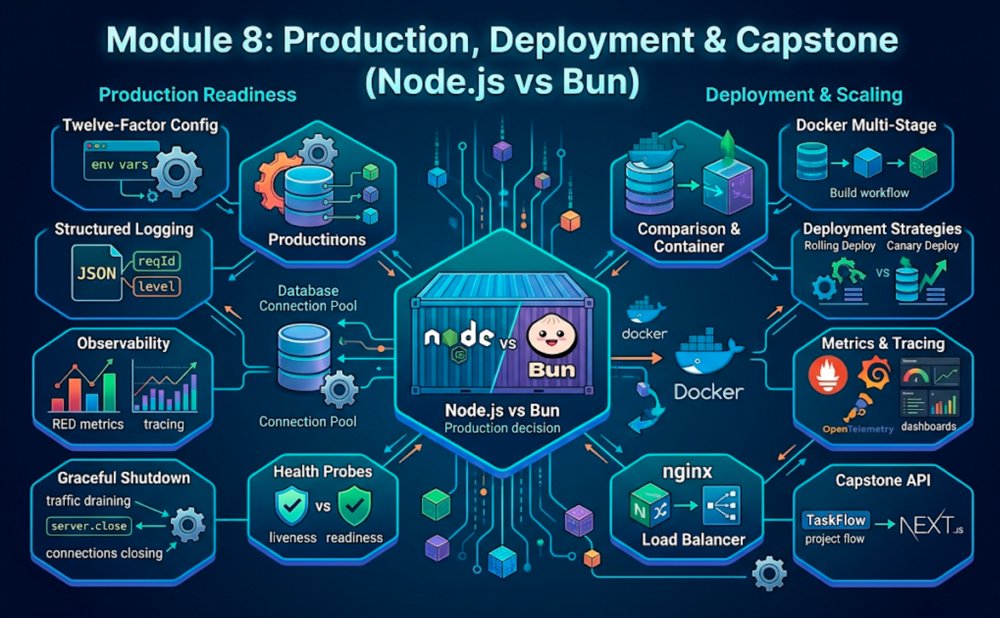

# Module 8: Production, Deployment & Capstone (Node.js vs Bun)



## Words you will meet in this module

| Word                        | Simple meaning                                                                                       |
| --------------------------- | ---------------------------------------------------------------------------------------------------- |
| **Twelve-factor app**       | A set of habits for apps that deploy cleanly: config in env vars, logs to stdout, stateless processes. |
| **Structured log**          | A log line written as JSON with fields (level, request id, duration), not a free-form sentence.      |
| **Request ID**              | A unique ID attached to one request and to every log line it causes, so you can follow it.           |
| **Liveness probe**          | "Is the process alive?" If it fails, the platform **restarts** the container.                        |
| **Readiness probe**         | "Can it serve traffic right now?" If it fails, the platform **stops routing** requests to it.        |
| **Graceful shutdown**       | Stop taking new requests, finish the ones in flight, close connections, then exit.                   |
| **Profiling**               | Measuring where a program spends CPU time or memory (a flame graph).                                 |
| **RED metrics**             | **R**ate, **E**rrors, **D**uration: the three numbers that describe a service's health.              |
| **Trace**                   | A record of one request's path across services, with timing for each step.                           |
| **Container image**         | A packaged, immutable snapshot of your app and its runtime, built from a Dockerfile.                 |
| **Reverse proxy**           | A server in front of your app (nginx, Caddy, a load balancer) handling TLS, routing and buffering.   |
| **Rolling deploy**          | Replacing instances one at a time so the service never goes fully down.                              |

## 8.1: Configuration and the Twelve-Factor App

The **twelve-factor** methodology describes how to build apps that are easy to deploy and scale. The parts that matter most for a Node.js or Bun API:

| Factor                         | What it means for TaskFlow                                                                  |
| ------------------------------ | ------------------------------------------------------------------------------------------- |
| **Config in the environment**  | Database URL, secrets, CORS origin come from env vars, never from code or committed files   |
| **One build, many deploys**    | The **same image** runs in staging and production. Only the environment differs             |
| **Stateless processes**        | No sessions, uploads or caches in process memory. Use Postgres, Redis, object storage       |
| **Backing services are attached resources** | Postgres and Redis are URLs. Swapping a local one for a managed one is a config change |
| **Port binding**               | The app listens on `PORT`. It does not need an external web server to run                   |
| **Disposability**              | Start fast, **shut down gracefully**, survive being killed at any moment                    |
| **Dev/prod parity**            | Run the same Postgres and Redis locally (Docker Compose) that you run in production         |
| **Logs as event streams**      | Write logs to **stdout**. The platform collects and ships them                              |
| **Admin tasks as one-off processes** | Migrations and scripts run as separate commands against the same code and config      |

### The final `env.ts`

```ts
// src/env.ts
import { z } from "zod";

const EnvSchema = z.object({
  NODE_ENV: z.enum(["development", "test", "production"]).default("development"),
  PORT: z.coerce.number().int().positive().default(3000),
  LOG_LEVEL: z.enum(["fatal", "error", "warn", "info", "debug", "trace", "silent"]).default("info"),
  DATABASE_URL: z.string().url(),
  REDIS_URL: z.string().url().default("redis://localhost:6379"),
  CORS_ORIGIN: z.string().url(),
  WEBHOOK_SECRET: z.string().min(32),
  SHUTDOWN_TIMEOUT_MS: z.coerce.number().int().positive().default(25_000),
});

const parsed = EnvSchema.safeParse(process.env);
if (!parsed.success) {
  console.error("Invalid environment configuration:", parsed.error.issues);
  process.exit(1);                                   // fail fast, before serving a single request
}
export const env = parsed.data;
```

Rules: **no defaults for secrets** (a missing secret must stop the app), **never log the whole env**, and keep a documented `.env.example` (no real values) in the repo.

## 8.2: Structured Logging

### Why not `console.log`?

In production nobody reads logs line by line. Tools **search and aggregate** them: "show all errors for request `a1b2` in the last hour." That requires **structured JSON logs** with levels and fields. `console.log("user logged in " + id)` is hard to filter, has no level, and costs more than a purpose-built logger.

**Pino** is the standard fast logger for Node.js (it also runs on Bun):

```bash
npm install pino pino-http
npm install -D pino-pretty
```

```ts
// src/logger.ts
import pino from "pino";
import { env } from "./env.ts";

export const logger = pino({
  level: env.LOG_LEVEL,
  base: { service: "taskflow-api" },
  redact: {                                          // never write secrets to logs
    paths: ["req.headers.authorization", "req.headers.cookie", "res.headers['set-cookie']",
            "*.password", "*.password_hash", "*.token"],
    censor: "[redacted]",
  },
});
```

```ts
// src/middleware/requestLogger.ts
import { randomUUID } from "node:crypto";
import { pinoHttp } from "pino-http";
import { logger } from "../logger.ts";

export const requestLogger = pinoHttp({
  logger,
  genReqId: (req, res) => {
    const id = String(req.headers["x-request-id"] ?? randomUUID());
    res.setHeader("X-Request-Id", id);               // the client (and support tickets) can quote it
    return id;
  },
  customLogLevel: (_req, res, err) =>
    err || res.statusCode >= 500 ? "error" : res.statusCode >= 400 ? "warn" : "info",
});
```

Now every request produces one line like this, and `req.log` inside handlers adds the same `reqId` automatically:

```json
{"level":30,"time":1762250400123,"service":"taskflow-api","reqId":"3b241101-e2bb-4255","req":{"method":"PATCH","url":"/api/tasks/7"},"res":{"statusCode":200},"responseTime":12,"msg":"request completed"}
```

```ts
// in a handler or the error middleware
req.log.info({ taskId: task.id, userId: req.user.id }, "task completed");
req.log.error({ err }, "unhandled error");           // pino serializes the error and stack
```

In development, pretty-print: `node src/server.ts | npx pino-pretty`.

### Logging rules

| Do                                                               | Do not                                                              |
| ---------------------------------------------------------------- | ------------------------------------------------------------------- |
| One **structured** line per request with method, route, status, duration, request ID | Log request bodies wholesale (they contain passwords and PII) |
| Use levels: `error` (needs attention), `warn`, `info`, `debug`   | Log everything at `info`, or leave `debug` on in production        |
| **Redact** secrets and personal data                             | Log tokens, cookies, passwords, full card numbers                   |
| Log **to stdout** and let the platform collect it                | Write log files inside containers and rotate them yourself          |
| Pass the **request ID** to downstream calls (`X-Request-Id`)     | Lose correlation at service boundaries                              |
| Log the **cause** (`err`) with stack for 5xx                     | Return stack traces to clients                                      |

Related: [Monitoring and Logging](devops/monitoring-and-logging).

## 8.3: Health Checks and Graceful Shutdown

### Two different probes

| Probe          | Question                                    | If it fails                    | What to check                                            |
| -------------- | ------------------------------------------- | ------------------------------ | -------------------------------------------------------- |
| **Liveness**   | Is the process stuck or dead?               | The platform **restarts** it   | Almost nothing: "I can answer an HTTP request"            |
| **Readiness**  | Can it handle traffic **now**?              | Traffic is **removed**, no restart | Dependencies it needs: database reachable, warmed up. Fails during shutdown |

```ts
// src/routes/health.ts
import { Router } from "express";
import { pool } from "../db/pool.ts";
import { state } from "../state.ts";

export const healthRouter = Router();

healthRouter.get("/healthz", (_req, res) => {         // liveness: cheap, no dependencies
  res.json({ ok: true });
});

healthRouter.get("/readyz", async (_req, res) => {    // readiness
  if (state.shuttingDown) return res.status(503).json({ ready: false, reason: "shutting down" });
  try {
    await pool.query("SELECT 1");
    res.json({ ready: true });
  } catch {
    res.status(503).json({ ready: false, reason: "database unreachable" });
  }
});
```

> **Never put database checks in the liveness probe.** If the database has a short outage, every instance fails liveness and the platform restarts **all** of them at once, turning a small incident into a restart storm. A database problem should make instances **unready**, not dead.

### Graceful shutdown: do not drop users during a deploy

Every deploy, scale-down or crash-recovery sends your process a **`SIGTERM`**. If you ignore it, the platform kills you after a grace period and **in-flight requests are cut off**. A graceful shutdown:

```
 SIGTERM arrives
   1. mark "shutting down" → /readyz returns 503 → the load balancer stops sending new requests
   2. stop accepting new connections (server.close), let in-flight requests finish
   3. close backing resources: database pool, Redis, queues
   4. exit 0
   5. safety net: if it takes too long, force exit 1
```

```ts
// src/state.ts
export const state = { shuttingDown: false };
```

```ts
// src/server.ts
import { createApp } from "./app.ts";
import { env } from "./env.ts";
import { logger } from "./logger.ts";
import { pool } from "./db/pool.ts";
import { redis } from "./cache.ts";
import { state } from "./state.ts";

const server = createApp().listen(env.PORT, () => logger.info({ port: env.PORT }, "API listening"));

server.keepAliveTimeout = 65_000;                     // longer than the load balancer's idle timeout
server.headersTimeout = 66_000;

async function shutdown(signal: string) {
  if (state.shuttingDown) return;
  state.shuttingDown = true;
  logger.info({ signal }, "shutting down");

  const force = setTimeout(() => {
    logger.error("shutdown timed out, forcing exit");
    process.exit(1);
  }, env.SHUTDOWN_TIMEOUT_MS);
  force.unref();                                      // do not let this timer itself keep the process alive

  server.close(async (err) => {                       // called once all connections have ended
    try {
      await pool.end();
      await redis.quit();
    } finally {
      process.exit(err ? 1 : 0);
    }
  });
  server.closeIdleConnections();                      // drop idle keep-alive sockets so close() can finish
}

process.on("SIGTERM", () => shutdown("SIGTERM"));    // sent by Docker, Kubernetes, systemd
process.on("SIGINT", () => shutdown("SIGINT"));      // Ctrl+C
process.on("unhandledRejection", (reason) => { logger.fatal({ reason }, "unhandled rejection"); shutdown("unhandledRejection"); });
process.on("uncaughtException", (err) => { logger.fatal({ err }, "uncaught exception"); process.exit(1); });
```

Details that matter:

- **Long-lived connections** (SSE, WebSockets) keep `server.close` waiting. Close them yourself (send a final event, then `res.end()` or `ws.close(1001)`) so shutdown finishes within the grace period.
- Make the **shutdown timeout smaller than the platform's grace period** (Kubernetes defaults to 30 s).
- Run `CMD ["node", "src/server.js"]` in **exec form** in Docker. `CMD npm start` wraps your app in a shell that does not forward signals, so `SIGTERM` never reaches Node.
- In Kubernetes, a short `preStop` sleep (a few seconds) gives load balancers time to stop sending traffic before `SIGTERM` arrives.

#### Interview traps

- "Liveness vs. readiness?" Liveness decides **restart**, readiness decides **routing**. Dependencies belong in readiness, never in liveness.
- "What happens to in-flight requests when you deploy?" With no graceful shutdown they are cut off. With one, the instance leaves the load balancer, finishes them, closes resources and exits.
- "Why does `npm start` break graceful shutdown in Docker?" `npm` runs your app as a child and does not relay `SIGTERM`, so the app is killed hard after the timeout. Run `node` directly in exec form.
- "Why `keepAliveTimeout` above the load balancer's idle timeout?" Otherwise Node can close a keep-alive connection at the same moment the balancer reuses it, producing sporadic 502 errors.

## 8.4: Performance: Measure, Then Fix

### The process

```
 1. Define the goal         "p99 under 300 ms at 200 req/s"
 2. Measure realistically   load test with real data volumes and a realistic request mix
 3. Find the bottleneck     profile / query plans / metrics: do not guess
 4. Fix ONE thing           re-measure
 5. Repeat until the goal is met, then stop
```

### Tools

| Question                                   | Tool                                                                              |
| ------------------------------------------ | --------------------------------------------------------------------------------- |
| How fast is it under load?                 | `autocannon` (`npx autocannon -c 100 -d 30 URL`), k6, wrk                         |
| Where does CPU time go?                    | `node --cpu-prof server.js`, or `node --inspect` and the Chrome DevTools profiler; flame graphs with `clinic flame` / `0x` |
| Where does memory go?                      | `node --heap-prof`, heap snapshots in DevTools (`--heapsnapshot-signal=SIGUSR2`)  |
| Is the event loop blocked?                 | `monitorEventLoopDelay` (Module 2)                                                |
| Which SQL is slow?                         | `EXPLAIN (ANALYZE, BUFFERS)`, `pg_stat_statements` (Module 5)                     |
| What is slow across services?              | Distributed tracing (Topic 8.5)                                                   |

### What usually helps, in order of typical impact

| #   | Fix                                                                  | Why it wins                                                                 |
| --- | -------------------------------------------------------------------- | --------------------------------------------------------------------------- |
| 1   | **Fix database access:** indexes, N+1, `SELECT` only needed columns, pagination | Most APIs are database-bound, not CPU-bound                        |
| 2   | **Cache** hot reads (Redis, HTTP cache headers, ETag/304)            | Avoids repeated work entirely (Module 5)                                    |
| 3   | **Stop blocking the event loop:** no sync I/O, move CPU work to workers | One blocked request delays everyone (Module 2)                           |
| 4   | **Send less data:** pagination, field selection, compression at the proxy | Smaller payloads mean faster serialization and transfer                |
| 5   | **Reuse connections:** the pool, HTTP keep-alive (the global `fetch` does this) | Handshakes are expensive                                              |
| 6   | **Parallelize independent I/O** with `Promise.all` and bounded concurrency | Latency becomes the slowest call, not the sum (Module 2)                 |
| 7   | **Scale out:** more instances, with stateless design                 | Raises throughput. Does **not** fix a slow query                            |
| 8   | Micro-optimizing JavaScript                                          | Rarely matters. Do it last, and only on measured hot paths                  |

### Memory leaks

**Symptom:** memory (RSS or heap) climbs steadily, the container is eventually `OOMKilled`. **Typical causes** in Node services:

- An **unbounded** `Map`, array or in-process cache that only grows. Use an LRU with a size limit or move it to Redis.
- **Event listeners** added per request and never removed (Module 3).
- Closures holding big objects, global arrays of "recent requests", timers that are never cleared.
- Per-request data stored in module-level variables.

**Find it:** watch `process.memoryUsage().heapUsed` over time, take **two heap snapshots** minutes apart under load, and compare in Chrome DevTools to see which objects grew. In containers, set a heap limit below the container limit (for example `--max-old-space-size` around 75% of container memory) so Node fails with a clear error instead of being killed silently.

### Benchmark skepticism

A "hello world requests per second" chart tells you almost nothing about your app: real services spend their time in the **database and the network**. When you compare runtimes or frameworks, test **your** workload (real queries, real payloads), compare **p95/p99 latency** and error rates (not only averages), run long enough to see garbage collection, and repeat the test. Treat vendor benchmarks as a starting hypothesis.

## 8.5: Observability: Logs, Metrics, Traces and Errors

You cannot operate what you cannot see. **Observability** is the ability to ask new questions about a running system from its outputs.

| Pillar         | Answers                                          | Tools                                                          |
| -------------- | ------------------------------------------------ | -------------------------------------------------------------- |
| **Logs**       | What happened, in detail, to this one request?   | pino to stdout, collected by Loki / ELK / a cloud logging service |
| **Metrics**    | How is the system behaving overall, over time?   | Prometheus + Grafana, or a cloud/APM metrics service           |
| **Traces**     | Where did the time go across services and DB calls? | OpenTelemetry with Jaeger / Tempo / an APM                  |
| **Error tracking** | Which exceptions occur, how often, since which release? | Sentry or similar                                         |

### The metrics that matter: RED

For every service watch **Rate** (requests per second), **Errors** (share of 5xx), **Duration** (latency percentiles, p50/p95/p99). Add **saturation** signals specific to Node: event loop delay, DB pool waiting count, CPU, memory, and **queue depth** for workers.

```bash
npm install prom-client
```

```ts
// src/metrics.ts
import client from "prom-client";
import type { RequestHandler } from "express";

client.collectDefaultMetrics();                       // process CPU, memory, event loop lag, GC...

const httpDuration = new client.Histogram({
  name: "http_request_duration_seconds",
  help: "HTTP request duration",
  labelNames: ["method", "route", "status"],
  buckets: [0.01, 0.05, 0.1, 0.3, 1, 3],
});

export const metricsMiddleware: RequestHandler = (req, res, next) => {
  const end = httpDuration.startTimer();
  res.on("finish", () => {
    end({
      method: req.method,
      route: req.route?.path ?? "unmatched",          // the ROUTE PATTERN ("/tasks/:id"), never the raw URL
      status: String(res.statusCode),
    });
  });
  next();
};

export const metricsHandler: RequestHandler = async (_req, res) => {
  res.set("Content-Type", client.register.contentType);
  res.end(await client.register.metrics());
};
```

> **Cardinality warning:** a label such as the raw URL (`/tasks/17`, `/tasks/18`, ...) creates a new time series per value and can crush your metrics system. Label by **route pattern**, status class and method, never by user IDs or IDs in paths.

Expose `/metrics` only on an **internal** network or port (it reveals details about your system), and let Prometheus scrape it.

### Alerting

Alert on **symptoms users feel**, not on every internal wobble:

- error rate above a threshold for N minutes,
- p99 latency above your target,
- saturation: event loop delay, DB pool waiting, memory trending to the limit,
- **queue age** growing (jobs are not being processed),
- health checks failing.

Every alert should be **actionable** and link to a runbook. See [Observability and Deployment](system-design/observability-and-deployment) and [Monitoring and Logging](devops/monitoring-and-logging) for SLOs, dashboards and on-call practice. For tracing, the OpenTelemetry Node SDK with its auto-instrumentations covers HTTP, Express and `pg` with little code.

## 8.6: Docker for Node.js and Bun

Containers package your app, its runtime and its dependencies into one immutable image that runs the same everywhere. (Docker fundamentals are in the [Docker Full Tutorial](devops/docker/docker-full-tutorial).)

### Node.js: multi-stage, non-root

```dockerfile
# syntax=docker/dockerfile:1

# stage 1: install production dependencies
FROM node:26-alpine AS deps
WORKDIR /app
COPY package.json package-lock.json ./
RUN npm ci --omit=dev                                  # exact versions from the lockfile, no dev tools

# stage 2: runtime
FROM node:26-alpine AS runtime
ENV NODE_ENV=production
WORKDIR /app
COPY --from=deps /app/node_modules ./node_modules
COPY package.json ./
COPY src ./src
COPY migrations ./migrations
COPY scripts ./scripts
USER node                                              # never run as root
EXPOSE 3000
HEALTHCHECK --interval=30s --timeout=3s --start-period=10s \
  CMD node -e "fetch('http://127.0.0.1:3000/healthz').then(r=>process.exit(r.ok?0:1)).catch(()=>process.exit(1))"
CMD ["node", "src/server.ts"]                          # exec form: SIGTERM reaches Node
```

Use the Active LTS tag you have tested (24 or 26 as of late 2026). This image runs `.ts` files directly through Node's type stripping, so no build step is needed, which is the simplification from Module 1. If you prefer to compile (`tsc` or a bundler), add a build stage and copy only `dist/`.

```
# .dockerignore
node_modules
.git
.env*
test
*.md
Dockerfile
docker-compose*.yml
```

Why this is good: **small** final image (no dev dependencies or sources you do not need), **cacheable** layers (dependencies change less often than code, so they are copied first), **non-root** user, **exec-form** `CMD`, **health check**, and reproducible installs with `npm ci`.

### Bun

```dockerfile
FROM oven/bun:1
WORKDIR /app
COPY package.json bun.lock ./
RUN bun install --frozen-lockfile --production
COPY src ./src
COPY migrations ./migrations
USER bun
EXPOSE 3000
CMD ["bun", "src/server.ts"]
```

Bun can also compile your app to a **single executable** (`bun build --compile src/server.ts --outfile api`), which can produce very small images, but verify behavior carefully before using it for production workloads.

### Docker Compose: the whole stack locally

```yaml
# docker-compose.yml
services:
  web:                                   # the React app from Part 1 (nginx serving dist/)
    image: taskflow-web
    ports: ["8080:80"]
    depends_on: [api]

  api:
    build: .
    environment:
      NODE_ENV: production
      DATABASE_URL: postgres://app:secret@db:5432/taskflow
      REDIS_URL: redis://redis:6379
      CORS_ORIGIN: http://localhost:8080
      WEBHOOK_SECRET: change-me-change-me-change-me-12345
    depends_on:
      db: { condition: service_healthy }
      redis: { condition: service_started }

  worker:                                # same image, different command
    build: .
    command: ["node", "src/worker.ts"]
    environment:
      NODE_ENV: production
      DATABASE_URL: postgres://app:secret@db:5432/taskflow
      REDIS_URL: redis://redis:6379
    depends_on: [db, redis]

  db:
    image: postgres:17-alpine
    environment: { POSTGRES_USER: app, POSTGRES_PASSWORD: secret, POSTGRES_DB: taskflow }
    volumes: [pgdata:/var/lib/postgresql/data]
    healthcheck:
      test: ["CMD-SHELL", "pg_isready -U app -d taskflow"]
      interval: 5s
      timeout: 3s
      retries: 10

  redis:
    image: redis:7-alpine

volumes:
  pgdata: {}
```

```bash
docker compose run --rm api node scripts/migrate.ts     # migrations as a one-off job
docker compose up --build
```

### Same origin through nginx (no CORS needed in production)

Let the web container's nginx proxy `/api` to the API, so the browser sees **one origin** and cookies work simply:

```nginx
location /api/ {
  proxy_pass http://api:3000;
  proxy_http_version 1.1;
  proxy_set_header Host $host;
  proxy_set_header X-Forwarded-For $proxy_add_x_forwarded_for;
  proxy_set_header X-Forwarded-Proto $scheme;
  proxy_set_header Connection "";               # keep-alive to upstream (and SSE friendly)
  proxy_buffering off;                          # needed for Server-Sent Events
  proxy_read_timeout 1h;                        # long-lived SSE and WebSocket connections
}
location /ws {                                   # WebSocket upgrade
  proxy_pass http://api:3000;
  proxy_http_version 1.1;
  proxy_set_header Upgrade $http_upgrade;
  proxy_set_header Connection "upgrade";
}
```

Set `app.set("trust proxy", 1)` in Express so `req.ip` and secure cookies behave correctly behind the proxy.

## 8.7: Deploying the API

### Where can it run?

| Option                                   | Examples                                  | Good for                                           | Watch out for                                         |
| ---------------------------------------- | ----------------------------------------- | -------------------------------------------------- | ----------------------------------------------------- |
| **PaaS (push code or an image)**         | Render, Railway, Fly.io, Heroku-style hosts | Small teams, fastest path to production         | Cost at scale, platform limits                        |
| **Managed containers**                   | Cloud Run, ECS/Fargate, Azure Container Apps | Containers without managing servers            | Cold starts, per-request limits (WebSockets/SSE)      |
| **Kubernetes**                           | EKS, GKE, AKS, self-hosted ([K8s tutorial](devops/k8s/kubernetes-full-tutorial)) | Many services, fine-grained control | Operational complexity                              |
| **A VM with systemd or PM2 + nginx**     | A VPS, EC2                                | Simple, cheap, full control ([Linux for DevOps](devops/linux-for-devops)) | You own patching, scaling and recovery |
| **Serverless functions**                 | AWS Lambda, Vercel/Netlify functions      | Spiky traffic, event handlers                      | Cold starts, no long-lived connections, connection pooling to the DB |
| **Edge runtimes**                        | Cloudflare Workers (Hono is a great fit)  | Low-latency, globally distributed handlers         | Limited Node APIs, different database access patterns |

> Managed platforms often support a **newer Node.js release a few months after it ships**. Check your platform's supported runtimes before you standardize on one.

### Zero-downtime deployments

All of these must be true for a rolling deploy to be invisible to users:

1. **Readiness probes** so new instances only receive traffic when ready.
2. **Graceful shutdown** so old instances finish their requests (Topic 8.3).
3. **Backward-compatible database migrations** (expand/contract, Module 5), because old and new code run **at the same time** during the rollout.
4. **Stateless instances** (sessions in the database, uploads in object storage, no in-memory state).
5. **Backward-compatible API changes**, because browsers may still hold the old front end for a while.

### PM2 vs. containers

On a plain VM, **PM2** keeps processes alive and can run one process per core (`pm2 start src/server.js -i max`). In containers, **do not** use PM2 or `cluster` inside the container: run **one process per container** and let the platform scale replicas and restart failures.

### The delivery pipeline

```
 push → lint → typecheck → tests (with Postgres) → build image → vulnerability scan
      → push image → run migrations → deploy (rolling) → smoke test → (rollback if it fails)
```

Keep rollbacks simple: deploy **immutable images tagged with the Git SHA**, so rolling back is redeploying the previous tag. See [CI/CD Pipelines](devops/ci-cd-pipelines).

### Data safety

Use a **managed Postgres** with automated backups and point-in-time recovery, and **practice restoring** from a backup (an untested backup is a hope, not a backup). Take extra care with destructive migrations. Keep migrations and application deploys as separate, ordered steps.

## 8.8: Node.js vs. Bun: How to Choose

There is no universally correct answer. Here is an honest comparison as of late 2026.

| Dimension                         | Node.js                                                                    | Bun                                                                         |
| --------------------------------- | -------------------------------------------------------------------------- | --------------------------------------------------------------------------- |
| **Maturity and track record**     | Since 2009. Runs a very large share of production JavaScript                | Newer (1.0 in 2023), improving quickly, shorter production history          |
| **Release and support policy**    | Predictable. LTS lines with published end-of-life dates (see Module 1)      | Fast-moving releases (the 1.4 line is current). Pin and test upgrades       |
| **Governance**                    | OpenJS Foundation project with broad community                             | Developed by Oven, whose creator announced in December 2025 that Bun joins Anthropic |
| **Compatibility**                 | The reference implementation. Every npm package targets it first            | High but **not complete**. Native addons and deep Node internals are the usual gaps |
| **Performance**                   | Fast and well understood                                                   | Often faster startup, installs and HTTP throughput. **Measure your workload** |
| **Tooling in the box**            | Runtime, `npm`, `node:test`, `--watch`, `--env-file`, native TS            | All of it plus bundler, `bun install`, `bun test`, SQL/Redis/S3 clients, `Bun.serve` |
| **Observability and debugging**   | APM agents, profilers and debuggers are built for Node first               | Improving. Verify your APM and tracing agents work                          |
| **Security features**             | Opt-in permission model, large security-review ecosystem                    | Does not run dependency install scripts unless trusted (an allowlist exists), built-in password hashing |
| **Hosting**                       | Supported everywhere                                                        | Works in containers and on many platforms. Not every managed runtime offers it |
| **Hiring and interviews**         | Ubiquitous                                                                  | Growing awareness, fewer deep experts                                       |

### A sensible decision guide

| Situation                                                                      | Recommendation                                                              |
| ------------------------------------------------------------------------------ | --------------------------------------------------------------------------- |
| Long-lived, business-critical production service                               | **Node.js LTS.** Predictable support and the widest tooling                 |
| You depend on native addons (image processing, certain DB drivers) or specialized APM agents | **Node.js**, or test Bun thoroughly first                     |
| Local tooling, scripts, `bun install`, `bun test`                              | **Bun is low-risk and fast** here, even if production runs Node             |
| Greenfield service where you control the dependencies                          | Bun is a reasonable choice **after** you run your tests and a load test on it |
| Edge or multi-runtime portability matters                                      | Write **web-standard** code (Hono, `fetch` handlers) and keep runtime-specific APIs behind small modules |

### How to keep the choice reversible

1. Prefer **web-standard APIs** (`fetch`, `Request`, `Response`, `URL`, streams, `crypto.randomUUID`) over runtime-specific ones.
2. Wrap any Bun-only or Node-only API (`Bun.password`, `Bun.sql`, `node:sqlite`) in a **single module** with a plain interface.
3. Run your **CI test suite on both runtimes** (a matrix job). Differences show up early and cheaply.
4. Run the **same load test** on both with realistic data. Compare p99 latency and memory, not only requests per second.
5. Deploy gradually (canary a small share of traffic) and watch error rate and latency.

### Migration checklist (Node to Bun)

- [ ] Native addons (`bcrypt`, `sharp`, `canvas`, database drivers): do they have Bun-compatible versions or pure-JS/Bun-native alternatives?
- [ ] `node:` APIs you use (`worker_threads`, `cluster`, `async_hooks`, `http2`): check the compatibility tables for your Bun version.
- [ ] Behavior differences: error messages and stack traces, timer and `nextTick` corner cases, streams edge cases.
- [ ] Observability: does your APM/OpenTelemetry/Sentry integration work?
- [ ] Container image, health checks and signal handling (test graceful shutdown).
- [ ] Lockfile: `bun.lock` replaces `package-lock.json`. Keep only one in the repo.
- [ ] Load test, soak test (hours), and a rollback plan.

(Deno is a third runtime with a permission-first design and strong web-standard support. It is outside this series, but the same "write portable code, test on each runtime" advice applies.)

#### Interview traps

- "Is Bun a drop-in replacement for Node?" For many projects, yes, but not guaranteed. Native addons, rarely used Node APIs and observability agents are the common gaps. Verify with your test suite and a load test.
- "Is Bun always faster?" Often for startup, installs and simple HTTP, but real services are usually limited by the database and network. Benchmark your own workload.
- "Which would you pick for a payments service and why?" A defensible answer: Node.js LTS for predictable support and tooling maturity, with web-standard code and CI on both runtimes to keep Bun an option.

## 8.9: From an API to Next.js

You now have a React front end (Part 1) and a production-style API (this part). **Part 3 introduces Next.js**, and it is worth seeing how the pieces map before you start.

| What you built in Parts 1 and 2                 | Its Next.js counterpart                                                                 |
| ----------------------------------------------- | --------------------------------------------------------------------------------------- |
| Vite SPA with React Router                      | **File-based routing** in the App Router (folders become routes, layouts nest)          |
| `useQuery` + `fetch("/api/...")` in components  | **Server Components** that fetch (or query the database) directly on the server         |
| `<form action>` + `useActionState` calling your API | **Server Actions** (`"use server"` functions) called from forms, with no hand-written endpoint |
| Express route handlers returning JSON           | **Route Handlers** (`route.ts`) written with the standard `Request` and `Response`, the same style as Hono and `Bun.serve` |
| Express middleware (auth, logging)              | **Middleware / proxy** and server-side helpers                                          |
| Nginx serving `dist/` and proxying `/api`       | The **Next.js server** (Node.js), or a platform that hosts it                           |
| Zod schemas, Postgres, sessions, cookies, env validation | **Identical.** These skills carry over directly                                |

### Keep a separate API, or go full-stack Next.js?

| Keep your Node.js / Bun API when...                               | Let Next.js own the backend when...                               |
| ----------------------------------------------------------------- | ----------------------------------------------------------------- |
| You have **several clients** (web, mobile app, partners)          | There is **one web client** and speed of iteration matters        |
| You need WebSockets or long-lived connections at scale            | Pages are mostly CRUD and rendering                               |
| Heavy background processing and independent scaling/ownership     | You want less infrastructure to run                               |
| Separate teams own the front end and the back end                 | A small team owns everything                                      |

A common middle path is the **backend-for-frontend (BFF)** pattern: Next.js renders pages on the server and calls your Node.js/Bun API (forwarding the session cookie), so the API stays reusable and the web app gets server rendering. Part 3 covers both approaches.

---

## Tricky Questions and Answers

#### Q1 [SDE-2]: During every deploy, a few users see 502 errors. What do you investigate?

**Answer:** Instances are being stopped while still receiving traffic or serving requests. Check that (1) the process handles `SIGTERM` (and that the container runs `node` in exec form so the signal arrives), (2) readiness flips to failing at the start of shutdown so the load balancer drains it, (3) `server.close()` lets in-flight requests finish within the grace period, (4) `keepAliveTimeout` is longer than the load balancer's idle timeout, and (5) rolling-update settings keep enough ready instances (`maxUnavailable`). Verify by running a load test during a restart and counting non-2xx responses.

#### Q2 [SDE-3]: p99 latency spikes to 2 seconds every few minutes while CPU stays low and the database looks healthy. How do you find the cause?

**Answer:** Correlate the spikes with the other saturation signals. Check **event loop delay** (a blocking operation such as a large `JSON.parse`, a sync call or a regex would show lag), **garbage collection pauses** (heap profile and GC metrics), **DB pool waiting count** (connections exhausted by a slow query or a leaked client), **outbound call latency** (a slow dependency without timeouts), and periodic jobs running in-process (a cron or cache rebuild). Take a CPU profile or flame graph during a spike, and use traces to see which span grows. The pattern (every N minutes) usually points to a scheduled task or cache expiry stampede.

#### Q3 [SDE-2]: Memory grows steadily until Kubernetes kills the pod with `OOMKilled`. Walk through your approach.

**Answer:** Confirm it is a leak and not just load (does heap shrink after GC, does it grow with time at constant traffic?). Capture two heap snapshots a few minutes apart under load and compare retained objects in DevTools. Common culprits: unbounded `Map` caches, listeners added per request, closures retaining large objects, or global arrays. Fix by bounding the structure (LRU/TTL), removing listeners, or moving state to Redis. As a safety net, set a Node heap limit below the container limit and alert on memory trending toward it.

#### Q4 [SDE-2]: What is wrong with putting `SELECT 1` against the database in a liveness probe?

**Answer:** A brief database outage makes every instance fail liveness, so the platform restarts all of them at once. Startup then hammers the recovering database with new connections, extending the outage. Liveness should only say "this process can respond." Database availability belongs in the **readiness** probe, which removes the instance from rotation without killing it.

---

## Capstone Lab: Build the TaskFlow API (Production-Ready)

Bring Parts 1 and 2 together. You will finish the API that the React TaskFlow app talks to, and run both in containers behind nginx.

### Requirements

| Area               | Requirement                                                                                                | From        |
| ------------------ | ---------------------------------------------------------------------------------------------------------- | ----------- |
| Runtime            | Runs on Node.js LTS (native TypeScript). CI also passes on Bun                                             | Modules 1, 8 |
| HTTP               | Express 5, layered (routes → services → repositories), consistent errors, 422 validation with Zod          | Module 4    |
| Data               | PostgreSQL, migrations (including expand/contract), transactions, optimistic `version` check, no N+1        | Module 5    |
| Auth               | Register/login/logout/me, scrypt (or Bun.password) hashing, hashed session tokens, `HttpOnly` cookies      | Module 6    |
| Authorization      | Every query scoped by owner. Negative tests prove user B cannot touch user A's data                         | Module 6    |
| Hardening          | Helmet, strict CORS, Origin check, rate limits (Redis store), body limit, server timeouts                  | Module 6    |
| Real-time          | SSE for live task updates, bridged across instances with Redis Pub/Sub                                     | Module 7    |
| Background work    | BullMQ worker: welcome email (idempotent), nightly session purge (single scheduler)                        | Module 7    |
| Tests              | 25+ tests: unit (services), integration (HTTP + real Postgres), security negatives. CI with a Postgres service | Module 7 |
| Observability      | pino JSON logs with request IDs and redaction, `/metrics` (RED + event loop lag), `/healthz`, `/readyz`    | Module 8    |
| Reliability        | Graceful shutdown. A load test during a restart shows zero failed requests (with 2+ replicas)               | Module 8    |
| Delivery           | Multi-stage non-root Dockerfile, Compose stack (web + api + worker + db + redis), nginx same-origin proxy  | Module 8    |

### Final structure

```
taskflow-api/
├── src/
│   ├── server.ts            listen, timeouts, graceful shutdown
│   ├── worker.ts            BullMQ worker entry point (separate process)
│   ├── app.ts               createApp(): middleware order lives here
│   ├── env.ts   logger.ts   state.ts   cache.ts   metrics.ts
│   ├── auth/                password.ts, sessions.ts, cookies.ts
│   ├── db/                  pool.ts, transaction.ts
│   ├── jobs/                queues.ts, handlers.ts, schedulers.ts
│   ├── realtime/            hub.ts, bus.ts (Redis), ws.ts (optional)
│   ├── middleware/          auth.ts, errorHandler.ts, rateLimit.ts, requestLogger.ts, checkOrigin.ts
│   ├── routes/              auth.ts, projects.ts, tasks.ts, events.ts, health.ts, webhooks.ts
│   ├── services/  repositories/  schemas/  lib/errors.ts  types/express.d.ts
├── migrations/              001_init.sql, 002_users_and_sessions.sql, 003_...
├── scripts/                 migrate.ts
├── test/                    helpers.ts, *.test.ts
├── Dockerfile  docker-compose.yml  .dockerignore  .env.example
└── .github/workflows/ci.yml
```

### The middleware order, and why

```ts
// src/app.ts
export function createApp() {
  const app = express();
  app.disable("x-powered-by");
  app.set("trust proxy", 1);                              // we sit behind nginx / a load balancer

  app.use(requestLogger);                                 // 1. first: even rejected requests get logged with an id
  app.use(metricsMiddleware);                             // 2. measure everything
  app.use(helmet());                                      // 3. security headers on every response
  app.use(cors({ origin: env.CORS_ORIGIN, credentials: true, exposedHeaders: ["X-Total-Count"] }));  // 4. before auth, so preflights succeed
  app.use(cookieParser());                                // 5. needed to read the session cookie
  app.use("/webhooks", webhooksRouter);                   // 6. raw-body routes BEFORE express.json()
  app.use(express.json({ limit: "100kb" }));              // 7. parse bodies (size-limited)

  app.use(healthRouter);                                  // no auth, no rate limit
  app.get("/metrics", metricsHandler);                    // restrict at the network level

  app.use("/api", apiLimiter);                            // 8. rate limit before doing expensive work
  app.use(loadUser);                                      // 9. identify the caller (may be anonymous)
  app.use("/api/auth", checkOrigin, authRouter);
  app.use("/api", checkOrigin, requireAuth, projectsRouter, tasksRouter, eventsRouter);   // 10. everything else needs a login

  app.use((_req, _res) => { throw new AppError("Route not found", 404, "NOT_FOUND"); });  // 11. 404
  app.use(errorHandler);                                  // 12. LAST: turns any error into a safe response
  return app;
}
```

### Milestones

```
 M1   Scaffold, env.ts validation, /healthz, Dockerized Postgres + Redis
 M2   Layered routes/services/repos with Zod, in-memory first, then Postgres + migrations
 M3   Auth: register/login/logout/me with scrypt and hashed session tokens
 M4   Ownership scoping everywhere + negative tests for every endpoint
 M5   Hardening: helmet, CORS, Origin check, rate limits, timeouts, body limits
 M6   Test suite (25+) and CI with a Postgres service. Typecheck on every push
 M7   SSE live updates; bridge across two instances with Redis Pub/Sub
 M8   BullMQ worker: idempotent welcome email, nightly purge with a single scheduler
 M9   Observability: pino + request IDs, /metrics, /readyz, event loop lag gauge
 M10  Graceful shutdown. Prove it: autocannon against 2 replicas while restarting one
 M11  Dockerfile (multi-stage, non-root), compose stack with the React web app,
      nginx proxying /api (and SSE/WebSocket), migrations as a one-off job
 M12  Run the suite and a load test on Bun. Document every difference you found
```

### Proving graceful shutdown (M10)

```bash
docker compose up -d --scale api=2
npx autocannon -c 50 -d 40 http://localhost:8080/api/healthz &     # 40 seconds of traffic
sleep 10 && docker compose restart api                              # restart while under load
# expected: the autocannon summary reports 0 non-2xx responses (readiness + graceful shutdown + 2 replicas)
```

If you see errors, work through Q1 above.

### Self-review questions

- Which three requests in your system are the most likely to be slow, and how would you notice?
- What happens to a user's open SSE stream when you deploy? What would you change?
- If the database went down for 30 seconds, what does each instance do, what do users see, and does it recover without a human?
- Which part of your design depends on Node-specific behavior, and what would break on Bun?
- If a stolen session cookie were reported, how quickly could you revoke it, and for which users?

---

## Where to Go Next

You can now build, secure, test, ship and operate a real backend. **Part 3 is Next.js**, where React, routing, data fetching and the server come together in one framework. Everything in Parts 1 and 2 applies directly: components and hooks, Zod, Postgres, sessions and cookies, `Request` and `Response`, Docker and deployment.

| Next                 | You will learn                                                                                                            | Builds on                         |
| -------------------- | ------------------------------------------------------------------------------------------------------------------------- | --------------------------------- |
| **Part 3: Next.js**  | App Router, Server and Client Components, data fetching and caching, Server Actions, Route Handlers, auth, rendering strategies, deployment | Parts 1 (React) and 2 (Node.js / Bun) |

---

## Module 8 Cheat Sheet

| Concept                      | One-line interview answer                                                                          |
| ---------------------------- | -------------------------------------------------------------------------------------------------- |
| Twelve-factor                | Config in env, stateless processes, logs to stdout, disposable, one build many deploys.            |
| Env validation               | Parse with a schema at startup, no defaults for secrets, fail fast.                                |
| Structured logging           | JSON lines with level, request ID, duration. pino. Redact secrets. stdout only.                    |
| Request ID                   | Generated (or taken from a header) per request, on every log line and in `X-Request-Id`.           |
| Liveness vs. readiness       | Restart vs. route traffic. Dependencies belong in readiness, never liveness.                        |
| Graceful shutdown            | On `SIGTERM`: fail readiness, stop accepting, finish in-flight, close pool and Redis, exit; force-exit timer as a safety net. |
| Docker signal gotcha         | Use exec-form `CMD ["node", ...]`. `npm start` does not forward `SIGTERM`.                          |
| `keepAliveTimeout`           | Set above the load balancer's idle timeout to avoid sporadic 502s.                                  |
| Performance method           | Measure, find the bottleneck, fix one thing, re-measure. Database and caching first.               |
| Profiling tools              | `autocannon`, `--cpu-prof`, `--heap-prof`, DevTools, flame graphs, `EXPLAIN`.                       |
| Memory leaks                 | Unbounded maps/caches, listeners per request, retained closures. Find with two heap snapshots.      |
| RED metrics                  | Rate, Errors, Duration (percentiles). Plus saturation: event loop lag, pool wait, queue depth.      |
| Metric labels                | Route pattern, method, status. Never raw URLs or IDs (cardinality explosion).                       |
| Docker image                 | Multi-stage, `npm ci --omit=dev`, non-root user, health check, small and cacheable.                 |
| One process per container    | Do not run PM2 or `cluster` in containers. Scale replicas instead.                                  |
| Zero-downtime deploy         | Readiness + graceful shutdown + backward-compatible migrations + stateless instances.               |
| Rollback                     | Deploy immutable images tagged by Git SHA, redeploy the previous tag.                               |
| Node vs. Bun                 | Node LTS for critical long-lived services. Bun for tooling, scripts, tests and verified greenfield. Keep it reversible: web-standard APIs, CI on both. |
| Next.js mapping              | Routes → file routing, `fetch` in effects → Server Components, API POSTs → Server Actions, Express handlers → Route Handlers. |
