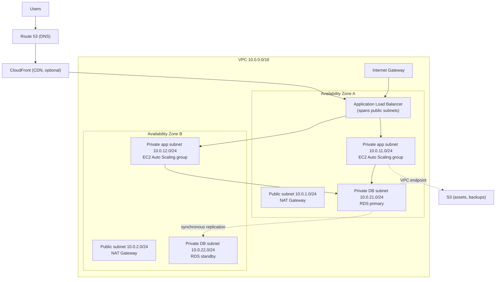
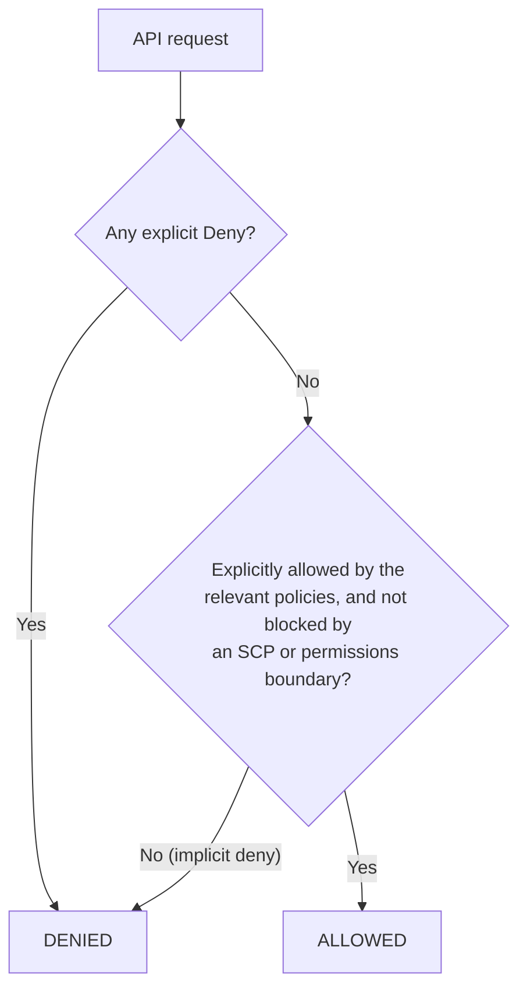
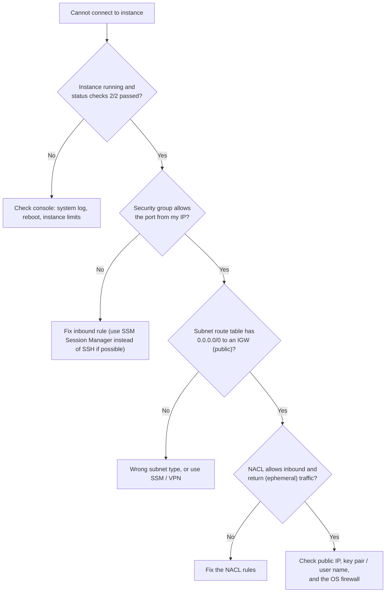

# AWS Hands-On for DevOps — VPC, IAM, EC2, Load Balancers, S3, RDS, EKS, and Troubleshooting

The [Cloud Computing](devops/cloud-computing) guide explains cloud concepts across providers. This guide is the **AWS hands-on companion**: the services a DevOps engineer touches every day, how they fit together, and the checklists that interviewers love ("design a VPC", "why can't this instance reach the internet?"). Because AWS is the most common cloud in job listings, knowing it well pays off directly.

> **Cost warning:** NAT Gateways, load balancers, EKS clusters, and RDS instances **cost money while they exist**. Set an AWS Budget alert first, tag everything, and destroy your lab resources (preferably with Terraform) when you finish.

---

## 1. The Big Picture

| Concept | Meaning |
|---|---|
| **Account** | A security and billing boundary. Production and non-production should be **separate accounts** (managed with AWS Organizations) |
| **Region** | A geographic area (for example `ap-south-1` Mumbai). Resources are regional; data stays in the region unless you move it |
| **Availability Zone (AZ)** | One or more data centers inside a region, isolated from failures in other AZs. Spread workloads across **at least two AZs** |
| **Shared responsibility** | AWS secures the cloud itself (hardware, facilities); you secure what you put **in** it (IAM, network rules, data, patches on your instances) |

A typical production web application:



---

## 2. Networking: The VPC

A **Virtual Private Cloud (VPC)** is your own isolated network in AWS. Getting the VPC right is the foundation of everything else, and it is the most common interview topic.

### Building Blocks

| Component | Purpose |
|---|---|
| **CIDR block** | The VPC's IP range (for example `10.0.0.0/16`, about 65,000 addresses). Plan so it **does not overlap** with other VPCs or your on-premises network, or you cannot connect them |
| **Subnet** | A slice of the VPC that lives in **one AZ** (for example `10.0.1.0/24`). AWS reserves 5 addresses in each subnet |
| **Route table** | Rules that decide where traffic from a subnet goes |
| **Internet Gateway (IGW)** | Connects the VPC to the internet (both directions) |
| **NAT Gateway** | Lets resources in **private** subnets reach the internet **outbound only** (updates, external APIs). Lives in a public subnet |
| **Security group** | Stateful firewall attached to instances/ENIs |
| **Network ACL (NACL)** | Stateless firewall at the subnet boundary |
| **VPC endpoint** | Private connection to AWS services without going over the internet or a NAT |

### Public vs Private Subnets

The difference is **only the route table**:

| | Public subnet | Private subnet |
|---|---|---|
| Route to `0.0.0.0/0` | Internet Gateway | NAT Gateway (or none) |
| Instances have public IPs? | Usually (if needed) | No |
| Reachable from the internet? | Yes, if security groups allow | **No** |
| Put here | Load balancers, NAT Gateways, bastion (or better, none) | Application servers, databases, EKS worker nodes |

**Rule of thumb:** only load balancers (and NAT) sit in public subnets. **Applications and databases stay private.**

### Security Groups vs NACLs

| | Security group | Network ACL |
|---|---|---|
| Level | Instance / network interface | Subnet |
| State | **Stateful** (return traffic is automatically allowed) | **Stateless** (must allow return traffic explicitly, including ephemeral ports 1024-65535) |
| Rules | **Allow only** | Allow **and deny**, evaluated in rule-number order |
| Default | All inbound denied, all outbound allowed | Default NACL allows everything |
| Typical use | Main access control | Extra subnet-level guardrail (for example block an IP range) |

**Chain security groups instead of using IP ranges:** the app tier's security group allows port 8080 **from the load balancer's security group**, and the database's security group allows port 5432 **from the app tier's security group**. Nothing else can reach the database.

### Connectivity Options

| Need | Solution |
|---|---|
| Connect two VPCs | **VPC peering** (simple, not transitive) or **Transit Gateway** (hub-and-spoke for many VPCs) |
| Reach S3/DynamoDB privately and for free | **Gateway endpoint** |
| Reach other AWS services privately (SQS, ECR, SSM, ...) | **Interface endpoint (PrivateLink)** |
| Connect to your office/data center | **Site-to-Site VPN** (quick, over the internet) or **Direct Connect** (dedicated line) |
| Admin access to private instances | **SSM Session Manager** (no open SSH port, no bastion, audited) |

**Cost tip:** NAT Gateways charge per hour **and per GB processed**. Heavy traffic to S3 through a NAT is a classic surprise bill: use a gateway endpoint instead. For high availability use **one NAT Gateway per AZ**; for cheap dev environments a single one is acceptable.

---

## 3. IAM: Identity and Access Management

IAM decides **who can do what** on which resources. It is global (not per region) and the most security-critical service.

### Core Concepts

| Concept | Meaning |
|---|---|
| **User** | A person or application with long-term credentials. For humans prefer **IAM Identity Center (SSO)** |
| **Group** | A set of users sharing permissions |
| **Role** | An identity that is **assumed temporarily** and provides short-lived credentials. No password or permanent keys |
| **Policy** | A JSON document listing allowed or denied actions |
| **Trust policy** | On a role: **who may assume it** |
| **Permissions policy** | On a role/user: **what it may do** |

### A Policy

```json
{
  "Version": "2012-10-17",
  "Statement": [
    {
      "Effect": "Allow",
      "Action": ["s3:GetObject", "s3:PutObject"],
      "Resource": "arn:aws:s3:::my-app-bucket/uploads/*"
    }
  ]
}
```

Each statement has **Effect** (Allow/Deny), **Action**, **Resource**, and optional **Condition** (for example only from a certain IP or with MFA).

### How AWS Decides (Simplified)



**Remember:** everything is denied by default; an **explicit Deny always wins**.

### Roles in Practice

| Use case | How |
|---|---|
| EC2 needs to read S3 | Attach an **instance profile** (IAM role) to the instance. The app gets temporary credentials automatically, with no keys in code |
| Lambda or ECS task accesses a service | Execution/task role |
| Pods in EKS | **IRSA** or **EKS Pod Identity** gives each service account its own role |
| CI/CD deploys to AWS | GitHub Actions assumes a role via **OIDC** (see [CI/CD Pipelines](devops/ci-cd-pipelines)) |
| Cross-account access | A role in the target account whose trust policy allows the source account; the caller uses `sts:AssumeRole` |

### IAM Best Practices

- **Never use the root user** for daily work; lock it with MFA and no access keys.
- **Least privilege:** start narrow and add permissions; avoid `"Action": "*"` and `"Resource": "*"`.
- **Prefer roles and temporary credentials** over long-lived access keys. If keys must exist, rotate them and never commit them to Git.
- **MFA** for humans, **SSO** for access.
- Use **permission boundaries** and **Service Control Policies (SCPs)** (Organizations) as guardrails.
- Review with **IAM Access Analyzer**, and turn on **CloudTrail** to audit every API call.

```bash
aws sts get-caller-identity       # who am I right now? (first command when debugging permissions)
```

---

## 4. Compute: EC2, Auto Scaling, and Load Balancers

### EC2 Essentials

| Topic | Notes |
|---|---|
| **Instance families** | `t` burstable (cheap, dev/small), `m` general purpose, `c` compute-optimized, `r` memory-optimized, `i` storage-optimized, `g/p` GPU |
| **AMI** | The image an instance boots from (OS plus software). Bake your own with Packer for immutable deployments |
| **User data** | A script run at first boot to configure the instance |
| **EBS** | Persistent block storage (`gp3` is the usual default). **Instance store** is fast but **ephemeral** |
| **Purchasing** | **On-Demand** (flexible), **Savings Plans/Reserved** (commitment for large discounts), **Spot** (big discounts, can be interrupted with a short warning: good for stateless, fault-tolerant work) |
| **Access** | Prefer **SSM Session Manager** to SSH; require **IMDSv2** (protects instance credentials from SSRF attacks) |

### Auto Scaling Groups (ASG)

An ASG keeps the right number of identical instances running, across AZs, replacing unhealthy ones automatically.

- **Launch template:** AMI, instance type, security groups, user data, IAM role.
- **Min / desired / max** capacity.
- **Scaling policies:** **target tracking** (keep average CPU at 50%, or requests per target at N: the simplest and usually best), step, scheduled.
- **Health checks:** EC2 status, and **ELB health checks** (so an instance failing the application check is replaced).
- **Instance refresh:** rolling replacement when the launch template changes (rolling deployments).

### Elastic Load Balancing

| | **ALB** (Application) | **NLB** (Network) |
|---|---|---|
| Layer | 7 (HTTP/HTTPS, gRPC, WebSocket) | 4 (TCP/UDP/TLS) |
| Routing | By host, path, header, query string | By port/protocol |
| Strengths | Content-based routing, redirects, authentication, WAF integration | Extreme throughput and low latency, **static IPs**, TLS passthrough |
| Use for | Web apps and microservices | Non-HTTP protocols, very high performance, fixed IPs |

A **target group** holds the targets (instances, IPs, Lambda) and runs **health checks**. See [Load Balancing](system-design/load-balancing) for L4 vs L7 concepts.

**HTTP errors from an ALB:**

| Code | Usually means |
|---|---|
| **502** Bad Gateway | The target closed the connection or sent an invalid response (app crash, protocol mismatch) |
| **503** Service Unavailable | **No healthy targets** in the target group |
| **504** Gateway Timeout | The target didn't respond within the idle timeout (slow app, security group blocking) |

---

## 5. Storage and Databases

### S3 (Object Storage)

- **Buckets and objects** (flat key namespace), very high durability (designed for 11 nines), **strong read-after-write consistency**.
- **Storage classes:** Standard, Intelligent-Tiering (automatic), Standard-IA / One Zone-IA (infrequent access), Glacier tiers (archive). Use **lifecycle rules** to move or expire objects automatically.
- **Security:** **Block Public Access** on (account level), **bucket policies** for access (ACLs are legacy), **encryption at rest** (SSE-S3 by default; SSE-KMS for key control), TLS enforced, **pre-signed URLs** for temporary access.
- **Versioning** protects from accidental deletes and overwrites; **replication** (cross-region or same-region) for DR.
- Often paired with **CloudFront** (use Origin Access Control so the bucket is not public).

### RDS and Aurora (Managed Relational Databases)

| Feature | Purpose |
|---|---|
| **Multi-AZ** | A **synchronous standby** in another AZ with **automatic failover**. For **high availability**, not read scaling |
| **Read replicas** | **Asynchronous** copies for **read scaling** (and cross-region DR); can be promoted |
| **Automated backups + point-in-time recovery** | Retention you configure (days); restore to any second in the window |
| **Snapshots** | Manual backups, can be copied across regions |
| **Subnet group** | Which (private) subnets the database may use |
| **Parameter groups** | Database engine settings |
| **RDS Proxy** | Connection pooling (valuable for Lambda and many app connections) |

**Aurora** is AWS's cloud-optimized MySQL/PostgreSQL-compatible engine: storage is replicated across three AZs, supports many read replicas, and fails over quickly. See [Databases](system-design/databases) for replication concepts.

**Multi-AZ vs read replica** is a very common question: Multi-AZ = availability (failover), read replica = performance (reads).

### Others to Know

**DynamoDB** (managed key-value/document store, single-digit ms at any scale), **ElastiCache** (managed Redis/Memcached, see [Caching and CDN](system-design/caching-and-cdn)), **EFS** (shared network file system), **SQS/SNS/EventBridge** (queues, pub/sub, event bus; see [Messaging and Communication](system-design/messaging-and-communication)), **Lambda** (serverless functions).

---

## 6. Containers on AWS

| Service | What it is |
|---|---|
| **ECR** | Private container image registry (supports vulnerability scanning) |
| **ECS** | AWS-native container orchestrator; runs tasks on EC2 or **Fargate** (serverless, no nodes to manage) |
| **EKS** | Managed **Kubernetes**: AWS runs the control plane (a fixed hourly charge per cluster); you run **managed node groups**, **Fargate**, or **Karpenter**-managed nodes |
| **App Runner** | Simplest "run my container" service |

**EKS essentials** (see the [Kubernetes Production Guide](devops/k8s/kubernetes-production-guide) for Kubernetes itself):

- Create with **Terraform** or `eksctl`; put worker nodes in **private subnets**.
- **IRSA / Pod Identity** to give pods IAM permissions without node-wide credentials.
- **AWS Load Balancer Controller** turns Ingress/Service resources into ALBs/NLBs.
- **EBS CSI driver** for persistent volumes; **Cluster Autoscaler or Karpenter** for node scaling.
- Upgrade the cluster one minor version at a time, and keep within supported versions.

---

## 7. Monitoring, Audit, and Security Services

| Service | Purpose |
|---|---|
| **CloudWatch Metrics** | CPU, network, request counts, custom metrics |
| **CloudWatch Logs** | Central logs (with the CloudWatch agent or Fluent Bit); **Logs Insights** for queries |
| **CloudWatch Alarms** | Alert (SNS, auto scaling) when a metric crosses a threshold |
| **CloudTrail** | **Who did what**: audit log of every API call (security and forensics) |
| **AWS Config** | Tracks resource configuration and compliance over time |
| **GuardDuty** | Threat detection from logs and network patterns |
| **Security Hub** | Aggregates security findings |
| **X-Ray** | Distributed tracing |

See [Monitoring and Logging](devops/monitoring-and-logging) and [Observability and Deployment](system-design/observability-and-deployment) for the principles.

---

## 8. Cost Optimization

| Practice | How |
|---|---|
| **Visibility** | Consistent **tags** (team, environment, project); Cost Explorer; **Budgets with alerts** |
| **Right-size** | Match instance size to real usage (CloudWatch metrics, Compute Optimizer) |
| **Commitments** | Savings Plans or Reserved Instances for steady workloads |
| **Spot** | For batch, CI runners, stateless workers |
| **Schedule** | Turn off dev/test environments at night and weekends |
| **Storage** | Lifecycle rules, Intelligent-Tiering, delete orphaned EBS volumes and old snapshots |
| **Network** | VPC endpoints to avoid NAT data charges; keep traffic within a region/AZ where possible; use CloudFront |
| **Clean up** | Release unused Elastic IPs, delete idle load balancers and NAT Gateways |

### The Well-Architected Framework: Six Pillars

Operational Excellence, **Security**, **Reliability**, **Performance Efficiency**, **Cost Optimization**, and Sustainability. Interviewers often frame design answers around these.

---

## 9. Troubleshooting Checklists

### "I can't SSH or connect to my EC2 instance"



### "My private instance cannot reach the internet"

1. Is there a **NAT Gateway** in a **public** subnet of the same VPC (ideally same AZ)?
2. Does the **private subnet's route table** send `0.0.0.0/0` to the NAT Gateway?
3. Does the **public subnet's route table** send `0.0.0.0/0` to the Internet Gateway?
4. Do the security group's **outbound** rules and the NACLs allow the traffic?
5. Is DNS working (`enableDnsSupport`)?

### "ALB returns 502 / 503 / 504"

- **503:** no healthy targets. Check the target group **health check** (path, port, expected status code) and that the **target security group allows traffic from the ALB's security group**.
- **502:** the app crashes or speaks the wrong protocol; check application logs and the port.
- **504:** the app is too slow or blocked; check the idle timeout, the app's latency, and downstream dependencies.

### "S3 AccessDenied"

Check, in order: **who is calling** (`aws sts get-caller-identity`), the **IAM policy** on that identity, the **bucket policy**, **Block Public Access**, a **KMS key policy** if SSE-KMS is used, any **VPC endpoint policy**, and an **explicit Deny** anywhere (including SCPs). Remember cross-account access needs permission on **both** sides.

### "Cannot connect to RDS"

Is the **security group** allowing the DB port **from the app's security group**? Are the app and DB in the same VPC (or connected)? Is the DB in **private subnets** (correct) and the client inside the VPC (or reaching it via VPN/bastion)? Is the **endpoint** correct and the instance **available**? After failover, does the app **re-resolve DNS** rather than caching the old IP?

### Useful CLI Commands

```bash
aws configure                                     # or use SSO: aws configure sso
aws ec2 describe-instances --query "Reservations[].Instances[].[InstanceId,State.Name,PrivateIpAddress]" --output table
aws s3 ls s3://my-app-bucket/
aws logs tail /aws/lambda/my-func --follow
aws eks update-kubeconfig --name my-cluster --region ap-south-1
aws ssm start-session --target i-0123456789abcdef0
```

---

## 10. Interview Questions

**Q: Design a VPC for a production web application.**
A /16 VPC across at least two AZs, with public subnets for the load balancer and NAT Gateways, private app subnets, and private database subnets. Route tables send public subnets to the Internet Gateway and private subnets through NAT. Security groups chain ALB to app to database. Add VPC endpoints for S3, and use SSM instead of bastions.

**Q: What is the difference between a security group and a NACL?**
Security groups are stateful, instance-level, allow-only. NACLs are stateless, subnet-level, and support allow and deny with ordered rules.

**Q: What makes a subnet public?**
Its route table has a route to an Internet Gateway (and resources have public IPs). A private subnet has no route to the IGW.

**Q: IAM user, role, and policy?**
A user has long-term credentials; a role is assumed temporarily and gives short-lived credentials; a policy is the JSON permission document attached to them. Prefer roles.

**Q: How does an EC2 instance access S3 securely?**
Attach an IAM role (instance profile) with least-privilege permissions; the SDK gets temporary credentials from the instance metadata (IMDSv2). No keys in code.

**Q: Multi-AZ vs read replica?**
Multi-AZ is a synchronous standby for automatic failover (availability). Read replicas are asynchronous copies for scaling reads and can be promoted.

**Q: ALB vs NLB?**
ALB is layer 7 with content-based routing for HTTP(S) and gRPC. NLB is layer 4 with extreme performance and static IPs.

**Q: How do you reduce an unexpectedly high AWS bill?**
Use Cost Explorer and tags to find the spend, then right-size, remove idle resources, use Savings Plans and Spot where suitable, add lifecycle rules, and use VPC endpoints to cut NAT data charges.

**Q: How do you give a CI pipeline access to AWS without storing keys?**
Use OIDC: the pipeline assumes an IAM role with a trust policy limited to the repo and branch, receiving temporary credentials.

**Q: A user gets AccessDenied. How do you debug?**
Identify the caller, review identity and resource policies, look for explicit denies, SCPs, permission boundaries, and KMS or VPC endpoint policies, and check CloudTrail for the denied call.

**Q: How would you make an application highly available on AWS?**
Multiple AZs for compute (ASG behind an ALB), Multi-AZ database, stateless application servers, health checks and auto replacement, and for DR a second region with replicated data and Route 53 failover. See [High Availability](system-design/high-availability).

---

## Hands-On Exercise

1. Create a **budget alert**, then (with Terraform, see [Terraform and Infrastructure as Code](devops/terraform-and-iac)) build a VPC with two public and two private subnets, an IGW, and one NAT Gateway.
2. Launch an **ALB** and an **Auto Scaling group** of instances in the private subnets running a simple web app, with an IAM role that can read one S3 bucket.
3. Add an **RDS** instance in private DB subnets, reachable only from the app's security group.
4. Break each of these on purpose (remove a route, change a security group) and use the checklists above to find the fault.
5. **Destroy everything.**

## Continue Learning

- [Terraform and Infrastructure as Code](devops/terraform-and-iac) — provisioning all of this from code.
- [CI/CD Pipelines](devops/ci-cd-pipelines) — deploying to AWS with OIDC.
- [Kubernetes Production Guide](devops/k8s/kubernetes-production-guide) — running workloads on EKS.
- [Monitoring and Logging](devops/monitoring-and-logging) — CloudWatch, Prometheus, and alerting.
- [Cloud Computing](devops/cloud-computing) — the vendor-neutral concepts behind these services.
