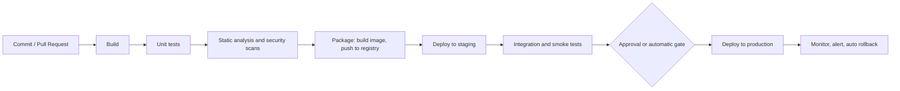
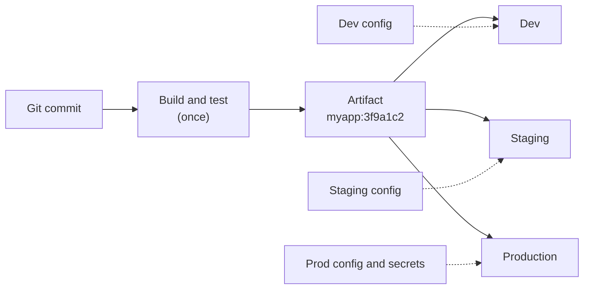
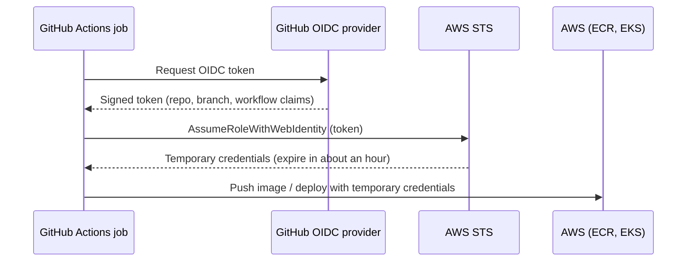
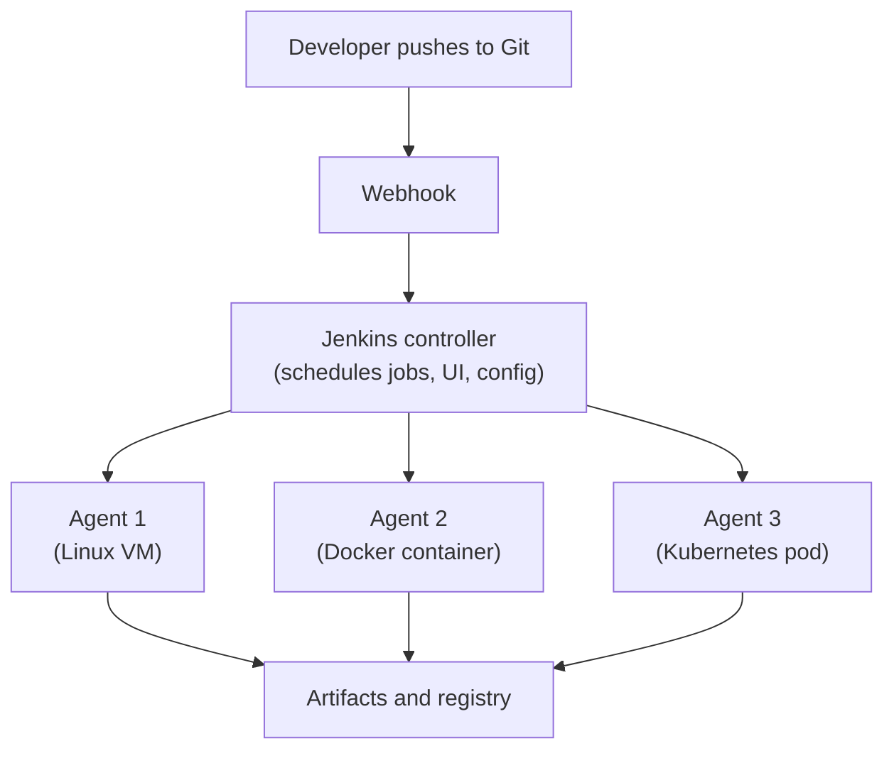
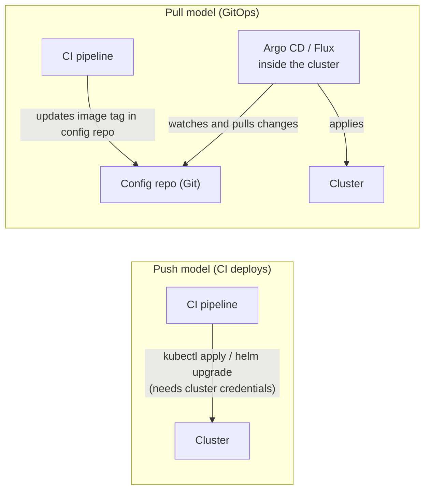

# CI/CD Pipelines — GitHub Actions, Jenkins, Deployment Strategies, GitOps, and DORA Metrics

CI/CD is the heart of DevOps: an automated path that takes code from a developer's commit to running in production, **safely, repeatedly, and quickly**. Interviewers for DevOps roles almost always ask you to design or debug a pipeline, so you need both the concepts and hands-on knowledge of at least one tool.

---

## 1. CI, Continuous Delivery, and Continuous Deployment

| Term | Meaning | Human approval before production? |
|---|---|---|
| **Continuous Integration (CI)** | Developers merge small changes frequently; every change is **built and tested automatically** | n/a |
| **Continuous Delivery (CD)** | Every change that passes the pipeline is **ready to deploy** at the push of a button | **Yes** (manual release decision) |
| **Continuous Deployment (CD)** | Every change that passes the pipeline is **deployed to production automatically** | **No** |

**Why it matters:** small, frequent, automated releases are less risky than large, rare, manual ones. Problems are found minutes after they are introduced, not weeks later, and the release process becomes boring (which is the goal).

### The Typical Pipeline



---

## 2. Principles of a Good Pipeline

| Principle | What it means |
|---|---|
| **Fail fast** | Run the quickest checks first (lint, unit tests) so feedback arrives in minutes |
| **Build once, deploy many** | Build the artifact **one time** and promote the **same artifact** through staging and production. Never rebuild per environment, or you are not testing what you ship |
| **Immutable, versioned artifacts** | Tag images with the **Git commit SHA** or a semantic version. Do not deploy `latest` |
| **Separate build from config** | The artifact is the same everywhere; environment differences come from configuration and secrets injected at deploy time |
| **Everything as code** | Pipelines live in Git next to the application (`.github/workflows/*.yml`, `Jenkinsfile`) and go through review |
| **Reproducible and idempotent** | Running a job twice gives the same result; pinned tool versions; clean runners |
| **Automate quality gates** | Tests, linting, coverage thresholds, vulnerability scans block bad changes automatically |
| **Make rollback easy** | Deploying the previous version should be one command or one revert |
| **Keep it fast** | Cache dependencies, run jobs in parallel, build only what changed. Slow pipelines get bypassed |
| **Secure by default** | Least-privilege credentials, no long-lived secrets, signed and scanned artifacts |

### Environment Promotion



---

## 3. GitHub Actions

GitHub Actions runs workflows defined in YAML files inside `.github/workflows/`.

### Core Concepts

| Term | Meaning |
|---|---|
| **Workflow** | An automated process defined in a YAML file |
| **Event / trigger** | What starts it: `push`, `pull_request`, `schedule` (cron), `workflow_dispatch` (manual), tag pushes, `release` |
| **Job** | A group of steps that runs on one **runner**. Jobs run in **parallel** unless you set `needs:` |
| **Step** | A single command (`run:`) or a reusable **action** (`uses:`) |
| **Runner** | The machine that runs a job: GitHub-hosted (`ubuntu-latest`) or **self-hosted** |
| **Matrix** | Run the same job across several versions or platforms |
| **Environment** | A named deployment target (`staging`, `production`) with its own secrets and **required reviewers** |
| **Artifact / cache** | Files passed between jobs / dependencies reused between runs |

### A Complete Example: Test, Build, Push, Deploy

```yaml
name: ci-cd

on:
  push:
    branches: [main]
  pull_request:

concurrency:                       # cancel older runs of the same branch
  group: ${{ github.workflow }}-${{ github.ref }}
  cancel-in-progress: true

permissions:
  contents: read                   # least privilege by default

jobs:
  test:
    runs-on: ubuntu-latest
    strategy:
      matrix:
        node: [20, 22]
    steps:
      - uses: actions/checkout@v4
      - uses: actions/setup-node@v4
        with:
          node-version: ${{ matrix.node }}
          cache: npm                # caches ~/.npm between runs
      - run: npm ci
      - run: npm run lint
      - run: npm test

  build:
    needs: test
    if: github.event_name == 'push' && github.ref == 'refs/heads/main'
    runs-on: ubuntu-latest
    permissions:
      contents: read
      id-token: write               # lets the job request an OIDC token for AWS
    outputs:
      image: ${{ steps.meta.outputs.image }}
    steps:
      - uses: actions/checkout@v4
      - uses: aws-actions/configure-aws-credentials@v4
        with:
          role-to-assume: arn:aws:iam::123456789012:role/github-actions-ecr
          aws-region: ap-south-1
      - id: ecr
        uses: aws-actions/amazon-ecr-login@v2
      - id: meta
        run: echo "image=${{ steps.ecr.outputs.registry }}/myapp:${{ github.sha }}" >> "$GITHUB_OUTPUT"
      - run: docker build -t "${{ steps.meta.outputs.image }}" .
      # add an image vulnerability scan here (for example Trivy) and fail on HIGH/CRITICAL
      - run: docker push "${{ steps.meta.outputs.image }}"

  deploy-staging:
    needs: build
    runs-on: ubuntu-latest
    environment: staging
    steps:
      - uses: actions/checkout@v4
      - run: echo "Deploy ${{ needs.build.outputs.image }} to staging (helm upgrade --install ...)"

  deploy-production:
    needs: deploy-staging
    runs-on: ubuntu-latest
    environment: production         # set "required reviewers" on this environment = manual approval
    steps:
      - uses: actions/checkout@v4
      - run: echo "Deploy ${{ needs.build.outputs.image }} to production"
```

(Use the latest major versions of the actions; the versions above are examples.)

### Secure AWS Access with OIDC (No Stored Keys)

The old way was to store `AWS_ACCESS_KEY_ID` and `AWS_SECRET_ACCESS_KEY` as GitHub secrets. Those are **long-lived** credentials that can leak. With **OpenID Connect (OIDC)**, the job proves its identity to AWS and receives **short-lived** credentials.



The IAM role's **trust policy** restricts which repository and branch may assume it (for example only `repo:my-org/my-repo:ref:refs/heads/main`). See [AWS Hands-On](devops/aws-hands-on) for IAM roles.

### GitHub Actions Best Practices

- **Least-privilege `permissions:`** for `GITHUB_TOKEN` (default to read-only).
- **Pin third-party actions** to a full commit SHA, not a moving tag, to reduce supply-chain risk. Use Dependabot to update them.
- **Never print secrets**; GitHub masks known secrets, but avoid echoing them. Secrets are **not** passed to workflows triggered by pull requests from forks.
- Use **`concurrency`** to avoid duplicate deploys, **caching** for dependencies, and **path filters** (`paths:`) in monorepos so only affected parts build.
- Use **reusable workflows** (`workflow_call`) so many repositories share one standard pipeline.
- Use **self-hosted runners** when you need private network access or special hardware, and keep them ephemeral and locked down.
- Protect production with **environments** and required reviewers.

---

## 4. Jenkins

Jenkins is the long-standing, self-hosted automation server. It is very flexible and common in enterprises, so you will meet it in interviews and real jobs.



- The **controller** orchestrates; **agents** do the work (scale horizontally, ideally as ephemeral containers or Kubernetes pods).
- **Pipeline as code:** a `Jenkinsfile` stored in the repo. **Declarative** syntax is the recommended style.
- **Plugins** add integrations, but need constant updating and are a common security and stability burden.
- **Credentials** are stored in Jenkins and injected with `withCredentials`.

### A Declarative Jenkinsfile

```groovy
pipeline {
  agent any
  environment {
    REGISTRY = 'registry.example.com/team'
    IMAGE    = "${REGISTRY}/app:${env.GIT_COMMIT}"
  }
  options { timeout(time: 30, unit: 'MINUTES') }

  stages {
    stage('Test') {
      steps { sh 'npm ci && npm test' }
    }
    stage('Build image') {
      steps { sh 'docker build -t $IMAGE .' }
    }
    stage('Scan') {
      steps { sh 'trivy image --exit-code 1 --severity HIGH,CRITICAL $IMAGE' }
    }
    stage('Push') {
      steps {
        withCredentials([usernamePassword(credentialsId: 'registry-creds',
                                          usernameVariable: 'REG_USER',
                                          passwordVariable: 'REG_PASS')]) {
          sh 'echo "$REG_PASS" | docker login registry.example.com -u "$REG_USER" --password-stdin'
          sh 'docker push $IMAGE'
        }
      }
    }
    stage('Deploy') {
      when { branch 'main' }
      steps { sh 'helm upgrade --install app ./chart --set image.tag=$GIT_COMMIT -n staging' }
    }
  }

  post {
    failure { echo 'Pipeline failed' }   // replace with a Slack or email notification
  }
}
```

Using **single quotes** around `sh` commands lets the shell (not Groovy) expand secrets, which avoids leaking them in logs.

### GitHub Actions vs Jenkins

| | GitHub Actions | Jenkins |
|---|---|---|
| Hosting | Managed by GitHub (or self-hosted runners) | You run and maintain it |
| Setup | Almost none: add a YAML file | Install, secure, upgrade, plug in plugins |
| Flexibility | Large marketplace, tied to GitHub | Extremely flexible, any SCM and tool |
| Maintenance | Low | High (plugins, upgrades, scaling agents) |
| Best for | Projects already on GitHub, fast start | Complex enterprise workflows, on-prem needs |

**GitLab CI/CD** (a `.gitlab-ci.yml` with stages and jobs) follows the same ideas and is built into GitLab. Learn the concepts once and the tools transfer.

---

## 5. Quality and Security Gates (Shift Left)

Catch problems **earlier** where they are cheap to fix.

| Gate | Purpose | Examples |
|---|---|---|
| **Lint and format** | Code style and simple bugs | ESLint, flake8, `terraform fmt` |
| **Unit tests** | Logic correctness, fast | Jest, pytest, JUnit |
| **Integration / e2e tests** | Components working together | Test containers, Cypress, Playwright |
| **Code quality** | Smells, coverage thresholds | SonarQube |
| **SAST** (static security analysis) | Insecure code patterns | CodeQL, Semgrep |
| **Dependency scanning** | Known vulnerabilities in libraries | Dependabot, `npm audit`, Snyk |
| **Secret scanning** | Committed credentials | gitleaks, GitHub push protection |
| **Container image scanning** | Vulnerabilities in the image | Trivy, Docker Scout |
| **IaC scanning** | Misconfigured Terraform or Kubernetes | Checkov, tfsec, kube-linter |
| **SBOM and signing** | Know and verify what you ship | Syft, cosign |
| **DAST** | Test the running app | OWASP ZAP in staging |

**The test pyramid:** many fast unit tests, fewer integration tests, very few slow end-to-end tests.

---

## 6. Deploying to Kubernetes: Push vs GitOps (Pull)

There are two ways to get the new image running in a cluster.



| | Push (pipeline deploys) | Pull (GitOps) |
|---|---|---|
| Cluster credentials | CI needs access to the cluster | Credentials stay **inside** the cluster; CI only writes to Git |
| Source of truth | The pipeline run | **Git** (declared desired state) |
| Drift | Not noticed until the next deploy | Controller **detects and reverts** manual changes |
| Audit and rollback | Pipeline logs; rerun an old job | Git history; `git revert` |
| Complexity | Simple to start | Extra component to run, clearer at scale |

GitOps with Argo CD is covered in the [Kubernetes Production Guide](devops/k8s/kubernetes-production-guide).

### Image Tagging Strategy

| Tag | Use |
|---|---|
| **Git commit SHA** (`myapp:3f9a1c2`) | Unique, traceable to the exact code. Best for deployment |
| **Semantic version** (`myapp:1.4.0`) | Human-friendly release versions, set on Git tags |
| **`latest`** | Avoid in production: it is mutable and makes rollbacks and audits unreliable |

For maximum safety deploy by **image digest** (`@sha256:...`).

---

## 7. Deployment Strategies and Rollback

The strategies (rolling, blue-green, canary, feature flags) are explained in [Observability and Deployment](system-design/observability-and-deployment). In a pipeline you implement them like this:

| Strategy | Pipeline implementation |
|---|---|
| **Rolling** | Kubernetes `Deployment` default; the pipeline updates the image tag |
| **Blue-green** | Deploy to the idle environment, run smoke tests, switch the Service or load balancer, keep the old one for rollback |
| **Canary** | Shift 5% → 25% → 100% of traffic with Argo Rollouts, Flagger, or a service mesh, and **auto-abort** on bad metrics |
| **Feature flags** | Deploy code dark, enable gradually via configuration |

**Rollback options:**

```bash
kubectl rollout undo deployment/myapp          # Kubernetes: previous ReplicaSet
helm rollback myapp 3                          # Helm: back to revision 3
git revert <sha> && git push                   # GitOps: revert the manifest change
```

Make rollbacks **fast and rehearsed**. Also plan for **database migrations**: use backward-compatible (expand and contract) changes so rolling back the app does not break the schema.

---

## 8. Measuring Delivery Performance: DORA Metrics

The DORA research identified four metrics that correlate with high-performing teams:

| Metric | Meaning |
|---|---|
| **Deployment frequency** | How often you deploy to production |
| **Lead time for changes** | Time from commit to running in production |
| **Change failure rate** | Percentage of deployments that cause a failure needing a fix or rollback |
| **Time to restore service (MTTR)** | How quickly you recover from a failure |

The first two measure **speed**, the last two measure **stability**. Good CI/CD improves all four together, which disproves the idea that speed and stability must be traded off.

---

## 9. Pipeline Performance and Reliability

- **Cache** dependencies (`actions/cache`, language-specific caching) and Docker layers (BuildKit cache).
- **Parallelize** independent jobs (tests across shards, matrix builds).
- **Build only what changed** in a monorepo (path filters).
- Use **shallow clones** (`fetch-depth: 1`) for faster checkouts.
- Keep runners **clean and ephemeral** to avoid "works on the runner" surprises.
- Handle **flaky tests**: quarantine and fix them, do not just retry forever.
- **Timeouts** on every job so a stuck pipeline doesn't hold resources.
- **Notifications** on failure (Slack, email) with a link to the logs.

### Common Anti-Patterns

| Anti-pattern | Fix |
|---|---|
| Rebuilding the image for each environment | Build once, promote the same artifact |
| Using `latest` in production | Pin by SHA, version, or digest |
| Long-lived cloud keys in CI secrets | OIDC and short-lived credentials |
| Manual steps in the middle of the pipeline | Automate, or make them explicit approval gates |
| Pipeline defined only in the Jenkins UI | Pipeline as code in Git |
| No tests, or a pipeline that is always ignored when red | Fail the build, fix flaky tests, keep it fast |
| Deploying straight to production with no staging or canary | Promote through environments, use gradual rollouts |
| Secrets echoed in logs | Mask and avoid printing; scan logs |

---

## 10. Interview Questions

**Q: What is the difference between continuous delivery and continuous deployment?**
Both automate the path to production. In delivery, a human approves the final release; in deployment, every change that passes the pipeline goes to production automatically.

**Q: Design a CI/CD pipeline for a containerized microservice.**
On a pull request: lint, unit tests, scans. On merge to main: build the image once, tag it with the commit SHA, scan it, push to the registry, deploy to staging, run smoke tests, then promote the same image to production through an approval or an automated canary with metric-based rollback. Store the pipeline as code, and use OIDC or GitOps to avoid long-lived credentials.

**Q: What does "build once, deploy many" mean and why?**
Create one immutable artifact and promote it unchanged across environments, so what you tested is exactly what you ship. Environment differences come from configuration, not rebuilds.

**Q: How do you handle secrets in a pipeline?**
Use the platform's secret store or an external one (Vault, cloud secret manager), prefer short-lived credentials through OIDC, restrict secrets by environment, never print them, and scan for leaks.

**Q: Push vs GitOps deployment?**
Push has CI apply changes to the cluster and needs cluster credentials. GitOps keeps desired state in Git and a controller in the cluster pulls and reconciles it, giving drift correction, audit, and easy rollback.

**Q: How would you speed up a slow pipeline?**
Cache dependencies and layers, run tests in parallel, build only changed parts, use shallow clones, run quick checks first, and remove or fix flaky and unnecessary steps.

**Q: How do you roll back a bad release?**
Redeploy the previous version (`kubectl rollout undo`, `helm rollback`, or revert in Git for GitOps), automate rollback on failed health checks or metrics, and keep database changes backward compatible.

**Q: How do you secure a CI/CD pipeline?**
Least-privilege tokens, OIDC instead of static keys, pinned and reviewed third-party actions, protected branches and environments, image and dependency scanning, signed artifacts, isolated ephemeral runners, and audit logs.

**Q: What are the DORA metrics?**
Deployment frequency, lead time for changes, change failure rate, and time to restore service.

**Q: A pipeline passes locally but fails in CI. How do you debug?**
Compare environments (tool and OS versions, environment variables, file paths, network access, cached state), read the full logs, reproduce in the same container image locally, and pin versions to remove differences.

**Q: What is a self-hosted runner, and what are the risks?**
A machine you manage that runs workflows. Risks include untrusted code running on your network and persistent state between jobs, so isolate it, make it ephemeral, and avoid using it for public forks.

---

## Hands-On Exercise

1. Create a small app with a `Dockerfile` and a test.
2. Write a GitHub Actions workflow that runs tests on every pull request.
3. Extend it: on merge to `main`, build the image, tag it with the commit SHA, and push it to a registry (GHCR is the easiest start).
4. Add a Trivy scan step that fails on critical vulnerabilities.
5. Deploy to a local Kind cluster with `helm upgrade --install` (or let Argo CD pull from a manifests repo).
6. Break something on purpose and practice a rollback.

This pipeline, extended with Terraform and monitoring, is the core of the capstone project in [DevOps Scenarios and Capstone Project](devops/devops-scenarios-and-capstone).

## Continue Learning

- [Git and Version Control for DevOps](devops/git-and-version-control) — branching, PR workflows, and GitOps foundations.
- [Terraform and Infrastructure as Code](devops/terraform-and-iac) — running `plan` and `apply` in pipelines.
- [Docker Full Tutorial](devops/docker/docker-full-tutorial) — building and securing the images you ship.
- [Kubernetes Production Guide](devops/k8s/kubernetes-production-guide) — deploying, probing, and rolling out safely.
- [Observability and Deployment](system-design/observability-and-deployment) — deployment strategies and SLO-based rollback decisions.
