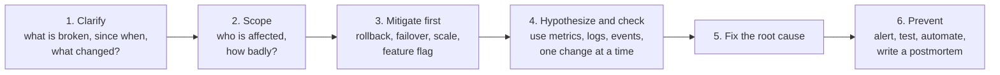
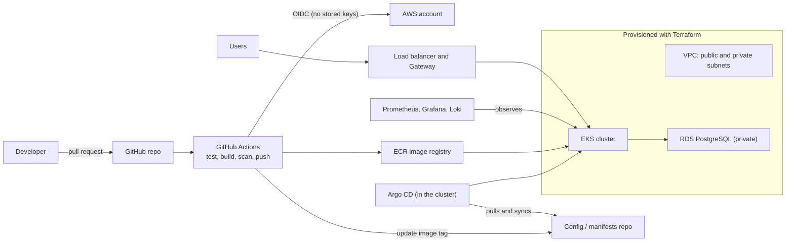
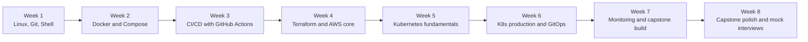

# DevOps Scenarios, Interview Question Bank, and Capstone Project

Reading tutorials is not enough for a DevOps role. Interviews are **scenario-based** ("the deployment failed halfway, what do you do?") and hiring managers trust candidates who have **built and operated something real**. This page gives you three things: a framework for answering scenario questions, a bank of questions with concise answers, and a **capstone project** that ties the whole DevOps series together.

---

## Part 1: How to Answer a Scenario Question

Interviewers care less about the final answer than about **how you think**. Use the same structure every time and say it out loud.



**Habits that impress:**

- **Ask clarifying questions** before diving in ("Is this production? What changed recently?").
- **Restore service first**, investigate second.
- **Name the tools and the exact command or metric** you would use, not just "check the logs".
- **Narrow systematically** (layer by layer or by the USE method) instead of guessing.
- End with **prevention**: monitoring, automation, a runbook, and a blameless postmortem.
- Admit what you don't know and say how you would find out.

---

## Part 2: Scenario Question Bank

Short model answers. Practice saying each one aloud in your own words. Deeper explanations are in the linked guides.

### Linux

**Q: A server is slow. How do you investigate?**
Check load average against core count (`uptime`), then `top`/`vmstat` to see whether time goes to CPU, I/O wait, or swapping; `iostat -xz` for disk latency, `free -h` for memory, `df -h` and `df -i` for space, `ss` and logs for network and application errors. See [Linux for DevOps](devops/linux-for-devops).

**Q: The disk is 100% full. What do you do?**
`df -h` and `df -i`, find big directories with `du -xh --max-depth=1`, check for deleted-but-open files with `lsof +L1`, free space (rotate or compress logs), then fix the root cause with logrotate, retention, alerts at 80%, or a larger volume.

**Q: A service keeps dying with no obvious error.**
`dmesg -T | grep -i killed` for the OOM killer, `journalctl -u service`, the exit code, and the cgroup or container memory limit. Fix by raising limits, fixing a leak, or adding memory.

**Q: You can't SSH into a server.**
Is the instance up? Security group or firewall allows the port from your IP? Routing and NACLs? Right key and user? Port bound by `sshd`? Use the console or SSM Session Manager to look from the inside.

### Git

**Q: You committed to the wrong branch.**
Create a branch at the current commit to keep the work, then `git reset --hard HEAD~1` on the wrong branch if it is unpushed (or `revert` if pushed). See [Git and Version Control](devops/git-and-version-control).

**Q: A password was pushed to the repository.**
Revoke and rotate it **immediately** (that is the real fix), then remove it from history with `git filter-repo`, force-push, check logs for misuse, and add secret scanning and push protection.

**Q: A bad change reached `main`. How do you undo it safely?**
`git revert` the commit (or the merge with `-m 1`) and let the pipeline deploy the revert. Don't rewrite shared history.

### CI/CD

**Q: The pipeline takes 40 minutes. How do you speed it up?**
Profile the stages; add dependency and Docker layer caching, parallelize tests, build only changed parts, run quick checks first, use bigger or more runners, and fix flaky tests. See [CI/CD Pipelines](devops/ci-cd-pipelines).

**Q: A deployment failed halfway. What now?**
Check what state the system is in (`kubectl rollout status`), roll back to the last good version if users are affected, then investigate. Prevent with readiness probes, automated rollback, and backward-compatible changes.

**Q: How do you manage secrets in pipelines?**
Platform or external secret stores, OIDC for cloud access (no long-lived keys), environment-scoped secrets, masking, and never printing them or passing them to fork PRs.

**Q: Tests pass locally but fail in CI.**
Compare environments (versions, env vars, paths, network, timing), read full logs, reproduce in the same container image, and pin versions.

**Q: How do you promote a release from staging to production?**
Build once, promote the **same artifact** by tag or digest, with environment-specific config, an approval gate or automated checks, and a canary or gradual rollout.

### Docker

**Q: A container exits immediately.**
`docker logs`, check the exit code (`docker inspect`), that the main process stays in the foreground, the `CMD`/`ENTRYPOINT`, and missing config or env vars. See the [Docker Full Tutorial](devops/docker/docker-full-tutorial).

**Q: The image is 1.5 GB. How do you shrink it?**
Slimmer base image, multi-stage build, `.dockerignore`, combine and clean package installs in one layer, and remove build tools from the final image.

**Q: Data disappears when the container restarts.**
Container filesystems are ephemeral: use a **volume** or bind mount for persistent data.

**Q: Two containers can't talk to each other.**
Same user-defined network? Using the **service/container name** as the host (not `localhost`)? Is the app listening on `0.0.0.0` rather than `127.0.0.1`? Ports and firewall?

**Q: How do you keep secrets out of images?**
Never `COPY` or `ENV` them; inject at runtime (env vars, orchestrator secrets), use BuildKit secret mounts for build-time needs, and scan images and history.

### Kubernetes

(Full playbook in the [Kubernetes Production Guide](devops/k8s/kubernetes-production-guide).)

**Q: A Pod is in CrashLoopBackOff.**
`kubectl logs --previous` and `describe pod`; check exit code (137 means OOM), config and env, dependencies, and whether the liveness probe is too aggressive.

**Q: A Pod is stuck in Pending.**
`describe pod` events: not enough CPU or memory, taints and affinity, an unbound PVC, or quotas.

**Q: A Service isn't reachable.**
`kubectl get endpoints svc`; empty means the selector doesn't match labels or Pods aren't Ready. Check `targetPort`, NetworkPolicies, DNS, and the Ingress or Gateway.

**Q: A rollout is stuck.**
New Pods are failing readiness or can't be scheduled: `rollout status`, describe the new Pods, then `rollout undo` if needed.

**Q: How do you do a zero-downtime deployment?**
Rolling update with `maxUnavailable: 0`, a correct readiness probe, graceful shutdown, 2+ replicas, and a PodDisruptionBudget.

**Q: A node is NotReady.**
`describe node` for conditions; on the node check `kubelet` (`journalctl -u kubelet`), disk or memory pressure, and CNI or network issues; cordon and drain if needed.

**Q: HPA is not scaling.**
Check metrics-server (`kubectl top pods`), CPU requests defined, `describe hpa` conditions, and max replicas or node capacity.

### Terraform and Infrastructure as Code

**Q: `terraform apply` is stuck on a state lock.**
Someone else may be running; if a crashed run left the lock, verify nobody is applying and then `terraform force-unlock <id>` (carefully). See [Terraform and Infrastructure as Code](devops/terraform-and-iac).

**Q: Someone changed a resource in the console.**
That's drift; `plan` shows it. Decide whether to revert it with `apply` or update the code to match; detect drift on a schedule.

**Q: A plan shows it will destroy the production database.**
Stop. Find why (renamed resource, changed immutable argument), use `moved` blocks or fix the change, add `prevent_destroy`, deletion protection, and approval gates.

**Q: How do you bring existing infrastructure under Terraform?**
Write the resource blocks and `import` them (import blocks), then run `plan` until there are no unexpected changes.

**Q: How do you manage dev, staging, and production?**
Separate state and directories (ideally separate accounts) calling shared versioned modules with different variables.

### AWS

(See [AWS Hands-On](devops/aws-hands-on).)

**Q: A private instance can't reach the internet.**
NAT Gateway in a public subnet, private route table sends `0.0.0.0/0` to it, public route table sends to the IGW, security group egress and NACLs allow it.

**Q: S3 returns AccessDenied.**
Identify the caller (`aws sts get-caller-identity`), then check IAM policy, bucket policy, Block Public Access, KMS key policy, endpoint policy, and explicit denies or SCPs.

**Q: The ALB returns 503.**
No healthy targets: check the target group health check path/port/code, and that targets' security groups allow the ALB.

**Q: The AWS bill doubled.**
Cost Explorer by service and tag; common culprits: NAT data processing, idle load balancers, oversized instances, unattached EBS volumes, cross-AZ or egress traffic, and forgotten dev environments.

**Q: Design a highly available web application on AWS.**
Multi-AZ VPC with public subnets for ALB, private app subnets with an Auto Scaling group, Multi-AZ RDS, S3 and CloudFront for static content, health checks, and a DR plan with a second region.

**Q: Give CI access to AWS without keys.**
OIDC federation with a role whose trust policy is restricted to the repository and branch.

### Monitoring and Incidents

**Q: You get paged at 3 a.m. What do you do?**
Acknowledge, assess impact, mitigate (rollback, scale, failover), communicate, then diagnose with dashboards, logs, and traces, and write a blameless postmortem. See [Monitoring and Logging](devops/monitoring-and-logging).

**Q: Your team is overwhelmed by alerts.**
Audit alerts by actionability; remove or downgrade noisy ones, alert on symptoms and SLO burn rate, add grouping and inhibition, and attach runbooks.

**Q: Prometheus is using too much memory.**
Look for high-cardinality metrics, reduce label values and series, shorten retention or use remote storage, and shard or scale it.

**Q: How do you know the system is healthy?**
SLIs and SLOs measured at the user edge (availability, latency, correctness), dashboards for the golden signals, synthetic checks, and error-budget tracking.

### Security

**Q: A vulnerability is found in your base image.**
Assess exposure and severity, rebuild with a patched base, scan again in CI, redeploy via the pipeline, and verify; add automated rebuilds and scan gates to prevent recurrence.

**Q: How do you secure a Kubernetes cluster?**
RBAC with least privilege, Pod Security restricted, NetworkPolicies, secrets in a proper store, private API endpoint and nodes, image scanning and signing, audit logging, and regular upgrades.

**Q: Someone's access key was leaked.**
Disable and rotate it, review CloudTrail for misuse, revoke sessions, find how it leaked, and move to roles and short-lived credentials.

### Behavioral and Culture

**Q: Describe an outage you handled.**
Use **STAR** (Situation, Task, Action, Result): the impact, your role, the timeline of actions (mitigation first), the root cause, and the specific improvements you drove afterward.

**Q: How do you handle developers who bypass the process?**
Understand why (the process may be too slow or painful), make the right path the easy path with automation and good defaults, and use guardrails rather than blame.

**Q: What does DevOps mean to you?**
Shared ownership of building and running software, fast feedback, automation, measurement (DORA metrics), and blameless learning.

**Q: How do you decide what to automate?**
Repetitive, error-prone, frequent, or slow tasks first, weighing effort against time saved and risk reduced.

---

## Part 3: The Capstone Project

A project you can **demo and defend** is the strongest signal on a DevOps resume. Build this end-to-end system, and be ready to explain every decision.

### What You Will Build

A small three-tier application (frontend, API, PostgreSQL) deployed to Kubernetes on AWS, with infrastructure as code, a CI pipeline, GitOps delivery, and full observability.



### Suggested Repository Layout

```text
capstone/
├── app/
│   ├── frontend/            # Dockerfile (multi-stage, non-root)
│   └── api/                 # Dockerfile, tests, /health and /metrics endpoints
├── infra/
│   ├── modules/             # network, eks, rds, ecr
│   └── envs/
│       ├── dev/
│       └── prod/
├── deploy/                  # Helm chart, or Kustomize base + overlays
├── monitoring/              # alert rules, Grafana dashboards (JSON)
├── .github/workflows/
│   ├── ci.yml               # test, build, scan, push
│   └── terraform.yml        # plan on PR, apply on merge
└── docs/
    ├── architecture.md      # diagram and decisions
    └── runbooks/            # how to respond to each alert
```

### Phases and Acceptance Criteria

| Phase | Build | You are done when |
|---|---|---|
| **0. App and containers** | A simple app with tests, a health endpoint, a `/metrics` endpoint; hardened multi-stage Dockerfiles; local `docker compose` | `docker compose up` runs everything; images run as non-root and pass a Trivy scan |
| **1. Infrastructure as code** | Terraform for VPC, EKS, RDS, ECR with remote state and modules; separate dev and prod | `terraform apply` builds everything from nothing and `destroy` removes it; state is remote and locked |
| **2. CI pipeline** | GitHub Actions: lint, test, build, scan, push to ECR with OIDC; branch protection; Terraform plan on PRs | A pull request cannot merge unless checks pass; no long-lived AWS keys exist anywhere |
| **3. GitOps delivery** | Helm chart or Kustomize; Argo CD syncing a manifests repo; image tag updated by CI; promotion from dev to prod | A merge to `main` ends with the new version running with no manual `kubectl` |
| **4. Observability** | kube-prometheus-stack, ServiceMonitor, RED dashboards, Loki logs, alerts routed to Slack, an SLO | You can see request rate, errors, and latency; a deliberately broken deploy triggers an alert |
| **5. Security and reliability** | Probes, resource requests, HPA, PDB, NetworkPolicies, Pod Security restricted, secrets from AWS Secrets Manager via External Secrets | A killed Pod or drained node causes no downtime; the DB is reachable only from the API |
| **6. Chaos and documentation** | Kill Pods, drain a node, deploy a bad version and roll back; write runbooks and a README with the diagram and decisions | You can narrate a failure drill and your README explains the architecture and trade-offs |

### Cost Control (Important)

- Set an **AWS Budget alert** before you start.
- Build phases 0, 3, and 4 first on a **free local Kind cluster**; use AWS only for phases 1, 2, and the final demo.
- On AWS use small nodes (two small instances, or Spot), a **single NAT Gateway** for dev, and **`terraform destroy` after every session**. The EKS control plane, NAT Gateway, and load balancers charge by the hour.
- Tag everything so you can find and delete leftovers.

### Stretch Goals

Canary releases with **Argo Rollouts**, **Kyverno** policies (only signed images), **cosign** image signing, **Velero** backups, **KEDA** event-driven scaling, **OpenTelemetry** tracing, cost dashboards, and a multi-environment promotion with approvals.

### What Interviewers Ask About Your Project

- Why **GitOps (pull)** instead of deploying from the pipeline (push)?
- How are **secrets** handled end to end?
- How do you **roll back**, and how fast?
- What happens if the **NAT Gateway** or an **AZ** fails?
- How did you keep **costs** down?
- What breaks if the **Terraform state** is lost or locked?
- What would you improve next, and what would you do differently at 10x scale?

Be honest about scope: a smaller project you understand deeply beats a huge one you can't explain. **On your resume use real, measurable results** (for example "cut deploy time from X to Y minutes") only if you actually measured them.

---

## Part 4: An 8-Week Study Plan



| Week | Study | Hands-on |
|---|---|---|
| **1** | [Linux for DevOps](devops/linux-for-devops), [Git and Version Control](devops/git-and-version-control), [Shell Scripting](devops/shell-scripting-for-devops) | Write a backup script with strict mode and a systemd timer; practice rebase, revert, and reflog |
| **2** | [Docker Full Tutorial](devops/docker/docker-full-tutorial), [Docker Interview Questions](devops/docker/docker-interview-questions) | Containerize an app with a hardened multi-stage Dockerfile and Compose |
| **3** | [CI/CD Pipelines](devops/ci-cd-pipelines) | Pipeline: test, build, scan, push to a registry |
| **4** | [Terraform and Infrastructure as Code](devops/terraform-and-iac), [AWS Hands-On](devops/aws-hands-on), [Cloud Computing](devops/cloud-computing) | VPC, ALB, ASG, and RDS from Terraform; then destroy |
| **5** | [Kubernetes Full Tutorial](devops/k8s/kubernetes-full-tutorial), [Kubernetes Interview Questions](devops/k8s/kubernetes-interview-questions) | Deploy your app to Kind with Deployment, Service, ConfigMap, Secret |
| **6** | [Kubernetes Production Guide](devops/k8s/kubernetes-production-guide) | Probes, HPA, PDB, NetworkPolicy, Argo CD |
| **7** | [Monitoring and Logging](devops/monitoring-and-logging), [Observability and Deployment](system-design/observability-and-deployment) | Dashboards, alerts, and logs for your app; start the capstone on AWS |
| **8** | This page, plus [System Design Cheat Sheet](system-design/cheat-sheet) | Finish the capstone README and runbooks; do 3 mock interviews using the scenario bank |

**Alongside:** keep practicing [networking](system-design/networking-fundamentals) fundamentals (DNS, TCP, load balancing), because DevOps interviews drift into them constantly.

### Certifications (Helpful, Not a Substitute for Projects)

| Certification | Why |
|---|---|
| **AWS Solutions Architect Associate** (or DevOps Engineer Professional later) | Broad AWS knowledge; widely recognized |
| **CKA** (Certified Kubernetes Administrator) | Hands-on, practical exam; valued for Kubernetes roles |
| **CKAD** | Application-focused Kubernetes |
| **HashiCorp Terraform Associate** | Validates Terraform fundamentals |

Projects and the ability to **debug live** matter more than certificates, but a certificate can help a resume get past screening.

---

## Final Checklist Before Interviews

- [ ] I can explain a request's path from browser to Pod, and from commit to production.
- [ ] I can debug a slow Linux server, a crashing Pod, and a failed pipeline step by step.
- [ ] I can write a Dockerfile, a GitHub Actions workflow, a Kubernetes Deployment with probes, and a Terraform module from memory (roughly).
- [ ] I can design a VPC and an HA architecture on AWS.
- [ ] I can describe monitoring: golden signals, SLOs, and a good alert.
- [ ] I have a capstone project I can demo and defend.
- [ ] I have two real incident or troubleshooting stories prepared (STAR format).

## Continue Learning

- [Introduction to DevOps](devops/introduction-to-devops) — the full roadmap and how the pieces fit.
- [CI/CD Pipelines](devops/ci-cd-pipelines) — the heart of the capstone.
- [Kubernetes Production Guide](devops/k8s/kubernetes-production-guide) — troubleshooting playbooks.
- [System Design Interview Guide](system-design/system-design-interview-guide) — for the design rounds that senior DevOps interviews include.
