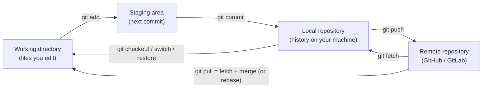
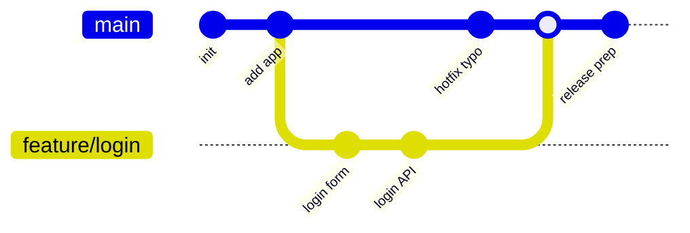
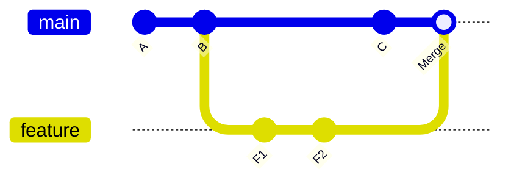
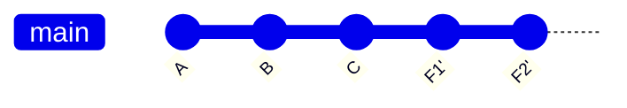
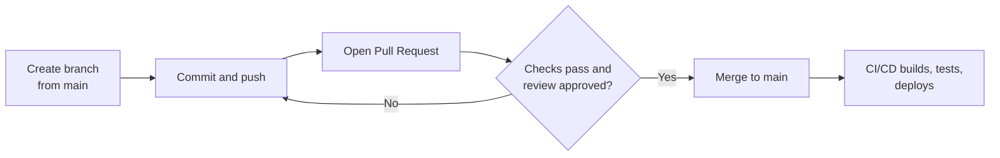
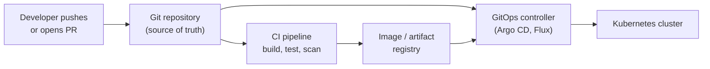

# Git and Version Control for DevOps — Branching, Merge vs Rebase, Undoing Mistakes, and Team Workflows

Git is the foundation of every modern DevOps workflow. Your code, Dockerfiles, Terraform files, Kubernetes manifests, and pipeline definitions all live in Git, and a push to Git is what **triggers** builds and deployments. Interviewers expect you to know Git beyond `add`, `commit`, and `push`: how branches really work, when to merge or rebase, and how to recover from mistakes without panic.

---

## 1. The Mental Model

Git tracks **snapshots** of your project, not line-by-line differences. Every file lives in one of three local areas, plus the remote.



**Key ideas:**

- A **commit** is a snapshot with a unique hash (for example `a1b2c3d`), a message, an author, and a pointer to its parent commit(s).
- A **branch** is just a movable **pointer to a commit**. Creating a branch is instant and cheap, which is why Git encourages lots of small branches.
- **`HEAD`** points to the branch (or commit) you currently have checked out.
- A **tag** is a fixed pointer to a commit, used for releases (`v1.4.0`).
- **`origin`** is the default name of the remote repository.

---

## 2. Everyday Commands

| Task | Command |
|---|---|
| Get a repo | `git clone <url>` |
| See state | `git status`, `git log --oneline --graph --decorate --all` |
| See changes | `git diff` (unstaged), `git diff --staged` (staged) |
| Stage | `git add file`, `git add -p` (choose parts interactively) |
| Commit | `git commit -m "feat: add login endpoint"` |
| New branch and switch | `git switch -c feature/login` |
| Switch branch | `git switch main` |
| Download remote changes (safe) | `git fetch` |
| Update current branch | `git pull --rebase` (or `git pull`) |
| Upload | `git push -u origin feature/login` |
| Temporarily shelve work | `git stash`, `git stash pop` |
| Name a release | `git tag -a v1.4.0 -m "Release 1.4.0"` then `git push origin v1.4.0` |

**`fetch` vs `pull`:** `fetch` only downloads remote changes and changes nothing in your files. `pull` is `fetch` plus a merge or rebase into your current branch. When unsure, `fetch` first and look.

**Good commit hygiene:** small, focused commits; a message that explains **why**, not only what; never commit secrets, build output, or large binaries (use `.gitignore`).

---

## 3. Branching



Branches let several people work in parallel without disturbing `main`. The usual flow: branch from `main`, commit, push, open a pull request, get review and passing checks, merge, delete the branch.

---

## 4. Merge vs Rebase vs Squash

All three combine work from one branch into another. They differ in the **history** they leave.

### Merge

Creates a **merge commit** with two parents, preserving the real branching history.



### Rebase

**Replays** your branch's commits on top of the target branch, producing a **linear** history (the commits get new hashes).



### Squash merge

Combines **all commits of the branch into one** commit on the target branch.

### Comparison

| | Merge | Rebase | Squash merge |
|---|---|---|---|
| History | Preserves branch structure, adds a merge commit | Linear, rewrites your commits | One clean commit per feature |
| Rewrites history? | No | **Yes** (new hashes) | Only on the target (your branch is discarded) |
| Safe on shared branches? | Yes | **No** (do not rebase commits others already pulled) | Yes |
| Best for | Integrating long-lived branches, keeping true history | Updating your **own** feature branch with latest `main` | Keeping `main` tidy, one commit per PR |

> **The golden rule of rebasing:** never rebase commits that exist on a shared remote branch and that others may have based work on. Rebase **your own local or feature branch**, then push with `git push --force-with-lease` (safer than `--force`, because it refuses to overwrite commits you haven't seen).

**Typical healthy flow:**

```bash
git switch feature/login
git fetch origin
git rebase origin/main        # replay my commits on top of the latest main
# fix conflicts if any, then: git rebase --continue
git push --force-with-lease   # only my own branch
# open a PR and squash-merge it into main
```

---

## 5. Team Workflows and Branching Strategies



| Strategy | How it works | Pros | Cons | Best for |
|---|---|---|---|---|
| **GitHub Flow** | `main` is always deployable; short-lived feature branches merged by PR | Simple, fits continuous delivery | Needs good automated tests | Most web apps and services |
| **Trunk-based development** | Everyone commits to `main` (or very short branches under a day or two); unfinished work hidden behind **feature flags** | Fewest merge conflicts, fastest delivery, matches CI/CD ideals | Needs strong tests and discipline with flags | High-performing teams |
| **GitFlow** | Long-lived `develop` and `main`, plus `release/*` and `hotfix/*` branches | Structured releases, parallel versions | Heavy, slow, big merges | Versioned products with scheduled releases (mobile, packaged software) |

**What DevOps teams usually choose:** GitHub Flow or trunk-based development, because short-lived branches pair naturally with continuous integration.

### Making Pull Requests Safe

- **Protected branches:** require pull requests, passing status checks (CI), and at least one approval before merging to `main`; block force pushes.
- **CODEOWNERS:** automatically request review from the right team (for example the platform team for `terraform/`).
- **Small PRs:** easier to review and less risky.
- **Conventional Commits** (`feat:`, `fix:`, `chore:`, `BREAKING CHANGE:`) make history readable and let tools generate changelogs and **semantic version** numbers automatically (MAJOR.MINOR.PATCH).

---

## 6. Undoing Things (Without Panic)

| Situation | Command | Notes |
|---|---|---|
| Discard unstaged edits to a file | `git restore file` | Cannot be undone |
| Unstage a file | `git restore --staged file` | Keeps your edits |
| Fix the last commit message or add a forgotten file | `git commit --amend` | Rewrites that commit; only before pushing |
| Undo last commit, keep changes **staged** | `git reset --soft HEAD~1` | |
| Undo last commit, keep changes **unstaged** | `git reset --mixed HEAD~1` (default) | |
| Undo last commit, **throw changes away** | `git reset --hard HEAD~1` | Destructive |
| Undo a commit **already pushed** to a shared branch | `git revert <sha>` | Adds a new commit that reverses it; history stays intact |
| Undo a merge commit | `git revert -m 1 <merge-sha>` | `-m 1` keeps the first parent (usually `main`) |
| Copy one commit onto another branch | `git cherry-pick <sha>` | Useful for hotfixes |
| Lost commits after a bad reset or rebase | `git reflog` then `git reset --hard <sha>` | The reflog records where `HEAD` has been, for weeks |

**`reset` vs `revert`:** `reset` **moves the branch pointer backwards** (rewrites history, fine for local work). `revert` **adds a new commit** that undoes an old one (safe for shared history). Rule of thumb: local mistakes use `reset`; anything already pushed to a shared branch uses `revert`.

### "I committed to the wrong branch"

```bash
git switch -c correct-branch      # new branch at the current commit (keeps the work)
git switch wrong-branch
git reset --hard HEAD~1           # remove the commit from the wrong branch (if not pushed)
```

### "I pushed a secret (password, API key, token)"

Treat the secret as **compromised the moment it was pushed**, even if you delete it quickly (bots scan public repos within minutes, and the data remains in history and forks).

1. **Revoke and rotate the secret immediately.** This is the only step that actually fixes the security problem.
2. Remove it from history with `git filter-repo` (or BFG Repo-Cleaner), then force-push, and ask everyone to re-clone.
3. Check logs for any use of the leaked credential.
4. Prevent it next time: `.gitignore` for env files, pre-commit secret scanning (gitleaks), and platform secret scanning with push protection.

---

## 7. Resolving Merge Conflicts

A conflict happens when two branches change the same lines. Git marks the file:

```text
<<<<<<< HEAD
timeout = 30
=======
timeout = 60
>>>>>>> feature/login
```

**Steps:** open the file, decide the correct final content, delete the markers, `git add file`, then `git merge --continue` (or `git rebase --continue`). Use `git merge --abort` or `git rebase --abort` to back out. Smaller, more frequent merges and short-lived branches are the best way to avoid painful conflicts.

---

## 8. Useful Advanced Tools

| Tool | What it does |
|---|---|
| `git rebase -i HEAD~4` | Interactively reorder, squash, edit, or drop recent commits before sharing |
| `git bisect` | Binary search for the commit that introduced a bug (`git bisect start`, `bad`, `good`, or `git bisect run ./test.sh`) |
| `git stash -u` | Shelve changes including untracked files |
| `git worktree add ../hotfix main` | Check out another branch in a separate folder without stashing |
| `git blame file` / `git log -S "text"` | Find who changed a line, or when a string was added or removed |
| `git clone --depth 1` | **Shallow clone** (latest snapshot only) for fast CI checkouts |
| **Hooks** (`pre-commit`, `pre-push`) | Run linters, tests, or secret scanners before a commit or push (the `pre-commit` framework manages them) |
| **Git LFS** | Stores large binary files outside the normal repository |
| **Signed commits** | Cryptographically prove who authored a commit (GPG or SSH signing) |
| **Submodules** | Embed another repository at a fixed commit (powerful but easy to misuse) |

### Monorepo vs Polyrepo

| | Monorepo | Polyrepo |
|---|---|---|
| Layout | Many projects in one repository | One repository per service |
| Pros | Atomic cross-project changes, shared tooling, easy refactors | Clear ownership, independent access and pipelines |
| Cons | Needs tooling for large scale; CI must build only what changed | Harder cross-repo changes, duplicated setup |

---

## 9. Git in DevOps: Where It Fits



- **CI/CD is triggered by Git events:** push, pull request, tag. Details in [CI/CD Pipelines](devops/ci-cd-pipelines).
- **Tags mark releases,** and the tag name becomes the artifact version.
- **GitOps** treats Git as the single source of truth for infrastructure and deployments: you change a manifest through a pull request, and a controller applies it to the cluster. This gives audit history, review, and one-click rollback with `git revert`. See the Argo CD section of the [Kubernetes Production Guide](devops/k8s/kubernetes-production-guide).
- **Infrastructure code goes through PRs too:** a `terraform plan` on every pull request, `apply` after merge. See [Terraform and Infrastructure as Code](devops/terraform-and-iac).
- Working with several GitHub accounts on one machine (personal and work)? See [How to Manage Multiple GitHub Accounts](config/how-to-manage-multiple-github-accounts).

---

## 10. Interview Questions

**Q: What is the difference between `git fetch` and `git pull`?**
`fetch` downloads remote changes without touching your working files; `pull` is `fetch` followed by a merge (or rebase) into the current branch.

**Q: Merge or rebase?**
Merge preserves true history and is safe on shared branches. Rebase gives a linear history but rewrites commits, so use it only on your own unpublished or feature branches. Many teams rebase their branch onto `main` and then squash-merge the PR.

**Q: What is the difference between `git reset` and `git revert`?**
`reset` moves the branch pointer back and rewrites history, suited to local changes. `revert` creates a new commit that undoes an earlier one, suited to commits already pushed to a shared branch.

**Q: You accidentally ran `git reset --hard` and lost commits. What do you do?**
Use `git reflog` to find the commit hash `HEAD` previously pointed to, then `git reset --hard <hash>` (or create a branch from it).

**Q: What is a detached HEAD?**
`HEAD` points directly to a commit instead of a branch (for example after checking out a tag). New commits there aren't on any branch and can be lost unless you create a branch (`git switch -c name`).

**Q: What does `--force-with-lease` do?**
It force-pushes only if the remote branch is still where you last saw it, so you don't overwrite someone else's new commits.

**Q: Explain GitFlow vs trunk-based development.**
GitFlow uses long-lived `develop`, `release`, and `hotfix` branches for scheduled releases. Trunk-based uses very short-lived branches or direct commits to `main` with feature flags, matching continuous delivery.

**Q: A secret was committed and pushed. What do you do?**
Revoke and rotate it immediately, then remove it from history with `git filter-repo` and force-push, check access logs, and add secret scanning to prevent a repeat.

**Q: How do you find which commit introduced a bug?**
`git bisect`: mark a known good and a known bad commit, and Git binary-searches; with `git bisect run <test>` it can automate the search.

**Q: How would you keep `main` always deployable?**
Protect the branch, require passing CI and reviews, keep PRs small, use feature flags for incomplete work, and automate tests and deploys.

---

## 11. Quick Reference

```bash
git switch -c feature/x          # new branch
git add -p && git commit -m "feat: ..."
git fetch && git rebase origin/main
git push -u origin feature/x     # first push
git push --force-with-lease      # after rebasing your own branch
git restore --staged file        # unstage
git reset --soft HEAD~1          # undo commit, keep changes staged
git revert <sha>                 # safe undo on shared history
git reflog                       # find lost commits
git cherry-pick <sha>            # copy one commit
git stash && git stash pop       # shelve and restore work
git log --oneline --graph --all  # see the shape of history
```

## Continue Learning

- [CI/CD Pipelines](devops/ci-cd-pipelines) — how Git events trigger builds and deployments.
- [Terraform and Infrastructure as Code](devops/terraform-and-iac) — infrastructure changes through pull requests.
- [Introduction to DevOps](devops/introduction-to-devops) — the full DevOps roadmap.
- [Docker Full Tutorial](devops/docker/docker-full-tutorial) — packaging what you commit.
