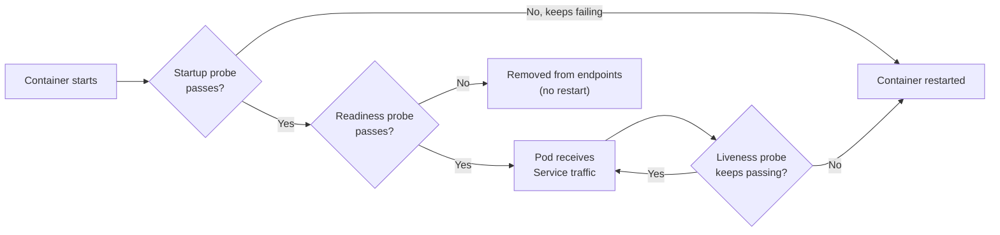
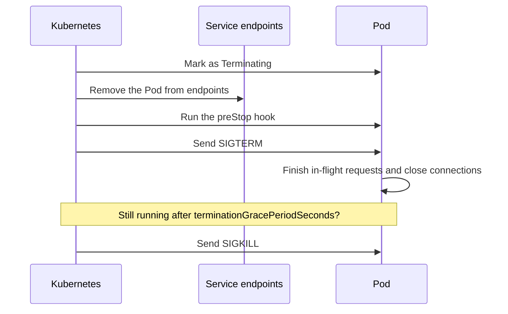
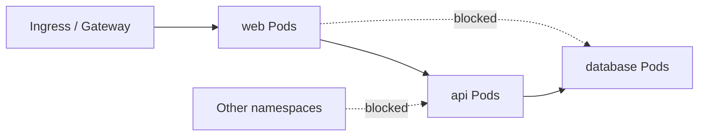
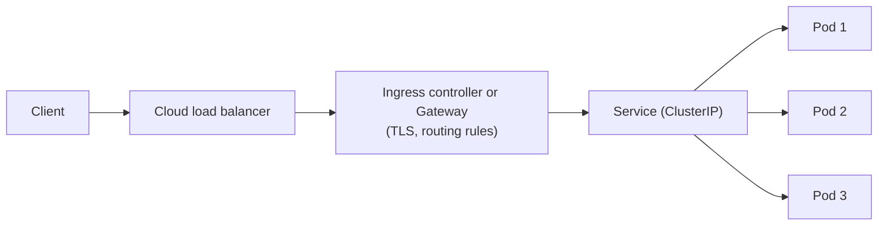
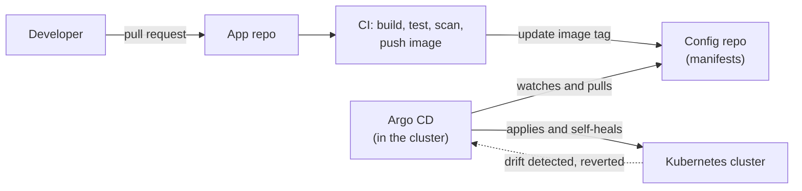
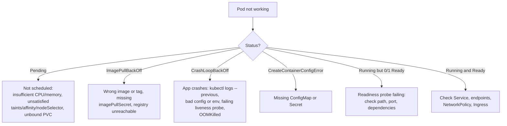

# Kubernetes Production Guide — Probes, Resources, Rollouts, Security, Gateway API, GitOps, and Troubleshooting

The [Kubernetes Full Tutorial](devops/k8s/kubernetes-full-tutorial) teaches the building blocks: Pods, Deployments, Services, storage, and Helm. This guide covers what separates a demo cluster from a **production** one: workloads that start safely, restart only when they should, deploy without downtime, survive node failures, stay secure, and can be debugged quickly at 3 a.m. These are also the topics that DevOps interviews probe hardest.

---

## 1. A Production-Ready Workload Checklist

| Area | What to have |
|---|---|
| **Resources** | CPU and memory **requests** on every container; memory limits |
| **Health** | **Readiness**, **liveness**, and (for slow starters) **startup** probes |
| **Rollouts** | Rolling update with `maxUnavailable: 0`, graceful shutdown, tested rollback |
| **Availability** | 2+ replicas, spread across nodes/zones, a **PodDisruptionBudget** |
| **Scaling** | HorizontalPodAutoscaler (and node autoscaling) |
| **Security** | Non-root, read-only filesystem, dropped capabilities, **NetworkPolicy**, least-privilege RBAC |
| **Config** | Config in ConfigMaps, secrets from a proper secret store |
| **Delivery** | Versioned image tags (never `latest`), GitOps or a controlled pipeline |
| **Observability** | Metrics, logs, alerts, dashboards (see [Monitoring and Logging](devops/monitoring-and-logging)) |

### A Deployment That Ticks These Boxes

```yaml
apiVersion: apps/v1
kind: Deployment
metadata:
  name: web
spec:
  replicas: 3
  revisionHistoryLimit: 5
  strategy:
    type: RollingUpdate
    rollingUpdate:
      maxSurge: 1
      maxUnavailable: 0            # never reduce capacity during a rollout
  selector:
    matchLabels:
      app: web
  template:
    metadata:
      labels:
        app: web
    spec:
      terminationGracePeriodSeconds: 30
      securityContext:
        runAsNonRoot: true
        seccompProfile:
          type: RuntimeDefault
      containers:
        - name: web
          image: myrepo/web:1.4.0   # pinned version, never :latest
          ports:
            - containerPort: 8080
          resources:
            requests:
              cpu: 250m
              memory: 256Mi
            limits:
              memory: 256Mi
          startupProbe:
            httpGet: { path: /healthz, port: 8080 }
            periodSeconds: 2
            failureThreshold: 30     # up to 60 s to start
          readinessProbe:
            httpGet: { path: /ready, port: 8080 }
            periodSeconds: 5
            failureThreshold: 3
          livenessProbe:
            httpGet: { path: /healthz, port: 8080 }
            periodSeconds: 10
            failureThreshold: 3
          lifecycle:
            preStop:
              exec:
                command: ["sh", "-c", "sleep 5"]   # let load balancers drain first
          securityContext:
            allowPrivilegeEscalation: false
            readOnlyRootFilesystem: true
            capabilities:
              drop: ["ALL"]
```

---

## 2. Resource Requests, Limits, and QoS

| Setting | Purpose | What happens when exceeded |
|---|---|---|
| **Request** | What the container is **guaranteed**; the scheduler uses it to **place** the Pod on a node | n/a |
| **CPU limit** | Maximum CPU | The container is **throttled** (slowed), not killed |
| **Memory limit** | Maximum memory | The container is **OOMKilled** (exit code 137) |

**Quality of Service classes** (assigned automatically) decide who gets evicted first when a node runs out of resources:

| QoS class | When | Eviction order |
|---|---|---|
| **Guaranteed** | Every container has requests **equal** to limits for CPU and memory | Last |
| **Burstable** | At least one request or limit set, but not equal | Middle |
| **BestEffort** | No requests or limits at all | **First** (avoid in production) |

**Practical guidance:**

- Always set **requests**; without them the scheduler is guessing and **HPA percentages have no meaning**.
- Set **memory limit = memory request** (memory is not compressible: overuse means a kill).
- CPU limits can cause surprising throttling and latency; many teams set CPU **requests** and either omit CPU limits or set them generously.
- Measure real usage (`kubectl top pods`, Prometheus) and tune; the **Vertical Pod Autoscaler** can recommend values.
- Use **LimitRange** (defaults per namespace) and **ResourceQuota** (caps per namespace/team) so one team cannot consume the cluster.

---

## 3. Health Probes

Probes let Kubernetes know whether a container is **alive**, **ready for traffic**, and **finished starting**. They are the single most-asked Kubernetes production topic.

| Probe | Question it answers | On failure |
|---|---|---|
| **Startup** | "Has the app finished starting?" | Keeps retrying; liveness and readiness are **disabled until it passes**. If it never passes, the container is restarted. For slow-starting apps |
| **Readiness** | "Can this Pod receive traffic **right now**?" | The Pod is **removed from Service endpoints** (no restart) until it passes again |
| **Liveness** | "Is the process stuck or deadlocked?" | The container is **restarted** |



**Probe types:** `httpGet`, `tcpSocket`, `exec` (run a command), and `grpc`.

### Rules That Prevent Outages

- **Liveness must be cheap and local.** Check only that the process itself works. **Never make liveness depend on the database or another service:** if the database blips, every Pod would restart at once and turn a small problem into an outage.
- **Readiness may check dependencies** the app truly needs (for example it can't serve without its cache), but be careful that a shared dependency failure doesn't remove all Pods simultaneously.
- Use a **startup probe** instead of a huge `initialDelaySeconds` for slow starters.
- Set sensible `periodSeconds`, `timeoutSeconds`, and `failureThreshold`; probes that are too aggressive cause restart loops under load.
- No readiness probe means traffic is sent to Pods that aren't ready, which causes errors during every rollout.

---

## 4. Zero-Downtime Rollouts and Graceful Shutdown

### Rolling Update Strategy

| Setting | Meaning |
|---|---|
| `maxSurge` | How many **extra** Pods may be created above `replicas` during the rollout |
| `maxUnavailable` | How many Pods may be **unavailable** during the rollout |

With `maxSurge: 1` and `maxUnavailable: 0`, Kubernetes starts one new Pod, waits until it is **Ready**, then terminates an old one, so capacity never drops. This depends on a **correct readiness probe**.

```bash
kubectl set image deployment/web web=myrepo/web:1.5.0
kubectl rollout status deployment/web        # watch it progress
kubectl rollout history deployment/web
kubectl rollout undo deployment/web          # roll back to the previous revision
```

### What Happens When a Pod Is Deleted



**The race to know about:** endpoint removal and SIGTERM happen **at about the same time**, and load balancers and proxies need a moment to stop sending traffic. Without care, a Pod can receive new requests after it started shutting down. Fixes:

- A short **`preStop` sleep** (a few seconds) so traffic drains before SIGTERM.
- The application **handles SIGTERM**: stop accepting new connections, finish in-flight work, then exit.
- A `terminationGracePeriodSeconds` longer than your longest request.
- Make sure the container's main process receives signals (use `exec` form for `CMD`, or an init like `tini`; a shell wrapper can swallow SIGTERM).

---

## 5. High Availability of Workloads

| Mechanism | Purpose |
|---|---|
| **2+ replicas** | A single replica means any node failure or update causes downtime |
| **PodDisruptionBudget (PDB)** | Limits **voluntary** disruptions (node drains, upgrades) so a minimum number of Pods always stay up |
| **Topology spread / anti-affinity** | Spread Pods across nodes and zones so one failure doesn't take them all |
| **Multiple AZs** for nodes | Survive an AZ outage |

```yaml
apiVersion: policy/v1
kind: PodDisruptionBudget
metadata:
  name: web-pdb
spec:
  minAvailable: 2               # or: maxUnavailable: 1
  selector:
    matchLabels:
      app: web
```

```yaml
# In the Pod spec: spread replicas evenly across zones
topologySpreadConstraints:
  - maxSkew: 1
    topologyKey: topology.kubernetes.io/zone
    whenUnsatisfiable: ScheduleAnyway
    labelSelector:
      matchLabels:
        app: web
```

A PDB protects only against **voluntary** disruptions (drains, upgrades), not crashes. Be careful not to set it so strict (for example `minAvailable` equal to `replicas`) that **node drains can never complete**.

---

## 6. Autoscaling

| Layer | Tool | Scales |
|---|---|---|
| **Pods (horizontal)** | **HPA** (HorizontalPodAutoscaler) | Number of replicas, on CPU, memory, or custom/external metrics |
| **Pods (vertical)** | **VPA** | Requests and limits (recommendations or automatic) |
| **Nodes** | **Cluster Autoscaler** or **Karpenter** | Number and type of nodes when Pods are Pending |
| **Event-driven** | **KEDA** | Replicas from queue length, Kafka lag, and other event sources (including scale to zero) |

```yaml
apiVersion: autoscaling/v2
kind: HorizontalPodAutoscaler
metadata:
  name: web
spec:
  scaleTargetRef:
    apiVersion: apps/v1
    kind: Deployment
    name: web
  minReplicas: 3
  maxReplicas: 20
  metrics:
    - type: Resource
      resource:
        name: cpu
        target:
          type: Utilization
          averageUtilization: 60
```

**Requirements and pitfalls:** HPA needs **metrics-server** and CPU **requests** on the containers (utilization is a percentage of the request). Don't run HPA and VPA on the same metric. The two autoscaling layers work together: HPA adds Pods, Pods that don't fit become Pending, and the node autoscaler adds nodes. Scaling takes time, so keep headroom for sudden spikes.

---

## 7. Configuration and Secrets

- **ConfigMap** for non-sensitive configuration; mount as files or environment variables. Pods do **not** automatically restart when a ConfigMap changes: use a checksum annotation in Helm, or a tool such as Reloader, to trigger a rollout.
- **Secrets are only base64-encoded**, not encrypted. Anyone who can read the Secret or access etcd can decode them. Production practice:
  - Turn on **encryption at rest** for etcd (or use a managed service that does).
  - Restrict access with **RBAC** (who can `get` secrets).
  - Prefer an external secret manager: **External Secrets Operator** or the **Secrets Store CSI driver** (sync from AWS Secrets Manager, Vault, and similar), or **Sealed Secrets** so encrypted secrets can live in Git.
  - **Never commit plain Secret manifests to Git.**
- Use **immutable** ConfigMaps/Secrets for safer, more efficient updates where practical.

---

## 8. Security

### Pod Security

Apply the **Pod Security Standards** with namespace labels:

```bash
kubectl label namespace prod \
  pod-security.kubernetes.io/enforce=restricted \
  pod-security.kubernetes.io/warn=restricted
```

| Level | Meaning |
|---|---|
| **privileged** | No restrictions |
| **baseline** | Blocks known privilege escalations |
| **restricted** | Hardened: non-root, no privilege escalation, dropped capabilities, seccomp profile |

(The old `PodSecurityPolicy` was **removed**. Use Pod Security Standards plus an admission policy engine such as **Kyverno** or **OPA Gatekeeper** for custom rules like "only images from our registry".)

In each Pod spec set: `runAsNonRoot`, `readOnlyRootFilesystem`, `allowPrivilegeEscalation: false`, `capabilities.drop: [ALL]`, and avoid `privileged`, `hostPath`, `hostNetwork`.

### RBAC: Least Privilege

- Prefer **Role + RoleBinding** (namespaced) over **ClusterRole + ClusterRoleBinding**.
- Give each application its **own ServiceAccount** with only the permissions it needs, and set `automountServiceAccountToken: false` when it doesn't call the API.
- Avoid `cluster-admin` and wildcard rules. Check with `kubectl auth can-i list secrets --as=system:serviceaccount:prod:web`.

### NetworkPolicy: Segmenting Traffic

By default **every Pod can talk to every other Pod**. NetworkPolicies add a firewall. Start with **deny all**, then allow only what is needed.

```yaml
apiVersion: networking.k8s.io/v1
kind: NetworkPolicy
metadata:
  name: default-deny-all
  namespace: prod
spec:
  podSelector: {}               # applies to every Pod in the namespace
  policyTypes: [Ingress, Egress]
---
apiVersion: networking.k8s.io/v1
kind: NetworkPolicy
metadata:
  name: allow-web-to-api
  namespace: prod
spec:
  podSelector:
    matchLabels:
      app: api
  policyTypes: [Ingress]
  ingress:
    - from:
        - podSelector:
            matchLabels:
              app: web
      ports:
        - protocol: TCP
          port: 8080
```



**Important details:**

- NetworkPolicies are enforced only if the **CNI plugin supports them** (Calico, Cilium do; plain Flannel does not).
- A default-deny **egress** policy also blocks **DNS**, so add a rule allowing traffic to CoreDNS (port 53) or everything will appear broken.

### Supply Chain

Use **trusted base images**, scan in CI (Trivy), **sign images** (cosign) and verify them at admission, pin by digest, and keep images updated. See [CI/CD Pipelines](devops/ci-cd-pipelines).

---

## 9. Getting Traffic In: Services, Ingress, and the Gateway API



| Resource | Purpose |
|---|---|
| **Service** | Stable virtual IP and DNS name that load-balances across matching, **ready** Pods (`ClusterIP`, `NodePort`, `LoadBalancer`) |
| **Ingress** | HTTP(S) routing rules (host/path to Service) implemented by an **Ingress controller** |
| **Gateway API** | The newer, more expressive and role-oriented successor: `GatewayClass`, `Gateway`, `HTTPRoute` |

> **Important change (2026):** the community **`ingress-nginx`** controller was **retired in March 2026**: no further releases, bug fixes, or security patches. Existing installations keep running but are an accumulating risk. The Ingress API itself still works, but it is frozen, and the direction of the ecosystem is the **Gateway API**. For new clusters choose a maintained Ingress controller (Traefik, HAProxy, an Envoy-based controller, or your cloud's load balancer controller) or, better, a **Gateway API** implementation, and plan a migration for old ingress-nginx setups.

```yaml
# Gateway API: a route attached to a shared Gateway
apiVersion: gateway.networking.k8s.io/v1
kind: HTTPRoute
metadata:
  name: web
spec:
  parentRefs:
    - name: public-gateway
  hostnames: ["app.example.com"]
  rules:
    - matches:
        - path:
            type: PathPrefix
            value: /
      backendRefs:
        - name: web
          port: 80
```

**TLS:** use **cert-manager** to obtain and renew certificates automatically (for example from Let's Encrypt).

---

## 10. Packaging and Delivery: Helm, Kustomize, and GitOps

| Tool | Approach | Best for |
|---|---|---|
| **Helm** | Templated, versioned **charts** with `values.yaml`; releases and rollbacks | Installing third-party software; parameterized packages |
| **Kustomize** | Plain YAML **base + overlays** (patches per environment), built into `kubectl` | Environment differences without templating |

```bash
helm upgrade --install web ./chart -n prod -f values-prod.yaml --atomic --wait   # roll back automatically if it fails
helm history web -n prod
helm rollback web 3 -n prod
kubectl kustomize overlays/prod | kubectl apply -f -
```

### GitOps with Argo CD

**GitOps:** Git is the **single source of truth** for what runs in the cluster. A controller inside the cluster continuously compares Git with reality and **reconciles** any difference.



```yaml
apiVersion: argoproj.io/v1alpha1
kind: Application
metadata:
  name: web
  namespace: argocd
spec:
  project: default
  source:
    repoURL: https://github.com/my-org/deploy-manifests.git
    targetRevision: main
    path: apps/web/overlays/prod
  destination:
    server: https://kubernetes.default.svc
    namespace: prod
  syncPolicy:
    automated:
      prune: true        # delete resources removed from Git
      selfHeal: true     # revert manual changes in the cluster
    syncOptions:
      - CreateNamespace=true
```

**Benefits:** full audit trail, deployments through pull requests, **rollback with `git revert`**, drift correction, and cluster credentials that stay inside the cluster. For progressive delivery (canary, blue-green with metric analysis) add **Argo Rollouts** or **Flagger**. Compare with push-based pipelines in [CI/CD Pipelines](devops/ci-cd-pipelines).

---

## 11. Cluster Operations

### Upgrades

- Kubernetes releases a minor version about every four months, and only the **most recent three** are supported, so plan to upgrade **at least yearly**. Upgrade **one minor version at a time**, and read the release notes for removed APIs first (tools like `kubent` or `pluto` find deprecated manifests).
- Order: **control plane first, then nodes** (the kubelet may lag the API server within the documented version-skew limit, but never be newer).
- For each node: **cordon** (stop scheduling), **drain** (evict Pods respecting PDBs), upgrade, **uncordon**.

```bash
kubectl cordon node-1
kubectl drain node-1 --ignore-daemonsets --delete-emptydir-data
# upgrade the node (kubeadm upgrade node, kubelet restart, or replace the node)
kubectl uncordon node-1
```

Managed services (EKS, GKE, AKS) upgrade the control plane for you; you still upgrade node groups, add-ons, and test your workloads. Prefer **replacing nodes** with new ones (immutable) over patching in place.

### Backups

- **etcd snapshot** (self-managed control planes):

```bash
ETCDCTL_API=3 etcdctl snapshot save /backup/etcd-$(date +%F).db \
  --endpoints=https://127.0.0.1:2379 \
  --cacert=/etc/kubernetes/pki/etcd/ca.crt \
  --cert=/etc/kubernetes/pki/etcd/server.crt \
  --key=/etc/kubernetes/pki/etcd/server.key
```

- **Velero** backs up Kubernetes objects and persistent volumes, useful for cluster migration and disaster recovery.
- With GitOps, cluster **configuration** is already in Git; what still needs backups is **data** (volumes, databases). **Test restores.**
- Watch **certificate expiry** on self-managed clusters (`kubeadm certs check-expiration`).

### Multi-Tenancy and Hygiene

Use **namespaces** per team/environment, **ResourceQuotas**, **RBAC** per namespace, **labels** (`app`, `team`, `env`) everywhere, and cost allocation by label.

---

## 12. Troubleshooting Playbook

**Always start with the same three commands:**

```bash
kubectl get pods -o wide                         # status, restarts, which node
kubectl describe pod <pod>                       # EVENTS at the bottom explain most problems
kubectl logs <pod> [-c container] [--previous]   # --previous = the crashed instance's logs
```



### Symptom Reference

| Symptom | Likely causes | How to confirm and fix |
|---|---|---|
| **Pending** | Not enough resources; node taints or affinity rules not matched; PVC not bound; quota exceeded | `describe pod` events (`0/3 nodes are available: ...`); `kubectl get pvc`; add capacity or fix requests/selectors |
| **ImagePullBackOff / ErrImagePull** | Typo in image/tag; private registry without credentials; rate limits; no network to the registry | `describe pod`; create/attach `imagePullSecrets`; verify the tag exists |
| **CrashLoopBackOff** | App exits on start (bad config, missing env var, cannot reach a dependency); liveness probe killing a slow app; OOM | `logs --previous`; check env/ConfigMaps; relax probes; look at `Last State` |
| **OOMKilled (exit code 137)** | Memory limit too low or a leak | `describe pod` shows `Reason: OOMKilled`; raise the limit or fix the leak; watch memory metrics |
| **CreateContainerConfigError** | Referenced ConfigMap/Secret/key doesn't exist | `describe pod`; create the missing object |
| **Evicted** | Node under disk or memory pressure | `describe pod`, `describe node`; set requests/limits, free space |
| **Running but not Ready** | Readiness probe failing | Check probe path/port from inside (`kubectl exec`), dependency health |
| **Service unreachable / no endpoints** | Selector doesn't match Pod labels; Pods not Ready; wrong `targetPort` | `kubectl get endpoints <svc>` (empty list = no matching ready Pods); compare labels |
| **DNS failures** | CoreDNS down; egress NetworkPolicy blocks DNS | `kubectl run -it --rm dbg --image=busybox -- nslookup kubernetes.default`; check CoreDNS Pods and logs |
| **Ingress 404/502/503** | Wrong host/path, wrong Service port, no ready endpoints, wrong ingress class or Gateway, TLS misconfig | Check Ingress/HTTPRoute, controller logs, and `kubectl get endpoints` |
| **Node NotReady** | kubelet stopped; disk/memory pressure; network or CNI problem | `kubectl describe node`; on the node: `systemctl status kubelet`, `journalctl -u kubelet` |
| **Rollout stuck** | New Pods fail readiness; quota/capacity; image problem | `kubectl rollout status`, `describe` the new ReplicaSet's Pods; `rollout undo` |

### More Debugging Tools

```bash
kubectl get events --sort-by=.lastTimestamp -A      # recent cluster events
kubectl exec -it <pod> -- sh                        # a shell inside (if the image has one)
kubectl debug -it <pod> --image=busybox --target=<container>   # ephemeral debug container (for distroless images)
kubectl port-forward svc/web 8080:80                # test a Service locally
kubectl top pods / kubectl top nodes                # needs metrics-server
kubectl auth can-i create deployments --as=<user>   # RBAC check
kubectl get pod <pod> -o yaml                       # the full spec and status
```

---

## 13. Interview Questions

**Q: What is the difference between liveness, readiness, and startup probes?**
Liveness restarts a stuck container, readiness removes a Pod from Service traffic without restarting it, and startup gives slow-starting apps time before the other probes begin.

**Q: Why shouldn't a liveness probe check the database?**
If the database has a brief problem, every Pod fails liveness and is restarted simultaneously, turning a small issue into a full outage. Liveness should check only the process itself.

**Q: What is the difference between requests and limits?**
Requests are what the scheduler reserves and guarantees; limits are the cap. Exceeding the CPU limit throttles, exceeding the memory limit gets the container OOMKilled.

**Q: How do you achieve zero-downtime deployments?**
Rolling updates with `maxUnavailable: 0`, a correct readiness probe, graceful shutdown (SIGTERM handling plus a `preStop` delay), enough replicas, and a PodDisruptionBudget.

**Q: What does a PodDisruptionBudget do?**
Limits how many Pods of an application can be voluntarily disrupted (drains, upgrades) at once, so a minimum number stay available. It doesn't protect against crashes.

**Q: A Pod is in CrashLoopBackOff. What do you do?**
`kubectl logs --previous` and `describe pod` for the exit code and events; check config and environment, dependencies, memory (exit 137), and whether the liveness probe is killing a slow start.

**Q: A Pod is Pending. Why?**
The scheduler can't place it: insufficient resources, unsatisfied taints, affinity or nodeSelector, an unbound PVC, or quota limits. `describe pod` shows the reason.

**Q: How do you secure a cluster's network?**
Default-deny NetworkPolicies with explicit allows (on a CNI that enforces them, remembering to allow DNS), mTLS or a service mesh if needed, and private nodes and API endpoints.

**Q: Are Kubernetes Secrets secure?**
By default they are only base64-encoded. Enable encryption at rest, restrict RBAC, avoid committing them to Git, and preferably sync from an external secrets manager.

**Q: Ingress vs Gateway API?**
Ingress is a simple HTTP routing resource implemented by controllers (and the popular ingress-nginx controller was retired in 2026). Gateway API is the more expressive, role-oriented successor and the recommended direction for new setups.

**Q: What is GitOps and why use it?**
Git holds the desired state and an in-cluster controller (Argo CD, Flux) reconciles the cluster to it, giving audit history, review via pull requests, drift correction, easy rollback, and no cluster credentials in CI.

**Q: How do you upgrade a cluster safely?**
One minor version at a time, after checking deprecated APIs; control plane first, then nodes via cordon, drain (respecting PDBs), upgrade or replace, uncordon; test in a non-production cluster first and have backups.

**Q: How do you back up a Kubernetes cluster?**
etcd snapshots for self-managed control planes, Velero for objects and volumes, manifests in Git, and database-level backups, with regular restore tests.

**Q: HPA isn't scaling. What do you check?**
That metrics-server works (`kubectl top pods`), the Pods have CPU requests, the HPA targets the right Deployment and metric, `kubectl describe hpa` for conditions, and whether max replicas or node capacity is the limit.

---

## Hands-On Exercise

1. On a Kind or Minikube cluster, deploy the manifest above and break the readiness probe path; watch the Pod stay `0/1 Ready` while the Service has **no endpoints**.
2. Deploy a new version with `maxUnavailable: 0` while running a load generator; confirm no failed requests.
3. Set a tiny memory limit and observe `OOMKilled`.
4. Add default-deny NetworkPolicies (on a cluster using Calico or Cilium) and allow only web to api.
5. Install Argo CD, point it at a Git repo of manifests, change the image tag in Git, and watch it sync; then edit something by hand and watch it self-heal.
6. Cordon and drain a node with a PodDisruptionBudget in place.

## Continue Learning

- [Kubernetes Full Tutorial](devops/k8s/kubernetes-full-tutorial) — the fundamentals this guide builds on.
- [Kubernetes Interview Questions](devops/k8s/kubernetes-interview-questions) — more practice questions.
- [CI/CD Pipelines](devops/ci-cd-pipelines) — delivering to the cluster safely.
- [Monitoring and Logging](devops/monitoring-and-logging) — metrics and alerts for your workloads.
- [AWS Hands-On](devops/aws-hands-on) — running Kubernetes on EKS.
