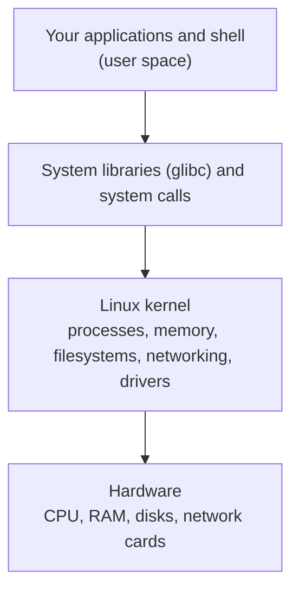
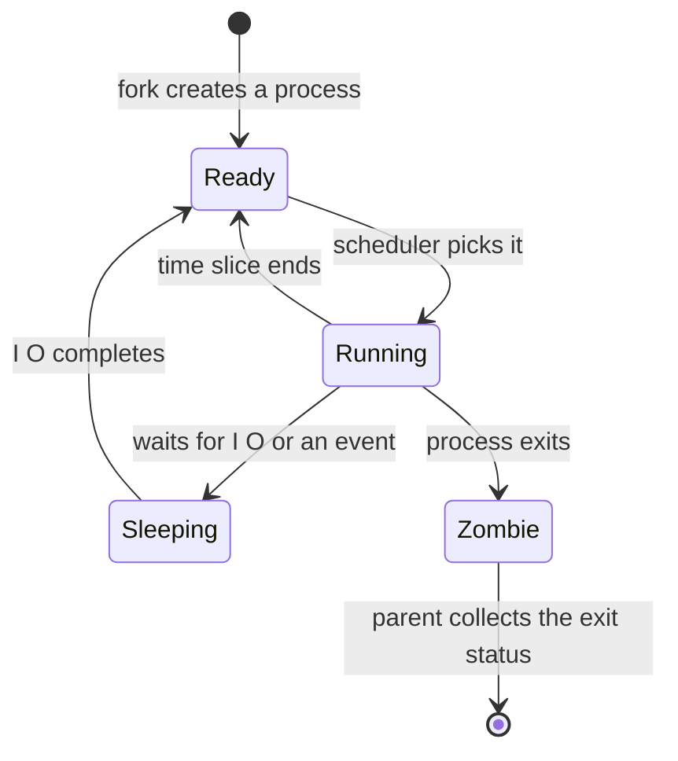
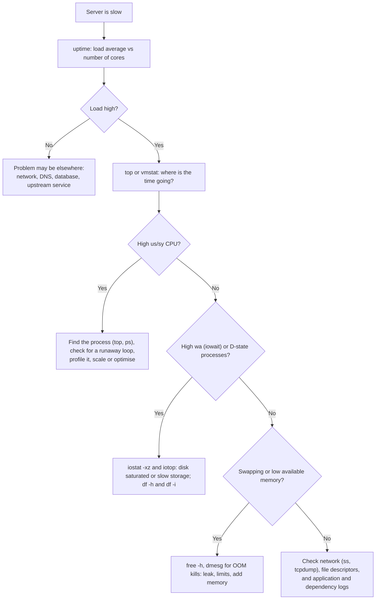

# Linux for DevOps — Permissions, Processes, systemd, Networking, Performance Troubleshooting, and Playbooks

Almost every server, container, and Kubernetes node you will touch runs Linux. DevOps and SRE interviews test two things: whether you know the **everyday tools**, and whether you can **diagnose a misbehaving system calmly and systematically**. This guide covers both, with the commands and the reasoning.

For the theory behind processes, memory, and scheduling, see the Operating Systems handbook. For scripting, see [Shell Scripting for DevOps](devops/shell-scripting-for-devops).

---

## 1. How Linux Is Organized



### Directory Layout (Filesystem Hierarchy)

| Path | Contents |
|---|---|
| `/etc` | System-wide **configuration** (`/etc/ssh/sshd_config`, `/etc/hosts`) |
| `/var/log` | **Logs** (`syslog`, `auth.log`, `nginx/`) |
| `/var/lib` | Application state (databases, package data) |
| `/home` | User home directories |
| `/usr`, `/bin`, `/sbin`, `/lib` | Programs and libraries |
| `/opt` | Optional/third-party software |
| `/tmp` | Temporary files (cleared on reboot, world-writable) |
| `/proc`, `/sys` | **Virtual** filesystems exposing kernel and process information (`/proc/cpuinfo`, `/proc/<pid>/`) |
| `/dev` | Device files |

**Everything is a file:** devices, processes (via `/proc`), and even network sockets are accessed through file-like interfaces, which is why tools like `lsof` are so useful.

---

## 2. Users, Groups, and Permissions

```bash
ls -l /opt/myapp/server
# -rwxr-x---  1  appuser  appgroup  2048  Oct 17 10:00  server
#  │└┬┘└┬┘└┬┘      │          │
#  │ │  │  └ others: --- (no access)
#  │ │  └ group:  r-x (read, execute)
#  │ └ owner:   rwx (read, write, execute)
#  └ file type (- file, d directory, l symlink)
```

| Permission | On a file | On a directory |
|---|---|---|
| `r` (4) | Read content | List names |
| `w` (2) | Modify content | Create/delete/rename entries inside |
| `x` (1) | Execute | **Enter** (cd into) and access items |

**Octal:** `rwx`=7, `r-x`=5, `r--`=4. So `chmod 750 file` means owner `rwx`, group `r-x`, others none.

| Task | Command |
|---|---|
| Change permissions | `chmod 640 file`, `chmod u+x script.sh`, `chmod -R g+rX dir` |
| Change owner and group | `chown appuser:appgroup file` (`-R` for recursive) |
| Default permissions for new files | `umask` (commonly `022`, giving 644 files and 755 directories) |
| Special bits | **SUID** (`u+s`: run as the file's owner), **SGID** (`g+s`: inherit group on directories), **sticky bit** (`+t` on `/tmp`: only the owner can delete their files) |
| Users and groups | `useradd -m -s /bin/bash alice`, `usermod -aG docker alice`, `passwd alice`, `id alice` |

**sudo:** run commands as root without logging in as root. Edit rules only with `visudo` (it validates syntax). Prefer `sudo` for specific tasks and **avoid logging in as root**, and never run applications as root without a reason.

**Least privilege for services:** run each service as its **own unprivileged user**, own only its directories, and keep secrets in files readable only by that user (`chmod 600`).

---

## 3. Processes and Signals

```bash
ps aux                       # all processes
ps -ef --forest              # tree view (parent/child)
top                          # live view; press M (sort by memory), P (CPU), 1 (per-core)
htop                         # friendlier top (if installed)
pgrep -a nginx               # find by name
```

### Process States



| State (`ps` code) | Meaning | Note |
|---|---|---|
| `R` | Running or runnable | |
| `S` | Interruptible sleep | Normal for idle services |
| `D` | **Uninterruptible sleep** (usually waiting on disk or NFS) | Cannot be killed; many `D` processes means an I/O problem, and they **count toward load average** |
| `Z` | **Zombie**: finished, but the parent hasn't collected its exit status | Harmless unless there are thousands; fix the parent |
| `T` | Stopped | |

### Signals

| Signal | Number | Meaning |
|---|---|---|
| `SIGTERM` | 15 | **Polite request to terminate**: lets the program clean up. The default for `kill` |
| `SIGKILL` | 9 | Forced kill; cannot be caught. **Last resort** (no cleanup) |
| `SIGHUP` | 1 | Often "reload your configuration" |
| `SIGINT` | 2 | Ctrl+C |
| `SIGSTOP` / `SIGCONT` | 19 / 18 | Pause / resume |

```bash
kill 1234            # SIGTERM first
kill -9 1234         # only if it ignores SIGTERM
pkill -f "my-script" # by pattern
nice -n 10 ./batch   # lower priority; renice to change a running one
nohup ./job.sh &     # keep running after logout (or use tmux / screen)
```

Containers: when Kubernetes or Docker stops a container, it sends **SIGTERM** (then SIGKILL after a grace period), so applications must handle SIGTERM to shut down gracefully.

---

## 4. systemd: Services, Logs, and Timers

systemd starts and supervises services on most modern distributions.

```bash
systemctl status nginx              # state, recent logs, PID
sudo systemctl start|stop|restart|reload nginx
sudo systemctl enable --now nginx   # start now AND at every boot
systemctl list-units --failed       # what is broken?
journalctl -u nginx -f              # follow a service's logs
journalctl -u nginx --since "1 hour ago"
journalctl -p err -b                # errors since this boot
```

### A Service Unit File (`/etc/systemd/system/myapp.service`)

```ini
[Unit]
Description=My Application
After=network.target

[Service]
User=appuser
WorkingDirectory=/opt/myapp
ExecStart=/opt/myapp/bin/server --port 8080
Restart=on-failure
RestartSec=5
Environment=APP_ENV=production
LimitNOFILE=65535

[Install]
WantedBy=multi-user.target
```

```bash
sudo systemctl daemon-reload        # required after editing unit files
sudo systemctl enable --now myapp
```

- **`enable`** = start at boot; **`start`** = start now. They are independent.
- **`Restart=on-failure`** gives automatic recovery with a delay.
- **Timers** (`*.timer` units) are an alternative to cron with better logging and dependencies.

### Cron

```text
# minute hour day-of-month month day-of-week  command
30 2 * * *   /opt/scripts/backup.sh >> /var/log/backup.log 2>&1
*/5 * * * *  /opt/scripts/healthcheck.sh
```

Cron jobs run with a **minimal environment** (short `PATH`), so use absolute paths, redirect output, and make jobs idempotent. Edit with `crontab -e`.

---

## 5. Package Management

| | Debian / Ubuntu | RHEL / Fedora / Amazon Linux |
|---|---|---|
| Update index | `apt update` | (automatic) |
| Install | `apt install nginx` | `dnf install nginx` |
| Upgrade | `apt upgrade` | `dnf upgrade` |
| Remove | `apt remove nginx` | `dnf remove nginx` |
| Search / info | `apt search`, `apt show` | `dnf search`, `dnf info` |
| Low level | `dpkg -l`, `dpkg -L pkg` | `rpm -qa`, `rpm -ql pkg` |

Pin versions for reproducibility in production, enable **automatic security updates** (`unattended-upgrades` on Ubuntu), and in containers prefer small base images over installing many packages.

---

## 6. Networking Tools

| Question | Command |
|---|---|
| What are my IPs and routes? | `ip addr`, `ip route` |
| What is listening on which port, and which process? | `sudo ss -tulpn` |
| Can I reach host:port? | `nc -zv db.internal 5432`, `curl -v telnet://host:port` |
| What does the HTTP response look like, and how fast? | `curl -v https://api.example.com/health`, `curl -o /dev/null -s -w "%{http_code} %{time_total}s\n" URL` |
| DNS lookup | `dig example.com`, `dig +short example.com`, `dig @8.8.8.8 example.com` |
| Where does the path break? | `traceroute host`, `mtr host` |
| What is on the wire? | `sudo tcpdump -i any -nn port 443` |
| Local name overrides / DNS config | `/etc/hosts`, `/etc/resolv.conf` |
| Firewall | `ufw status` (Ubuntu), `firewall-cmd --list-all` (RHEL), `iptables -L -n` / `nft list ruleset` |

**"Connection refused" vs "timed out":** *refused* means the host answered but **nothing is listening** on that port (or a reject rule); *timed out* means packets are **dropped or unreachable** (firewall, security group, routing). This distinction solves many problems quickly.

For protocols and layers, see [Networking Fundamentals](system-design/networking-fundamentals) and the Computer Networks series.

---

## 7. Disk, Memory, CPU, and I/O

### Disk Space

```bash
df -h                              # free space per filesystem
df -i                              # INODES (a disk can be "full" with space left)
du -xh --max-depth=1 / | sort -h | tail    # which directory is big?
find / -xdev -type f -size +500M 2>/dev/null
lsblk                              # disks and partitions
```

**Disk full but you deleted big files?** A process may still hold the deleted file open, so the space isn't freed. Find it with `sudo lsof +L1` and restart that process.

### Memory

```bash
free -h
```

| Column | Meaning |
|---|---|
| `total` / `used` / `free` | Raw numbers. A small `free` is **normal**: Linux uses spare RAM for the page cache |
| **`available`** | **The number that matters**: memory that can be given to applications without swapping |
| `Swap used` | Heavy swap use (especially growing) means memory pressure and slowness |

**OOM killer:** when memory runs out, the kernel kills a process to survive. Check with `dmesg -T | grep -i -E "killed process|out of memory"`. In containers, the cgroup memory limit triggers an `OOMKilled` status.

### CPU and Load Average

```bash
uptime            # load average: 1, 5, 15 minute averages
vmstat 1 5        # r (runnable), b (blocked), si/so (swap), us/sy/id/wa
mpstat -P ALL 1   # per core (sysstat package)
```

**Load average** is the average number of processes that are **running, waiting for CPU, or in uninterruptible sleep (often I/O)**. Compare it with the **number of cores** (`nproc`): a load of 4 is full on a 4-core machine; 12 means heavy queuing.

**High load with low CPU usage?** Suspect **I/O wait** (`wa` in `top`/`vmstat`, or many `D` state processes): the system is waiting on disk or network storage.

### Disk I/O

```bash
iostat -xz 1      # per-device: r/s, w/s, await (latency ms), %util
iotop             # which process is doing the I/O
```

High `await` (latency) and `%util` near 100% mean the disk is saturated.

### File Descriptors and Limits

"**Too many open files**" means a process hit its file-descriptor limit (each socket and file uses one).

```bash
ulimit -n                           # limit for the current shell
cat /proc/<pid>/limits              # limits of a running process
ls /proc/<pid>/fd | wc -l           # how many it has open
sudo lsof -p <pid> | head           # what they are
```

Raise limits per service with `LimitNOFILE` in the systemd unit (see above), and find the **leak** instead of only raising the number.

---

## 8. Logs

| Where | What |
|---|---|
| `journalctl` | systemd journal (services, kernel, boot) |
| `/var/log/syslog` or `/var/log/messages` | General system log |
| `/var/log/auth.log` or `/var/log/secure` | Logins, `sudo`, SSH |
| `dmesg -T` | Kernel messages (hardware errors, OOM kills) |
| `/var/log/nginx/access.log`, `error.log` | Application logs (typical) |

**`logrotate`** rotates and compresses logs so they don't fill the disk: confirm every application's log is covered. In containers, log to **stdout/stderr** and let the platform collect them (see [Monitoring and Logging](devops/monitoring-and-logging)).

---

## 9. Text Processing One-Liners

```bash
grep -rn "ERROR" /var/log/myapp/              # search recursively with line numbers
grep -E "timeout|refused" app.log | tail -50
tail -f app.log | grep --line-buffered ERROR   # follow and filter live

# Top 10 client IPs in an access log
awk '{print $1}' access.log | sort | uniq -c | sort -nr | head

# Count HTTP status codes
awk '{print $9}' access.log | sort | uniq -c | sort -nr

# 5xx errors per minute
grep ' 50[0-9] ' access.log | awk '{print substr($4,2,17)}' | sort | uniq -c

sed -i 's/old/new/g' config.txt               # in-place replace
cut -d: -f1 /etc/passwd                        # first field
find /var/log -name "*.log" -mtime +30 -delete # delete logs older than 30 days
xargs                                          # build commands from input
jq '.items[] | .metadata.name' data.json       # query JSON
```

`awk`, `sort | uniq -c`, `grep`, and `jq` solve most log questions without any special tooling.

---

## 10. SSH: Access and Hardening

```bash
ssh-keygen -t ed25519 -C "alice@laptop"      # create a key pair
ssh-copy-id alice@server                      # install the public key
ssh -J bastion.example.com alice@10.0.1.15    # jump host
ssh -L 5433:db.internal:5432 alice@bastion    # local port forward: localhost:5433 -> db
scp file alice@server:/tmp/                   # copy
rsync -avz ./dist/ alice@server:/var/www/     # efficient sync
```

`~/.ssh/config` saves typing:

```text
Host prod-bastion
    HostName bastion.example.com
    User alice
    IdentityFile ~/.ssh/id_ed25519
```

### Hardening `/etc/ssh/sshd_config`

```text
PasswordAuthentication no      # keys only
PermitRootLogin no
PubkeyAuthentication yes
AllowUsers alice bob           # optional allow-list
```

```bash
sudo sshd -t && sudo systemctl reload sshd   # test the config BEFORE reloading (do not lock yourself out)
```

Also: keep a second session open while changing SSH settings, use **fail2ban** (or cloud security groups restricting source IPs) against brute force, keep the system patched, and in the cloud prefer **SSM Session Manager** over open SSH ports.

---

## 11. Containers Are Just Linux

A container is a normal Linux process with extra isolation:

- **Namespaces** isolate what a process can *see* (its own PIDs, network, mounts, hostname, users).
- **cgroups** limit what it can *use* (CPU, memory, I/O). Exceeding a memory limit gets the process OOM-killed.
- A **layered filesystem** provides the image's files.

Understanding this explains why `docker exec` and `kubectl debug` work, why containers share the host kernel, and why a container "using too much memory" is killed. See the [Docker Full Tutorial](devops/docker/docker-full-tutorial).

---

## 12. Troubleshooting Method

Use the **USE method** (Utilization, Saturation, Errors) on each resource (CPU, memory, disk, network): *how busy is it, is work queuing up, are there errors?* Move from broad to narrow, and **change one thing at a time**.

### "The Server Is Slow": A Triage Flow



### Playbooks for Classic Scenarios

**1. Disk is full**
1. `df -h` to find the full filesystem, `df -i` to rule out inode exhaustion.
2. `du -xh --max-depth=1 /var | sort -h | tail` to drill down (logs are the usual culprit).
3. `sudo lsof +L1` for deleted-but-open files, then restart the holder.
4. Fix the cause: log rotation, cleanup job, bigger volume, and alert at 80%.

**2. A service won't start**
1. `systemctl status myapp` and `journalctl -u myapp -n 100 --no-pager` for the actual error.
2. Common causes: wrong config syntax, port already in use (`ss -tulpn | grep :8080`), permission denied (file ownership, SELinux), missing environment or dependency, wrong `User=` or paths in the unit file.
3. After editing a unit file: `systemctl daemon-reload`.

**3. High load but low CPU usage**
Suspect I/O: `vmstat 1` (check `wa`, `b`), `iostat -xz 1` (latency), `ps aux | awk '$8 ~ /D/'` for D-state processes, then identify the slow disk, NFS mount, or overloaded database.

**4. "Connection refused" or timeout to a service**
1. On the server: is it listening? `ss -tulpn | grep PORT`. Bound to `127.0.0.1` only? (It must listen on `0.0.0.0` or the right interface.)
2. Locally: `curl -v localhost:PORT`.
3. Firewall on the host (`ufw`, `iptables`) and cloud security groups/NACLs.
4. From the client: `nc -zv host port`, `traceroute`; check DNS resolves to the right IP.

**5. A process is killed unexpectedly**
`dmesg -T | grep -i killed` (OOM killer), check `journalctl` for exit codes, container limits (`OOMKilled`), and application logs.

**6. "Too many open files"**
Check `ulimit -n` / `LimitNOFILE`, count descriptors in `/proc/<pid>/fd`, find a connection or file leak, then raise the limit if appropriate.

**7. Clock problems** (TLS errors, auth failures, odd logs)
`timedatectl` and ensure NTP/chrony is running and synchronized.

---

## 13. Interview Questions

**Q: What does `chmod 755 file` mean?**
Owner read/write/execute, group and others read/execute.

**Q: What is the difference between `kill` and `kill -9`?**
`kill` sends SIGTERM, which allows graceful cleanup. `kill -9` sends SIGKILL, which can't be caught and gives no chance to clean up, so use it last.

**Q: What is a zombie process?**
A process that has finished but whose parent hasn't read its exit status. It uses no CPU or memory beyond a process table entry; the fix is for the parent to reap it (or kill the parent).

**Q: What does load average tell you?**
The average number of runnable plus uninterruptible-sleeping tasks over 1, 5, and 15 minutes. Compare it to the CPU core count. High load with low CPU points to I/O wait.

**Q: `free` shows very little free memory. Is that a problem?**
Not necessarily. Linux uses spare memory for caching. Look at the **available** column and swap activity.

**Q: How do you find which process is using a port?**
`sudo ss -tulpn | grep :PORT` (or `lsof -i :PORT`).

**Q: The disk shows 100% but du doesn't add up. Why?**
Deleted files still held open by a process (`lsof +L1`), or inode exhaustion (`df -i`).

**Q: Difference between hard and soft links?**
A hard link is another name for the same inode (same filesystem, survives deleting the original name). A symbolic link is a separate file that stores a path and breaks if the target moves.

**Q: What are namespaces and cgroups?**
Kernel features behind containers: namespaces isolate views of system resources; cgroups limit and account for resource usage.

**Q: How do you harden SSH?**
Key-based authentication only, disable root login and password authentication, restrict users and source IPs, use fail2ban, keep software updated, and test the config before reloading.

**Q: How would you debug a slow server?**
Check load against cores, then CPU, I/O wait, memory and swap, disk space, and network, in that order of evidence, using `top`, `vmstat`, `iostat`, `free`, `df`, `ss`, and logs. Change one thing at a time.

**Q: `cron` job works manually but not from cron. Why?**
Cron has a minimal environment: different `PATH`, no shell profile, different working directory. Use absolute paths, set needed variables, and log output.

**Q: What happens when you type a command and press Enter?**
The shell parses it, searches `PATH`, forks a child process, `exec`s the program in it, waits for it to finish, and reports the exit status (`echo $?`).

---

## Quick Reference

| Need | Command |
|---|---|
| Who/what is using CPU or memory | `top`, `ps aux --sort=-%mem | head` |
| Listening ports | `sudo ss -tulpn` |
| Disk space / inodes | `df -h`, `df -i` |
| Big directories | `du -xh --max-depth=1 / | sort -h | tail` |
| Service state / logs | `systemctl status X`, `journalctl -u X -f` |
| Memory | `free -h` |
| I/O | `iostat -xz 1`, `iotop` |
| Open files / ports by process | `lsof -p PID`, `lsof -i :PORT` |
| System calls of a process | `sudo strace -p PID -f` |
| Network packets | `sudo tcpdump -i any -nn port 443` |
| HTTP check with timing | `curl -o /dev/null -s -w "%{http_code} %{time_total}\n" URL` |
| Kernel messages | `dmesg -T | tail` |

## Continue Learning

- [Shell Scripting for DevOps](devops/shell-scripting-for-devops) — automating these tasks safely.
- [Monitoring and Logging](devops/monitoring-and-logging) — metrics that alert you before you log in.
- [Docker Full Tutorial](devops/docker/docker-full-tutorial) — containers built on namespaces and cgroups.
- [Networking Fundamentals](system-design/networking-fundamentals) — the protocols behind the network tools.
