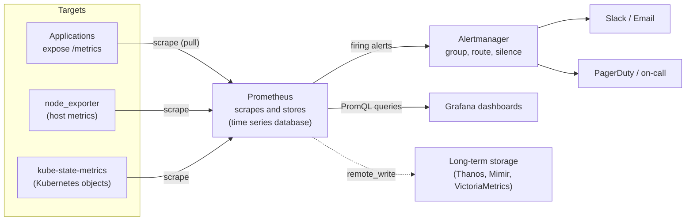
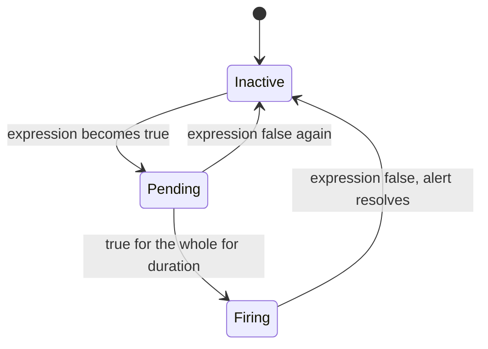
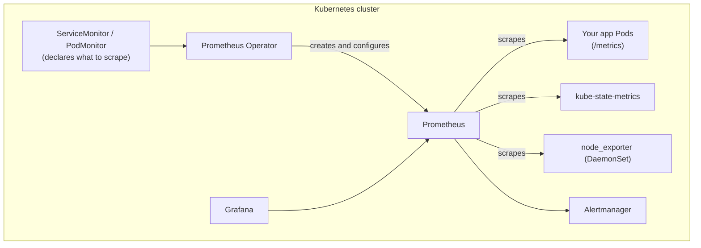
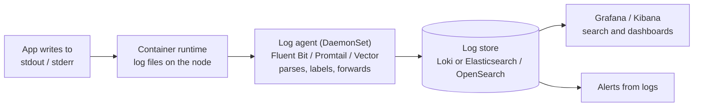
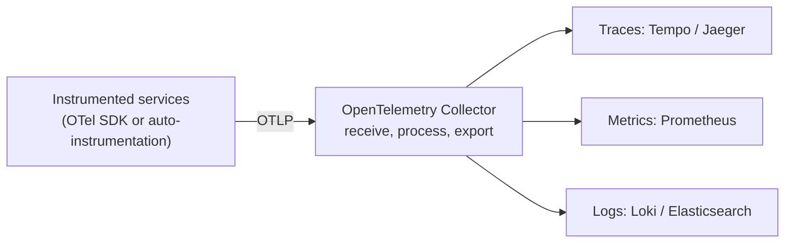

# Monitoring and Logging — Prometheus, Grafana, Alertmanager, Loki, ELK, and OpenTelemetry in Practice

The principles of observability (the three pillars, golden signals, SLOs, and alert design) are explained in [Observability and Deployment](system-design/observability-and-deployment). This guide is the **hands-on companion**: the actual tools, queries, and configuration you will use as a DevOps engineer, and the questions interviewers ask about them.

---

## 1. The Standard Open-Source Stack

| Need | Tool | Notes |
|---|---|---|
| **Metrics** collection and storage | **Prometheus** | Pulls metrics, stores them as time series, evaluates alert rules |
| **Dashboards** | **Grafana** | Visualizes Prometheus, Loki, CloudWatch, and many other sources |
| **Alert routing** | **Alertmanager** | Groups, deduplicates, silences, and routes alerts to Slack, email, PagerDuty |
| **Logs** | **Loki** (lightweight) or **Elasticsearch/OpenSearch + Kibana** (powerful search) | Central log storage and search |
| **Log shipping** | Fluent Bit, Promtail, Vector, Logstash | Agents that collect and forward logs |
| **Traces** | Jaeger, Tempo, Zipkin | Distributed tracing backends |
| **Instrumentation** | **OpenTelemetry** | Vendor-neutral SDKs and collector for metrics, logs, and traces |

Managed alternatives: **CloudWatch** (AWS), **Amazon Managed Prometheus and Managed Grafana**, Google Cloud Operations, Azure Monitor, and commercial platforms such as Datadog and New Relic.

---

## 2. Prometheus

### Architecture



**Pull model:** Prometheus **scrapes** an HTTP endpoint (`/metrics`) on each target at an interval (for example every 15 seconds). Benefits: it knows immediately when a target is down (`up == 0`), targets stay simple, and you can scrape from anywhere. Short-lived batch jobs that can't be scraped push to the **Pushgateway** (use sparingly).

### Metric Format and Types

An exposed metric looks like this:

```text
# HELP http_requests_total Total HTTP requests
# TYPE http_requests_total counter
http_requests_total{method="GET",status="200"} 10432
http_requests_total{method="GET",status="500"} 17
```

| Type | Behavior | Example | Query with |
|---|---|---|---|
| **Counter** | Only goes **up** (resets on restart) | `http_requests_total` | `rate()`, `increase()` |
| **Gauge** | Goes up and down | memory used, queue depth, temperature | the value itself, `avg_over_time()` |
| **Histogram** | Counts observations in **buckets** (latency distribution) | `http_request_duration_seconds_bucket` | `histogram_quantile()` |
| **Summary** | Pre-computed quantiles on the client | less common | the quantile series |

**Labels** (`method`, `status`) let you slice data, and each unique combination of labels is a separate **time series**. **High cardinality** (labels with unbounded values such as user IDs, request IDs, or raw URLs) creates millions of series and is the most common way to overload Prometheus. Keep label values bounded.

**Naming conventions:** `_total` suffix for counters, base units (`_seconds`, `_bytes`), and `snake_case`.

### Configuration

```yaml
# prometheus.yml
global:
  scrape_interval: 15s
  evaluation_interval: 15s

rule_files:
  - /etc/prometheus/rules/*.yml

alerting:
  alertmanagers:
    - static_configs:
        - targets: ["alertmanager:9093"]

scrape_configs:
  - job_name: prometheus
    static_configs:
      - targets: ["localhost:9090"]

  - job_name: node
    static_configs:
      - targets: ["node-exporter:9100"]

  - job_name: app
    metrics_path: /metrics
    static_configs:
      - targets: ["app:8000"]
```

In Kubernetes you don't list targets by hand; Prometheus uses **service discovery** to find Pods and Services automatically (see section 5).

### Exporters: Metrics for Things You Don't Control

| Exporter | Provides |
|---|---|
| **node_exporter** | Host CPU, memory, disk, network |
| **cAdvisor** | Per-container resource usage |
| **kube-state-metrics** | State of Kubernetes objects (Deployments, Pods, nodes) |
| **blackbox_exporter** | Probes endpoints from outside (HTTP, TCP, ICMP, TLS expiry) |
| Database exporters | PostgreSQL, MySQL, Redis, Kafka, and more |

For your own applications, use a **client library** (Python, Go, Java, Node) to expose request counts, latencies, and business metrics.

### Retention and Scale

A single Prometheus keeps data locally (15 days by default) and is not clustered. For **long-term storage and high availability**, send data with `remote_write` to **Thanos, Grafana Mimir, or VictoriaMetrics**, and run two identical Prometheus replicas for redundancy.

---

## 3. PromQL Essentials

PromQL is the query language. These queries cover most real needs.

```promql
# Is the target up? (1 = yes, 0 = no)
up

# Requests per second over the last 5 minutes (counters need rate())
rate(http_requests_total[5m])

# Total request rate per service
sum by (service) (rate(http_requests_total[5m]))

# Error ratio: share of 5xx responses
sum(rate(http_requests_total{status=~"5.."}[5m]))
  /
sum(rate(http_requests_total[5m]))

# 99th percentile latency from a histogram
histogram_quantile(0.99, sum by (le) (rate(http_request_duration_seconds_bucket[5m])))

# CPU usage percent per host
100 - (avg by (instance) (rate(node_cpu_seconds_total{mode="idle"}[5m])) * 100)

# Memory available as a fraction
node_memory_MemAvailable_bytes / node_memory_MemTotal_bytes

# Will the disk fill within 24 hours? (linear prediction)
predict_linear(node_filesystem_avail_bytes{fstype!~"tmpfs|overlay"}[6h], 24 * 3600) < 0

# Pod restarts in the last hour (Kubernetes)
increase(kube_pod_container_status_restarts_total[1h]) > 3
```

**Concepts to know:**

- **Instant vector** (current value), **range vector** (`[5m]` window of samples), and functions that turn range vectors into values (`rate`, `increase`).
- **`rate()`** = per-second average increase of a counter, and it handles counter resets. **`increase()`** = total increase over the window. Never graph a raw counter.
- **Aggregation:** `sum`, `avg`, `max`, `count` with `by (label)` (keep these labels) or `without (label)` (drop these labels).
- **Percentiles from histograms** use `histogram_quantile`, and you must `sum by (le)` first so buckets aggregate correctly across instances. Averages of percentiles are meaningless.
- **Choose the range window** to be at least a few scrape intervals (for example `[5m]` with a 15 s interval).

---

## 4. Alerting

### Alert Rules

```yaml
# rules/alerts.yml
groups:
  - name: availability
    rules:
      - alert: InstanceDown
        expr: up == 0
        for: 5m
        labels:
          severity: page
        annotations:
          summary: "{{ $labels.instance }} has been down for 5 minutes"
          runbook_url: https://wiki.example.com/runbooks/instance-down

      - alert: HighErrorRate
        expr: |
          sum(rate(http_requests_total{status=~"5.."}[5m]))
            / sum(rate(http_requests_total[5m])) > 0.05
        for: 10m
        labels:
          severity: page
        annotations:
          summary: "More than 5% of requests are failing"

      - alert: DiskWillFillIn24h
        expr: predict_linear(node_filesystem_avail_bytes{fstype!~"tmpfs|overlay"}[6h], 24 * 3600) < 0
        for: 30m
        labels:
          severity: warning
        annotations:
          summary: "{{ $labels.instance }} {{ $labels.mountpoint }} is predicted to fill within 24h"
```

The **`for:`** clause means the condition must hold continuously for that long before the alert fires, which avoids paging on brief spikes.



**Recording rules** precompute expensive queries (used by dashboards and alerts):

```yaml
groups:
  - name: recordings
    rules:
      - record: job:http_requests:rate5m
        expr: sum by (job) (rate(http_requests_total[5m]))
```

### Alertmanager

Prometheus decides **when** to alert; **Alertmanager** decides **who gets told, and how**.

| Feature | What it does |
|---|---|
| **Grouping** | Combines related alerts into one notification (one message instead of 50 when a cluster fails) |
| **Routing** | Sends alerts to different receivers by labels (severity, team) |
| **Inhibition** | Suppresses less important alerts when a bigger one is firing (don't alert on every service when the whole node is down) |
| **Silences** | Temporarily mute alerts (maintenance) |
| **Deduplication and repeat interval** | Avoids spam |

```yaml
# alertmanager.yml
route:
  receiver: team-slack
  group_by: [alertname, cluster]
  group_wait: 30s          # wait to collect related alerts
  group_interval: 5m
  repeat_interval: 4h
  routes:
    - matchers:
        - severity="page"
      receiver: oncall-pagerduty

receivers:
  - name: team-slack
    slack_configs:
      - channel: "#alerts"
        api_url_file: /etc/alertmanager/slack_url
  - name: oncall-pagerduty
    pagerduty_configs:
      - routing_key_file: /etc/alertmanager/pagerduty_key

inhibit_rules:
  - source_matchers: [severity="page"]
    target_matchers: [severity="warning"]
    equal: [alertname, cluster]
```

### Alerting Strategy

- **Alert on symptoms users feel** (error rate, latency, failed logins), not only on causes (CPU 80%). Use cause-based alerts as warnings or dashboards.
- Every page must be **actionable and urgent**, with a **runbook link**. If it doesn't need a human now, make it a ticket or a dashboard panel.
- Prevent **alert fatigue**: review noisy alerts regularly, delete or tune them.
- **Test your alerts** (fire a test alert end to end) and monitor the monitoring system itself (a "dead man's switch" alert that always fires, so silence means the pipeline is broken).

### SLO Burn-Rate Alerts

Instead of static thresholds, alert on **how fast the error budget is being consumed** (see [Observability and Deployment](system-design/observability-and-deployment) for SLOs and error budgets).

For a 99.9% SLO over 30 days, a **burn rate** of 1 uses exactly the whole budget in 30 days. A burn rate of **14.4 sustained for 1 hour** consumes **2% of the monthly budget**, which is worth paging for. A common pattern uses **two windows** per alert (a long one to confirm it is real and a short one so it resets quickly): fast-burn alerts page, slow-burn alerts open tickets. This catches both sudden outages and slow leaks with few false alarms.

---

## 5. Monitoring Kubernetes

The standard approach is the **kube-prometheus-stack** Helm chart. It installs the **Prometheus Operator**, Prometheus, Alertmanager, Grafana, node_exporter, kube-state-metrics, and a set of ready-made dashboards and alerts.

```bash
helm repo add prometheus-community https://prometheus-community.github.io/helm-charts
helm repo update
helm install monitoring prometheus-community/kube-prometheus-stack \
  -n monitoring --create-namespace
kubectl -n monitoring port-forward svc/monitoring-grafana 3000:80
```



### Telling Prometheus What to Scrape: ServiceMonitor

```yaml
apiVersion: monitoring.coreos.com/v1
kind: ServiceMonitor
metadata:
  name: web
  labels:
    release: monitoring          # must match the Prometheus instance's selector
spec:
  selector:
    matchLabels:
      app: web                   # selects the Service
  endpoints:
    - port: http                 # the NAME of the Service port
      path: /metrics
      interval: 15s
```

If your metrics don't show up, check: the **`release` label** matches, the Service **port name** is correct, the selector matches the Service, and the Prometheus **Targets** page (`/targets`) for scrape errors.

### Useful Kubernetes Signals

| Question | Metric or query |
|---|---|
| Are Pods restarting? | `increase(kube_pod_container_status_restarts_total[1h])` |
| Are Deployments healthy? | `kube_deployment_status_replicas_unavailable > 0` |
| Pods stuck Pending? | `kube_pod_status_phase{phase="Pending"}` |
| Container memory use | `container_memory_working_set_bytes` |
| CPU throttling | `rate(container_cpu_cfs_throttled_periods_total[5m])` |
| Node pressure | `kube_node_status_condition{condition="MemoryPressure",status="true"}` |

See the [Kubernetes Production Guide](devops/k8s/kubernetes-production-guide) for troubleshooting with `kubectl`.

---

## 6. Grafana

Grafana turns data sources into dashboards and (optionally) alerts.

- **Data sources:** Prometheus, Loki, Elasticsearch, CloudWatch, PostgreSQL, Tempo, and many more.
- **Variables** (a dropdown for `namespace`, `service`, `instance`) make one dashboard serve many services.
- **Annotations** overlay events such as **deployments** on graphs, which makes cause and effect visible.
- **Dashboards as code:** export JSON and provision it through files or Helm so dashboards are versioned in Git and recreated automatically.

### Dashboard Design

| Principle | How |
|---|---|
| **Layered** | Overview (is the business healthy?) → service dashboard → deep-dive/debug |
| **Standard layout** | For each service: **Rate, Errors, Duration (RED)**; for each resource: **Utilization, Saturation, Errors (USE)** |
| **Answer a question** | Each panel should help a decision; remove decorative graphs |
| **Show percentiles** | p50/p95/p99, not only averages |
| **Include SLO status** | Error budget remaining and burn rate |

---

## 7. A Local Monitoring Lab with Docker Compose

```yaml
# docker-compose.yml  (pin image versions in real use)
services:
  prometheus:
    image: prom/prometheus
    volumes:
      - ./prometheus.yml:/etc/prometheus/prometheus.yml:ro
      - ./rules:/etc/prometheus/rules:ro
      - prom_data:/prometheus
    ports:
      - "9090:9090"

  alertmanager:
    image: prom/alertmanager
    volumes:
      - ./alertmanager.yml:/etc/alertmanager/alertmanager.yml:ro
    ports:
      - "9093:9093"

  node-exporter:
    image: prom/node-exporter
    ports:
      - "9100:9100"

  grafana:
    image: grafana/grafana
    volumes:
      - grafana_data:/var/lib/grafana
    ports:
      - "3000:3000"

volumes:
  prom_data:
  grafana_data:
```

```bash
docker compose up -d
# Prometheus: http://localhost:9090   Grafana: http://localhost:3000 (add Prometheus as a data source: http://prometheus:9090)
```

Try: stop `node-exporter` and watch the `InstanceDown` alert go from Pending to Firing; then create a dashboard panel with the CPU query from section 3.

---

## 8. Logging

### Principles

- **Structured logs** (JSON with `timestamp`, `level`, `service`, `trace_id`, message) are searchable and aggregatable; free text is not.
- **Log to stdout/stderr** in containers; the platform collects them. Don't write log files inside containers.
- **Correlation IDs** passed through every service let you follow one request across systems.
- **Never log secrets or personal data**; mask sensitive fields.
- Control **volume and cost**: use sensible levels (`INFO` in production, `DEBUG` temporarily), sample noisy logs, and set **retention** (for example 14 days hot, longer in cheap storage).

### The Pipeline



### Loki vs ELK/EFK

| | **Grafana Loki** | **Elasticsearch / OpenSearch (ELK / EFK)** |
|---|---|---|
| Indexing | Indexes only **labels** (app, namespace, pod); log content is stored compressed and scanned at query time | Indexes the **full text** of every log |
| Cost and footprint | **Much cheaper and lighter** | Heavier: more storage, memory, and operations |
| Search power | Good: label filter plus text/regex filters | **Very powerful** full-text search, aggregations, analytics |
| Integration | Native with Grafana and Prometheus-style labels | Kibana ecosystem, strong for security/search use cases |
| Best for | Operational logs in Kubernetes, cost-conscious teams | Heavy search and analytics, compliance, large existing ELK investments |

### LogQL (Loki) Examples

```logql
{app="checkout"}                                  # all logs from the app
{app="checkout"} |= "error"                       # lines containing "error"
{app="checkout"} | json | level="error"           # parse JSON, filter on a field
sum by (level) (count_over_time({app="checkout"}[5m]))   # log volume per level
```

**Keep Loki labels low-cardinality** (app, namespace, environment). Putting user IDs or request IDs in labels causes the same cardinality problems as in Prometheus. Keep those in the log line.

### CloudWatch Logs Insights (AWS)

```text
fields @timestamp, @message
| filter @message like /ERROR/
| sort @timestamp desc
| limit 20
```

---

## 9. Tracing with OpenTelemetry

**OpenTelemetry (OTel)** is the vendor-neutral standard for generating telemetry.



- **Context propagation:** a **trace ID** travels between services in a header (the W3C `traceparent` header), so spans from different services join into one trace.
- The **Collector** decouples applications from backends: change where data goes without redeploying apps, and apply **sampling** (for example keep 1% of normal traces plus all errors and slow requests) to control cost.
- **Link the pillars:** put the `trace_id` in logs so you can jump from a slow trace to its logs, and attach **exemplars** to metrics so you can jump from a latency spike to an example trace.

---

## 10. Monitoring on AWS (CloudWatch)

| Feature | Use |
|---|---|
| **Metrics** | EC2, RDS, ALB, Lambda metrics built in (basic memory/disk need the CloudWatch agent) |
| **Logs and Logs Insights** | Central logs and queries |
| **Alarms** | Threshold or anomaly alarms that notify SNS or trigger Auto Scaling |
| **Container Insights** | Metrics and logs for ECS/EKS |
| **Dashboards** | Visualization |
| **Managed Prometheus and Grafana** | Prometheus-compatible metrics without running the servers |

Many teams use CloudWatch for AWS-managed services and Prometheus/Grafana for Kubernetes and applications, with Grafana as the single view over both. See [AWS Hands-On](devops/aws-hands-on).

---

## 11. Troubleshooting the Monitoring System

| Problem | Check |
|---|---|
| Target shows **DOWN** | `/targets` page error message; network policy or firewall; wrong port or path; the app's `/metrics` endpoint |
| Metrics missing in Kubernetes | ServiceMonitor `release` label and selectors, port **name**, namespace selectors |
| Prometheus **out of memory** or slow | High cardinality (find the biggest metrics with `topk(10, count by (__name__)({__name__=~".+"}))`), too-long retention, too many series |
| Gaps in graphs | Scrape failures, restarts, a `rate()` window shorter than 2 scrape intervals |
| Alert never fires | Run the expression in the UI; check `for:` duration, labels, rule file loaded (`/rules`), Alertmanager connectivity |
| Alert fires but no notification | Alertmanager routing, receiver credentials, silences, inhibition |
| Dashboard empty | Wrong data source or time range; label names or variable values don't match |
| Disk filling with logs | Missing rotation or retention, log level too verbose |

---

## 12. Interview Questions

**Q: How does Prometheus collect metrics?**
It pulls (scrapes) an HTTP `/metrics` endpoint from each target at a regular interval, storing samples in its time series database. Service discovery finds targets in dynamic environments like Kubernetes.

**Q: Pull vs push monitoring?**
Pull lets the server detect dead targets, keeps targets simple, and centralizes configuration. Push suits short-lived jobs (via the Pushgateway) or networks where scraping isn't possible.

**Q: Explain counter, gauge, and histogram.**
A counter only increases (use `rate()`), a gauge goes up and down, and a histogram buckets observations so you can compute percentiles with `histogram_quantile`.

**Q: Why use `rate()` on counters?**
A raw counter just keeps growing and resets on restart. `rate()` converts it to a per-second rate and handles resets.

**Q: What is cardinality and why does it matter?**
The number of unique label combinations, which equals the number of time series. Unbounded labels (user IDs, URLs) explode memory and storage and can take Prometheus down.

**Q: How do you compute 99th percentile latency?**
`histogram_quantile(0.99, sum by (le) (rate(http_request_duration_seconds_bucket[5m])))`.

**Q: What does Alertmanager do?**
It receives alerts from Prometheus, then groups, deduplicates, routes, silences, and inhibits them before notifying people through Slack, email, or PagerDuty.

**Q: Design alerting for a web service.**
Alert on user-visible symptoms (error ratio, latency percentile, availability) with `for:` durations, preferably as SLO burn-rate alerts; add warnings for causes like disk filling or saturation; each page has a runbook; review and prune noisy alerts.

**Q: Loki vs Elasticsearch?**
Loki indexes only labels and is cheap and simple for operational logs; Elasticsearch indexes full text, giving powerful search and analytics at a higher cost and operational burden.

**Q: How do you monitor a Kubernetes cluster?**
Deploy kube-prometheus-stack for Prometheus, Alertmanager, Grafana, node_exporter, and kube-state-metrics; use ServiceMonitors for applications; alert on restarts, unavailable replicas, pending Pods, node pressure, and resource saturation.

**Q: How do you correlate metrics, logs, and traces?**
Share identifiers: a trace ID in logs and spans, consistent labels across metrics and logs, and exemplars that link a metric point to a trace, all viewable together in Grafana.

**Q: Your application's latency suddenly doubled. How do you investigate?**
Check the dashboards for when it started (and deployment annotations), use traces to find the slow span, compare saturation of resources and dependencies (CPU, memory, database, queues), then use logs for the details, and roll back if it correlates with a release.

---

## Hands-On Exercise

1. Run the Compose lab above; add an application that exposes `/metrics` (a client library in Python or Node is enough) and scrape it.
2. Build a Grafana dashboard with request rate, error ratio, and p95 latency (RED).
3. Write an alert for error ratio above 5% for 10 minutes and a disk-fill prediction alert, and route `severity=page` to a Slack webhook through Alertmanager.
4. Install kube-prometheus-stack on a Kind cluster and add a ServiceMonitor for your app.
5. Add Loki and Promtail (or Fluent Bit) and query your app's logs with LogQL.
6. Break the app on purpose and use metrics, then logs, to find the cause.

This monitoring setup is part of the capstone in [DevOps Scenarios and Capstone Project](devops/devops-scenarios-and-capstone).

## Continue Learning

- [Observability and Deployment](system-design/observability-and-deployment) — the principles: pillars, golden signals, SLOs, and incident response.
- [Kubernetes Production Guide](devops/k8s/kubernetes-production-guide) — troubleshooting workloads with `kubectl`.
- [Linux for DevOps](devops/linux-for-devops) — host-level performance troubleshooting.
- [AWS Hands-On](devops/aws-hands-on) — CloudWatch and AWS monitoring services.
- [CI/CD Pipelines](devops/ci-cd-pipelines) — deploy markers and automatic rollback on bad metrics.
