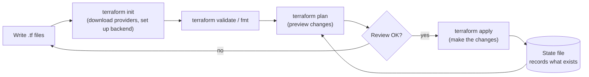
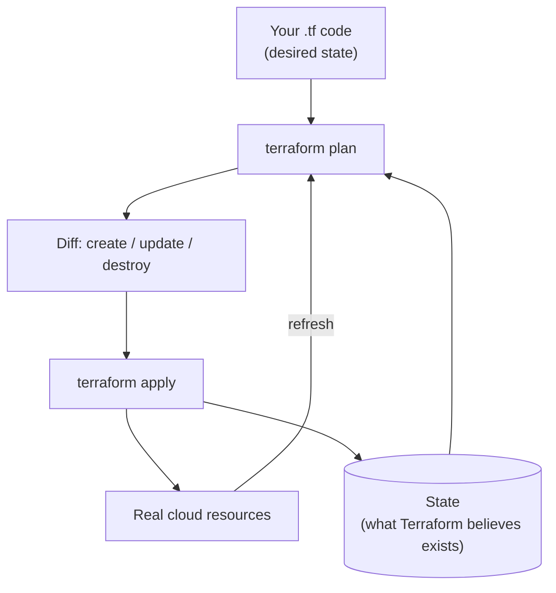
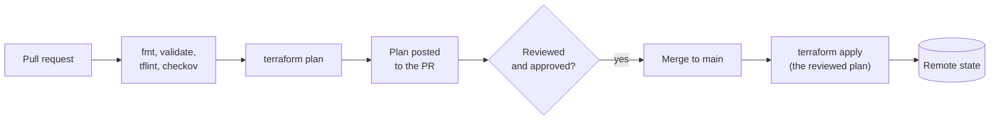
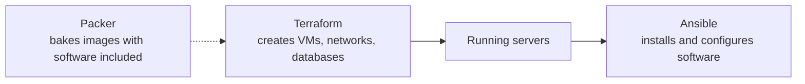

# Terraform and Infrastructure as Code — State, Modules, Environments, CI Workflows, and Ansible

**Infrastructure as Code (IaC)** means describing servers, networks, databases, and permissions in **files** that live in Git, instead of clicking through a console. The files are reviewed, versioned, tested, and applied automatically, so environments are **repeatable**, **auditable**, and **recoverable**.

**Terraform** is the most widely used IaC tool. You write what you want (declarative), and Terraform works out how to get there across AWS, Azure, GCP, Kubernetes, GitHub, and hundreds of other providers.

---

## 1. Why IaC, and Where Terraform Fits

| Problem with manual setup | What IaC gives you |
|---|---|
| "Works in staging, breaks in production" (environments differ) | Same code builds every environment |
| Nobody remembers who changed what | Changes are commits and pull requests with history |
| Rebuilding after a disaster takes days | Re-run the code to recreate everything |
| Slow, error-prone clicking | Fast, automated, consistent |
| Config drift over time | Detect drift and correct it |

**Declarative vs imperative:** in a declarative tool (Terraform, CloudFormation, Kubernetes manifests) you describe the **end state** ("I want 3 servers") and the tool decides the steps. In an imperative script ("create server, create server, create server") you spell out the steps and must handle existing state yourself.

### The Tools

| Tool | What it is | Typical use |
|---|---|---|
| **Terraform** | Multi-cloud declarative IaC (HCL language) | Provisioning cloud infrastructure |
| **OpenTofu** | Open-source fork of Terraform, mostly command-compatible (`tofu`) | Same, with an open-source license |
| **CloudFormation / CDK** | AWS-native IaC | AWS-only shops |
| **Pulumi** | IaC in general programming languages | Teams who prefer Python, TypeScript, or Go |
| **Ansible** | Agentless configuration management | Configuring servers, deploying software |
| **Packer** | Builds machine images | Baking AMIs for immutable infrastructure |

---

## 2. The Terraform Workflow



| Command | What it does |
|---|---|
| `terraform init` | Downloads providers and modules, configures the state backend |
| `terraform fmt` | Formats code consistently |
| `terraform validate` | Checks syntax and internal consistency |
| `terraform plan` | Compares your code with the **state** and the real world, shows what would change |
| `terraform apply` | Executes the plan (asks for confirmation unless `-auto-approve`) |
| `terraform destroy` | Deletes everything the configuration manages |
| `terraform output` | Prints output values |
| `terraform state list` / `show` | Inspect what Terraform tracks |

**Always read the plan.** `+` create, `-` destroy, `~` update in place, `-/+` destroy and recreate (this can mean downtime or data loss for databases).

---

## 3. HCL Basics

A typical project (a few files in one folder, all combined by Terraform):

```text
infra/
├── main.tf          # resources
├── variables.tf     # inputs
├── outputs.tf       # outputs
├── versions.tf      # terraform and provider requirements
└── terraform.tfvars # values for the variables
```

### Providers and Backend

```hcl
terraform {
  required_version = ">= 1.10"

  required_providers {
    aws = {
      source  = "hashicorp/aws"
      version = "~> 5.0"          # pin to a major version you have tested
    }
  }

  backend "s3" {
    bucket       = "my-company-tf-state"
    key          = "prod/network/terraform.tfstate"
    region       = "ap-south-1"
    encrypt      = true
    use_lockfile = true           # S3-native state locking (newer Terraform versions)
  }
}

provider "aws" {
  region = var.region
}
```

### Variables, Locals, Data Sources, Resources, Outputs

```hcl
variable "region" {
  type    = string
  default = "ap-south-1"
}

variable "environment" {
  type        = string
  description = "dev, staging, or prod"
}

variable "public_subnets" {
  type = map(string)
  default = {
    "ap-south-1a" = "10.0.1.0/24"
    "ap-south-1b" = "10.0.2.0/24"
  }
}

locals {
  name = "app-${var.environment}"
  tags = {
    Environment = var.environment
    ManagedBy   = "terraform"
  }
}

# Data source: READ something that already exists
data "aws_ami" "al2023" {
  most_recent = true
  owners      = ["amazon"]
  filter {
    name   = "name"
    values = ["al2023-ami-2023*-x86_64"]
  }
}

# Resources: CREATE and manage
resource "aws_vpc" "main" {
  cidr_block           = "10.0.0.0/16"
  enable_dns_hostnames = true
  tags                 = merge(local.tags, { Name = "${local.name}-vpc" })
}

resource "aws_subnet" "public" {
  for_each                = var.public_subnets          # one subnet per map entry
  vpc_id                  = aws_vpc.main.id             # reference creates a dependency
  availability_zone       = each.key
  cidr_block              = each.value
  map_public_ip_on_launch = true
  tags                    = merge(local.tags, { Name = "${local.name}-public-${each.key}" })
}

resource "aws_instance" "web" {
  ami           = data.aws_ami.al2023.id
  instance_type = "t3.micro"
  subnet_id     = aws_subnet.public["ap-south-1a"].id
  tags          = merge(local.tags, { Name = "${local.name}-web" })
}

output "vpc_id" {
  value = aws_vpc.main.id
}
```

**Key ideas:**

- **References** (`aws_vpc.main.id`) create an automatic **dependency graph**; Terraform creates things in the right order and in parallel where possible. Use `depends_on` only when a dependency is not visible through references.
- **`count` vs `for_each`:** `count` creates N copies by index (removing item 0 shifts the rest and can recreate resources). **`for_each`** uses stable keys and is usually the better choice.
- **Variables** can be set in `terraform.tfvars`, `-var` flags, `TF_VAR_name` environment variables, or `*.auto.tfvars`.
- **`sensitive = true`** on a variable or output hides it from the console, but the value is **still stored in the state file**.
- Useful features: **functions** (`merge`, `cidrsubnet`, `lookup`), **conditionals** (`var.env == "prod" ? 3 : 1`), **`dynamic` blocks** for repeated nested blocks, and `terraform console` to experiment.

---

## 4. State: The Most Important Concept

The **state file** (`terraform.tfstate`) maps your configuration to real resources (IDs, attributes). Terraform uses it to know what already exists and what needs to change.



### Why Local State Is Not Enough for Teams

| Problem | Remote backend solution |
|---|---|
| Only on one laptop | Stored centrally (S3, GCS, Azure Blob, Terraform Cloud) |
| Two people applying at once corrupt state | **State locking** blocks concurrent runs |
| Contains secrets and sensitive attributes | Encrypted at rest, access restricted by IAM |
| Lost file = lost control | Versioning on the bucket allows recovery |

### Remote State on AWS

- An **S3 bucket** with **versioning**, **encryption**, and **blocked public access**.
- **Locking:** newer Terraform versions can lock directly in S3 (`use_lockfile = true`). Older setups use a **DynamoDB table** for locks. Pick the mechanism your Terraform version supports.
- **Bootstrap problem:** the bucket must exist before the backend can use it. Create it once with a small separate configuration (or manually) and treat it carefully.
- **Split state by component and environment** (network, database, app; dev, staging, prod). Small states are faster, safer, and limit the **blast radius** of a mistake.

### Working with State

| Command | Purpose |
|---|---|
| `terraform state list` | List tracked resources |
| `terraform state show aws_instance.web` | Inspect one resource |
| `terraform state mv` / `moved` block | Rename or restructure without destroying |
| `terraform state rm` | Stop managing a resource (does not delete it) |
| `terraform import` / `import` block | Bring an existing resource under management |
| `terraform apply -replace="aws_instance.web"` | Force recreation of one resource (the modern replacement for `taint`) |
| `terraform plan -refresh-only` | Detect drift without proposing changes |

**Never edit the state file by hand** and never commit it to Git.

### Drift

**Drift** is when real infrastructure differs from your code (someone changed it in the console). `terraform plan` shows it, and applying the code brings things back. Detect drift automatically with a scheduled `terraform plan -detailed-exitcode` (exit code `2` means changes were found) and alert on it.

---

## 5. Modules: Reusable Building Blocks

A **module** is a folder of Terraform files used like a function: inputs (variables) in, outputs out.

```text
infra/
├── modules/
│   └── network/
│       ├── main.tf
│       ├── variables.tf
│       └── outputs.tf
└── envs/
    ├── dev/
    │   └── main.tf
    └── prod/
        └── main.tf
```

```hcl
module "network" {
  source      = "../../modules/network"
  environment = "prod"
  cidr_block  = "10.0.0.0/16"
}

# Use a module's output elsewhere
resource "aws_instance" "web" {
  subnet_id = module.network.public_subnet_ids[0]
  # ...
}
```

- **Root module** = the folder you run Terraform in; it calls **child modules**.
- Sources: local paths, Git repositories (pin a tag: `?ref=v1.2.0`), or the **Terraform Registry** (`terraform-aws-modules/vpc/aws`) with a `version`.
- Good modules have a **small, clear interface**, sensible defaults, documented variables, and **versioned releases**.
- Don't over-abstract: a module that wraps a single resource usually adds noise, not value.

---

## 6. Managing Multiple Environments

| Approach | How | Pros | Cons |
|---|---|---|---|
| **Separate directories per environment** (recommended) | `envs/dev`, `envs/prod`, each with its own backend key, all calling shared modules | Clear, isolated state, per-environment differences are explicit, safest | Some repetition |
| **Workspaces** | `terraform workspace new dev`: same code, separate state per workspace | Less duplication | Easy to apply to the wrong workspace; same backend and credentials; environments can't diverge easily |
| **Wrappers** (Terragrunt) | Generate backends and call modules DRY-ly | Removes repetition | Another tool to learn |

Use **separate AWS accounts** for production and non-production where possible: the strongest isolation. Pass environment-specific values through `*.tfvars` files.

---

## 7. Lifecycle, Refactoring, and Safety

### Lifecycle Rules

```hcl
resource "aws_db_instance" "main" {
  # ...
  lifecycle {
    prevent_destroy       = true             # error if a plan would destroy this
    create_before_destroy = true             # build the replacement first
    ignore_changes        = [tags["Owner"]]  # ignore changes made outside Terraform
  }
}
```

### Refactoring Without Destroying

```hcl
moved {                       # renamed a resource in code
  from = aws_instance.web
  to   = aws_instance.app
}

import {                      # adopt an existing resource
  to = aws_s3_bucket.logs
  id = "my-existing-logs-bucket"
}
```

### Safety Practices

- Review every plan; watch for `-/+` (replace) on stateful resources.
- Enable **deletion protection** and backups on databases.
- Use **least-privilege credentials** for Terraform, and short-lived ones in CI (OIDC).
- Avoid **provisioners** (`local-exec`, `remote-exec`) where possible; use user data, images, or Ansible.
- Keep secrets out of code; use a secrets manager and data sources, remembering that they will still appear in state.
- **Pin** provider and module versions, and commit the `.terraform.lock.hcl` file.
- Keep modules and state **small** to limit blast radius.

---

## 8. Terraform in CI/CD

Treat infrastructure changes like application changes: through pull requests.



- **On pull request:** `fmt -check`, `validate`, lint (**tflint**), security scan (**Checkov**, **tfsec/Trivy**), and `plan`. Post the plan as a PR comment.
- **On merge:** `apply`, ideally using the **saved plan** (`terraform plan -out=tfplan` then `terraform apply tfplan`) so what is applied is what was reviewed.
- Use **OIDC** to give the pipeline short-lived cloud credentials (see [CI/CD Pipelines](devops/ci-cd-pipelines)).
- Require **manual approval** for production applies; serialize runs per state with locking.
- Tools that automate this: **Atlantis**, Terraform Cloud/HCP Terraform, Spacelift, or plain GitHub Actions.
- **Policy as code:** OPA/Conftest or Sentinel to enforce rules ("no public S3 buckets", "required tags", "allowed instance types").

---

## 9. Ansible and Where It Fits

**Ansible** is an **agentless configuration management** tool: it connects over SSH (or WinRM) and runs **tasks** described in YAML **playbooks**. Its modules are designed to be **idempotent**: running a playbook twice leaves the system in the same state.

```yaml
# inventory.ini
# [web]
# 10.0.1.10
# 10.0.1.11

# site.yml
- name: Configure web servers
  hosts: web
  become: true
  tasks:
    - name: Install nginx
      ansible.builtin.package:
        name: nginx
        state: present

    - name: Deploy nginx config
      ansible.builtin.template:
        src: nginx.conf.j2
        dest: /etc/nginx/nginx.conf
      notify: Restart nginx

    - name: Ensure nginx is running and enabled
      ansible.builtin.service:
        name: nginx
        state: started
        enabled: true

  handlers:
    - name: Restart nginx
      ansible.builtin.service:
        name: nginx
        state: restarted
```

```bash
ansible-playbook -i inventory.ini site.yml --check   # dry run
ansible-playbook -i inventory.ini site.yml
```

**Concepts:** **inventory** (hosts and groups), **playbook**, **tasks and modules**, **roles** (reusable bundles), **handlers** (run only when notified of a change), **variables and templates** (Jinja2), **`ansible-vault`** (encrypted secrets).

### Terraform vs Ansible



| | Terraform | Ansible |
|---|---|---|
| Main purpose | **Provisioning** infrastructure | **Configuring** software on machines |
| Style | Declarative, with state | Procedural tasks (idempotent modules), stateless |
| Strength | Cloud resources, dependencies, plan preview | Server configuration, deployments, ad hoc tasks |
| Typical sequence | First: create the servers | Second: configure them |

In a **container and Kubernetes** world, less configuration happens on servers (it moves into images and manifests), so Ansible's role shrinks to bootstrapping hosts, networking devices, and legacy systems. The modern trend is **immutable infrastructure**: build an image (Packer or Docker), deploy it, and replace instead of modifying.

---

## 10. Interview Questions

**Q: What is Terraform state and why does it matter?**
It records the mapping between your configuration and real resources. Terraform uses it to plan changes. It must be stored remotely with locking and encryption for teams, because it can contain sensitive data and concurrent writes can corrupt it.

**Q: What happens if two engineers run `terraform apply` at the same time?**
Without locking, state can be corrupted. A remote backend with locking makes the second run wait or fail.

**Q: What is the difference between `plan` and `apply`?**
`plan` previews changes by comparing code, state, and real infrastructure. `apply` performs them. In CI, apply the saved plan that was reviewed.

**Q: `count` vs `for_each`?**
`count` indexes resources by number, so removing one in the middle shifts the others and can recreate them. `for_each` keys by stable names, so changes affect only the specific item.

**Q: How do you manage multiple environments?**
Separate state per environment, preferably separate directories (and accounts) calling shared modules with different variables. Workspaces are an option but make mistakes easier.

**Q: Someone changed a resource in the console. What happens?**
That is drift. The next `plan` shows the difference and `apply` reverts it to match the code (unless it is in `ignore_changes`). Detect drift on a schedule.

**Q: How do you bring existing resources under Terraform?**
Write the resource block and use `terraform import` or an `import` block, then run `plan` until there are no unexpected changes.

**Q: How do you avoid destroying a critical resource by accident?**
`prevent_destroy`, deletion protection on the resource, careful plan review (watch for replacements), restricted credentials, and approvals for production.

**Q: How do you handle secrets?**
Keep them out of code and Git; fetch from a secrets manager at runtime; encrypt and restrict the state; mark outputs and variables `sensitive`, knowing that state still holds them.

**Q: What are modules, and when would you write one?**
Reusable, parameterized groups of resources. Write one when the same pattern is used several times (a VPC, a service with its load balancer), with a clear, small interface and versioned releases.

**Q: Terraform or CloudFormation?**
Terraform is multi-cloud with a large provider ecosystem and a clear plan step. CloudFormation is AWS-native with tight integration and no separate state to manage. Teams pick based on cloud strategy and skills.

**Q: Terraform and Ansible together?**
Terraform provisions the infrastructure; Ansible configures the software on it (or Packer bakes images and Terraform deploys them). They complement each other.

---

## Hands-On Exercise

1. Create a remote state bucket, then a configuration that builds a VPC with two public subnets and one EC2 instance (see the example above).
2. Run `init`, `plan`, `apply`; then change the instance type and read the plan.
3. Refactor the network into a module and use `moved` blocks so nothing is destroyed.
4. Add a GitHub Actions workflow: `plan` on pull requests, `apply` on merge using OIDC.
5. Make a manual change in the console, then detect and fix the drift.
6. `terraform destroy` to avoid costs.

This is the infrastructure half of the capstone in [DevOps Scenarios and Capstone Project](devops/devops-scenarios-and-capstone).

## Continue Learning

- [AWS Hands-On](devops/aws-hands-on) — the resources you will be provisioning (VPC, IAM, EC2, EKS).
- [CI/CD Pipelines](devops/ci-cd-pipelines) — automating plan and apply safely.
- [Git and Version Control for DevOps](devops/git-and-version-control) — pull request workflows for infrastructure.
- [Cloud Computing](devops/cloud-computing) — concepts behind IaC and the cloud service models.
