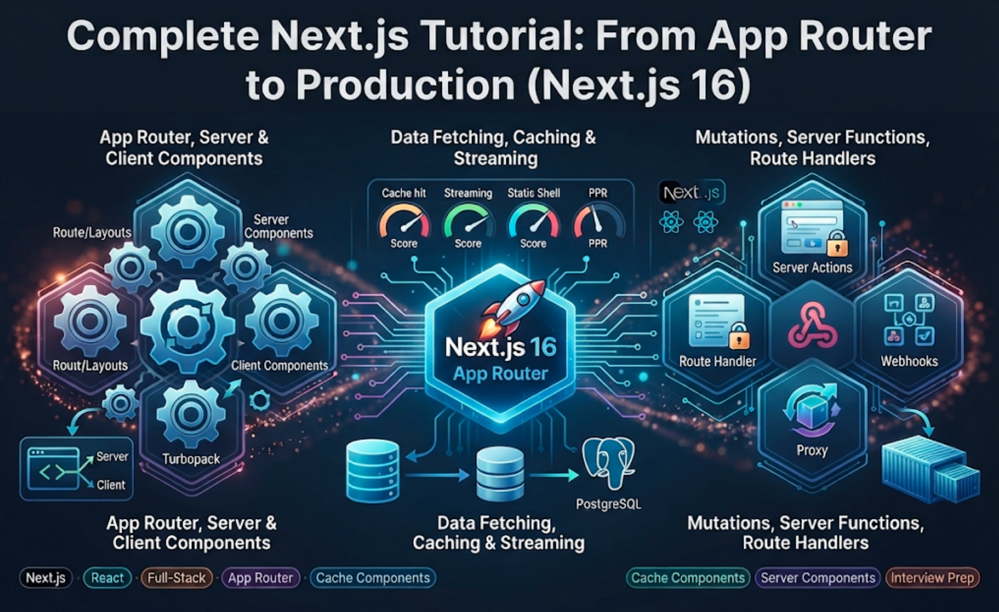
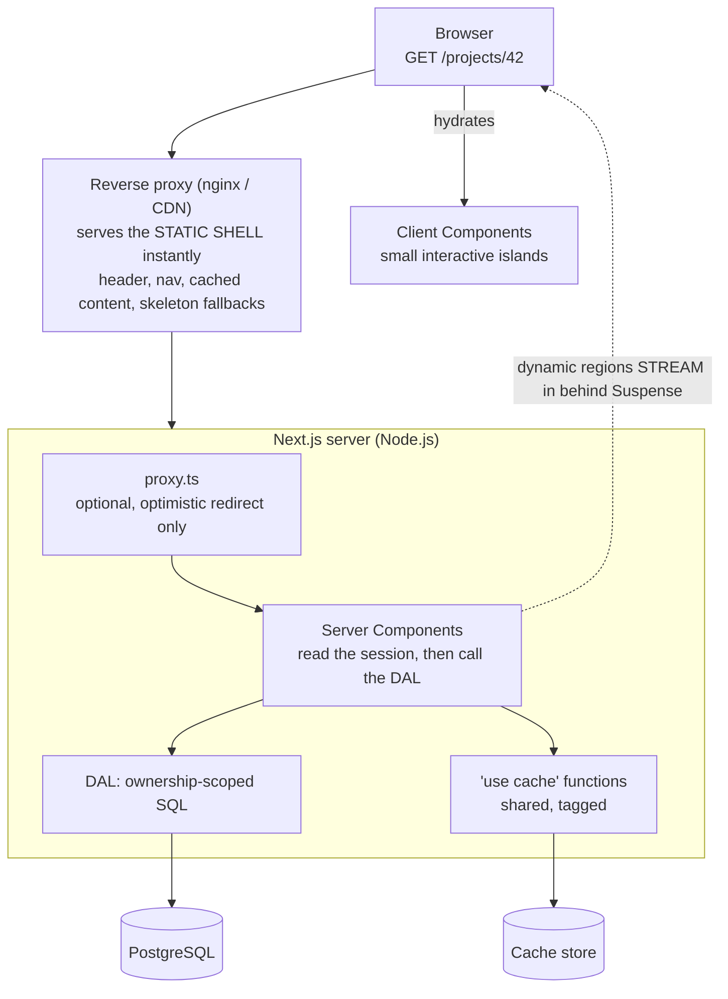
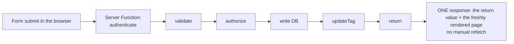
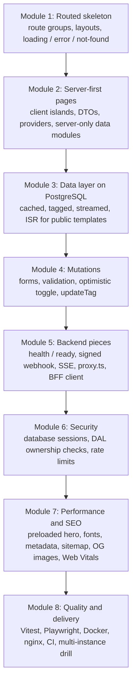
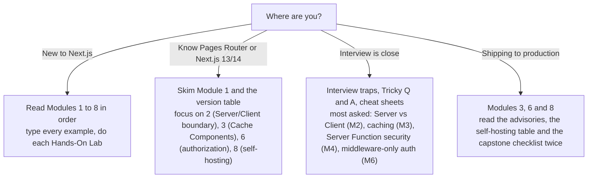
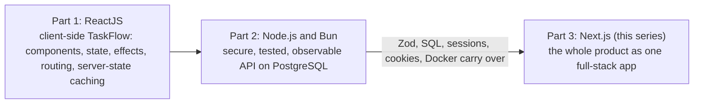

# Complete Next.js Tutorial: From App Router to Production (Next.js 16)

This is **Part 3**, the final part of the full-stack path. [Part 1](reactjs) taught React. [Part 2](nodejs) taught the Node.js and Bun backend. This part teaches **Next.js**, the framework where React, routing, data, a server and a build system come together in one codebase.

The language is simple. Every topic starts with a plain-words idea, then goes step by step into how things really work, and ends with the traps and questions that appear in full-stack interviews. Code is TypeScript and follows **Next.js 16.4**, the current stable release.

> **How this part fits:** you built TaskFlow as a Vite single-page app (Part 1) and then built its API (Part 2). Here you rebuild TaskFlow as **one full-stack Next.js app** on the **same PostgreSQL schema**, and then compare it with your Part 2 API. Almost nothing you learned earlier is wasted: Zod, SQL, sessions, cookies, `Request` and `Response`, Docker and deployment all carry over.

## The tutorial at a glance

| #   | Module                                          | What it answers                                                                                                           | Read more                                                            |
| --- | ----------------------------------------------- | ------------------------------------------------------------------------------------------------------------------------- | -------------------------------------------------------------------- |
| 1   | **Getting Started & the App Router**            | What is Next.js, what changed in version 16, how do routes, layouts, special files, navigation and async `params` work?   | [Open Module 1](nextjs/getting-started-and-the-app-router)           |
| 2   | **Server Components & Client Components**       | What runs where, what does `"use client"` really mean, and how do I compose server and client code safely?                | [Open Module 2](nextjs/server-and-client-components)                 |
| 3   | **Data Fetching, Caching & Streaming**          | How do Cache Components, `"use cache"`, `cacheLife`, tags, Suspense streaming and revalidation work together?             | [Open Module 3](nextjs/data-fetching-caching-and-streaming)          |
| 4   | **Mutations, Forms & Server Functions**         | How do I change data with forms that work without JavaScript, validation, optimistic UI, and keep every action secure?    | [Open Module 4](nextjs/mutations-forms-and-server-functions)         |
| 5   | **Route Handlers, Proxy & Backend Integration** | How do I build endpoints and webhooks, use `proxy.ts` safely, and connect Next.js to my Part 2 API?                       | [Open Module 5](nextjs/route-handlers-proxy-and-backend-integration) |
| 6   | **Authentication, Authorization & Security**    | Why has routing-layer auth failed repeatedly, and how do sessions, the Data Access Layer and ownership checks fix it?     | [Open Module 6](nextjs/authentication-and-security)                  |
| 7   | **Rendering Strategies, Performance & SEO**     | How do I choose a rendering strategy, hit good Core Web Vitals, optimize images and bundles, and ship solid SEO?          | [Open Module 7](nextjs/rendering-performance-and-seo)                |
| 8   | **Testing, Deployment & Capstone**              | How do I test with Vitest and Playwright, containerize, self-host across instances, deploy, and decide when Next.js fits? | [Open Module 8](nextjs/testing-deployment-and-capstone)              |

## Next.js in one minute (basic definitions)

| Term                 | Simple meaning                                                                                     | Example                                        |
| -------------------- | -------------------------------------------------------------------------------------------------- | ---------------------------------------------- |
| **Next.js**          | A React **framework**: routing, server rendering, bundling, data handling and a production server. | `npx create-next-app@latest`                   |
| **App Router**       | Folders in `app/` become URLs. `page.tsx` makes a folder a route.                                  | `app/projects/[id]/page.tsx`                   |
| **Server Component** | A component that runs only on the server. It can `await` data and ships no JavaScript for itself.  | An `async` page that queries Postgres          |
| **Client Component** | A component in a `"use client"` file. It can use state, effects and events.                        | A task checkbox with `useState`                |
| **Cache Components** | The current caching model. Nothing is cached unless you opt in with `"use cache"`.                 | `"use cache"` + `cacheLife("minutes")`         |
| **Streaming**        | Sending the page in pieces; dynamic parts arrive when ready behind `<Suspense>` fallbacks.         | A skeleton replaced by a real task list        |
| **PPR**              | Partial Prerendering: a static shell plus streamed dynamic regions on one page.                    | The default with Cache Components              |
| **Server Function**  | An `async` `"use server"` function the client can call. Used for mutations and forms.              | `<form action={createTaskAction}>`             |
| **Route Handler**    | A `route.ts` file that is a real HTTP endpoint using `Request` and `Response`.                     | A webhook receiver                             |
| **`proxy.ts`**       | Code that runs before routes (formerly `middleware.ts`). For optimistic redirects, not security.   | Redirect visitors without a cookie to `/login` |
| **DAL**              | Data Access Layer: server-only functions that verify the session, authorize and return DTOs.       | `getProjectForUser(userId, id)`                |
| **Turbopack**        | The Rust-based bundler, now the default for dev and build.                                         | `next dev`                                     |

## The big picture: one request through Next.js 16

**1a. First load (GET /projects/42)**

**1b. Baad me form submit (mutation loop)**

[Module 2](nextjs/server-and-client-components) explains who runs where, [Module 3](nextjs/data-fetching-caching-and-streaming) the shell and the caching, [Module 4](nextjs/mutations-forms-and-server-functions) the mutation loop, and [Module 6](nextjs/authentication-and-security) why the DAL, not the proxy, is the lock on the door.

## Vite SPA vs. Next.js at a glance

| Question          | Vite SPA (Part 1) + Express API (Part 2)           | Next.js                                               |
| ----------------- | -------------------------------------------------- | ----------------------------------------------------- |
| First paint       | Empty HTML, then JavaScript, then API calls        | Real HTML (often a static shell from a CDN)           |
| Routing           | React Router                                       | File-system routing                                   |
| Reading data      | `useEffect` / TanStack Query → `fetch` → API       | `async` Server Components query the database directly |
| Writing data      | `fetch` POST → Express route                       | Server Functions from forms (progressive enhancement) |
| Backend endpoints | Separate Express/Hono server                       | Route Handlers in the same project                    |
| SEO               | Weak                                               | Strong                                                |
| Hosting           | Static files + an API server                       | A Node.js server (or a platform that runs Next.js)    |
| Best for          | Internal tools behind login, multi-client backends | Public pages plus an app, full-stack TypeScript teams |

[Module 8, Topic 8.9](nextjs/testing-deployment-and-capstone#89-choosing-nextjs-and-when-not-to) is an honest decision guide, including when **not** to use Next.js.

## Versions this series assumes

| Tool                       | Version / note                                                                                                       |
| -------------------------- | -------------------------------------------------------------------------------------------------------------------- |
| **Next.js**                | **16.4** (October 2026). **Next.js 17 had not been released** when this was written                                  |
| **Caching model**          | **Cache Components** (`cacheComponents: true`): recommended and on by default in new apps, the default in Next.js 17 |
| **React**                  | 19.3 (ships with Next.js 16.4)                                                                                       |
| **Node.js**                | 20.9 or newer required. Use an LTS line: **24 or 26** (Node 20 is end-of-life)                                       |
| **TypeScript**             | 5.1+                                                                                                                 |
| **Bundler**                | Turbopack (default)                                                                                                  |
| **Tailwind CSS**           | v4 (the `create-next-app` default)                                                                                   |
| **Zod, PostgreSQL, Redis** | Same as Part 2                                                                                                       |
| **Vitest + Playwright**    | Unit tests and end-to-end tests                                                                                      |

> **Read this before you trust any Next.js tutorial, including AI answers:** Next.js has changed its **caching model several times** (13/14, 15, 16). Code written for an older version can fail to build or behave differently on 16.4. Always check the version a tutorial targets and read the docs for **your** version. [Module 1, Topic 1.2](nextjs/getting-started-and-the-app-router#12-versions-and-requirements-in-2026) lists the Next.js 16 breaking changes, and [Module 3, Topic 3.8](nextjs/data-fetching-caching-and-streaming#38-the-previous-caching-model-reading-older-code) maps the old caching model to the new one.

## What you should know before you start

You should have done [Part 1](reactjs) (React: components, state, effects, `use`, Actions) and ideally [Part 2](nodejs) (HTTP, SQL, sessions, Zod, Docker). If you skipped Part 2, read at least [Module 4](nodejs/http-servers-and-rest-apis), [Module 5](nodejs/databases-and-the-data-layer) and [Module 6](nodejs/authentication-and-security), because the Next.js modules build directly on those ideas.

| Skill                                 | Why it matters here                                                |
| ------------------------------------- | ------------------------------------------------------------------ |
| React components, props, state, hooks | Next.js is React with a server. Everything in Part 1 still applies |
| `async` / `await`, promises           | Server Components are `async` functions                            |
| HTTP, cookies, status codes           | Route Handlers, sessions and caching are built on them             |
| SQL and a connection pool             | The Data Access Layer talks to PostgreSQL directly                 |
| Zod                                   | Validation of forms, query strings and environment variables       |
| Basic Docker                          | Module 8 containerizes and deploys the app                         |

## The project that ties it together: TaskFlow, Next.js edition

| Module | TaskFlow gains...                                                                                                 |
| ------ | ----------------------------------------------------------------------------------------------------------------- |
| 1      | A routed skeleton: marketing and app route groups, layouts, loading, error and not-found pages                    |
| 2      | Server-first pages with small client islands, DTOs, providers and `server-only` data modules                      |
| 3      | A cached, tagged, streamed data layer on PostgreSQL, with ISR for public template pages                           |
| 4      | Forms with validation, **optimistic** task toggling, and `updateTag` revalidation                                 |
| 5      | Health and readiness endpoints, a signed webhook, an SSE stream, `proxy.ts`, and a BFF client for your Part 2 API |
| 6      | Database sessions, login and logout, a Data Access Layer with ownership checks, rate limits                       |
| 7      | A preloaded hero, fonts, a bundle pass, metadata, sitemap, Open Graph images and Web Vitals reporting             |
| 8      | Vitest and Playwright suites, a standalone Docker image, nginx, CI, and a multi-instance drill                    |

## Suggested reading paths

**If you are new to Next.js:** read Modules 1 → 8 in order. Type every example, and do the **Hands-On Lab** at the end of each module before moving on.

**If you already know the Pages Router or Next.js 13/14:** skim Module 1 and read the version table. Then spend your time on Module 2 (the Server/Client boundary), Module 3 (Cache Components, which is **very** different from older caching), Module 6 (the authorization model) and Module 8 (self-hosting).

**If an interview is close:** read **Interview traps** and **Tricky questions and answers** in every module, then the cheat sheets. The most-asked topics are Server vs. Client Components ([Module 2](nextjs/server-and-client-components)), caching and revalidation ([Module 3](nextjs/data-fetching-caching-and-streaming)), Server Function security ([Module 4](nextjs/mutations-forms-and-server-functions)) and why middleware-only auth is unsafe ([Module 6](nextjs/authentication-and-security)).

**If you want to ship to production:** Modules 3, 6 and 8 matter most. Read the security advisories section, the self-hosting table and the capstone checklist twice.

## Quick finder: "Where do I read about...?"

| If you want to understand...                            | Go to                                                                                                                                 |
| ------------------------------------------------------- | ------------------------------------------------------------------------------------------------------------------------------------- |
| What Next.js is and why it exists                       | [Module 1, Topic 1.1](nextjs/getting-started-and-the-app-router#11-what-is-nextjs-and-why-does-it-exist)                              |
| Versions, requirements, Next.js 16 breaking changes     | [Module 1, Topic 1.2](nextjs/getting-started-and-the-app-router#12-versions-and-requirements-in-2026)                                 |
| `create-next-app` and project structure                 | [Module 1, Topic 1.3](nextjs/getting-started-and-the-app-router#13-creating-a-project)                                                |
| Routes, layouts, route groups                           | [Module 1, Topic 1.4](nextjs/getting-started-and-the-app-router#14-file-system-routing)                                               |
| `loading`, `error`, `not-found` and other special files | [Module 1, Topic 1.5](nextjs/getting-started-and-the-app-router#15-the-special-files)                                                 |
| `Link`, `useRouter`, prefetching                        | [Module 1, Topic 1.6](nextjs/getting-started-and-the-app-router#16-navigation-and-linking)                                            |
| Async `params` and `generateStaticParams`               | [Module 1, Topic 1.7](nextjs/getting-started-and-the-app-router#17-dynamic-routes-and-async-params)                                   |
| Server-first mental model                               | [Module 2, Topic 2.1](nextjs/server-and-client-components#21-the-mental-model-server-first)                                           |
| What a Server Component can and cannot do               | [Module 2, Topic 2.2](nextjs/server-and-client-components#22-server-components)                                                       |
| What `"use client"` really means                        | [Module 2, Topic 2.3](nextjs/server-and-client-components#23-client-components-and-the-use-client-boundary)                           |
| Passing server content as `children`, providers         | [Module 2, Topic 2.4](nextjs/server-and-client-components#24-composition-patterns)                                                    |
| `React.cache`, env vars, module-state leaks             | [Module 2, Topic 2.5](nextjs/server-and-client-components#25-sharing-data-and-environment-variables)                                  |
| Hydration errors and how to fix them                    | [Module 2, Topic 2.6](nextjs/server-and-client-components#26-hydration-and-common-errors)                                             |
| Fetching on the server, avoiding waterfalls             | [Module 3, Topic 3.1](nextjs/data-fetching-caching-and-streaming#31-fetching-data-in-server-components)                               |
| Static vs. cached vs. dynamic, PPR, blocking routes     | [Module 3, Topic 3.2](nextjs/data-fetching-caching-and-streaming#32-static-cached-and-streaming-the-three-kinds-of-content)           |
| `"use cache"`, `cacheLife`, `cacheTag`                  | [Module 3, Topic 3.3](nextjs/data-fetching-caching-and-streaming#33-use-cache-cachelife-and-cachetag)                                 |
| Runtime data, `connection()`, random and time values    | [Module 3, Topic 3.4](nextjs/data-fetching-caching-and-streaming#34-runtime-data-random-values-and-timestamps)                        |
| Suspense, streaming, `loading.tsx`                      | [Module 3, Topic 3.5](nextjs/data-fetching-caching-and-streaming#35-streaming-with-suspense-and-loadingtsx)                           |
| `updateTag` vs. `revalidateTag` vs. `revalidatePath`    | [Module 3, Topic 3.6](nextjs/data-fetching-caching-and-streaming#36-revalidation-updatetag-revalidatetag-revalidatepath)              |
| ISR, prefetching, instant navigation                    | [Module 3, Topic 3.7](nextjs/data-fetching-caching-and-streaming#37-dynamic-params-isr-prefetching-and-instant-navigation)            |
| Old caching model (`unstable_cache`, `revalidate`)      | [Module 3, Topic 3.8](nextjs/data-fetching-caching-and-streaming#38-the-previous-caching-model-reading-older-code)                    |
| Data Access Layer and the database pool                 | [Module 3, Topic 3.9](nextjs/data-fetching-caching-and-streaming#39-the-data-access-layer-and-database-connections)                   |
| Server Functions: what they are and how they work       | [Module 4, Topic 4.1](nextjs/mutations-forms-and-server-functions#41-what-server-functions-are)                                       |
| Forms, Zod and `useActionState`                         | [Module 4, Topic 4.2](nextjs/mutations-forms-and-server-functions#42-forms-validation-and-useactionstate)                             |
| Refreshing data after a mutation                        | [Module 4, Topic 4.3](nextjs/mutations-forms-and-server-functions#43-revalidating-after-a-mutation)                                   |
| Optimistic UI with `useOptimistic`                      | [Module 4, Topic 4.4](nextjs/mutations-forms-and-server-functions#44-optimistic-ui)                                                   |
| Securing Server Functions                               | [Module 4, Topic 4.6](nextjs/mutations-forms-and-server-functions#46-securing-server-functions)                                       |
| Server Function vs. Route Handler vs. your API          | [Module 4, Topic 4.7](nextjs/mutations-forms-and-server-functions#47-server-functions-vs-route-handlers-vs-your-part-2-api)           |
| Route Handlers basics and caching                       | [Module 5, Topic 5.1](nextjs/route-handlers-proxy-and-backend-integration#51-route-handlers)                                          |
| Webhooks, downloads, SSE                                | [Module 5, Topic 5.2](nextjs/route-handlers-proxy-and-backend-integration#52-route-handler-patterns-json-apis-webhooks-streaming)     |
| `proxy.ts` and what not to do in it                     | [Module 5, Topic 5.3](nextjs/route-handlers-proxy-and-backend-integration#53-proxyts-code-that-runs-before-routes)                    |
| Calling your Part 2 API (BFF, rewrites)                 | [Module 5, Topic 5.4](nextjs/route-handlers-proxy-and-backend-integration#54-nextjs-as-a-front-door-to-your-part-2-api)               |
| Headers, cookies, redirects, rewrites                   | [Module 5, Topic 5.5](nextjs/route-handlers-proxy-and-backend-integration#55-headers-cookies-redirects-rewrites-and-security-headers) |
| `NEXT_PUBLIC_` and build-time vs. runtime env           | [Module 5, Topic 5.6](nextjs/route-handlers-proxy-and-backend-integration#56-environment-variables-build-time-vs-runtime)             |
| `after()`, background jobs, real-time                   | [Module 5, Topic 5.7](nextjs/route-handlers-proxy-and-backend-integration#57-background-work-real-time-and-long-lived-connections)    |
| Why routing-layer auth fails (the advisories)           | [Module 6, Topic 6.1](nextjs/authentication-and-security#61-the-threat-model-and-the-advisories-that-shaped-it)                       |
| Optimistic vs. secure checks, the layers of defense     | [Module 6, Topic 6.2](nextjs/authentication-and-security#62-the-three-concepts-and-the-layers-of-defense)                             |
| Sessions in HttpOnly cookies                            | [Module 6, Topic 6.3](nextjs/authentication-and-security#63-sessions-in-nextjs-database-sessions-in-httponly-cookies)                 |
| The Data Access Layer                                   | [Module 6, Topic 6.4](nextjs/authentication-and-security#64-the-data-access-layer)                                                    |
| Login, register, logout Server Functions                | [Module 6, Topic 6.5](nextjs/authentication-and-security#65-sign-up-login-and-logout-with-server-functions)                           |
| Why layout checks are not enough                        | [Module 6, Topic 6.6](nextjs/authentication-and-security#66-protecting-routes-where-checks-belong)                                    |
| Auth with Cache Components                              | [Module 6, Topic 6.7](nextjs/authentication-and-security#67-authentication-under-cache-components)                                    |
| IDOR/BOLA and roles                                     | [Module 6, Topic 6.8](nextjs/authentication-and-security#68-authorization-ownership-and-roles)                                        |
| Better Auth, Clerk and other libraries                  | [Module 6, Topic 6.9](nextjs/authentication-and-security#69-auth-libraries-better-auth-clerk-and-others)                              |
| A Next.js security checklist                            | [Module 6, Topic 6.10](nextjs/authentication-and-security#610-a-security-checklist-for-nextjs-apps)                                   |
| Choosing a rendering strategy                           | [Module 7, Topic 7.1](nextjs/rendering-performance-and-seo#71-rendering-strategies-in-nextjs-164)                                     |
| Core Web Vitals levers                                  | [Module 7, Topic 7.2](nextjs/rendering-performance-and-seo#72-core-web-vitals-and-what-moves-them)                                    |
| `next/image`, `next/font`, `next/script`                | [Module 7, Topic 7.3](nextjs/rendering-performance-and-seo#73-images-fonts-and-scripts)                                               |
| Bundle analyzer and React Compiler                      | [Module 7, Topic 7.4](nextjs/rendering-performance-and-seo#74-bundle-size-and-the-react-compiler)                                     |
| Metadata API, sitemap, Open Graph, JSON-LD              | [Module 7, Topic 7.6](nextjs/rendering-performance-and-seo#76-seo-metadata-sitemaps-open-graph-and-structured-data)                   |
| Measuring performance in lab and field                  | [Module 7, Topic 7.7](nextjs/rendering-performance-and-seo#77-measuring-lighthouse-real-user-monitoring-and-build-output)             |
| Testing strategy, Vitest                                | [Module 8, Topic 8.1](nextjs/testing-deployment-and-capstone#81-a-testing-strategy-for-nextjs)                                        |
| Playwright end-to-end tests                             | [Module 8, Topic 8.2](nextjs/testing-deployment-and-capstone#82-end-to-end-tests-with-playwright)                                     |
| `next build`, standalone output, build-time data        | [Module 8, Topic 8.3](nextjs/testing-deployment-and-capstone#83-building-for-production)                                              |
| Dockerfile and Compose for Next.js                      | [Module 8, Topic 8.4](nextjs/testing-deployment-and-capstone#84-docker-for-nextjs)                                                    |
| Self-hosting: nginx, encryption key, cache handlers     | [Module 8, Topic 8.5](nextjs/testing-deployment-and-capstone#85-self-hosting-in-production)                                           |
| Where to deploy                                         | [Module 8, Topic 8.6](nextjs/testing-deployment-and-capstone#86-choosing-a-deployment-target)                                         |
| Observability                                           | [Module 8, Topic 8.7](nextjs/testing-deployment-and-capstone#87-observability-seeing-what-your-app-is-doing)                          |
| Upgrading safely                                        | [Module 8, Topic 8.8](nextjs/testing-deployment-and-capstone#88-upgrading-nextjs-safely)                                              |
| When not to use Next.js                                 | [Module 8, Topic 8.9](nextjs/testing-deployment-and-capstone#89-choosing-nextjs-and-when-not-to)                                      |
| The full project to build                               | [Module 8, Capstone](nextjs/testing-deployment-and-capstone#capstone-lab-build-taskflow-nextjs-edition)                               |

## Tools you will use

| Tool                                             | What it does                                                                                         |
| ------------------------------------------------ | ---------------------------------------------------------------------------------------------------- |
| `node` and `npm` (or `pnpm` / `bun` for tooling) | Runtime and package manager. Next.js runs on Node.js in production                                   |
| `create-next-app`                                | Scaffolds a project with recommended defaults                                                        |
| Turbopack and the dev overlay                    | The bundler, plus insight cards that teach you the caching model                                     |
| PostgreSQL + `pg`, Redis                         | Data and rate limits/cache coordination (same as Part 2)                                             |
| Zod                                              | Validation everywhere                                                                                |
| Vitest + React Testing Library                   | Unit and component tests                                                                             |
| Playwright + axe                                 | End-to-end, security-negative and accessibility tests                                                |
| Lighthouse and the Turbopack analyzer            | Performance and bundle analysis                                                                      |
| Docker, Compose, nginx                           | Containers and the reverse proxy. See the [Docker Full Tutorial](devops/docker/docker-full-tutorial) |
| Git and CI                                       | See [CI/CD Pipelines](devops/ci-cd-pipelines)                                                        |

## How each module is organized

Every module follows the same pattern, so you always know where to look.

1. **Words you will meet:** a short glossary. Read it first.
2. **Numbered topics (1.1, 1.2, ...):** the idea in plain words, then how it really works, then code.
3. **Interview traps:** the wrong answers people give, and the better ones.
4. **Tricky questions and answers:** tagged `[SDE-1]`, `[SDE-2]` or `[SDE-3]` so you know the expected depth.
5. **Hands-On Lab:** a build you do yourself, extending the TaskFlow project.
6. **Cheat sheet:** one-line answers for a final review.

## The complete path

| Part | Series                        | What you built                                                                                                        |
| ---- | ----------------------------- | --------------------------------------------------------------------------------------------------------------------- |
| 1    | [**ReactJS**](reactjs)          | A client-side TaskFlow app: components, state, effects, routing, server-state caching                                 |
| 2    | [**Node.js and Bun**](nodejs) | A secure, tested, observable API on PostgreSQL with sessions, real-time and jobs                                      |
| 3    | **Next.js** (this one)        | The whole product as one full-stack app: server rendering, caching, Server Functions, security in depth, self-hosting |

Together they cover what a full-stack TypeScript engineer is expected to know: a UI framework, a backend runtime, a database, authentication and authorization, testing, performance, deployment and operations. [Module 8's closing section](nextjs/testing-deployment-and-capstone#where-to-go-from-here) lists good next steps, linked to the system design, DevOps, security and database posts on this blog.

Related reading from this blog: [DNS, HTTP and TLS](computer-networks/dns-http-and-tls-the-application-layer) (what every request really does), [Authentication and Security](system-design/auth-and-security), [Caching and CDN](system-design/caching-and-cdn), [Rate Limiting](system-design/rate-limiting), and [Clickjacking](vulnerabilities/clickjacking).
