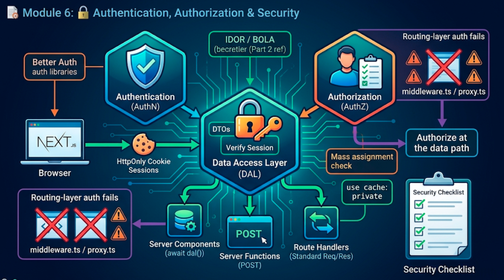
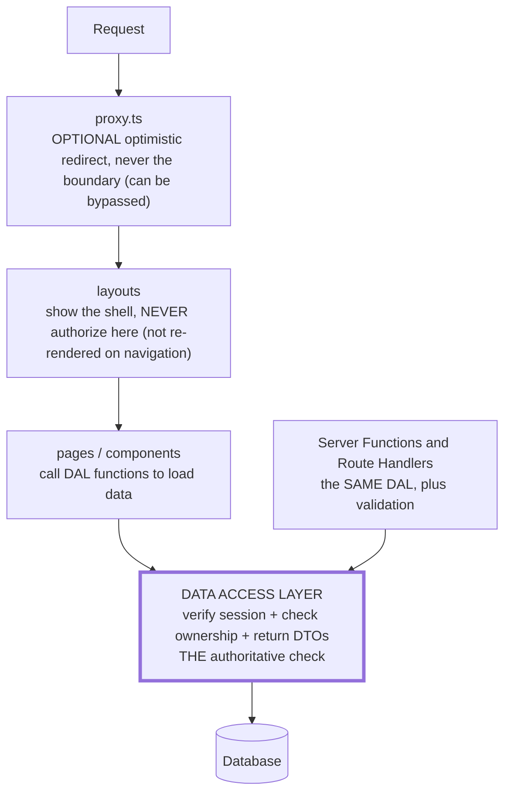
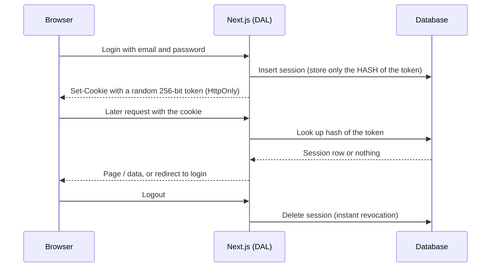
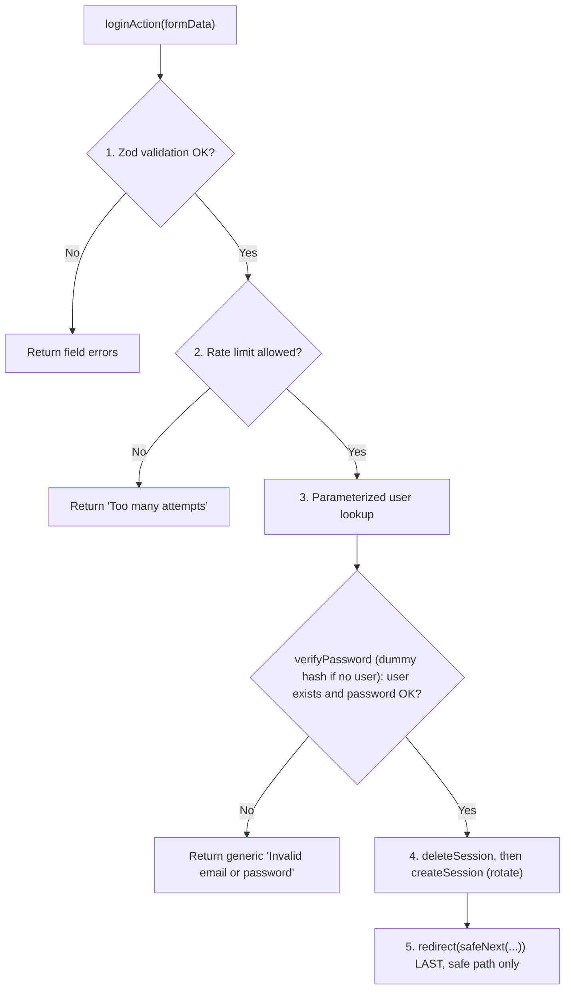
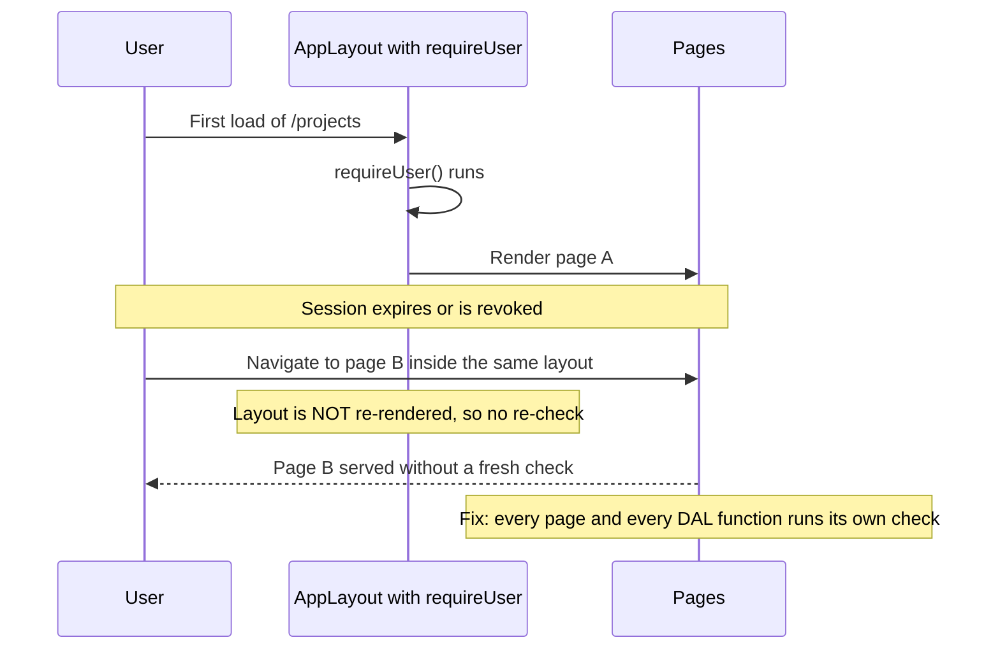
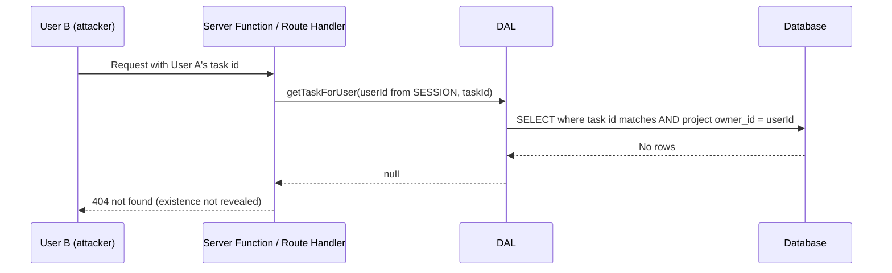

# Module 6: Authentication, Authorization & Security



## Words you will meet in this module

| Word                        | Simple meaning                                                                                          |
| --------------------------- | ------------------------------------------------------------------------------------------------------- |
| **Authentication (AuthN)**  | **Who are you?** Proving identity (password, passkey, social login).                                    |
| **Session management**      | Remembering that proof across requests, usually with a cookie.                                          |
| **Authorization (AuthZ)**   | **What may you do?** Checking permissions on each specific action and resource.                         |
| **Optimistic check**        | A quick check using only the cookie (no database). Good for UX redirects. **Not** a security guarantee. |
| **Secure check**            | A check that verifies the session against the database and the resource's owner, next to the data.      |
| **Data Access Layer (DAL)** | One server-only module that authenticates, authorizes and returns only safe data.                       |
| **DTO**                     | Data Transfer Object: a small object with only the fields you intend to expose.                         |
| **IDOR / BOLA**             | Accessing another user's object by changing an identifier. The most common API flaw.                    |
| **Session fixation**        | An attacker plants a known session ID before login and reuses it afterward.                             |
| **Open redirect**           | A login page that redirects to a URL the attacker controls (`?next=https://evil.example`).              |
| **Defense in depth**        | Several independent layers, so one failure does not expose data.                                        |
| **`use cache: private`**    | A cache directive whose result lives **only in the browser** and may read cookies and headers.          |

## 6.1: The Threat Model and the Advisories That Shaped It

Every earlier module added a security habit. This module puts them together, and it starts with a history lesson, because the history is why Next.js apps are built the way this module teaches.

### A record of routing-layer authorization failures

| When              | What happened                                                                                                                                                                                                                                                                                                                                                         | The lesson                                                    |
| ----------------- | --------------------------------------------------------------------------------------------------------------------------------------------------------------------------------------------------------------------------------------------------------------------------------------------------------------------------------------------------------------------- | ------------------------------------------------------------- |
| **March 2025**    | **CVE-2025-29927**: apps that relied on **middleware** for authorization could be bypassed by sending a crafted internal header                                                                                                                                                                                                                                       | Middleware is not a security boundary                         |
| **December 2025** | **CVE-2025-66478** (Next.js) and **CVE-2025-55182** (React): a critical remote-code-execution flaw (CVSS 10) in React Server Components' request handling. Patching was the fix                                                                                                                                                                                       | Patch fast. Server-side React endpoints are an attack surface |
| **January 2026**  | A follow-up release addressed an **incomplete fix** from the earlier advisories                                                                                                                                                                                                                                                                                       | Patches can be incomplete. Keep updating                      |
| **May 7, 2026**   | A coordinated release of **13 advisories** (7 high): **proxy/middleware bypasses** through App Router segment-prefetch URLs and dynamic-route parameter injection (for example **CVE-2026-44574**), RSC denial of service, SSRF through WebSocket upgrades, cache poisoning. Fixed in 15.5.18 and 16.2.6. No WAF rule could block them; **patching was the only fix** | Routing-layer auth fails in new ways                          |
| **July 2026**     | Another proxy bypass: App Router builds on Turbopack with a single `i18n.locales` entry. The vendor's workaround: **"enforce authorization in the page's server-side data path instead of relying solely on middleware"**                                                                                                                                             | Authorize at the data                                         |

(Release details are summarized from the Next.js advisories and security releases. Always read the current advisory list for your exact version.)

### What the pattern teaches

1. **Authorization enforced only in the routing layer (`middleware.ts` or `proxy.ts`) has been bypassed again and again, by different techniques.** You cannot predict the next one. So **do not make it your only protection.**
2. The official Next.js guidance is that "the majority of security checks should be performed as close as possible to your data source", and that Proxy "should not be your only line of defense."
3. **Stay patched.** Enable automated update pull requests (Dependabot or Renovate), subscribe to security advisories for the Next.js repository, and treat a security release as urgent, not routine.
4. **Layer your defenses**, so that a bypass of one layer exposes nothing.

If your authorization lives in the data path (a Data Access Layer, every Server Function, every Route Handler), a proxy bypass is an inconvenience instead of a breach. That is the architecture below.

#### Interview traps

- "Is it safe to protect routes only with middleware or proxy?" No. Both have had repeated authorization-bypass advisories. Use them for optimistic redirects, and enforce authorization where the data is accessed.
- "A new Next.js security release is out. Is it optional?" No. Several 2025 and 2026 releases had no WAF mitigation, so upgrading was the only fix. Automate dependency updates and test your auth routes in CI.

## 6.2: The Three Concepts and the Layers of Defense

Authentication has three separate jobs:

| Concept                | Question                         | Where in Next.js                                               |
| ---------------------- | -------------------------------- | -------------------------------------------------------------- |
| **Authentication**     | Who are you?                     | A login Server Function (credentials, OAuth, passkeys)         |
| **Session management** | Are you still that person?       | A cookie plus a session record (Topic 6.3)                     |
| **Authorization**      | May you do this to _this_ thing? | The Data Access Layer, every Server Function and Route Handler |

### Two kinds of checks

| Type           | Uses                                          | Fast?         | Trustworthy?                              | Use for                                       |
| -------------- | --------------------------------------------- | ------------- | ----------------------------------------- | --------------------------------------------- |
| **Optimistic** | The cookie only (is there one?)               | Yes           | **No.** The cookie may be forged or stale | Redirecting visitors, hiding buttons          |
| **Secure**     | The database session and the resource's owner | Needs a query | **Yes**                                   | Anything that reads or changes protected data |

### The layers



Everything above the DAL is convenience. The DAL is the lock on the door.

## 6.3: Sessions in Next.js: Database Sessions in HttpOnly Cookies

### Two session styles

The Next.js authentication guide describes both:

| Style                 | The cookie holds...                                                       | Revocation               | Server cost                 |
| --------------------- | ------------------------------------------------------------------------- | ------------------------ | --------------------------- |
| **Stateless**         | The session data itself, **signed or encrypted** (`jose`, `iron-session`) | Hard until it expires    | None per request            |
| **Database sessions** | Only a **random session ID**. The data lives in your database or Redis    | **Easy**: delete the row | One lookup per verification |

This series uses **database sessions**, the same design you built in [Part 2, Module 6](nodejs/authentication-and-security#63-sessions-vs-jwt): a 256-bit random token in an `HttpOnly` cookie, and **only the hash of the token** stored in the `sessions` table. You can revoke instantly (logout, "log out everywhere", password change), and a database leak does not hand an attacker working cookies. The tables and migrations from Part 2 apply unchanged.

(Stateless encrypted cookies are a fine, simpler choice when you accept the revocation trade-off. The rest of this module works with either, because the **DAL** hides the difference.)



### The session module

```ts
// lib/session.ts
import 'server-only';
import { cache } from 'react';
import { cookies } from 'next/headers';
import { createHash, randomBytes } from 'node:crypto';
import { pool } from '@/lib/db';

export const COOKIE = 'tf_sid'; // consider the "__Host-" prefix in production (HTTPS, Path=/)
const TTL_MS = 7 * 24 * 60 * 60 * 1000;
const sha256 = (value: string) =>
  createHash('sha256').update(value).digest('hex');

export type SessionUser = {
  id: number;
  email: string;
  name: string;
  role: 'member' | 'admin';
};

// Call ONLY from a Server Function or Route Handler: setting cookies is not allowed while rendering
export async function createSession(userId: number) {
  const token = randomBytes(32).toString('base64url'); // unguessable
  const expiresAt = new Date(Date.now() + TTL_MS);

  await pool.query(
    'INSERT INTO sessions (id_hash, user_id, expires_at) VALUES ($1, $2, $3)',
    [sha256(token), userId, expiresAt],
  );

  (await cookies()).set(COOKIE, token, {
    httpOnly: true, // JavaScript cannot read it (XSS cannot steal it)
    secure: process.env.NODE_ENV === 'production', // HTTPS only in production
    sameSite: 'lax', // not sent on cross-site subrequests (CSRF defense)
    path: '/',
    expires: expiresAt,
  });
}

export async function deleteSession() {
  const store = await cookies();
  const token = store.get(COOKIE)?.value;
  if (token)
    await pool.query('DELETE FROM sessions WHERE id_hash = $1', [
      sha256(token),
    ]);
  store.delete(COOKIE);
}

// Reads the cookie and verifies it against the database. Memoized for ONE request with React.cache
export const readSession = cache(async (): Promise<SessionUser | null> => {
  const token = (await cookies()).get(COOKIE)?.value;
  if (!token) return null;

  const { rows } = await pool.query<SessionUser>(
    `SELECT u.id, u.email, u.name, u.role
       FROM sessions s JOIN users u ON u.id = s.user_id
      WHERE s.id_hash = $1 AND s.expires_at > now()`,
    [sha256(token)],
  );
  return rows[0] ?? null;
});
```

Points to note:

- `server-only` keeps this file out of every client bundle ([Module 2](nextjs/server-and-client-components#22-server-components)).
- **`cache()` from React** means that calling `readSession()` from the layout, the page and a nested component runs the query **once per request**.
- **`readSession` reads `cookies()`, which is runtime data**, so components that call it must sit behind `<Suspense>` under Cache Components (Topic 6.7).
- Using `userId` and the verified user row, **never** an identifier from the URL or the form, is how you decide who is calling.
- **Rotate on login:** always create a **new** session when someone logs in, and delete any old one, to defeat session fixation (Topic 6.5).
- **Expiry:** this is an absolute 7-day lifetime. For sliding expiry, extend `expires_at` and re-set the cookie in a Server Function or Route Handler (you cannot set cookies during a Server Component render). Housekeeping: delete expired rows with a scheduled job.

#### Interview traps

- "Stateless cookie session or database session?" Stateless is simpler and needs no lookup, but cannot be revoked before it expires. Database sessions cost one lookup but can be revoked instantly. Choose based on whether you need immediate revocation (usually yes).
- "Why store only a hash of the session token?" So a database leak does not give an attacker working session cookies.
- "Where can you set a cookie in the App Router?" In Server Functions and Route Handlers (and Proxy), not while a Server Component renders.

## 6.4: The Data Access Layer

The Next.js guide's central recommendation for new projects: a **Data Access Layer (DAL)**, an internal library that controls **how and when data is fetched** and **what gets passed to your render context**. It does three things every time:

1. **Verifies the session** (who is calling?).
2. **Authorizes** (may they touch this resource?), inside the query.
3. **Returns DTOs** (only the fields the caller may see).

```ts
// lib/dal.ts
import 'server-only';
import { cache } from 'react';
import { notFound, redirect } from 'next/navigation';
import { readSession, type SessionUser } from '@/lib/session';

export type UserDTO = Pick<SessionUser, 'id' | 'name' | 'email' | 'role'>;

// May return null. Use where anonymous visitors are allowed
export const getUser = cache(
  async (): Promise<UserDTO | null> => readSession(),
);

// For pages and Server Functions: redirect to login if nobody is signed in
export async function requireUser(): Promise<UserDTO> {
  const user = await getUser();
  if (!user) redirect('/login');
  return user;
}

// For Route Handlers: return null so the handler can answer 401 as JSON
export const requireUserForApi = getUser;

// Roles: deny by default. Unauthorized users do not learn the page exists
export async function requireAdmin(): Promise<UserDTO> {
  const user = await requireUser();
  if (user.role !== 'admin') notFound();
  return user;
}
```

And the data functions take the **verified user id** and enforce ownership **in SQL**:

```ts
// lib/data/projects.ts
import 'server-only';
import { pool } from '@/lib/db';

export type ProjectDTO = { id: number; name: string };

export async function getProjectForUser(
  userId: number,
  projectId: number,
): Promise<ProjectDTO | null> {
  const { rows } = await pool.query<ProjectDTO>(
    'SELECT id, name FROM projects WHERE id = $1 AND owner_id = $2', // ownership is part of the query
    [projectId, userId],
  );
  return rows[0] ?? null; // not found OR not yours: the same answer
}
```

Used from a page:

```tsx
// app/(app)/projects/[projectId]/page.tsx
import { Suspense } from 'react';
import { notFound } from 'next/navigation';
import { requireUser } from '@/lib/dal';
import { getProjectForUser } from '@/lib/data/projects';

export default function ProjectPage({
  params,
}: PageProps<'/projects/[projectId]'>) {
  return (
    <Suspense fallback={<p>Loading project…</p>}>
      <ProjectDetails params={params} />
    </Suspense>
  );
}

async function ProjectDetails({
  params,
}: Pick<PageProps<'/projects/[projectId]'>, 'params'>) {
  const { projectId } = await params;
  const user = await requireUser(); // authenticate
  const project = await getProjectForUser(user.id, Number(projectId)); // authorize in the query
  if (!project) notFound(); // 404 for "not yours" too
  return <h1>{project.name}</h1>; // render a DTO
}
```

### Why this layout wins

| Benefit                            | Explanation                                                                                                         |
| ---------------------------------- | ------------------------------------------------------------------------------------------------------------------- |
| **One place to audit**             | Every read goes through functions that take a `userId`. A reviewer can grep for raw `pool.query` outside `lib/data` |
| **A proxy bypass exposes nothing** | The DAL runs for every render, Server Function and Route Handler, regardless of how the request arrived             |
| **No accidental over-exposure**    | Functions return DTOs, so a new database column is never sent to the browser by accident                            |
| **Caching stays safe**             | You authorize first, then pass `userId` into cached functions (Module 3)                                            |
| **Secrets in one file**            | The official guidance: only the DAL touches `process.env` for secrets                                               |

### Component-level access is for prototypes

The docs also mention reading the database directly inside components. They recommend that for **prototypes and learning only**. In a real app, every component calls the DAL.

### DTOs with per-field rules

Sometimes different viewers may see different fields. Encode that in the DAL, not the component:

```ts
export async function getTeamMemberForUser(viewer: UserDTO, memberId: number) {
  const m = await loadMember(memberId);
  if (!m) return null;
  return {
    name: m.name,
    email: viewer.role === 'admin' || viewer.id === m.id ? m.email : null, // only admins and the person themself
  };
}
```

#### Interview traps

- "What is a Data Access Layer?" A server-only module through which all data reads go. It verifies the session, enforces authorization inside the query, and returns minimal DTOs. It gives you one place to audit and keeps security independent of routing.
- "Why take `userId` as a parameter instead of reading the session inside every data function?" Explicit parameters make ownership scoping visible and testable, and let you pass the id into cached functions. The session read happens once, in `requireUser()`.
- "Why return 404 for resources the user does not own?" So an attacker cannot learn which IDs exist.

## 6.5: Sign-Up, Login and Logout with Server Functions

You wrote these routes in Express in Part 2. Here they are as Server Functions, reusing the same `hashPassword`/`verifyPassword` (scrypt) from [Part 2, Module 6](nodejs/authentication-and-security#62-password-storage), moved to `lib/password.ts` with `import "server-only"`.

### Small helpers

```ts
// lib/auth-helpers.ts
import 'server-only';
import { headers } from 'next/headers';
import { hashPassword } from '@/lib/password';

// Only follow redirects to RELATIVE paths on this site (prevents open redirects)
export function safeNext(
  value: FormDataEntryValue | null,
  fallback = '/projects',
): string {
  const s = typeof value === 'string' ? value : '';
  return s.startsWith('/') && !s.startsWith('//') && !s.startsWith('/\\')
    ? s
    : fallback;
}

// A client address. Trustworthy ONLY behind your own reverse proxy that sets the header
export async function clientIp(): Promise<string> {
  const h = await headers();
  return h.get('x-forwarded-for')?.split(',')[0]?.trim() ?? 'unknown';
}

// Hash computed once, used to keep response time similar for unknown emails
let dummy: Promise<string> | undefined;
export const dummyHash = () => (dummy ??= hashPassword('not-a-real-password'));
```

### The login Server Function

```ts
// app/(auth)/login/actions.ts
'use server';

import { redirect } from 'next/navigation';
import { z } from 'zod';
import { pool } from '@/lib/db';
import { verifyPassword } from '@/lib/password';
import { createSession, deleteSession } from '@/lib/session';
import { rateLimit } from '@/lib/rate-limit';
import { clientIp, dummyHash, safeNext } from '@/lib/auth-helpers';
import {
  type ActionState,
  fieldErrorsFrom,
  textValues,
} from '@/lib/actions/helpers';

const Login = z.object({
  email: z.string().trim().toLowerCase().email().max(254),
  password: z.string().min(1).max(128),
});

export async function loginAction(
  _prev: ActionState,
  formData: FormData,
): Promise<ActionState> {
  const parsed = Login.safeParse(Object.fromEntries(formData)); // 1. validate shape
  if (!parsed.success) {
    return {
      ok: false,
      fieldErrors: fieldErrorsFrom(parsed.error),
      values: textValues(formData, ['email']),
    };
  }
  const { email, password } = parsed.data;

  const limit = await rateLimit(
    `login:${await clientIp()}:${email}`,
    10,
    15 * 60,
  ); // 2. throttle brute force
  if (!limit.allowed)
    return {
      ok: false,
      message: 'Too many attempts. Try again in a few minutes.',
    };

  const { rows } = await pool.query<{ id: number; password_hash: string }>( // 3. look up (parameterized)
    'SELECT id, password_hash FROM users WHERE lower(email) = $1',
    [email],
  );
  const user = rows[0];
  const ok = await verifyPassword(
    password,
    user?.password_hash ?? (await dummyHash()),
  ); // always do the work
  if (!user || !ok) {
    return {
      ok: false,
      message: 'Invalid email or password',
      values: textValues(formData, ['email']),
    }; // generic message
  }

  await deleteSession(); // 4. rotate: never reuse a pre-login session
  await createSession(user.id);
  redirect(safeNext(formData.get('next'))); // 5. redirect LAST, only to a safe path
}

export async function logoutAction() {
  await deleteSession();
  redirect('/login');
}
```



### The forms

```tsx
// app/(auth)/login/login-form.tsx
'use client';
import { useActionState } from 'react';
import { useFormStatus } from 'react-dom';
import { loginAction } from './actions';
import { idle } from '@/lib/actions/helpers';

function Submit() {
  const { pending } = useFormStatus();
  return (
    <button type="submit" disabled={pending}>
      {pending ? 'Signing in…' : 'Sign in'}
    </button>
  );
}

export function LoginForm({ next }: { next?: string }) {
  const [state, action] = useActionState(loginAction, idle);
  return (
    <form action={action}>
      <input type="hidden" name="next" value={next ?? ''} />
      <label htmlFor="email">Email</label>
      <input
        id="email"
        name="email"
        type="email"
        autoComplete="email"
        defaultValue={!state.ok ? state.values?.email : ''}
      />
      <label htmlFor="password">Password</label>
      <input
        id="password"
        name="password"
        type="password"
        autoComplete="current-password"
      />
      <Submit />
      {!state.ok && state.message && <p role="alert">{state.message}</p>}
    </form>
  );
}
```

```tsx
// the logout button: a POST form, never a GET link
<form action={logoutAction}>
  <button type="submit">Sign out</button>
</form>
```

**Logout must be a `POST`** (a form), not a GET link. A GET link could be triggered by any other page (an ``), logging users out against their will.

### Registration

Registration follows the same steps: validate (min length 12 and long passphrases allowed), hash, `INSERT` with only whitelisted fields (**never** copy a `role` from the form), map the unique-violation code `23505` to "Email already registered", create a session, redirect. Registration inevitably reveals whether an email exists, so rate limit it and consider an email-verification flow for sensitive products.

### The rest of the account lifecycle

| Feature              | Rule (details in Part 2, Module 6)                                                                             |
| -------------------- | -------------------------------------------------------------------------------------------------------------- |
| Password reset       | Random token, store only its hash, expire in 15 to 60 minutes, single use, delete **all** sessions after reset |
| Password change      | Require the current password, then delete other sessions                                                       |
| "Log out everywhere" | `DELETE FROM sessions WHERE user_id = $1`                                                                      |
| MFA / passkeys       | Strongly consider them. A library makes them far easier (Topic 6.9)                                            |
| Email verification   | A single-use hashed token before the account is trusted for sensitive actions                                  |

#### Interview traps

- "Why must logout be a POST?" A GET logout can be triggered cross-site by an image or link, forcing users to log out. State-changing operations belong in non-GET requests.
- "How do you prevent open redirects after login?" Only redirect to relative paths that start with a single `/`. Reject absolute URLs and `//` or `/\` prefixes.
- "What is session fixation and how do you stop it?" An attacker sets a known session ID before login and reuses it. Always create a new session at login and delete any old one.
- "Why verify against a dummy hash when the email is unknown?" To make the response time similar, so attackers cannot discover registered emails by timing.

## 6.6: Protecting Routes: Where Checks Belong

### Layouts are the wrong place

```tsx
// app/(app)/layout.tsx : TEMPTING and WRONG as the only check
export default async function AppLayout({
  children,
}: {
  children: React.ReactNode;
}) {
  const user = await requireUser(); // runs on first load...
  return <Shell user={user}>{children}</Shell>;
}
```

Because of **partial rendering** ([Module 1](nextjs/getting-started-and-the-app-router#14-file-system-routing)), a layout **does not re-render when you navigate between the pages inside it**. A check in the layout runs when the layout is first rendered, **not on every navigation**. A session that expires or is revoked while the user clicks around is **not rechecked** by the layout. So the layout may show the shell, but **every page and every data function must perform its own check**, which is exactly what the DAL does.



### The recommended layout of checks

| Place                   | What to do                                                                                       |
| ----------------------- | ------------------------------------------------------------------------------------------------ |
| `proxy.ts`              | Optional **optimistic** redirect on cookie presence (Module 5). A convenience                    |
| `layout.tsx`            | Render the shell. Show the user's name from a streamed component. **No authorization decisions** |
| `page.tsx` / components | Call `requireUser()` and DAL functions at the point where data is loaded                         |
| Server Functions        | `requireUser()` and an ownership-scoped query, every time                                        |
| Route Handlers          | `requireUserForApi()` and an ownership-scoped query, every time                                  |
| Client Components       | UX only (hide a button). Never a security control                                                |

### 401 and 403 pages (experimental)

With the experimental `authInterrupts` flag you can call `unauthorized()` or `forbidden()` from `next/navigation` in Server Components, Server Functions and Route Handlers, and Next.js renders `unauthorized.tsx` or `forbidden.tsx`. There is an important limitation under Cache Components: **every dynamic route streams a static shell first**, so by the time your data-level check runs, the HTTP status has already been sent. The documentation therefore suggests running such interruption checks in **`proxy`** for those cases. For most apps the simpler, predictable approach is:

- **Not signed in** → `redirect("/login?next=…")`.
- **Signed in but not allowed (or not found)** → `notFound()`.

#### Interview traps

- "Why not authorize in the layout?" Layouts are not re-rendered on navigation between their child pages (partial rendering), so the check would not run on each navigation. Check where the data is loaded.
- "Where does a hidden button belong in your security model?" It is UX only. The Server Function or Route Handler behind it must authorize independently.

## 6.7: Authentication Under Cache Components

Reading the session (`cookies()`) is **runtime data**, so it cannot be prerendered into the static shell. The official guide ("Authentication with Cache Components") gives the patterns.

### 1. Stream the personal part behind `<Suspense>`

```tsx
import { Suspense } from 'react';

export default function HomePage() {
  return (
    <main>
      <h1>TaskFlow</h1> {/* static shell: instant */}
      <Announcements /> {/* cached: also in the shell */}
      <Suspense fallback={<p>Loading your dashboard…</p>}>
        <Dashboard /> {/* reads the session: streams per request */}
      </Suspense>
    </main>
  );
}

async function Announcements() {
  'use cache';
  cacheLife('hours');
  return <AnnouncementList items={await getAnnouncements()} />;
}

async function Dashboard() {
  const user = await requireUser(); // runtime data, inside the boundary
  const projects = await getProjectsForUser(user.id);
  return <ProjectGrid projects={projects} />;
}
```

Reading `cookies()` **outside** a boundary is a build error. Keep the read as **deep** as possible (push dynamic access down, Module 3) so the rest of the page stays static.

### 2. Share the user with Client Components without prop drilling

Create the promise **inside** the boundary, pass it through a context, and unwrap it with `use()`:

```tsx
// app/user-provider.tsx
'use client';
import { createContext, use, useContext } from 'react';
import type { UserDTO } from '@/lib/dal';

const UserContext = createContext<Promise<UserDTO> | null>(null);

export function UserProvider({
  userPromise,
  children,
}: {
  userPromise: Promise<UserDTO>;
  children: React.ReactNode;
}) {
  return <UserContext value={userPromise}>{children}</UserContext>;
}

export function useUser(): UserDTO {
  const promise = useContext(UserContext);
  if (!promise) throw new Error('useUser must be used within <UserProvider>');
  return use(promise); // suspends until the server resolves it
}
```

```tsx
// a Server Component inside <Suspense>
async function AuthedShell({ children }: { children: React.ReactNode }) {
  const userPromise = requireUser(); // a Promise created on the SERVER, not awaited here
  return <UserProvider userPromise={userPromise}>{children}</UserProvider>;
}
```

The promise is created **once on the server and passed down**, which is the stable-promise rule you learned for `use()` in Part 1.

### 3. Cache data **derived from** the session, safely

A user session is valid for a while, so personal data can be given a cache lifetime and even prefetched. There are two correct ways:

| Approach                                             | How it works                                                                                                                             | Where the result lives                 |
| ---------------------------------------------------- | ---------------------------------------------------------------------------------------------------------------------------------------- | -------------------------------------- |
| **Extract the id, pass it to a plain `"use cache"`** | Read the cookie and **authorize outside** the cache, then call a cached function with `userId` as an argument (so it is part of the key) | The **server** cache (per instance)    |
| **`"use cache: private"`**                           | The cached function may call `cookies()` and `headers()` directly (it cannot call `connection()`)                                        | **The browser only**, never the server |

```ts
// Option A: server cache, keyed by the argument
async function CachedTasks({ userId }: { userId: number }) {
  "use cache";
  cacheLife("minutes");
  cacheTag(`tasks:user:${userId}`);
  return <TaskTable tasks={await getTasksForUser(userId)} />;
}

// Option B: browser-only cache that reads the session itself
export async function getCurrentUser(): Promise<UserDTO> {
  "use cache: private";
  cacheLife({ stale: 60 });
  return requireUser();
}
```

Both give personalized content a lifetime so the router can prefetch it. **Never** put per-user data in a shared `"use cache"` function that is not keyed by the user, and remember the rule from Module 3: **authorize before you read from a cache.**

### Instant-navigation validation

With Cache Components, **instant navigation validation flags every route that reads the session**, because a request read cannot be prerendered into the static shell. You do not have to resolve all of these before shipping. Adding a cache lifetime (Option A or B) is how you let the framework prefetch that personal content.

#### Interview traps

- "Why does my build fail after I add `cookies()` to a layout?" Under Cache Components, reading runtime data outside a `<Suspense>` boundary is an error. Move the read into a component inside a boundary, as deep as possible.
- "How do Client Components get the current user?" Pass a promise created on the server through a context provider, and read it with `use()`. Do not fetch the user again in the browser.
- "Can a `use cache` function read `cookies()`?" Not a plain one. Read cookies outside and pass the id in, or use `use cache: private` (browser-only result).

## 6.8: Authorization: Ownership and Roles

### Ownership (BOLA/IDOR), the flaw behind most breaches

Part 2 showed that the most common serious API bug is letting user B read user A's object by changing an id. The cure is identical here: **every query that touches user-owned data includes the owner**.

```ts
// lib/data/tasks.ts
export async function getTaskForUser(userId: number, taskId: number) {
  const { rows } = await pool.query(
    `SELECT t.id, t.project_id AS "projectId", t.title, t.status, t.version
       FROM tasks t JOIN projects p ON p.id = t.project_id
      WHERE t.id = $1 AND p.owner_id = $2`, // the join to the owner is part of the read
    [taskId, userId],
  );
  return rows[0] ?? null;
}

export async function toggleTaskForUser(
  userId: number,
  taskId: number,
  expectedVersion: number,
) {
  const { rows } = await pool.query(
    `UPDATE tasks t
        SET status = CASE WHEN t.status = 'done' THEN 'todo' ELSE 'done' END,
            version = t.version + 1, updated_at = now()
       FROM projects p
      WHERE t.id = $1 AND p.id = t.project_id AND p.owner_id = $2 AND t.version = $3    -- owner AND version in the write
      RETURNING t.id, t.project_id AS "projectId"`,
    [taskId, userId, expectedVersion],
  );
  return rows[0] ?? null;
}
```



Do this in **every** data function, and put it in the **write** as well as the read.

### Roles (RBAC)

```ts
// admin-only page
export default async function AdminPage() {
  await requireAdmin(); // notFound() for non-admins: the page does not appear to exist
  // ...
}
```

Apply the principles from Part 2: **deny by default**, **least privilege**, take the identity from the **session** (never from the request body), and make admin actions rare and audited. For organizations ("multi-tenancy"), take the **organization id from the session or a verified membership row**, not from a URL parameter, and include it in every query.

### Row-level security (defense in depth)

PostgreSQL's **row-level security (RLS)** lets the **database** itself refuse rows the current user may not see. It is a powerful extra layer, but it takes care with connection pooling (the "current user" must be set per transaction). Treat it as an addition to, not a replacement for, DAL checks. Your ownership-scoped SQL remains the primary control.

### Test the negative cases

For every protected resource, write a test where **user B tries to read, update and delete user A's resource**, and assert a 404 or a refusal. Without negative tests, nobody notices when a refactor drops an ownership condition. Module 8 shows how to automate this with Playwright and database tests.

#### Interview traps

- "How do you prevent IDOR in a Next.js app?" Scope every data function by the authenticated user (join to the owner in the SQL), take the user from the verified session, return 404 for non-owned resources, and test that user B cannot access user A's data.
- "Where does the tenant or organization id come from?" From the verified session or membership, never from a URL or form field the client controls.

## 6.9: Auth Libraries: Better Auth, Clerk and Others

You have now built the primitives. Their value is that you understand what a library does for you. For production, a maintained library handles a long list of hard problems: social login, password reset, email verification, MFA, passkeys, session management, rate limiting and breached-password checks.

| Option                                          | What it is                                                                                                     | Notes                                                                                                                                                                       |
| ----------------------------------------------- | -------------------------------------------------------------------------------------------------------------- | --------------------------------------------------------------------------------------------------------------------------------------------------------------------------- |
| **Better Auth**                                 | An open-source, TypeScript-first auth library with a plugin ecosystem (organizations, 2FA, passkeys, and more) | **Auth.js (NextAuth) joined the Better Auth project in September 2025.** Auth.js continues with security maintenance, and new projects are generally pointed to Better Auth |
| **Auth.js (NextAuth)**                          | The long-standing open-source option for OAuth and credentials                                                 | In maintenance mode. Fine for existing apps                                                                                                                                 |
| **Clerk**                                       | A hosted service with prebuilt UI components, organizations and a dashboard                                    | Fastest to ship. Ongoing cost and vendor dependence                                                                                                                         |
| **Auth0, WorkOS, Supabase Auth, Firebase Auth** | Hosted identity platforms. WorkOS and Auth0 are strong for enterprise SSO (SAML)                               | Choose by pricing, enterprise features and where your data lives                                                                                                            |
| **`iron-session` or `jose`**                    | Low-level building blocks for **encrypted or signed cookie sessions**                                          | You write the login flows. Used in the official guide's examples                                                                                                            |
| **Passkeys (WebAuthn)**                         | Phishing-resistant, passwordless login                                                                         | Usually added through a library (for example SimpleWebAuthn or a provider's plugin)                                                                                         |

### How to choose

| If...                                                                  | Then...                                                                                      |
| ---------------------------------------------------------------------- | -------------------------------------------------------------------------------------------- |
| You need social login, MFA, organizations or SSO soon                  | Use a library or a hosted provider. Do not build these yourself                              |
| Your needs are simple (email + password, one app) and you want control | The session code in this module is a legitimate starting point                               |
| You must keep user data in your own database                           | Better Auth or Auth.js style libraries (data in your DB) rather than a hosted identity store |
| Compliance and audit evidence matter                                   | A hosted provider or a well-supported library with audit features                            |

### Keep your architecture either way

A library changes **how you get the session**. It does not change **how you authorize**. Wrap the library's session read in your DAL:

```ts
// lib/dal.ts : the library is an implementation detail behind getUser()
export const getUser = cache(async (): Promise<UserDTO | null> => {
  const session = await auth.api.getSession({ headers: await headers() }); // the library's call (API varies by library)
  if (!session) return null;
  return {
    id: session.user.id,
    name: session.user.name,
    email: session.user.email,
    role: session.user.role ?? 'member',
  };
});
```

Everything else stays the same: `requireUser()`, ownership-scoped data functions, DTOs, validation in Server Functions. If you swap libraries later, only `getUser()` changes.

### OAuth ("Sign in with Google") in one paragraph

Use the **Authorization Code flow with PKCE**, verify the ID token (signature, issuer, audience, nonce), check the `state` parameter, and require **exact** registered redirect URIs. Let a library do this ([Part 2, Module 6](nodejs/authentication-and-security#69-oauth-20-and-oidc-sign-in-with-google) has the diagram), and finish by creating **your own** session. Treat an email returned by a provider as verified only if the provider says it is.

#### Interview traps

- "Build auth yourself or use a library?" Build the primitives to understand them. Use a library for anything beyond the simplest case, because social login, MFA, passkeys and reset flows are easy to get subtly wrong. Keep authorization in your own DAL regardless.
- "What happened to Auth.js?" It joined the Better Auth project in September 2025 and continues with security maintenance. New projects are typically steered toward Better Auth.

## 6.10: A Security Checklist for Next.js Apps

| Area                 | Check                                                                                                                                                       |
| -------------------- | ----------------------------------------------------------------------------------------------------------------------------------------------------------- |
| **Patching**         | On a supported Next.js and React release. Dependabot or Renovate enabled. Subscribed to the Next.js security advisories. Security releases applied promptly |
| **Authorization**    | A DAL used everywhere. Ownership in every query. DTOs returned. **Not** relying on proxy or layouts                                                         |
| **Server Functions** | Each one: authenticate, validate, authorize, rate limit, minimal return (Module 4)                                                                          |
| **Route Handlers**   | Same checklist, plus CSRF defense for cookie-authenticated state-changing methods (Module 5)                                                                |
| **Proxy**            | Only optimistic redirects. No slow work. A negative matcher. Not relied on for Server Functions                                                             |
| **Sessions**         | Random 256-bit token, only its hash stored, `HttpOnly` + `Secure` + `SameSite`, rotation on login, revocation                                               |
| **Passwords**        | scrypt, argon2id or bcrypt. Long passphrases allowed. Rate limited. Generic errors                                                                          |
| **Cookies and CSRF** | `SameSite=Lax`, Origin check on Route Handlers, logout as POST                                                                                              |
| **Redirects**        | `next` parameters limited to relative same-site paths                                                                                                       |
| **Environment**      | Secrets read only in the DAL. No secrets in `NEXT_PUBLIC_`. Validated at startup                                                                            |
| **XSS**              | No `dangerouslySetInnerHTML` with user data (sanitize if unavoidable). Review third-party scripts                                                           |
| **CSP and headers**  | `nosniff`, referrer policy, frame protection. A CSP approach compatible with your rendering mode (Module 5)                                                 |
| **SSRF**             | `images.remotePatterns` restricted to hosts you trust. Allowlist any user-supplied URL your server fetches. Review WebSocket upgrade proxying               |
| **Uploads**          | Size limits, magic-byte checks, generated names, object storage with presigned URLs                                                                         |
| **Caching**          | Authorize **before** cached reads. Per-user data keyed by user. No personal data in shared caches                                                           |
| **Errors**           | Generic messages to clients. Details in server logs only (use the error `digest` to correlate)                                                              |
| **Monitoring**       | Log auth failures and authorization denials. Alert on bursts. Error tracking (Module 8)                                                                     |
| **Tests**            | Negative authorization tests for every protected resource, run in CI                                                                                        |

#### Tricky Questions and Answers

###### Q1 [SDE-3]: Design authentication for a Next.js 16.4 app with Cache Components. Walk through the layers.

**Answer:** Use database sessions: a random token in an `HttpOnly`, `Secure`, `SameSite=Lax` cookie, only its hash stored, revocable. Build a Data Access Layer: `requireUser()` (memoized per request with `React.cache`) verifies the cookie against the database, and every data function takes the verified `userId` and enforces ownership inside the SQL and returns DTOs. Because reading the session is runtime data, the personal regions of pages sit behind `<Suspense>` as deep as possible, with the public parts in the static shell. Per-user data may be cached by passing `userId` into a `"use cache"` function (after authorization) or with `"use cache: private"`. Server Functions and Route Handlers each authenticate, validate, authorize and rate limit. `proxy.ts` only does an optimistic redirect on cookie presence. Login rotates the session, redirects only to safe paths, and logout is a POST. Keep Next.js patched.

###### Q2 [SDE-3]: Your proxy verifies the JWT signature and redirects invalid users. A reviewer says it is not enough. Give two independent reasons.

**Answer:** First, proxy has had multiple authorization-bypass advisories (for example through segment-prefetch URLs and dynamic-route parameter injection), and a matcher can skip paths and Server Function calls, so a request can reach your handlers without passing through it. The actual data access must verify authorization itself. Second, a valid signature only proves the token was issued and not tampered with. It does not prove the session is still valid (revocation, logout, role changes) or that this user may access **this** resource. Those checks need the database and the resource's owner, in the data path.

###### Q3 [SDE-2]: After login the app redirects to whatever `?next=` says. Describe the attack and the fix.

**Answer:** It is an open redirect: an attacker sends a victim a link to the real login page with `?next=https://evil.example`, and after a successful login the victim lands on a look-alike site that can phish them. Fix by accepting only relative paths that begin with a single `/` (reject `//`, `/\` and absolute URLs), and fall back to a default.

###### Q4 [SDE-2]: An engineer put `await requireUser()` in the `(app)/layout.tsx` and removed checks from pages. Explain the vulnerability.

**Answer:** Layouts are not re-rendered when you navigate between pages that share them, so the check runs when the layout is first rendered and not on each navigation or each data read. A session that expires or is revoked, or a request that reaches a page or Server Function directly, is not re-checked. Authorization must happen where data is loaded (the DAL), in every page, Server Function and Route Handler.

###### Q5 [SDE-2]: Why return `notFound()` instead of a 403 for another user's project?

**Answer:** A 403 confirms that the project exists, which lets an attacker enumerate valid IDs. A 404 for both "does not exist" and "not yours" reveals nothing. Use `forbidden`-style responses only when existence is already known to the user and the action is genuinely not permitted.

###### Q6 [SDE-3]: A cached component renders `<ProjectHeader projectId={id} />` with `"use cache"` keyed by `id`. Users report seeing other users' project names. What went wrong?

**Answer:** The cached function stores its result by `projectId` and returns it to anyone who asks, and the page calls it **before** verifying ownership. A cache stores results, not permissions. Authorize first (an ownership-scoped query through the DAL, `notFound()` if not owned), pass the verified `userId` into the cached function so it is part of the key, return a DTO, and add a negative test.

---

## Hands-On Lab: Lock Down TaskFlow

```
1. Reuse the Part 2 migrations (users, sessions, projects.owner_id). Add lib/password.ts (scrypt),
   lib/session.ts, lib/dal.ts, lib/auth-helpers.ts, lib/rate-limit.ts as shown.
2. Implement register, login and logout Server Functions with useActionState forms.
   Check the database: is only a hash stored in sessions.id_hash? Is the cookie HttpOnly (DevTools → Application)?
3. Make logout a POST form. Try to log out with an  on another page: it must not work.
4. Protect every page and Server Function with requireUser() and ownership-scoped data functions.
   Create two users in two browser profiles. As user B, open a URL of user A's project: you must see a 404.
5. Open redirect test: visit /login?next=//evil.com and /login?next=https://evil.com. After login you must
   land on the default page. Then ?next=/projects/1 must work.
6. Session fixation test: copy a session cookie value before login, log in, and verify the old value no longer works.
7. Put an optimistic redirect in proxy.ts. Then DELETE proxy.ts. Is any data still exposed? (It must not be.)
   Add it back.
8. Move the user shell into a streamed component and give client components the user through UserProvider
   and use(). Confirm the build passes with Cache Components, and the static shell appears instantly.
9. Cache a per-user task list with "use cache" (userId as an argument, tag tasks:user:ID). Prove that user B cannot see
   user A's cached data. Then try "use cache: private" for the current-user lookup.
10. Rate limiting: make 11 wrong logins quickly. Confirm the throttle. Check the generic error message and
    compare the response time for unknown versus known emails.
11. Run npm audit. Add Dependabot (or Renovate). Check your Next.js version against the latest security release.
12. Optional: replace session.ts with a library (for example Better Auth) behind getUser(), without changing
    the rest of the app. What stayed the same? What changed?
```

Questions to answer for yourself:

- If `proxy.ts` and the layout checks vanished tomorrow, which of your protections would still hold?
- Which functions in your codebase take a `userId`, and are there any data reads that do not?
- What can an attacker learn from your error messages and response times?

---

## Module 6 Cheat Sheet

| Concept                          | One-line interview answer                                                                                               |
| -------------------------------- | ----------------------------------------------------------------------------------------------------------------------- |
| Advisory history                 | Middleware/proxy-based authorization was bypassed repeatedly (2025 and 2026). Do not make it the boundary.              |
| Official guidance                | Do most security checks as close to the data as possible. Proxy is optional and not the only defense.                   |
| Optimistic vs. secure            | Optimistic: cookie only, for UX redirects. Secure: verified against the DB and resource owner.                          |
| Session styles                   | Stateless signed/encrypted cookie (hard to revoke) vs. database session with a random ID (revocable).                   |
| Session token storage            | Random 256-bit token in an `HttpOnly`, `Secure`, `SameSite=Lax` cookie. Store only its hash.                            |
| Setting cookies                  | Only in Server Functions and Route Handlers, not while rendering.                                                       |
| `React.cache(readSession)`       | Verifies the session once per request across layout, page and components.                                               |
| Data Access Layer                | Server-only functions that verify the session, enforce ownership in SQL, return DTOs.                                   |
| Layout checks                    | Not sufficient. Layouts are not re-rendered on navigation. Check where data is loaded.                                  |
| Login checklist                  | Validate, rate limit, generic error, dummy-hash timing, rotate session, safe redirect.                                  |
| Logout                           | A POST form, never a GET link.                                                                                          |
| Open redirect                    | Allow only relative paths starting with a single `/`.                                                                   |
| Session fixation                 | Always create a new session at login and delete the old one.                                                            |
| IDOR / BOLA                      | Join to the owner in every read **and** write. Return 404 for non-owned. Test with a second user.                       |
| Cache Components + auth          | Session read is runtime data: behind `<Suspense>`, as deep as possible.                                                 |
| Share user with clients          | Create the promise on the server inside the boundary, pass via context, read with `use()`.                              |
| Caching personal data            | Authorize first. Pass `userId` to a plain `use cache`, or use `use cache: private` (browser only).                      |
| `unauthorized()` / `forbidden()` | Experimental (`authInterrupts`). With Cache Components, status is sent with the shell, so prefer redirect/`notFound()`. |
| Libraries                        | Better Auth (Auth.js joined it, Sept 2025), Clerk, Auth0, WorkOS, Supabase. Wrap in your DAL's `getUser()`.             |
| Stay patched                     | Automate updates, subscribe to advisories, upgrade on every security release.                                           |
| Negative tests                   | User B must not read, change or delete user A's data. Run in CI.                                                        |
