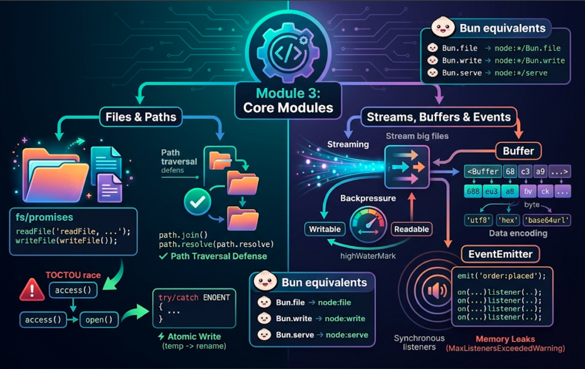
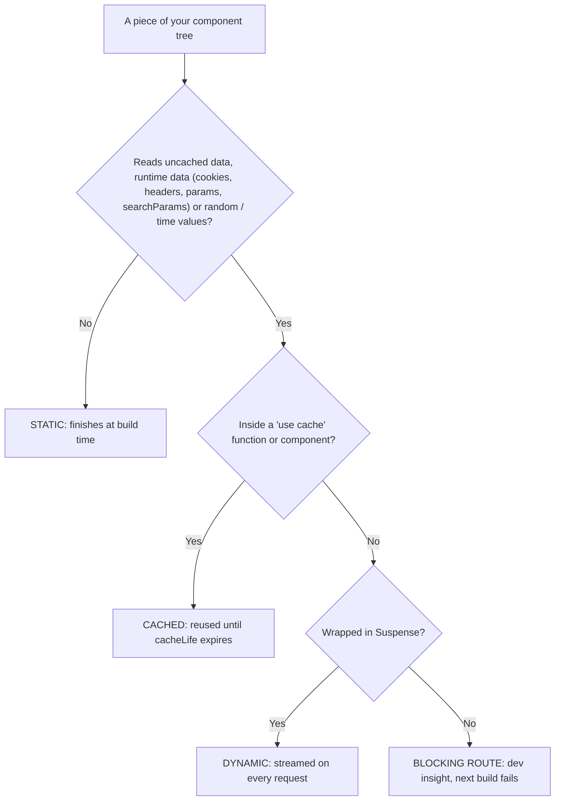
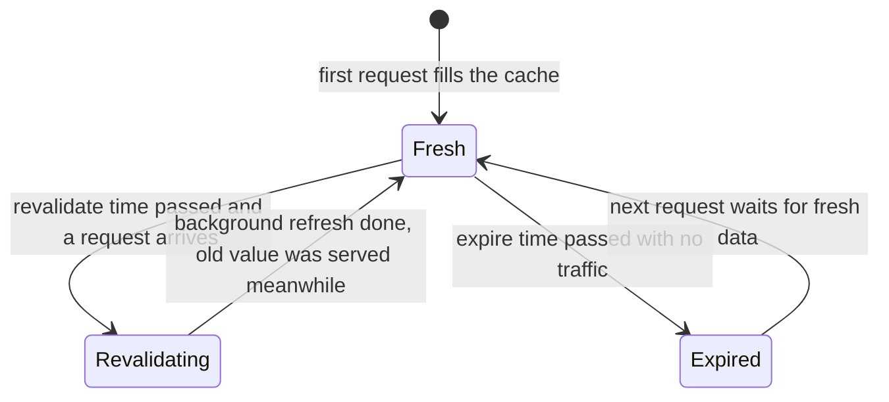
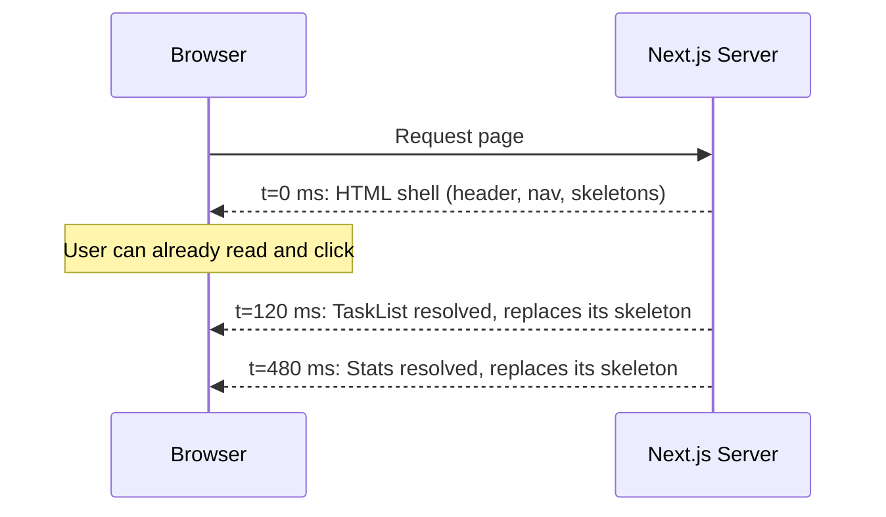
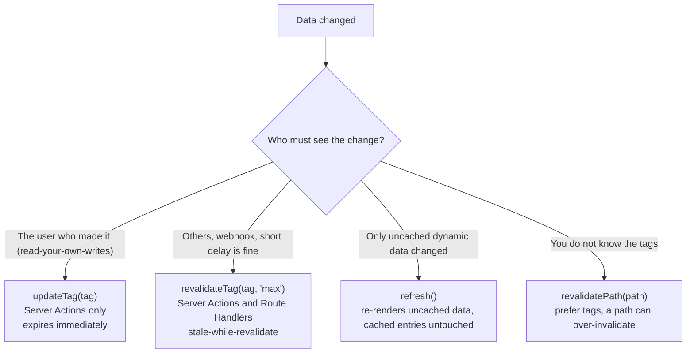
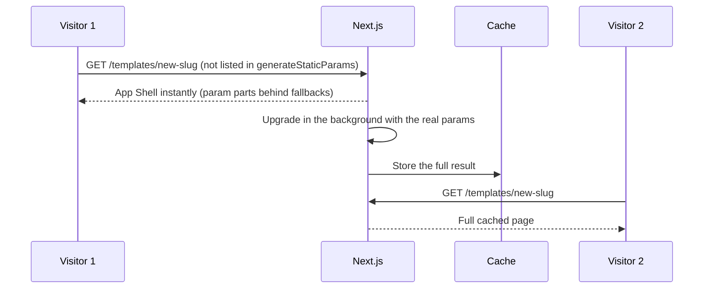

# Module 3: Data Fetching, Caching & Streaming (Cache Components)



## Words you will meet in this module

| Word                           | Simple meaning                                                                                                         |
| ------------------------------ | ---------------------------------------------------------------------------------------------------------------------- |
| **Cache Components**           | Next.js's current caching model (`cacheComponents: true`). Nothing is cached unless you say so with `"use cache"`.     |
| **`"use cache"`**              | A directive that caches the result of an async function or component for a lifetime.                                   |
| **`cacheLife`**                | Sets how long a cached result stays fresh (a named profile or custom `stale` / `revalidate` / `expire`).               |
| **`cacheTag`**                 | Labels a cached result so you can invalidate it on demand.                                                             |
| **Static shell**               | The pre-built HTML + RSC payload of a route, served instantly (even from a CDN).                                       |
| **PPR (Partial Prerendering)** | A route that is part static (the shell) and part dynamic (streamed in per request). The default with Cache Components. |
| **App Shell**                  | The reusable, URL-independent static shell of a route whose params are not known at build time.                        |
| **Runtime data**               | Data only known when a request arrives: `cookies()`, `headers()`, `searchParams`, unknown `params`.                    |
| **Blocking route**             | A route that cannot produce a static shell because something uncached is not wrapped in `<Suspense>`.                  |
| **Streaming**                  | Sending the page to the browser in pieces as each piece becomes ready.                                                 |
| **Stale-while-revalidate**     | Serve the old cached value immediately while a fresh one is computed in the background.                                |
| **Read-your-own-writes**       | After you change something, you immediately see your change (not an old cached copy).                                  |
| **ISR**                        | Incremental Static Regeneration: pages for unknown params are built after the first visit and then cached.             |
| **Data Access Layer (DAL)**    | One server-only place where all database and API reads live.                                                           |

## 3.1: Fetching Data in Server Components

### The simplest case

A Server Component is just an `async` function. You `await` whatever you need:

```tsx
// app/(app)/projects/page.tsx
import { getProjectsForUser } from '@/lib/data/projects';

export default async function ProjectsPage() {
  const projects = await getProjectsForUser(); // database call, runs on the server
  return <ProjectList projects={projects} />;
}
```

The data can come from:

| Source                          | Example                                            |
| ------------------------------- | -------------------------------------------------- |
| **Your database**               | `pool.query(...)`, an ORM. No API layer needed     |
| **Another service via `fetch`** | Your Part 2 Node.js API, a CMS, a payment provider |
| **The file system**             | Markdown content, JSON config                      |

Server-side `fetch` is the normal `fetch` you already know. Under Cache Components it is **not cached by default** (see Topic 3.2), so each render hits the source unless you opt in with `"use cache"`.

### Avoid waterfalls: fetch in parallel

A **waterfall** is a chain of requests where each waits for the previous one even though they do not depend on each other. On the server this wastes time on every page view.

```tsx
// WATERFALL: tasks wait for the project, though they are independent
const project = await getProject(projectId);
const tasks = await getTasks(projectId);

// PARALLEL: both start at the same time
const [project, tasks] = await Promise.all([
  getProject(projectId),
  getTasks(projectId),
]);
```

The most scalable way to stay parallel is to let **separate components** fetch their own data, each inside its own `<Suspense>` boundary. They start together and stream in as each finishes:

```tsx
export default function ProjectPage({
  params,
}: PageProps<'/projects/[projectId]'>) {
  return (
    <>
      <Suspense fallback={<HeaderSkeleton />}>
        <ProjectHeader params={params} />
      </Suspense>
      <Suspense fallback={<TasksSkeleton />}>
        <TaskList params={params} />
      </Suspense>
      <Suspense fallback={<StatsSkeleton />}>
        <ProjectStats params={params} />
      </Suspense>
    </>
  );
}
```

A nested layout of components that each `await` **inside their parent's render** (parent awaits, then renders a child that awaits) creates a waterfall again. Keep independent reads at the **same level**.

### The same data, asked for twice

If the layout and the page both need `getCurrentUser()`, do not worry about duplicate queries. Wrap the loader in `React.cache` ([Module 2](nextjs/server-and-client-components#25-sharing-data-and-environment-variables)) so it runs once **per request**. Identical `fetch` GET calls within a render are de-duplicated for you as well.

### Errors and missing data

```tsx
const project = await getProject(projectId);
if (!project) notFound(); // renders the nearest not-found.tsx
```

Unexpected failures simply throw: the nearest **`error.tsx`** (route-level) catches them. For a failure that should affect **only one widget**, wrap just that subtree in a component-level error boundary (Next.js provides `catchError` for this; see its API reference) so the rest of the page keeps working.

### Client-side fetching still has a place

Server fetching is the default for **reading**. Use a client data library (TanStack Query from Part 1) when the **user's interaction drives the data**: infinite scroll, live polling, search-as-you-type, or data that must refresh while the page stays open. You can seed it with server data (`initialData` or a hydrated cache) so the first paint still comes from the server.

#### Interview traps

- "Do I still need `useEffect` + `fetch` in Next.js?" For initial page data, no: `await` in a Server Component. Keep client fetching for interaction-driven, live or paginated-on-scroll data.
- "How do you avoid a request waterfall?" Start independent requests together (`Promise.all`) or give each its own component inside its own `<Suspense>`, and do not nest sequential awaits.
- "Does Next.js cache `fetch` by default in 16?" No. With Cache Components nothing is cached unless you opt in with `"use cache"`.

## 3.2: Static, Cached and Streaming: The Three Kinds of Content

This is the single most important idea in Next.js 16. When you build, Next.js **pre-renders** every route and looks at each piece of your component tree. Every piece falls into exactly one of three kinds.

| Kind                   | What it is                                                                 | How you get it                               | When it runs                                              |
| ---------------------- | -------------------------------------------------------------------------- | -------------------------------------------- | --------------------------------------------------------- |
| **Static**             | Same for everyone, always. No async data, no request data                  | Just write the component                     | **Build time**                                            |
| **Cached**             | Async data that is the same for many users and OK to reuse for a while     | Add `"use cache"` + `cacheLife`              | Build time or first request, then reused until it expires |
| **Dynamic (streamed)** | Depends on the request (cookies, user, params) or must be fresh every time | Wrap in `<Suspense>` (and read request data) | **Every request**, streamed in                            |

```
 One TaskFlow page, three kinds of content:

 ┌─────────────────────────────────────────────────────────────┐
 │  TaskFlow  ▸ Projects ▸ Settings         ← STATIC           │  built once, served from a CDN
 ├─────────────────────────────────────────────────────────────┤
 │  Welcome, Asha!                          ← DYNAMIC (cookies)│  streams in ("Loading…" shown first)
 ├─────────────────────────────────────────────────────────────┤
 │  Popular templates (same for everyone)   ← CACHED, 1 hour   │  part of the shell, refreshed hourly
 ├─────────────────────────────────────────────────────────────┤
 │  Your tasks                              ← DYNAMIC (user)   │  streams in behind a skeleton
 └─────────────────────────────────────────────────────────────┘

 The browser first receives the STATIC SHELL: static + cached content and the fallbacks.
 The dynamic parts then stream into their places as they finish.
```

This is **Partial Prerendering (PPR)**, the default with Cache Components. The shell is served instantly, from a CDN if your platform has one, and the rest streams in. Old models forced a whole route to be _either_ static _or_ dynamic. Now a single route is both.

### The rule that Next.js enforces

> Every component that needs **uncached data** or **runtime data** must either be wrapped in a **`<Suspense>`** boundary (so the shell has a fallback to show), or have its result **cached** with `"use cache"`.

If you break the rule, the dev overlay shows a **blocking route** insight with fix cards, and `next build` fails. This is deliberate: the framework refuses to silently produce a slow page. It teaches you the rendering model as you work.

### What counts as what

| Code in a component                                                                | Treated as                                                     |
| ---------------------------------------------------------------------------------- | -------------------------------------------------------------- |
| Imports, pure computation, `fs.readFileSync`, synchronous DB (`node:sqlite`)       | **Static** (finishes during prerender)                         |
| `await db.query(...)` / `await fetch(...)` with no directive                       | **Uncached data** → needs Suspense or `"use cache"`            |
| `await cookies()`, `await headers()`, `await searchParams`, unknown `await params` | **Runtime data** → needs Suspense                              |
| `Math.random()`, `Date.now()`, `crypto.randomUUID()`                               | **Non-deterministic** → `connection()` + Suspense, or cache it |
| Anything inside a `"use cache"` function or component                              | **Cached**                                                     |



`<Suspense>` itself does not make something dynamic. It is only the **fallback slot**. A component that does only synchronous work completes during prerender whether or not it sits inside a boundary.

#### Interview traps

- "What is Partial Prerendering?" A route that is part static shell (served instantly) and part dynamic content streamed per request. It is the default behavior with Cache Components.
- "What is a blocking route?" A route that cannot produce a static shell because uncached or runtime data is read with no `<Suspense>` boundary or cache covering it. The build fails so that you fix it.
- "Does `<Suspense>` make a component dynamic?" No. It provides fallback UI while async work completes. Dynamic means the work depends on the request or is uncached.

## 3.3: `"use cache"`, `cacheLife` and `cacheTag`

### Two levels

**Data-level:** cache a function that returns data (reusable across many components):

```ts
// lib/data/projects.ts
import 'server-only';
import { cacheLife, cacheTag } from 'next/cache';
import { pool } from '@/lib/db';

export async function getProjectsForUser(userId: number) {
  'use cache';
  cacheLife('minutes');
  cacheTag(`projects:${userId}`);

  const { rows } = await pool.query<{ id: number; name: string }>(
    'SELECT id, name FROM projects WHERE owner_id = $1 ORDER BY id',
    [userId],
  );
  return rows;
}
```

**UI-level:** cache a whole component (or page, or layout) including the HTML it renders:

```tsx
// components/popular-templates.tsx
import { cacheLife } from 'next/cache';

export async function PopularTemplates() {
  'use cache';
  cacheLife('hours');

  const templates = await getTemplates();
  return (
    <ul>
      {templates.map((t) => (
        <li key={t.id}>{t.name}</li>
      ))}
    </ul>
  );
}
```

Put `"use cache"` at the top of a **file** and every exported function in it is cached.

### The cache key

The **arguments** and any **values captured from parent scopes** automatically become the cache key, so different inputs produce separate entries. `getProjectsForUser(3)` and `getProjectsForUser(4)` are cached separately. Arguments and return values must be **serializable** (the same rule as props across the server/client boundary).

### `cacheLife`: how long a result stays good

The official guidance is to **pair every cache directive with a `cacheLife`**. Without one the implicit `default` profile applies.

| Profile   | `stale` | `revalidate` | `expire` |
| --------- | ------- | ------------ | -------- |
| `default` | 5 m     | 15 m         | never    |
| `seconds` | 30 s    | 1 s          | 60 s     |
| `minutes` | 5 m     | 1 m          | 1 h      |
| `hours`   | 5 m     | 1 h          | 1 d      |
| `days`    | 5 m     | 1 d          | 1 w      |
| `weeks`   | 5 m     | 1 w          | 30 d     |
| `max`     | 5 m     | 30 d         | 1 y      |

Three numbers, three meanings:

| Number           | Who it affects  | Meaning                                                                                                                |
| ---------------- | --------------- | ---------------------------------------------------------------------------------------------------------------------- |
| **`stale`**      | The **browser** | How long the client may reuse its copy without asking the server (client-side router cache)                            |
| **`revalidate`** | The **server**  | After this time, the next request gets the cached value **and** triggers a background refresh (stale-while-revalidate) |
| **`expire`**     | The **server**  | After this time with no traffic, the entry is dropped, and the next request waits for fresh data                       |



A custom profile:

```ts
cacheLife({ stale: 60, revalidate: 300, expire: 3600 }); // seconds
```

> **Short-lived caches become dynamic.** A cache that uses the `seconds` profile, `revalidate: 0`, or an `expire` under 5 minutes is automatically **left out of the static shell** and becomes a dynamic hole, because caching for so little time is not worth freezing into the HTML. Choose lifetimes on purpose.

### `cacheTag`: name it so you can invalidate it

```ts
cacheTag('tasks', `tasks:project:${projectId}`); // one or more tags
```

When data changes, call `updateTag("tasks:project:7")` or `revalidateTag(...)` (Topic 3.6) and every cache entry with that tag is invalidated, wherever it was used. Design tags like **keys**: coarse (`tasks`) and specific (`tasks:project:7`).

### What you cannot do inside `"use cache"`

A cached function runs **once** and is reused for **many different requests**, so it must not depend on the request. You cannot call `cookies()`, `headers()` or read `searchParams` inside it directly. Instead, read them **outside** and pass the extracted value in as an **argument** (which then becomes part of the key):

```tsx
// Not cached: reads the cookie (runtime data), sits under Suspense
async function Tasks() {
  const sessionToken = (await cookies()).get('tf_sid')?.value;
  const user = await verifySession(sessionToken); // authorization happens HERE, outside the cache
  return <CachedTaskList userId={user.id} />;
}

// Cached: receives userId as an argument. It is part of the cache key
async function CachedTaskList({ userId }: { userId: number }) {
  'use cache';
  cacheLife('minutes');
  cacheTag(`tasks:user:${userId}`);
  const tasks = await getTasksForUser(userId);
  return <TaskTable tasks={tasks} />;
}
```

There are two variants for special situations:

| Directive              | Where the result lives                                                           | Use when                                                                                                                                          |
| ---------------------- | -------------------------------------------------------------------------------- | ------------------------------------------------------------------------------------------------------------------------------------------------- |
| `"use cache"`          | **In memory** of each server instance (and in the static shell when prerendered) | The default                                                                                                                                       |
| `"use cache: remote"`  | A **durable cache handler** shared across instances (you configure it)           | Serverless or multi-instance deployments where in-memory caches do not persist or share. Worth the network round trip only at a **high hit rate** |
| `"use cache: private"` | **The browser only**                                                             | A function that must read cookies, headers or `searchParams` **directly** and still get a lifetime so it can join prefetches                      |

### Where cached results are stored (and why it matters)

- **Prerendered HTML:** build-time results become the static shell (on disk when self-hosting, in your platform's storage behind a CDN).
- **Server memory:** runtime results are cached **per instance, in memory, and are lost on restart**. On serverless platforms entries may not survive between invocations. With several self-hosted instances, **each has its own copy**, which affects invalidation (Topic 3.6, Module 8).
- **The browser:** results are included in the RSC payload for navigations and prefetches and kept fresh for the `stale` window.
- **All stores are scoped to one deployment.** The cache key includes the **build id**, so a new deploy starts fresh, even for durable remote caches.

### The most important safety rule

> **A cache stores results, not permissions.** Always **authorize before** you read from or call a cached function. Never let a cached function "decide" whether the current user may see the data.

If `getProject(projectId)` is cached by `projectId` only and you call it before checking that the user owns that project, any user who guesses an id gets the cached result. Check ownership **outside** the cache (in the DAL, Module 6), then call the cached read.

#### Interview traps

- "What forms the cache key for `use cache`?" The function's serializable arguments plus any values captured from outer scopes (and the build id). Different inputs, different entries.
- "Why can't you call `cookies()` inside a `use cache` function?" The result is shared across requests, so it cannot depend on one request. Read runtime data outside and pass what you need as arguments, or use `use cache: private`.
- "`stale`, `revalidate`, `expire`?" `stale`: how long the browser may reuse its copy. `revalidate`: after this, serve the cached value and refresh in the background. `expire`: after this, the entry is gone and the next request waits.
- "Is `use cache` safe for per-user data?" Only if the user identity is part of the key (an argument) **and** authorization was checked before the call. Never rely on the cache to enforce access.

## 3.4: Runtime Data, Random Values and Timestamps

### Runtime data goes behind Suspense

```tsx
import { Suspense } from 'react';
import { cookies } from 'next/headers';

export default function DashboardPage() {
  return (
    <>
      <h1>Dashboard</h1> {/* static: in the shell */}
      <Suspense fallback={<p>Loading your greeting…</p>}>
        <Greeting /> {/* dynamic: streams per request */}
      </Suspense>
    </>
  );
}

async function Greeting() {
  const theme = (await cookies()).get('theme')?.value ?? 'light';
  return <p>Your theme: {theme}</p>;
}
```

Reading `cookies()` here **does not make the whole route dynamic** (as the older model did). Only `Greeting` streams. The heading and the fallback are in the static shell.

### Push the await as deep as you can

The deeper your async work sits in the tree, the **more of the page is static**. Awaiting `params` or `cookies()` at the top of a layout forces the whole layout to wait. Instead **pass the promise down** and await it in a small child inside a `<Suspense>`:

```tsx
// Not async: the layout never awaits params
export default function Layout({
  children,
  params,
}: LayoutProps<'/shop/[slug]'>) {
  return (
    <div>
      <Sidebar /> {/* static shell */}
      <Suspense fallback={<h1>Loading…</h1>}>
        {params.then(({ slug }) => (
          <SlugHeading slug={slug} />
        ))}{' '}
        {/* only this streams */}
      </Suspense>
      {children}
    </div>
  );
}
```

The same principle applies to `cookies()`, `headers()`, `searchParams` and data fetches. A small streamed island inside a big static page is what you are aiming for.

### Random values and timestamps

`Math.random()`, `Date.now()`, `new Date()` and `crypto.randomUUID()` give a different answer every time, so a prerendered page that used one would freeze **one** value for everyone. Cache Components makes you choose:

```tsx
// Option 1: unique per request → defer to request time, inside Suspense
import { connection } from 'next/server';

async function RequestId() {
  await connection(); // "this part depends on the incoming request"
  return <p>Request: {crypto.randomUUID()}</p>;
}

// Option 2: one shared value until revalidation → cache it
async function BuildStamp() {
  'use cache';
  return <p>Built: {new Date().toISOString()}</p>;
}
```

The dev overlay names the exact problem (`blocking-prerender-random`, `-current-time`, `-crypto`) and offers these two fixes. `performance.now()` is exempt because it is for timing, not rendering.

### Predictable values are free

Module imports, `fs.readFileSync`, synchronous embedded databases and pure computations always return the same thing, so they simply become part of the static shell. For an async read of a local file that is the same for every request (a config file, a font), read it **once at module scope** instead of inside the component:

```tsx
import { readFile } from 'node:fs/promises';

const content = await readFile('./config.json', 'utf8'); // top-level await, runs once
const items = JSON.parse(content).items ?? [];

export default function Page() {
  return (
    <ul>
      {items.map((i: { id: string; value: string }) => (
        <li key={i.id}>{i.value}</li>
      ))}
    </ul>
  );
}
```

#### Interview traps

- "Why does `new Date()` in a Server Component break the build with Cache Components?" It would be frozen at build time for every visitor. You must make it per-request (`await connection()` inside `<Suspense>`) or cache one value on purpose.
- "How do I keep most of a page static when one part needs cookies?" Move the `cookies()` read into a small child component wrapped in `<Suspense>`, and keep everything else outside it.

## 3.5: Streaming with Suspense and `loading.tsx`

### How streaming works

The server does not wait for the slowest part. It sends the **static shell immediately**, then keeps the connection open and sends each dynamic part **as soon as it is ready**. The browser swaps each fallback for the real content.



### Placing boundaries

| Guideline                                                        | Why                                                    |
| ---------------------------------------------------------------- | ------------------------------------------------------ |
| One boundary per **independent** slow region                     | They load in parallel and appear independently         |
| Make the fallback the **same shape** as the content (a skeleton) | No layout shift when content arrives                   |
| Wrap the **smallest** component that needs the data              | The rest of the page stays in the static shell         |
| Use **nested** boundaries for progressive detail                 | A summary appears first, details later                 |
| Do not wrap everything in one giant boundary                     | The user sees nothing until the slowest piece finishes |

### `loading.tsx`

A `loading.tsx` file is shorthand for a boundary around the **page** (not the layout) of its segment:

```tsx
// app/(app)/projects/[projectId]/loading.tsx
export default function Loading() {
  return (
    <div aria-busy="true" className="animate-pulse space-y-3">
      <div className="h-8 w-1/3 rounded bg-gray-200" />
      <div className="h-24 rounded bg-gray-200" />
    </div>
  );
}
```

It also provides the instant fallback for client navigations to that segment. Use `loading.tsx` for a route-wide skeleton, and explicit `<Suspense>` for finer regions inside a page.

### Errors inside streaming

```tsx
// app/(app)/projects/[projectId]/error.tsx   (route-level, a Client Component)
'use client';
export default function ProjectError({
  error,
  reset,
}: {
  error: Error & { digest?: string };
  reset: () => void;
}) {
  return (
    <div role="alert">
      <p>We could not load this project.</p>
      <button onClick={reset}>Retry</button>
    </div>
  );
}
```

A failure in one streamed region should not blank the page. Combine a `<Suspense>` with an error boundary around each independent region (`catchError` for component-level boundaries, `error.tsx` for route level).

### HTTP status and streaming

An HTTP response has **one** status line, sent **before** the body. Once the shell has started streaming, the status is already `200`. A `notFound()` called **inside** a streamed region cannot change it, so Next.js marks such pages as non-indexable instead. If you need a true `404` for a missing resource, make that existence check **before the shell is sent** (for example by providing `generateStaticParams` or checking in code that runs before streaming begins), and check the framework docs for the current behavior of status codes with streaming.

### Bots and crawlers

Dynamic metadata streams in **after** the shell, and some crawlers and link-preview bots cannot handle that. Next.js detects them by **user agent**, skips the static shell, and renders the page dynamically at request time so the metadata is in the `<head>`. One consequence to remember: **data sources available at build time must also be available at request time**, or those bots can receive a 500.

#### Interview traps

- "`loading.tsx` vs. `<Suspense>`?" `loading.tsx` wraps the segment's page in a Suspense boundary automatically. Explicit `<Suspense>` gives finer control inside a page. Both stream.
- "Why can't a streamed `notFound()` return a 404 status?" The status line was already sent as 200 with the shell. Check existence before streaming begins if you need a real 404.
- "Why make the fallback the same size as the content?" To avoid layout shift (CLS) when the content streams in.

## 3.6: Revalidation: `updateTag`, `revalidateTag`, `revalidatePath`

Caches go stale. There are two ways to refresh them.

### Time-based

Set by `cacheLife`: after `revalidate`, the next request triggers a background refresh. This is enough for content that changes on a schedule.

### On-demand (after a change)

| API                               | Behavior                                                                                             | Where it can be called                | Use for                                                                             |
| --------------------------------- | ---------------------------------------------------------------------------------------------------- | ------------------------------------- | ----------------------------------------------------------------------------------- |
| **`updateTag(tag)`**              | **Immediately expires** the tagged entries. The next read waits for fresh data                       | **Server Actions only**               | **Read-your-own-writes**: the user just changed something and must see it           |
| **`revalidateTag(tag, profile)`** | **Stale-while-revalidate**: keep serving the old value while fresh content loads in the background   | Server Actions and **Route Handlers** | Background refresh where a short delay is fine (CMS webhooks, other users' changes) |
| **`revalidatePath(path)`**        | Invalidates everything cached for a route path                                                       | Server Actions and Route Handlers     | When you do not know the tags. Prefer tags                                          |
| **`refresh()`**                   | Refreshes the current route so **uncached** (dynamic) data re-renders. Does not touch cached entries | Server Actions                        | Showing fresh dynamic data after a mutation                                         |



```ts
// app/(app)/projects/[projectId]/actions.ts
'use server';
import { updateTag } from 'next/cache';

export async function createTask(projectId: number, title: string) {
  await insertTask(projectId, title);
  updateTag(`tasks:project:${projectId}`); // the page re-renders with the new task, in this very response
}
```

```ts
// app/api/cms-webhook/route.ts
import { revalidateTag } from 'next/cache';

export async function POST(request: Request) {
  // verify the webhook signature first (Module 5)
  revalidateTag('articles', 'max'); // stale-while-revalidate; "max" = the longest stale window
  return Response.json({ ok: true });
}
```

Two details about `revalidateTag`: the **second argument is required** in Next.js 16 (it sets how long stale content may keep being served while the fresh copy is generated), and once that window has passed, requests block until fresh content is ready. Use `"max"` for the longest window.

### Design tags before you write code

```
 tasks:project:7    ← tasks of project 7
 projects:user:3    ← user 3's project list
 templates          ← the public templates list
```

| Event                                   | Invalidate                          |
| --------------------------------------- | ----------------------------------- |
| User 3 adds a task to project 7         | `updateTag("tasks:project:7")`      |
| User 3 creates a project                | `updateTag("projects:user:3")`      |
| Admin edits a public template (webhook) | `revalidateTag("templates", "max")` |

Prefer precise tags over `revalidatePath`, which can **over-invalidate** things you did not mean to touch.

### A multi-instance warning

Cached entries live **in memory, per server instance**. If you self-host **three instances**, `updateTag` in instance A expires A's entries, but B and C still serve their copies until they expire. For correct behavior across instances you need a **shared cache handler** (or `"use cache: remote"`), or short lifetimes. On Vercel and similar platforms this is handled for you. Module 8 shows the self-hosting configuration.

#### Interview traps

- "`updateTag` vs. `revalidateTag`?" `updateTag` expires immediately and is for read-your-own-writes. It works only in Server Actions. `revalidateTag` is stale-while-revalidate and works in Server Actions and Route Handlers.
- "A user adds a task but the old list still shows. Why?" The mutation did not invalidate the tag, or it used `revalidateTag` (which serves stale content first) where `updateTag` was needed for read-your-own-writes.
- "Why prefer tags over paths?" Tags target exactly the data that changed. A path invalidates everything on the route.
- "Why did revalidation work locally but not in production with three instances?" Cache entries are per instance in memory. Without a shared cache handler, invalidating on one instance does not affect the others.

## 3.7: Dynamic Params, ISR, Prefetching and Instant Navigation

### Dynamic params and `generateStaticParams`

A route like `/projects/[projectId]` has a value that is **unknown at build time**, so by default its page cannot be fully prerendered. You have three ways to give the framework what it needs (the same three fixes as [Module 1](nextjs/getting-started-and-the-app-router#17-dynamic-routes-and-async-params)):

1. A `loading.tsx` or `<Suspense>`, so the shell shows a fallback.
2. `generateStaticParams`, which **lists the values** to prerender at build time.
3. Cached content that is the same for everyone.

```tsx
// app/(marketing)/templates/[slug]/page.tsx
export async function generateStaticParams() {
  const templates = await getTemplates();
  return templates.map((t) => ({ slug: t.slug })); // prerendered at build time
}
```

### ISR with Cache Components

For a param value you did **not** list, Next.js serves the reusable **App Shell** instantly (the static shell with the param-specific parts behind fallbacks), then **upgrades** that URL in the background with its real params and caches the result for the next visitor. This is **Incremental Static Regeneration**: you get fast pages for an unbounded set of URLs (millions of products) without building them all up front.



### Prefetching

With `partialPrefetching: true` (the default in new apps), every `<Link>` that scrolls into view prefetches its route's **App Shell**. That shell contains static content and session data derived from `cookies()` and `headers()`.

For content that depends on a link's **URL data** (a `params` value or `searchParams`), opt the link into a **per-link prefetch**:

```tsx
<Link href={`/search?q=${encodeURIComponent(term)}`} prefetch={true}>
  {term}
</Link>
```

With `prefetch={true}`, Next.js renders the destination again at prefetch time **with the URL resolved**, so cached functions called with values from `params` or `searchParams` can be included, and the result is ready **before the click**. The browser treats it as fresh for the `stale` window of its `cacheLife`. It costs a **server invocation per prefetchable link**, so use it for the links users are most likely to click. Results from `"use cache: private"` live only in the browser and join the per-link prefetch too.

### Instant navigation

Direct visits are made instant by the static shell. **Client navigations** are different: a Suspense boundary that covers a direct visit may not be part of the render during a transition. Cache Components now validates this too and gives dev insights and errors that guide you to make navigations to your route instant (wrap data in `<Suspense>`, cache it, or move where the access happens). Next.js 16.4 also added tooling around these checks, so read the **Instant navigation** and **Optimizing prefetching** guides in the docs for the current inspection tools.

> **Rule of thumb for fast apps:** push awaits deep, cache what is shared, stream what is personal, and prefetch the links people click.

#### Interview traps

- "What is the App Shell?" The reusable, URL-independent static shell of a route whose params are unknown at build time. It is served instantly and then upgraded with the real params.
- "What does `generateStaticParams` do with Cache Components?" It lists param values to prerender at build time so those pages ship with concrete content. Other values get the App Shell and are upgraded after the first visit.
- "When should I use `prefetch={true}`?" On links to routes whose cached content depends on `params` or `searchParams`, when you want that content ready before the click. It costs a server invocation per link.

## 3.8: The Previous Caching Model (Reading Older Code)

Millions of Next.js lines were written for older models, and you will meet them. If `cacheComponents` is **not** enabled, your app uses the **previous model**, which the docs keep in a separate guide ("Caching and Revalidating (Previous Model)"). Know how to translate.

| Older code (Next.js 13 to 15)                                         | Cache Components equivalent                                                       |
| --------------------------------------------------------------------- | --------------------------------------------------------------------------------- |
| `export const dynamic = "force-static"`                               | Write static code, or cache with `"use cache"` and a long `cacheLife`             |
| `export const dynamic = "force-dynamic"`                              | Read runtime data or call `connection()` inside `<Suspense>`; do not cache        |
| `export const revalidate = 60` (route segment config)                 | `"use cache"` + `cacheLife({ revalidate: 60 })`                                   |
| `fetch(url, { next: { revalidate: 60 } })`                            | A `"use cache"` function that fetches, with `cacheLife`                           |
| `fetch(url, { next: { tags: ["posts"] } })`                           | `cacheTag("posts")` inside the cached function                                    |
| `unstable_cache(fn, keys, { tags, revalidate })`                      | A `"use cache"` function with `cacheTag` and `cacheLife`                          |
| `unstable_cacheLife` / `unstable_cacheTag`                            | `cacheLife` / `cacheTag` (stable, no prefix)                                      |
| `experimental.ppr`                                                    | Cache Components (PPR is its default behavior)                                    |
| `revalidateTag("posts")` (one argument)                               | `revalidateTag("posts", "max")`, or `updateTag("posts")` for read-your-own-writes |
| `export const dynamicParams`, `fetchCache`, `runtime` segment options | Not part of the Cache Components model. Check the migration guide for each        |
| Sync `params` / `cookies()` access                                    | `await params`, `await cookies()`                                                 |

The key mental shift:

| Previous model                                            | Cache Components                                           |
| --------------------------------------------------------- | ---------------------------------------------------------- |
| Caching was **implicit** and varied between versions      | Caching is **explicit** (`"use cache"`)                    |
| A route was **static or dynamic**, decided by a heuristic | A route is **both**: a static shell plus streamed holes    |
| `cookies()` anywhere made the **whole route dynamic**     | Only the component reading it is dynamic (behind Suspense) |
| You discovered caching surprises in production            | The build and dev overlay **tell you** what is not handled |

If you inherit an older app, do not mix models. Either keep it on the previous model and plan a migration, or enable `cacheComponents` and convert route by route, following the framework's migration guide.

## 3.9: The Data Access Layer and Database Connections

### One place for reads

Every database read should live in a small set of **server-only functions**, not scattered through components. This is the **Data Access Layer (DAL)**, the Next.js name for the repository layer you built in Part 2.

```
lib/
├── db.ts                 ← the Postgres pool (server-only)
├── env.ts                ← validated environment variables (server-only)
├── session.ts            ← read and write the session cookie (Module 6)
├── dal.ts                ← verifySession(), getCurrentUser()  (cached per request)
└── data/
    ├── projects.ts       ← getProjectsForUser(userId), getProject(userId, id)
    ├── tasks.ts          ← getTasks(userId, projectId, filters)
    └── types.ts          ← DTO types returned to components
```

Why: **security** (authorization and DTO shaping in one place, Module 6), **caching** (one place to put `"use cache"` and `cacheTag`), **testability**, and **swappability** (change the database or switch to your Part 2 API without touching components).

### A database pool that survives hot reload

In development, Next.js reloads modules when you edit files. A new `pg.Pool` per reload leaves old pools holding connections until Postgres runs out. Keep one on `globalThis`:

```ts
// lib/db.ts
import 'server-only';
import pg from 'pg';
import { env } from '@/lib/env';

const globalForPg = globalThis as unknown as { pgPool?: pg.Pool };

export const pool =
  globalForPg.pgPool ??
  new pg.Pool({
    connectionString: env.DATABASE_URL,
    max: 10,
    idleTimeoutMillis: 30_000,
    connectionTimeoutMillis: 5_000,
  });

if (process.env.NODE_ENV !== 'production') globalForPg.pgPool = pool; // reuse across hot reloads
```

### Serverless and pooling

If you deploy on a platform that runs **many short-lived instances** (serverless), each instance opens its own pool and the total can overwhelm Postgres ([Part 2, Module 5](nodejs/databases-and-the-data-layer#58-n1-indexes-pool-sizing-and-concurrency)). Use a **pooler** (PgBouncer, or your provider's pooled connection string), a small `max` per instance, and keep transactions short.

### Reuse what you built in Part 2

The Postgres schema, the migrations and the SQL repository functions from Part 2 carry over directly. Two clean options:

| Option                                                            | Notes                                                                                           |
| ----------------------------------------------------------------- | ----------------------------------------------------------------------------------------------- |
| **Share the database** (Next.js reads and writes Postgres itself) | Fewer moving parts. Keep **one** owner of migrations (for example the Part 2 repo)              |
| **Call your Part 2 API** from the DAL with `fetch`                | Reuses all its rules and keeps a single backend for several clients (Module 5, the BFF pattern) |

The capstone in Module 8 uses the first option and shows where the second would plug in.

### Typed, validated reads

Validate untrusted input (the `searchParams` of a page) before using it in a query, exactly as in Part 2:

```ts
const Filters = z.object({
  status: z.enum(['todo', 'doing', 'done']).optional(),
  q: z.string().trim().max(100).optional(),
  page: z.coerce.number().int().min(1).default(1),
});

const filters = Filters.parse(await searchParams); // throws a ZodError on junk → error.tsx
```

#### Interview traps

- "Why keep database access in a separate layer?" Security checks and DTO shaping in one place, one location for caching, easier tests, and the freedom to change the data source.
- "Why store the pool on `globalThis` in development?" Hot reload re-evaluates modules, which would create a new pool every time and exhaust Postgres connections.
- "Should the Next.js app share the Part 2 database or call its API?" Either is valid. Share the database for a single web client and fewer moving parts. Call the API when other clients depend on its rules or it must remain the single owner of writes.

## Tricky Questions and Answers

#### Q1 [SDE-2]: A dashboard page reads the user's session and then queries tasks. `next build` fails with a blocking-route error. Describe two valid designs.

**Answer:** Design A (all dynamic): keep the page shell static, put the session and task reads in a child component wrapped in `<Suspense>` with a skeleton, so the heading and layout are in the shell and the personal part streams in. Design B (cached per user): in a non-cached component under `<Suspense>`, read the session cookie and authorize, then pass `userId` as an argument into a `"use cache"` function (or component) with `cacheLife("minutes")` and `cacheTag(`tasks:user:${id}`)`. The user id is part of the key, so each user has their own entry. Either way the runtime read sits under Suspense and authorization happens outside the cache.

#### Q2 [SDE-3]: A security review finds that user B can see user A's project name. The code is `getProject(projectId)` marked `"use cache"`, called from the page before any ownership check. Explain and fix.

**Answer:** The cached function is keyed only by `projectId`, so after A's first request the result is stored and anyone who requests that id gets it, and the page never checked ownership. A cache stores results, not permissions. Fix: authorize before reading, in the DAL (`SELECT … WHERE id = $1 AND owner_id = $2`, with the verified user id), pass the user id into the cached function so it is part of the key, and return a DTO with only the needed fields. Return `notFound()` for non-owned projects. Add a negative test that user B receives a 404.

#### Q3 [SDE-2]: After adding a task, the user lands back on the project page and sees the old list for a moment, or until refresh. What do you change?

**Answer:** The task list is cached with a tag and the mutation either did not invalidate it or used `revalidateTag`, which serves stale content while refreshing. For read-your-own-writes use `updateTag("tasks:project:7")` inside the Server Action after the database write, which expires the entry immediately so the re-render in the same response shows the new task. Use `revalidateTag` only for background refreshes where a short delay is acceptable.

#### Q4 [SDE-3]: You self-host three Next.js instances behind a load balancer. After a mutation some users see the new data and others see old data for up to an hour. Why, and what are your options?

**Answer:** `"use cache"` results live in each instance's memory, and `updateTag` or `revalidateTag` only invalidates the entries of the instance that handled the call. The other two keep serving theirs until `revalidate` or `expire` passes. Options: configure a shared cache handler (for example backed by Redis) or use `"use cache: remote"`, so all instances share and invalidate the same store, shorten `cacheLife` for data that must be fresh, or deploy on a platform that manages the shared cache. Also set the Server Actions encryption key and deployment identifiers consistently across instances (Module 8).

#### Q5 [SDE-2]: How do you find and fix a request waterfall in a Server Component page?

**Answer:** Look for sequential `await`s of independent calls, and for a child component that fetches only after its parent has finished its own fetch. Confirm with server timing or traces. Fix by running independent reads in parallel with `Promise.all`, or by splitting them into sibling components each wrapped in its own `<Suspense>`, so they start together. Use `React.cache` so a shared dependency (the current user) is still loaded once.

---

## Hands-On Lab: Give TaskFlow a Fast Data Layer

```
1. Start Postgres from your Part 2 docker-compose.yml. Reuse the migrations (projects, tasks,
   users, sessions). Add DATABASE_URL to .env.local and a lib/env.ts with Zod validation.
2. Create lib/db.ts (pool on globalThis) and lib/data/projects.ts and lib/data/tasks.ts.
   Start each with: import "server-only";
3. Build the page /projects/[projectId] with three independent regions:
     <ProjectHeader/>  (cached, tag projects:user:ID)
     <TaskList/>       (cached per user, tag tasks:project:ID)
     <ProjectStats/>   (uncached, streams)
   Use a fake getCurrentUser() that returns userId 1 for now (real auth comes in Module 6).
4. Run npm run dev. Open the overlay. Remove the <Suspense> around <ProjectStats/> and read the
   blocking-route insight. Restore it. Run npm run build and read the route table legend:
   which routes are static, partially prerendered, or dynamic?
5. Add loading.tsx with a skeleton. Slow a query with pg_sleep(2) and watch each region stream.
6. cacheLife experiments: set cacheLife("seconds") on <TaskList/>. Run the build. What happened to
   its place in the static shell? (It becomes a dynamic hole.) Now set "minutes".
7. Add a temporary Server Function that inserts a task and calls updateTag(...). Call it from a
   plain <form action>. Confirm the list updates immediately. Replace updateTag with
   revalidateTag(..., "max"). What do you see now, and why?
8. Use connection() to show a per-request ID in a streamed <RequestStamp/>. Then try Date.now()
   without it and read the error.
9. Add generateStaticParams for projects 1 to 3. Visit /projects/99. Which kind of response
   (App Shell then upgrade) do you get? Look at the Network tab.
10. Prefetch: build a list of links to /search?q=… and compare the Network activity with and
    without prefetch={true}. How many requests does each add?
11. Run two instances: npm run build, then PORT=3001 npm run start and PORT=3002 npm run start.
    Change data through instance 1 and read from instance 2. Is the cache invalidated there?
    What would you do about it?
12. Port ONE data function to call your Part 2 API with fetch (cookie forwarded) instead of SQL.
    Which parts of the page had to change? (Ideally none.)
```

Questions to answer for yourself:

- Which of your regions are static, cached and dynamic, and what decided each?
- What did `updateTag` do that `revalidateTag` did not?
- Where in your code would a cached result be returned to a user who is not allowed to see it?

---

## Module 3 Cheat Sheet

| Concept                        | One-line interview answer                                                                                                        |
| ------------------------------ | -------------------------------------------------------------------------------------------------------------------------------- |
| Fetching on the server         | `async` Server Components `await` DB or API data directly. No `useEffect`, no loading state.                                     |
| Waterfall fix                  | `Promise.all`, or sibling components each in their own `<Suspense>`. Avoid sequential nested awaits.                             |
| Default caching in 16          | None. Nothing is cached unless you add `"use cache"`.                                                                            |
| Three kinds of content         | Static (build time), cached (`"use cache"`), dynamic (request time, behind `<Suspense>`).                                        |
| PPR                            | A route that is a static shell plus streamed dynamic holes. Default with Cache Components.                                       |
| Blocking route                 | Uncached or runtime data with no Suspense or cache. The build fails. Fix with Suspense, cache, or known params.                  |
| `"use cache"`                  | Caches an async function or component. Key = arguments + captured values (+ build id).                                           |
| `cacheLife`                    | `stale` (browser), `revalidate` (background refresh), `expire` (drop). Profiles: seconds…max.                                    |
| Short-lived caches             | `seconds` profile, `revalidate: 0` or `expire` < 5 min are excluded from the shell (dynamic holes).                              |
| `cacheTag`                     | Names a cache entry so it can be invalidated precisely.                                                                          |
| Runtime data + cache           | Cannot read `cookies()` / `headers()` / `searchParams` inside `use cache`. Pass values as arguments or use `use cache: private`. |
| `use cache: remote`            | Durable shared store (cache handler) for serverless or multi-instance. Pays off at a high hit rate.                              |
| Cache storage                  | Static HTML, per-instance memory (lost on restart), the browser. Scoped to one deployment (build id).                            |
| Authorize before caching       | A cache stores results, not permissions. Check access outside the cached function.                                               |
| `updateTag`                    | Immediate expiry, Server Actions only. Read-your-own-writes.                                                                     |
| `revalidateTag(tag, "max")`    | Stale-while-revalidate. Server Actions and Route Handlers. Second argument required.                                             |
| `revalidatePath` / `refresh()` | Path-wide invalidation / refresh uncached data. Prefer precise tags.                                                             |
| `connection()`                 | Marks a component as per-request so random and time values can be used inside `<Suspense>`.                                      |
| Streaming                      | Send the shell first, stream each region when ready. Boundaries per independent region.                                          |
| `loading.tsx`                  | A Suspense fallback around the segment's page. Not around the layout.                                                            |
| Status codes and streaming     | Status is sent with the shell. Check existence before streaming for a real 404.                                                  |
| ISR with Cache Components      | Unknown params get the App Shell instantly, then are upgraded and cached after the first visit.                                  |
| Prefetching                    | App Shell by default. `prefetch={true}` for per-link, URL-dependent cached content (costs a server call).                        |
| Old model                      | `dynamic`, `revalidate`, `unstable_cache`, `fetch` options. Map them to `use cache` + `cacheLife` + `cacheTag`.                  |
| DAL                            | Server-only data functions, DTOs, authorization and caching in one place. Pool on `globalThis` in dev.                           |
