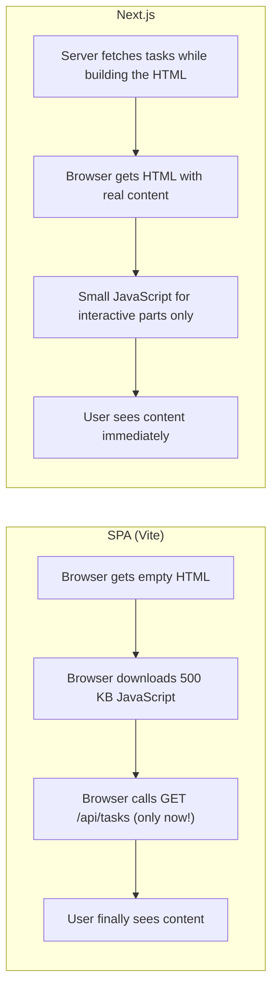
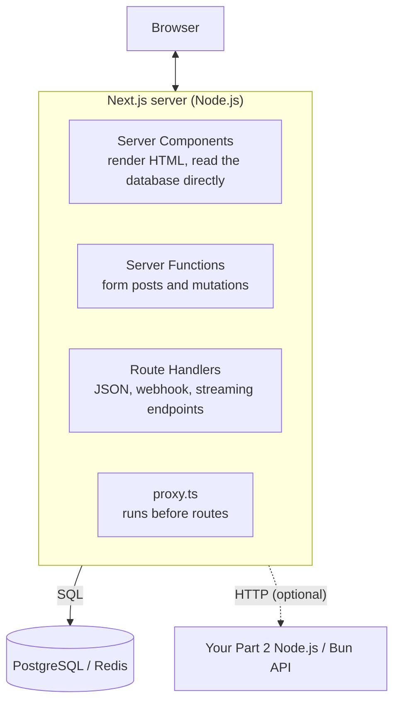
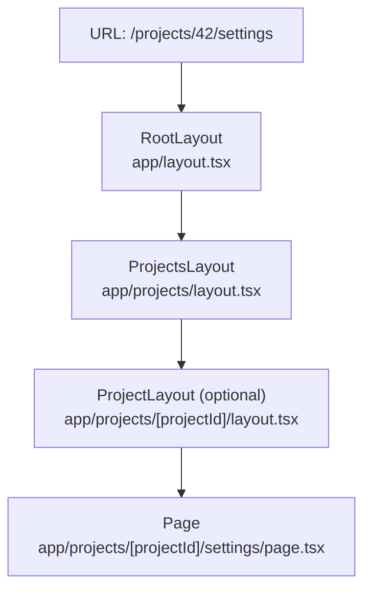
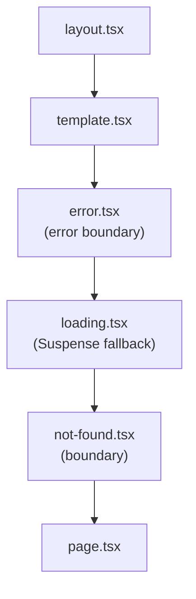
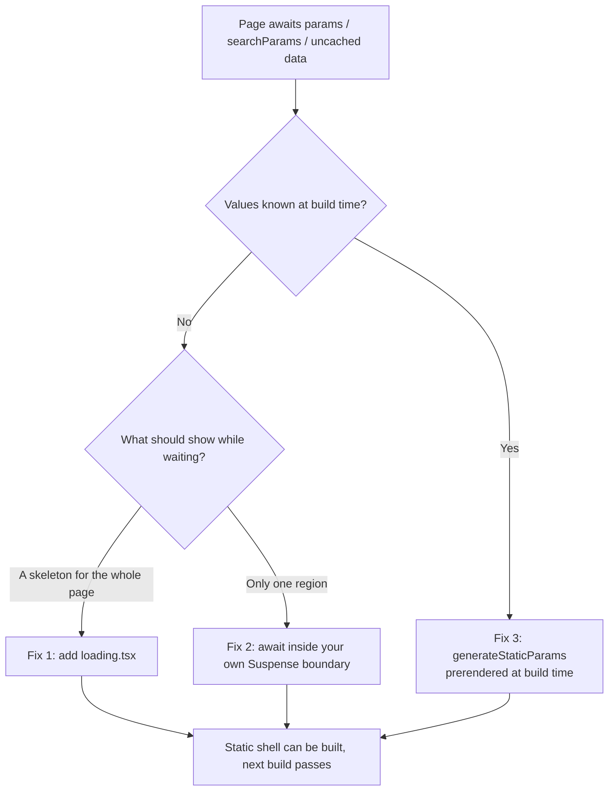

# Module 1: Getting Started & the App Router (Next.js 16)


## Words you will meet in this module

| Word                 | Simple meaning                                                                                         |
| -------------------- | ------------------------------------------------------------------------------------------------------ |
| **Next.js**          | A React **framework**: React plus routing, rendering on the server, bundling, and a production server. |
| **App Router**       | Next.js's current routing system. Folders inside `app/` become URLs.                                   |
| **Route segment**    | One folder name in a path. `app/projects/[id]` has two segments: `projects` and `[id]`.                |
| **Layout**           | UI that wraps a page and its children, and **stays mounted** while you navigate between them.          |
| **Page**             | The UI that is unique to a route. A route is public only if it has a `page` file.                      |
| **Server Component** | A React component that runs **only on the server** (the default in the App Router). Module 2.          |
| **Client Component** | A component marked `"use client"` that also runs in the browser. Module 2.                             |
| **Static shell**     | The part of a page that is pre-built at build time and served instantly from a CDN.                    |
| **Cache Components** | Next.js's current model: you opt specific parts of a page into caching with `"use cache"`. Module 3.   |
| **Turbopack**        | The Rust-based bundler that is now the default for `next dev` and `next build`.                        |
| **Proxy**            | `proxy.ts`: code that runs before a request reaches a route. It replaced `middleware.ts`. Module 5.    |
| **Prefetching**      | Loading a linked page's content in the background before the user clicks.                              |

## 1.1: What Is Next.js and Why Does It Exist?

In [Part 1](react) you built a single-page app with Vite. The browser downloaded an almost empty HTML file, then a pile of JavaScript, then ran that JavaScript to fetch data and finally draw the page. [Module 7 of that series](reactjs/testing-typescript-security-and-capstone#77-beyond-the-spa-ssr-ssg-and-server-components) listed the pain this causes: a blank first paint, request waterfalls, weak SEO and ever-growing bundles.

**Next.js** is a React **framework** that fixes this by running React on the **server** as well as in the browser. The server sends real, ready-to-read HTML, and the browser then "wakes up" only the parts that need interactivity.



### What a framework adds to React

React alone is a **library**: it draws UI. Everything else, you choose and wire up. Next.js bundles those choices:

| Need                     | In a Vite SPA (Part 1)             | In Next.js                                                 |
| ------------------------ | ---------------------------------- | ---------------------------------------------------------- |
| Routing                  | Add React Router, configure routes | **File-system routing**: folders become URLs               |
| Rendering location       | Browser only                       | Server **and** browser, chosen per component               |
| Data fetching            | `useEffect` or TanStack Query      | `async` components that `await` data on the server         |
| Writing data             | `fetch` POST to your API           | **Server Functions** you call from forms                   |
| Backend endpoints        | A separate Express server (Part 2) | **Route Handlers** inside the same project                 |
| Bundler and dev server   | Vite                               | **Turbopack**, built in                                    |
| Images, fonts, SEO tags  | Manual                             | Built-in components and the Metadata API                   |
| Caching and prerendering | You build it                       | Built in (**Cache Components**)                            |
| Production server        | Static files on nginx              | A Node.js server (or static export, or a platform adapter) |

### The trade-off

A framework gives you speed and conventions, and takes some control: you follow its file conventions, its caching rules, and its release schedule. Next.js also moves **fast** (this series teaches the model current in late 2026, and details do change between versions). Module 8, Topic 8.8 gives an honest "when not to use Next.js" guide.

### Next.js, React and your Node.js API: who does what?



You will see both ways of working with a backend in this part: talking to the database **directly** from the Next.js server, and using Next.js as a **front door** (a backend-for-frontend) to the API you built in Part 2.

#### Interview traps

- "Is Next.js a replacement for React?" No. Next.js **uses** React. It adds routing, server rendering, bundling and a server on top.
- "Is Next.js only for server-rendered sites?" No. You choose per route and even per component: fully static, cached, or streamed per request. You can also export a pure static site.
- "Is Next.js a backend framework?" It can serve APIs and talk to databases, so it can **be** your backend for a web app. For multiple clients, heavy background work or long-lived connections you often keep a separate backend (Module 5).

## 1.2: Versions and Requirements in 2026

| Item               | Status (November 2026)                                                                                                        |
| ------------------ | ----------------------------------------------------------------------------------------------------------------------------- |
| **Current stable** | **Next.js 16.4** (released October 6, 2026). Patch releases (16.4.x) follow. **Next.js 17 has not been released**             |
| **Bundler**        | **Turbopack** is the default for `next dev` and `next build` (opt out with `--webpack`)                                       |
| **Caching model**  | **Cache Components** is recommended for every app and **on by default** in new projects. It becomes the default in Next.js 17 |
| **React**          | 16.4 ships **React 19.3** (stable `<ViewTransition>` and Fragment refs, plus everything from 19.2)                            |
| **Node.js**        | **20.9 or newer** is required. Use an LTS line: **24 or 26** (Node 20 is end-of-life)                                         |
| **TypeScript**     | 5.1 or newer                                                                                                                  |
| **Browsers**       | Chrome 111+, Edge 111+, Firefox 111+, Safari 16.4+                                                                            |
| **Adapter API**    | Stable since 16.2. Lets other platforms implement Next.js deployment consistently (Module 8)                                  |

### The Next.js 16 changes you must know (they break older tutorials)

| Change                                                                               | What it means for your code                                                                                                                                                               |
| ------------------------------------------------------------------------------------ | ----------------------------------------------------------------------------------------------------------------------------------------------------------------------------------------- |
| `params`, `searchParams`, `cookies()`, `headers()`, `draftMode()` are **async only** | You must `await` them. The old synchronous access was removed                                                                                                                             |
| `middleware.ts` → **`proxy.ts`**                                                     | Rename the file and the exported function. It runs on the **Node.js** runtime                                                                                                             |
| **`next lint` was removed**                                                          | Run ESLint or Biome directly (`"lint": "eslint"`)                                                                                                                                         |
| `cacheLife` and `cacheTag` are **stable**                                            | Import `cacheLife` / `cacheTag` (the `unstable_` prefix is gone)                                                                                                                          |
| `revalidateTag()` takes a **second argument**                                        | `revalidateTag("tasks", "max")` (a cache-life profile). The one-argument form is deprecated                                                                                               |
| New: `updateTag()` and `refresh()`                                                   | For Server Functions: read-your-own-writes and refreshing uncached data (Module 4)                                                                                                        |
| **Parallel routes need `default.js`**                                                | Every `@slot` folder needs one or the build fails                                                                                                                                         |
| `next/image` defaults changed                                                        | `priority` is deprecated in favor of `preload`, `images.qualities` defaults to `[75]`, `minimumCacheTTL` defaults to 4 hours, `images.domains` is deprecated in favor of `remotePatterns` |
| AMP and `serverRuntimeConfig` / `publicRuntimeConfig` removed                        | Use environment variables                                                                                                                                                                 |

> **A warning about documentation:** Next.js has changed its **caching model** several times (Next.js 13/14 cached `fetch` aggressively, 15 flipped the defaults, 16 introduced Cache Components). A tutorial or AI answer written for an older version can give you code that is wrong or even fails to build. Always check which version it targets, and read the docs for **your** version (the docs site has a version switcher). Module 3, Topic 3.8 maps the old model to the new one so you can read older codebases.

### Keeping up

Next.js ships a minor release every few months and a steady stream of patches. Two commands matter:

```bash
npx next --version              # what you have
npm install next@latest react@latest react-dom@latest
```

Security fixes are not optional: Next.js had several serious advisories in 2025 and 2026 (Module 6, Topic 6.1). Stay on a **supported, patched** release line.

## 1.3: Creating a Project

```bash
npx create-next-app@latest taskflow-web
# or: pnpm create next-app   |   bun create next-app   |   yarn create next-app
```

The CLI asks first:

```
Would you like to use the recommended Next.js defaults?
  Yes, use recommended defaults - TypeScript, ESLint, Tailwind CSS, App Router, Cache Components, AGENTS.md
  No, reuse previous settings
  No, customize settings
```

Choose the **recommended defaults**. They give you TypeScript, ESLint, Tailwind CSS, the App Router, **Cache Components**, Turbopack, and an `AGENTS.md` file (guidance for AI coding assistants). Choosing "customize" lets you pick Biome instead of ESLint, add the **React Compiler**, use a `src/` folder, or change the import alias (`@/*` by default).

```bash
cd taskflow-web
npm run dev          # http://localhost:3000
```

### What you get

```
taskflow-web/
├── app/                      ← the App Router. Your routes live here
│   ├── layout.tsx            ← root layout (required): <html> and <body>
│   ├── page.tsx              ← the home page: "/"
│   ├── globals.css           ← global styles (Tailwind)
│   └── favicon.ico
├── public/                   ← static files served from "/" (images, robots.txt)
├── next.config.ts            ← Next.js configuration
├── tsconfig.json             ← "@/*" import alias, strict mode
├── eslint.config.mjs         ← linting
├── postcss.config.mjs        ← Tailwind
├── AGENTS.md                 ← guidance for coding agents
└── package.json
```

### `package.json` scripts

```json
{
  "scripts": {
    "dev": "next dev",
    "build": "next build",
    "start": "next start",
    "lint": "eslint"
  }
}
```

| Command      | What it does                                                                                 |
| ------------ | -------------------------------------------------------------------------------------------- |
| `next dev`   | Dev server with Fast Refresh and Turbopack. Shows validation insights for caching (Module 3) |
| `next build` | Production build. Prints a table of routes and how each is rendered                          |
| `next start` | Runs the production server from the build output                                             |
| `eslint`     | Linting. (`next lint` no longer exists)                                                      |

### `next.config.ts`

```ts
import type { NextConfig } from 'next';

const nextConfig: NextConfig = {
  cacheComponents: true, // the Cache Components model (the default for new apps)
  partialPrefetching: true, // prefetch each route's "App Shell" by default
};

export default nextConfig;
```

Leave `partialPrefetching` set explicitly (the framework warns when it is unset). Both options become the standard behavior in the next major release.

### The dev overlay

In development, an error overlay and **insight cards** appear in the browser. Under Cache Components these tell you when a page would block (for example, "uncached data accessed outside `<Suspense>`") and link to a fix. Read them. They are the framework teaching you its rendering model as you build.

### Bun note

`bun create next-app` works, and Bun can install dependencies and run scripts. **Next.js itself runs on the Node.js runtime** in production, so deploy with Node.js unless you have verified your setup on Bun.

## 1.4: File-System Routing

### The rule

Inside `app/`, **folders define URL segments**, and a **`page.tsx`** file makes that folder a public route.

```
app/
├── page.tsx                        →  /
├── about/
│   └── page.tsx                    →  /about
├── projects/
│   ├── page.tsx                    →  /projects
│   └── [projectId]/
│       ├── page.tsx                →  /projects/42
│       └── settings/
│           └── page.tsx            →  /projects/42/settings
└── api/
    └── health/
        └── route.ts                →  /api/health   (a Route Handler, Module 5)
```

A folder **without** `page.tsx` or `route.ts` is not a route. That means you can freely **colocate** components, styles and tests next to your pages without exposing them.

### A page

```tsx
// app/about/page.tsx
export default function AboutPage() {
  return (
    <main>
      <h1>About TaskFlow</h1>
      <p>Plan work with your team.</p>
    </main>
  );
}
```

A page is a React component with a **default export**. By default it is a **Server Component**: it runs on the server and ships no JavaScript of its own to the browser (Module 2).

### Layouts

A **layout** wraps pages and child layouts. Layouts **nest**, and they **persist** while you navigate between the pages inside them (their state is not reset and they do not re-render).

```tsx
// app/layout.tsx : the ROOT layout. Required. Must render <html> and <body>.
import type { Metadata } from 'next';
import './globals.css';

export const metadata: Metadata = {
  title: { default: 'TaskFlow', template: '%s | TaskFlow' },
  description: 'Plan work with your team.',
};

export default function RootLayout({
  children,
}: {
  children: React.ReactNode;
}) {
  return (
    <html lang="en">
      <body>{children}</body>
    </html>
  );
}
```

```tsx
// app/projects/layout.tsx : applies to /projects and everything under it
export default function ProjectsLayout({
  children,
}: {
  children: React.ReactNode;
}) {
  return (
    <div className="grid grid-cols-[240px_1fr]">
      <aside>{/* project navigation */}</aside>
      <section>{children}</section>
    </div>
  );
}
```



Navigating from `/projects/42/settings` to `/projects/42` keeps the shared layouts mounted and re-renders only what changed. This is **partial rendering**, and it has an important security consequence you will meet in Module 6: **layouts do not re-render on every navigation, so they are not a safe place for authorization checks.**

### Templates

A **`template.tsx`** looks like a layout but is **re-created on every navigation** (new state, effects re-run). Use it for things like enter animations or per-page analytics. Most apps never need one.

### Route groups: organize without changing the URL

Wrap a folder name in parentheses and it is **ignored in the URL**. Use groups to share a layout between some routes only, or to organize code.

```
app/
├── (marketing)/
│   ├── layout.tsx          ← marketing layout (big header, footer)
│   ├── page.tsx            →  /
│   └── pricing/page.tsx    →  /pricing
└── (app)/
    ├── layout.tsx          ← signed-in shell (sidebar)
    └── projects/page.tsx   →  /projects
```

You can even have **several root layouts** by giving each group its own `layout.tsx` with `<html>` and `<body>`, provided no top-level `app/layout.tsx` exists.

### Private folders

A folder starting with an underscore (`_components`, `_lib`) is **opted out of routing**. Use it to keep helpers beside the routes that use them.

### Dynamic segments

| Folder name   | Matches                         | `params`                    |
| ------------- | ------------------------------- | --------------------------- |
| `[projectId]` | `/projects/42`                  | `{ projectId: "42" }`       |
| `[...slug]`   | `/docs/a`, `/docs/a/b/c`        | `{ slug: ["a", "b", "c"] }` |
| `[[...slug]]` | `/docs`, `/docs/a`, `/docs/a/b` | `{ slug?: string[] }`       |

#### Interview traps

- "How do you create a route in the App Router?" Add a folder inside `app/` with a `page.tsx` (or `route.ts` for an endpoint). The folder name is the URL segment.
- "Can I put components in the `app/` folder?" Yes. Only `page` and `route` files make a folder publicly routable, so other files are safe to colocate.
- "Layout vs. template?" A layout persists across navigations (state preserved, no re-render). A template is remounted on every navigation.
- "What is a route group?" A folder in parentheses: it organizes routes and shares layouts without adding a URL segment.

## 1.5: The Special Files

Next.js gives certain **file names** special behavior. Know this table.

| File                                                         | Purpose                                                                                                    |
| ------------------------------------------------------------ | ---------------------------------------------------------------------------------------------------------- |
| `page.tsx`                                                   | The unique UI of a route. Makes it public                                                                  |
| `layout.tsx`                                                 | Shared wrapper that persists across navigation. The root one is required                                   |
| `template.tsx`                                               | Like a layout, but remounted on every navigation                                                           |
| `loading.tsx`                                                | An instant **loading state**. Next.js wraps the page in a `<Suspense>` boundary with this as the fallback  |
| `error.tsx`                                                  | An **error boundary** for the segment (must be a Client Component). Gets `error` and a reset function      |
| `global-error.tsx`                                           | The last-resort boundary, replacing the root layout when it fails. Must include `<html>` and `<body>`      |
| `not-found.tsx`                                              | UI shown when you call `notFound()` or a URL does not match                                                |
| `route.ts`                                                   | An HTTP endpoint (Route Handler). Cannot sit beside a `page.tsx` in the same folder                        |
| `default.tsx`                                                | Fallback for a parallel-route slot (required for every `@slot` in Next.js 16)                              |
| `proxy.ts`                                                   | Code that runs **before** matching routes. Lives at the project root (or `src/`). Replaced `middleware.ts` |
| `instrumentation.ts`                                         | Startup hook for monitoring and tracing (Module 8)                                                         |
| `opengraph-image.tsx`, `sitemap.ts`, `robots.ts`, `icon.tsx` | Generate SEO and icon assets (Module 7)                                                                    |

### `loading.tsx` and `error.tsx` together

```tsx
// app/projects/loading.tsx
export default function Loading() {
  return <p aria-busy="true">Loading projects…</p>;
}
```

```tsx
// app/projects/error.tsx : MUST be a Client Component
'use client';

export default function ProjectsError({
  error,
  reset,
}: {
  error: Error & { digest?: string };
  reset: () => void;
}) {
  return (
    <div role="alert">
      <h2>Something went wrong</h2>
      <p>Reference: {error.digest}</p>{' '}
      {/* a safe id you can find in the server logs */}
      <button onClick={reset}>Try again</button>
    </div>
  );
}
```

```tsx
// app/projects/[projectId]/not-found.tsx
export default function ProjectNotFound() {
  return <h2>We could not find that project.</h2>;
}
```

```tsx
// app/projects/[projectId]/page.tsx (excerpt)
import { notFound } from 'next/navigation';
if (!project) notFound(); // renders the nearest not-found.tsx and sends a 404 status
```



The nesting of these files gives you **granular boundaries**. An error inside `projects/[projectId]` shows that segment's `error.tsx` while the surrounding layouts (header, sidebar) stay on screen. Production error messages from server code are **redacted** for the browser (only a `digest` is shown), so you never leak internals, and you find the real error in the server logs by that digest.

#### Interview traps

- "Why must `error.tsx` be a Client Component?" Error boundaries need state and a reset callback, which are client features.
- "What does `loading.tsx` do under the hood?" It creates a React `<Suspense>` boundary around the page so Next.js can show the fallback immediately and stream the page in.
- "Where do you show a 404?" Call `notFound()` for missing resources and add a `not-found.tsx` for the segment. A global one lives at `app/not-found.tsx`.

## 1.6: Navigation and Linking

### `<Link>`

```tsx
import Link from "next/link";

<Link href="/projects">Projects</Link>
<Link href={`/projects/${project.id}`}>{project.name}</Link>
<Link href="/projects" replace>Projects (no new history entry)</Link>
<Link href="/search?q=milk" scroll={false}>Search</Link>
```

`Link` extends `<a>`. It navigates **on the client** (no full reload), keeps shared layouts mounted, and **prefetches** the destination so the click feels instant.

### How prefetching works in 16.4

With `partialPrefetching` on (the default), Next.js prefetches each linked route's **App Shell** as the link becomes visible. The App Shell contains the static content and session-derived data that does not depend on the specific URL. If the destination also has cached content that depends on **URL data** (a dynamic `params` value or `searchParams`), opt a particular link into the richer prefetch:

```tsx
<Link href={`/projects/${project.id}`} prefetch>
  {project.name}
</Link>
```

That costs a server invocation per link, so use it for the links users are most likely to click. Module 3, Topic 3.7 covers prefetching and instant navigation in depth.

### Navigating from code (Client Components)

```tsx
'use client';
import { useRouter, usePathname, useSearchParams } from 'next/navigation';

export function Example() {
  const router = useRouter();
  const pathname = usePathname(); // "/projects/42"
  const searchParams = useSearchParams(); // ?status=done

  return (
    <button onClick={() => router.push('/projects')}>Go to projects</button>
  );
}
```

| Method                        | Effect                                                                                   |
| ----------------------------- | ---------------------------------------------------------------------------------------- |
| `router.push(url)`            | Navigate, adding a history entry                                                         |
| `router.replace(url)`         | Navigate without adding a history entry                                                  |
| `router.back()` / `forward()` | Browser history                                                                          |
| `router.refresh()`            | Re-fetch the current route's server-rendered output from the server (client state stays) |
| `router.prefetch(url)`        | Prefetch programmatically                                                                |

**Use the right import:** in the App Router these hooks come from **`next/navigation`**, not `next/router` (that one belongs to the older Pages Router).

### Navigating on the server

```tsx
import { redirect, notFound, permanentRedirect } from 'next/navigation';

export default async function Page() {
  const user = await getUser();
  if (!user) redirect('/login'); // sends a redirect. Does not return
  if (!user.isAdmin) notFound();
  // ...
}
```

`redirect()` and `notFound()` work by **throwing a special error**. Never call them inside a `try / catch` that swallows it (Module 4 shows the pattern).

### An active-link component

```tsx
// components/nav-link.tsx
'use client';
import Link from 'next/link';
import { usePathname } from 'next/navigation';

export function NavLink({
  href,
  children,
}: {
  href: string;
  children: React.ReactNode;
}) {
  const pathname = usePathname();
  const active = pathname === href || pathname.startsWith(href + '/');

  return (
    <Link
      href={href}
      aria-current={active ? 'page' : undefined}
      className={active ? 'font-semibold' : ''}
    >
      {children}
    </Link>
  );
}
```

`usePathname` and `useSearchParams` read **request-time** URL data. If a page's static shell would otherwise include them, the dev overlay may ask you to wrap that component in `<Suspense>`. Follow its suggestion.

### Search params in the URL

For server-side filtering, read `searchParams` in the page (it is a **Promise**, and runtime data under Cache Components). Reading them in a Client Component uses `useSearchParams`. The principle from Part 1 holds: filters, pages and sort order belong in the **URL**.

## 1.7: Dynamic Routes and Async `params`

### The Next.js 16 rule

`params` and `searchParams` are **Promises**. You `await` them (or `use()` them in a Client Component).

```tsx
// app/projects/[projectId]/page.tsx
export default async function ProjectPage({
  params,
}: PageProps<'/projects/[projectId]'>) {
  const { projectId } = await params;
  return <h1>Project {projectId}</h1>;
}
```

`PageProps<"/projects/[projectId]">` and `LayoutProps<"/projects/[projectId]">` are **globally available helper types** that Next.js generates from your folder structure (they refresh when you run `next dev` or `next build`). They give you correctly typed `params` and `searchParams` with no manual typing. You can still write the type by hand:

```tsx
export default async function ProjectPage({
  params,
}: {
  params: Promise<{ projectId: string }>;
}) {
  const { projectId } = await params;
  // ...
}
```

### Why a Promise?

So that Next.js can **start rendering the static parts of your page before the request is known**. The params are request data, and making them async means a component that does not touch them does not wait for them.

### The Cache Components catch: runtime data needs a Suspense boundary

With Cache Components on (the default), a dynamic `params` value that is **not known at build time** is **runtime data**. A component that awaits it cannot be prerendered, so Next.js requires you to say what to show **while it waits**. If you forget, `next dev` shows a **"blocking route"** insight and `next build` fails, because the framework refuses to produce a route with nothing to show instantly.

You have three fixes. Pick the one that fits.



**Fix 1: add a `loading.tsx` next to the page.** It automatically wraps the page in a Suspense boundary, so the page can `await params` at the top:

```
app/projects/[projectId]/
├── loading.tsx      ← provides the Suspense fallback
└── page.tsx         ← async page that awaits params
```

**Fix 2: do the `await` inside a Suspense boundary you control.** The page itself does not await, so the surrounding static shell can render:

```tsx
// app/projects/[projectId]/page.tsx
import { Suspense } from 'react';

export default function ProjectPage({
  params,
}: PageProps<'/projects/[projectId]'>) {
  return (
    <>
      <h1>Project</h1> {/* part of the static shell */}
      <Suspense fallback={<p>Loading…</p>}>
        <ProjectDetails params={params} />{' '}
        {/* pass the PROMISE down. Do not await here */}
      </Suspense>
    </>
  );
}

async function ProjectDetails({
  params,
}: Pick<PageProps<'/projects/[projectId]'>, 'params'>) {
  const { projectId } = await params; // awaited inside the boundary
  return <p>Details for {projectId}</p>;
}
```

**Fix 3: tell Next.js the values at build time** with `generateStaticParams`, so the param is **known** and the page is prerendered:

```tsx
// app/projects/[projectId]/page.tsx
export async function generateStaticParams() {
  const projects = await getPopularProjects(); // runs at build time
  return projects.map((p) => ({ projectId: String(p.id) }));
}
```

Unknown values then render on demand (and can be **incrementally generated** after the first visit: Module 3, Topic 3.7). You can combine fixes: pre-render the popular IDs and provide a `loading.tsx` for the rest.

### Search params the same way

```tsx
export default function SearchPage({ searchParams }: PageProps<'/search'>) {
  return (
    <Suspense fallback={<p>Searching…</p>}>
      <Results searchParams={searchParams} />
    </Suspense>
  );
}

async function Results({
  searchParams,
}: Pick<PageProps<'/search'>, 'searchParams'>) {
  const { q } = await searchParams;
  // q is string | string[] | undefined
}
```

#### Interview traps

- "What changed about `params` in Next.js 15 and 16?" They became **Promises**. In 15 there was a temporary synchronous compatibility layer. In 16 synchronous access is **removed**, so you must `await` (or `use()`).
- "Why does `next build` fail with 'blocking route' after I read `params`?" With Cache Components, uncached or runtime data must be inside a `<Suspense>` boundary (or cached, or its values known via `generateStaticParams`), so the framework can prerender a static shell.
- "How do you pre-render dynamic routes?" `generateStaticParams` returns the known param values for build time. Others render on demand.

## 1.8: Layouts, Metadata, Fonts and Styling (the Basics)

You will go deeper on these in Module 7. For now, know the shape.

### Metadata

```tsx
import type { Metadata } from 'next';

export const metadata: Metadata = {
  // static, in a layout or page
  title: 'Projects', // becomes "Projects | TaskFlow" via the root template
  description: 'Your projects in TaskFlow.',
};

// or dynamic:
export async function generateMetadata({
  params,
}: PageProps<'/projects/[projectId]'>): Promise<Metadata> {
  const { projectId } = await params;
  const project = await getProject(projectId);
  return { title: project?.name ?? 'Project' };
}
```

Next.js writes the `<title>` and `<meta>` tags into the `<head>` for you. (Under Cache Components, dynamic metadata streams in after the static shell. Crawlers that cannot handle that are detected by user agent and served a fully rendered page: Module 3 and 7.)

### Fonts

```tsx
// app/layout.tsx
import { Inter } from "next/font/google";
const inter = Inter({ subsets: ["latin"], display: "swap" });

<html lang="en" className={inter.className}>
```

`next/font` downloads the font **at build time**, **self-hosts** it with your site, and removes layout shift. No request goes to Google when a user visits.

### Images

```tsx
import Image from 'next/image';

<Image
  src="/hero.png"
  alt="Team planning on a board"
  width={1200}
  height={600}
  preload
/>;
```

`next/image` serves correctly sized, modern-format images, lazy-loads below the fold, and reserves space to prevent layout shift. For the one important above-the-fold image, use **`preload`** (it replaces the deprecated `priority` prop in Next.js 16). Remote images must be allowed in `next.config.ts` with `images.remotePatterns`.

### Styling options

| Approach                   | Notes                                                                                                                                                       |
| -------------------------- | ----------------------------------------------------------------------------------------------------------------------------------------------------------- |
| **Tailwind CSS** (default) | In v4: `@import "tailwindcss";` in `globals.css`. Utility classes in JSX                                                                                    |
| **CSS Modules**            | `Component.module.css`, scoped class names, no runtime cost                                                                                                 |
| **Global CSS**             | Import once, in the root layout                                                                                                                             |
| **CSS-in-JS (runtime)**    | Libraries that inject styles at runtime (styled-components, Emotion) need extra setup and sit awkwardly with Server Components. Prefer zero-runtime options |

### Static files

Files in `public/` are served from the root: `public/logo.svg` is available at `/logo.svg`. Do not reference `public/` in the path.

#### Interview traps

- "Why use `next/font`?" Self-hosted fonts with zero layout shift and no third-party request at runtime.
- "Which prop do you use for the LCP image in Next.js 16?" `preload` (the older `priority` prop is deprecated).
- "Where do you set the page title?" Export `metadata` or `generateMetadata` from a layout or page. Do not hand-write `<head>` tags.

## Tricky Questions and Answers

#### Q1 [SDE-1]: What is the difference between a layout and a page, and why does a layout not re-render when you navigate between its pages?

**Answer:** A page is the unique UI of a route. A layout is shared UI that wraps the pages and layouts below it. Next.js uses **partial rendering**: when you navigate between sibling routes, only the segments that changed are re-rendered, and shared layouts stay mounted with their state intact. This makes navigation fast, but it also means a layout is the wrong place for logic that must run on **every** request or navigation, such as authorization (Module 6).

#### Q2 [SDE-2]: Your new dynamic route works in `next dev` but `next build` fails with an error about uncached data accessed outside Suspense. What happened and how do you fix it?

**Answer:** Under Cache Components the framework pre-renders a static shell for every route, and the page awaits a runtime value (`params`, `searchParams`, `cookies()`, or an uncached fetch) with nothing covering it. Dev mode shows this as an insight, and the build enforces it. Fixes: add a `loading.tsx` (or a `<Suspense>`) so the shell has a fallback, move the `await` into a component inside a `<Suspense>` boundary, cache the data with `"use cache"` if it can be shared, or provide `generateStaticParams` so the param values are known at build time.

#### Q3 [SDE-2]: Which Next.js features replace `useEffect` + `fetch`, React Router and an Express route in a Vite + Express app?

**Answer:** File-system routing replaces React Router. `async` Server Components that `await` data (or query the database directly) replace `useEffect` + `fetch` for reads. Server Functions called from forms and Route Handlers (`route.ts`) replace most Express routes for the web app. Cross-cutting middleware logic moves into `proxy.ts` and the data-access layer. You may still keep a separate API when other clients (a mobile app) need it.

#### Q4 [SDE-3]: A teammate follows a 2024 tutorial and writes `export const dynamic = "force-static"` plus `fetch(url, { next: { revalidate: 60 } })`. What is wrong on a new Next.js 16.4 project?

**Answer:** Those belong to the **previous caching model** (route segment config and `fetch` cache options). New apps use **Cache Components**, where caching is opt-in per component or function with `"use cache"`, a lifetime with `cacheLife`, and tags with `cacheTag`, and dynamic parts stream inside `<Suspense>`. The old segment config options are not the way to express this anymore, and mixing models causes confusing errors. Rewrite as `"use cache"` + `cacheLife({ revalidate: 60 })` and consult Module 3, Topic 3.8 for the mapping.

---

## Hands-On Lab: The TaskFlow Web Skeleton

You will create the Next.js version of TaskFlow, with static data first. Later modules add the real database, auth and mutations.

```
1. npx create-next-app@latest taskflow-web   (recommended defaults)
   Run npm run dev. Open the page. Read the generated AGENTS.md and next.config.ts.
2. Delete the starter content. Build this structure:

   app/
   ├── (marketing)/
   │   ├── layout.tsx          marketing header + footer
   │   ├── page.tsx            "/"  landing page
   │   └── pricing/page.tsx    "/pricing"
   ├── (app)/
   │   ├── layout.tsx          sidebar + <NavLink> items (Projects, Settings)
   │   ├── projects/
   │   │   ├── page.tsx        "/projects": list of 3 hard-coded projects, each a <Link>
   │   │   ├── loading.tsx
   │   │   └── [projectId]/
   │   │       ├── page.tsx    "/projects/1": project name + hard-coded tasks
   │   │       ├── loading.tsx
   │   │       └── not-found.tsx
   │   └── settings/page.tsx
   ├── not-found.tsx
   └── error.tsx? (put it inside (app)/projects/)

3. In app/layout.tsx set metadata with a title template ("%s | TaskFlow"),
   load a next/font font, and give each page its own metadata.title.
4. Write NavLink (a Client Component using usePathname) and use it in the sidebar.
5. In [projectId]/page.tsx: await params. If projectId is not 1, 2 or 3 call notFound().
   Make sure npm run build passes. If it does not, read the error and fix it
   with a loading.tsx, then try the Suspense-inside-the-page version instead.
6. Add generateStaticParams for projects 1 to 3. Run npm run build and read the
   route table. Which routes are marked static / prerendered?
7. Add an <Image> hero on the landing page with preload and a remote image
   allowed through images.remotePatterns.
8. Throw an error inside a project page on purpose. Which error.tsx catches it?
   Do the layouts stay on screen? What does the browser show versus the terminal?
9. Add a proxy.ts that only adds a header (x-powered-by-taskflow: 1) to every
   response. Check it in DevTools. (Module 5 explains proxy fully.)
10. Run npm run build && npm run start. Compare the speed of the first load with the
    dev server. Open the Network tab and look at the JavaScript transferred.
```

Questions to answer for yourself:

- Which of your files are Server Components? How can you tell? (Module 2 gives you the full answer.)
- What happened when you navigated between two projects: which layouts stayed mounted?
- Which pages can be served from a CDN with no server work? Which cannot?

---

## Module 1 Cheat Sheet

| Concept                     | One-line interview answer                                                                                                     |
| --------------------------- | ----------------------------------------------------------------------------------------------------------------------------- |
| Next.js                     | A React **framework**: routing, server rendering, bundling, data, caching and a production server.                            |
| Current version             | 16.4 (October 2026). Next.js 17 is not out. Cache Components is recommended and default for new apps.                         |
| Requirements                | Node.js 20.9+ (use 24/26), TypeScript 5.1+. Turbopack is the default bundler.                                                 |
| `create-next-app`           | Recommended defaults: TypeScript, ESLint, Tailwind, App Router, Cache Components, AGENTS.md.                                  |
| App Router routing          | Folders in `app/` are segments. `page.tsx` makes a route public. `route.ts` makes an endpoint.                                |
| Layout                      | Shared wrapper that persists across navigation. Root layout must render `<html>` and `<body>`.                                |
| Template                    | Like a layout but remounted on every navigation.                                                                              |
| Route group `(name)`        | Organizes routes and shares layouts without affecting the URL.                                                                |
| Private folder `_name`      | Excluded from routing.                                                                                                        |
| Dynamic segments            | `[id]`, `[...slug]`, `[[...slug]]`.                                                                                           |
| Special files               | `loading` (Suspense fallback), `error` (client error boundary), `not-found`, `default`, `proxy`.                              |
| Async request APIs          | `params`, `searchParams`, `cookies()`, `headers()` must be awaited in Next.js 16.                                             |
| `proxy.ts`                  | Replaced `middleware.ts`. Node.js runtime. Runs before routes.                                                                |
| Blocking route              | Runtime or uncached data with no `<Suspense>` or cache. Fix: `loading.tsx`, Suspense, `use cache`, or `generateStaticParams`. |
| `next/navigation`           | App Router hooks: `useRouter`, `usePathname`, `useSearchParams`. Not `next/router`.                                           |
| `redirect()` / `notFound()` | Work by throwing. Do not swallow them in `try / catch`.                                                                       |
| Prefetching                 | `<Link>` prefetches the App Shell by default. `prefetch` opts a link into a richer prefetch.                                  |
| `next/image`, `next/font`   | Optimized images (`preload`, `remotePatterns`) and self-hosted fonts with no layout shift.                                    |
| Docs warning                | Older tutorials target older caching models. Check the version.                                                               |
