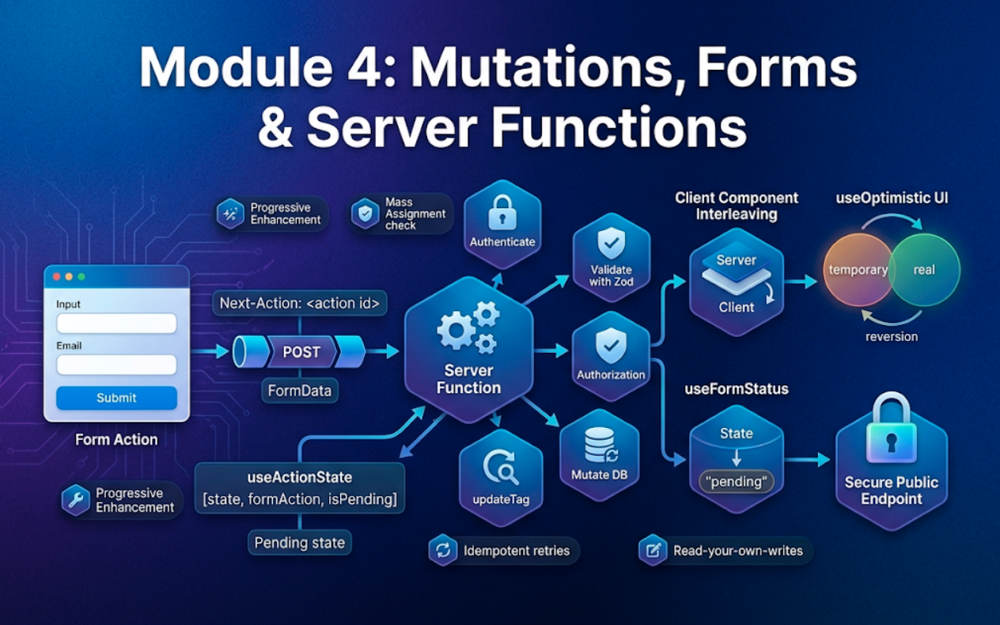
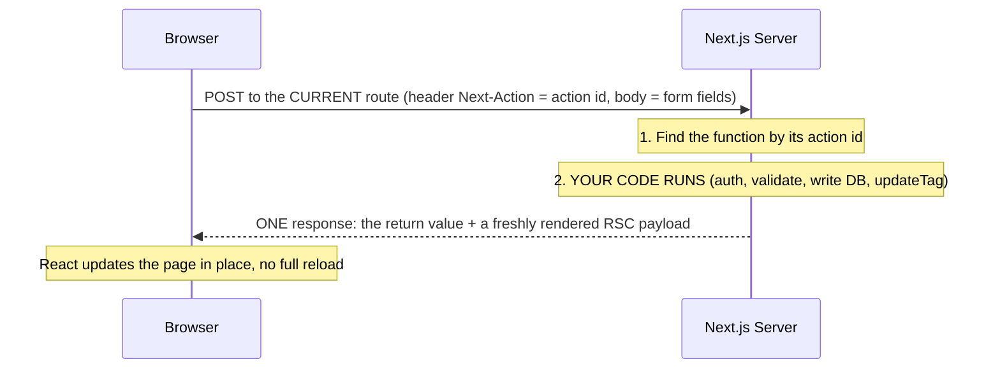
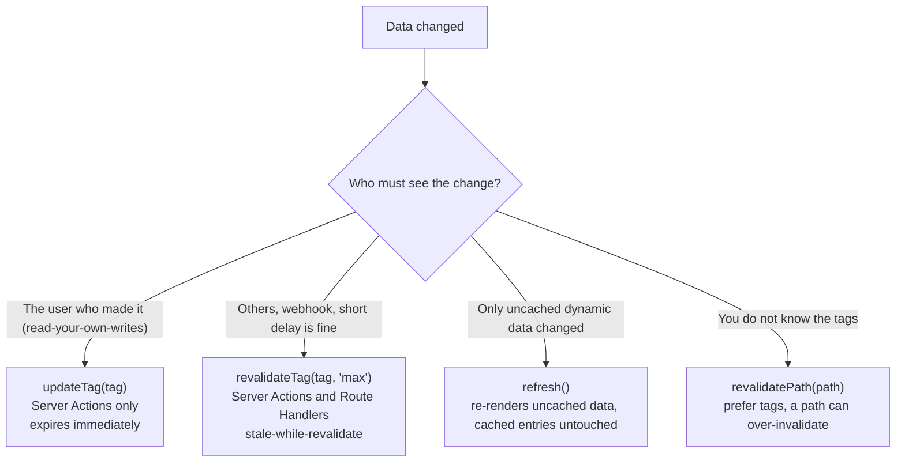
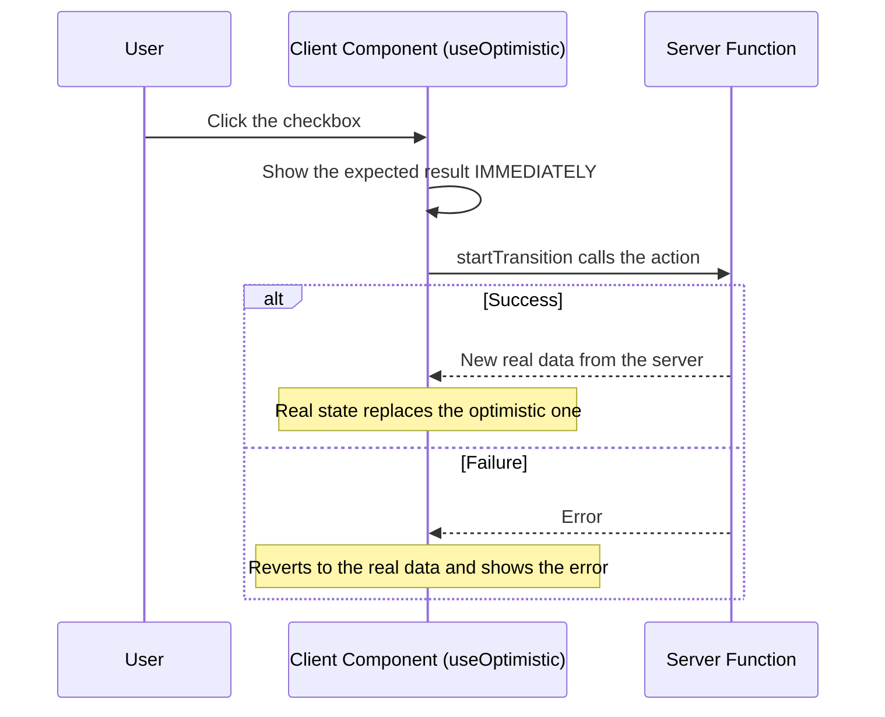
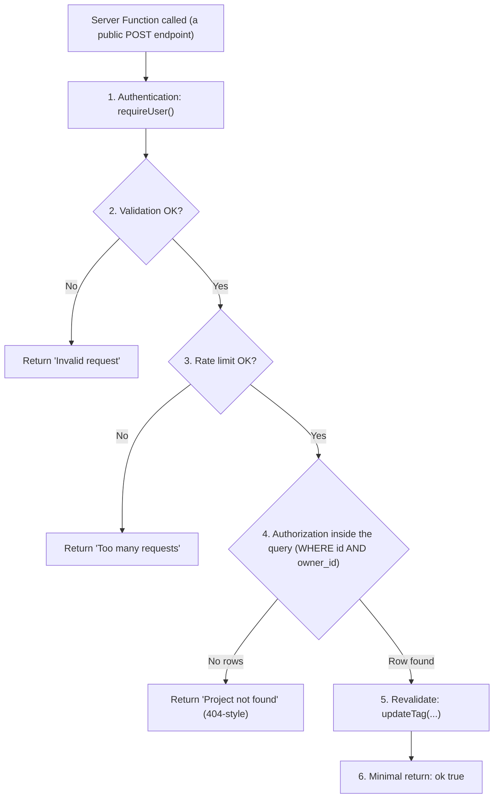

# Module 4: Mutations, Forms & Server Functions



## Words you will meet in this module

| Word                        | Simple meaning                                                                                             |
| --------------------------- | ---------------------------------------------------------------------------------------------------------- |
| **Server Function**         | An `async` function marked `"use server"` that runs on the server but can be called from the client.       |
| **Server Action**           | A Server Function used for a **mutation**, typically as a form's `action` or inside a transition.          |
| **`FormData`**              | The standard browser object holding a form's fields. A form action receives it automatically.              |
| **Progressive enhancement** | A form that works with plain HTML (no JavaScript), and gets smoother once JavaScript loads.                |
| **`useActionState`**        | React hook returning `[state, formAction, isPending]` for an action that returns a result.                 |
| **`useFormStatus`**         | React hook (in `react-dom`) giving a child of a `<form>` its `pending` status.                             |
| **`useOptimistic`**         | React hook showing the expected result immediately, then reverting to the real state when the action ends. |
| **Read-your-own-writes**    | After you change something, you immediately see your change, not an old cached copy.                       |
| **Action ID**               | An internal identifier the client sends so the server knows which Server Function to run.                  |
| **Mass assignment**         | Letting a client set fields it should not by copying request data straight into a database write.          |
| **Idempotent**              | Running it twice has the same effect as running it once. Important for retries.                            |

## 4.1: What Server Functions Are

In Part 1 you submitted a form with `fetch("/api/tasks", { method: "POST" })`, and in Part 2 you wrote an Express route to receive it. In Next.js you can skip both. You write an `async` function on the server, pass it to `<form action={...}>`, and React/Next.js wire up the network request for you.

```tsx
// app/(app)/projects/[projectId]/actions.ts
'use server';

export async function createTask(formData: FormData) {
  const title = String(formData.get('title') ?? '');
  // ...validate, check the user, write to the database...
}
```

```tsx
// app/(app)/projects/[projectId]/new-task-form.tsx : a Server Component. No "use client" needed
import { createTask } from './actions';

export function NewTaskForm() {
  return (
    <form action={createTask}>
      <input name="title" required />
      <button type="submit">Add task</button>
    </form>
  );
}
```

The terminology is slightly layered:

| Term                | Meaning                                                                                  |
| ------------------- | ---------------------------------------------------------------------------------------- |
| **Server Function** | The React feature: any `"use server"` function the client can call                       |
| **Server Action**   | A Server Function used as a form `action` or for a mutation. Next.js docs use both words |

### Where you can define them

```tsx
// 1. A dedicated file: every exported async function is a Server Function
// actions.ts
'use server';
export async function createTask(formData: FormData) {
  /* ... */
}
export async function deleteTask(formData: FormData) {
  /* ... */
}
```

```tsx
// 2. Inline in a Server Component: the directive goes at the top of the function body
export default function Page() {
  async function createPost(formData: FormData) {
    'use server';
    // ...
  }
  return <form action={createPost}>{/* ... */}</form>;
}
```

```tsx
// 3. A Client Component cannot DEFINE one, but it can IMPORT one from a "use server" file
'use client';
import { createTask } from './actions';
```

A server function can also be **passed as a prop** to a Client Component (`<Form action={createTask} />`). It is one of the few kinds of function that is serializable across the boundary (Module 2).

### How a call actually works



Four facts to remember:

1. **They use `POST` only.** Nothing else can invoke them.
2. **One round trip** brings back both the **return value** and the **re-rendered UI**. That is why you rarely write client-side "refetch after save" code.
3. **The client sends them one at a time** (sequentially). Do not use Server Functions for parallel reads, and `Promise.all` over several actions does **not** parallelize them. Fetch in Server Components, or do parallel work **inside** a single Server Function, or use a Route Handler.
4. **They are public HTTP endpoints.** Anyone who knows (or discovers) how to send the request can call them, with arguments you did not intend. Topic 4.6 is about this.

### Progressive enhancement: forms that work without JavaScript

A form that targets a Server Function from a **Server Component** works even if JavaScript has not loaded, or is disabled: the browser does a normal form POST and the server responds with the updated page. Once JavaScript loads, the same form submits through `fetch` in the background with no page reload. In a **Client Component**, a submission before hydration is **queued** and the form is prioritized for hydration. After hydration the browser does not refresh on submit.

This makes your forms resilient on slow phones and flaky networks, and it is a built-in advantage over the Vite SPA, where a form needs JavaScript to do anything at all.

### Extra arguments

The form passes only `FormData`. To include other values you can add **hidden inputs**:

```tsx
<form action={createTask}>
  <input type="hidden" name="projectId" value={projectId} />
  <input name="title" required />
</form>
```

or use `Function.prototype.bind` to pre-fill leading arguments (`const create = createTask.bind(null, projectId)`). Either way, **treat those values as untrusted user input**: a client can send any `projectId` it likes. The server must verify that the current user owns that project (Topic 4.6).

#### Interview traps

- "How does a Server Function reach the server?" The client sends a `POST` to the current route with an action identifier, and the server runs the function and returns its result plus a re-rendered RSC payload in one response.
- "Why do forms using Server Actions work without JavaScript?" In Server Components, the form uses the standard form POST, and React/Next.js handle it on the server, so it works before or without hydration.
- "Can I use `Promise.all` on several Server Functions to run them in parallel?" No. The client dispatches them sequentially. Parallelize on the server inside one function, or fetch in Server Components or Route Handlers.
- "Where can you write `'use server'`?" At the top of a file (all exports become Server Functions) or at the top of a function body in a Server Component. Not inside a Client Component, which can only import them.

## 4.2: Forms, Validation and `useActionState`

### The pattern in a nutshell

A good form does four things: **validates** input on the server, **returns errors** without losing what the user typed, shows a **pending** state, and **updates** the page on success. `useActionState` gives you the loop.

### Shared types and a small helper

```ts
// lib/actions/helpers.ts
import type { ZodError } from 'zod';

export type ActionState =
  | { ok: true; message?: string }
  | {
      ok: false;
      message?: string;
      fieldErrors?: Record<string, string[]>;
      values?: Record<string, string>;
    };

export const idle: ActionState = { ok: true };

export function fieldErrorsFrom(error: ZodError): Record<string, string[]> {
  const out: Record<string, string[]> = {};
  for (const issue of error.issues) {
    const key = String(issue.path[0] ?? 'form');
    (out[key] ??= []).push(issue.message);
  }
  return out;
}

export function textValues(
  formData: FormData,
  keys: string[],
): Record<string, string> {
  return Object.fromEntries(
    keys.map((k) => [k, String(formData.get(k) ?? '')]),
  );
}
```

### The Server Function

```ts
// app/(app)/projects/[projectId]/actions.ts
'use server';

import { z } from 'zod';
import { updateTag } from 'next/cache';
import { requireUser } from '@/lib/dal'; // Module 6
import { createTaskForUser } from '@/lib/data/tasks';
import {
  type ActionState,
  fieldErrorsFrom,
  textValues,
} from '@/lib/actions/helpers';

const NewTask = z.object({
  projectId: z.coerce.number().int().positive(),
  title: z
    .string()
    .trim()
    .min(1, 'Please enter a title')
    .max(200, 'Keep it under 200 characters'),
});

export async function createTaskAction(
  _prev: ActionState,
  formData: FormData,
): Promise<ActionState> {
  const user = await requireUser(); // 1. who is calling? (redirects to /login if nobody)

  const parsed = NewTask.safeParse(Object.fromEntries(formData)); // 2. validate the SHAPE of the input
  if (!parsed.success) {
    return {
      ok: false,
      fieldErrors: fieldErrorsFrom(parsed.error),
      values: textValues(formData, ['title']),
    };
  }

  const task = await createTaskForUser(
    user.id,
    parsed.data.projectId,
    parsed.data.title,
  ); // 3. may this user do it?
  if (!task)
    return {
      ok: false,
      message: 'Project not found',
      values: textValues(formData, ['title']),
    };

  updateTag(`tasks:project:${task.projectId}`); // 4. refresh cached data (read-your-own-writes)
  return { ok: true, message: 'Task added' }; // 5. return only what the UI needs
}
```

Notes on the shape:

- The first parameter `_prev` is the **previous state**, because `useActionState` passes it. The second is the `FormData`.
- `Object.fromEntries(formData)` includes some internal hidden fields React adds. A normal (non-strict) Zod object ignores unknown keys, which is what you want.
- **Expected failures are returned**, not thrown: invalid input and "not found" are normal outcomes that the UI should render. **Unexpected** failures throw and reach `error.tsx`.
- Note the order: **authenticate, validate, authorize inside the data call, mutate, revalidate, return minimal data.** You will see it again in Topic 4.6.

### The form component

```tsx
// app/(app)/projects/[projectId]/new-task-form.tsx
"use client";

import { useActionState } from "react";
import { useFormStatus } from "react-dom";
import { createTaskAction } from "./actions";
import { idle } from "@/lib/actions/helpers";

function SubmitButton({ children }: { children: React.ReactNode }) {
  const { pending } = useFormStatus();                         // must be rendered INSIDE the <form>
  return <button type="submit" disabled={pending}>{pending ? "Saving…" : children}</button>;
}

export function NewTaskForm({ projectId }: { projectId: number }) {
  const [state, formAction] = useActionState(createTaskAction, idle);
  const titleError = !state.ok ? state.fieldErrors?.title?.[0] : undefined;

  return (
    <form action={formAction} noValidate>
      <input type="hidden" name="projectId" value={projectId} />

      <label htmlFor="title">Title</label>
      <input
        id="title"
        name="title"
        defaultValue={!state.ok ? state.values?.title : ""}    {/* keep what the user typed after an error */}
        aria-invalid={titleError ? true : undefined}
        aria-describedby={titleError ? "title-error" : undefined}
      />
      {titleError && <p id="title-error" role="alert">{titleError}</p>}

      <SubmitButton>Add task</SubmitButton>

      {!state.ok && state.message && <p role="alert">{state.message}</p>}
      {state.ok && state.message && <p role="status">{state.message}</p>}
    </form>
  );
}
```

How the pieces fit:

| Piece                               | Job                                                                                                                      |
| ----------------------------------- | ------------------------------------------------------------------------------------------------------------------------ |
| `useActionState(fn, initial)`       | Returns `[state, formAction, isPending]`. `state` is whatever the last call returned                                     |
| `formAction`                        | Pass it to `<form action>`. Calling it runs your Server Function                                                         |
| `useFormStatus().pending`           | Lets a **child** such as a submit button know the form is submitting, without props                                      |
| `defaultValue` from `state.values`  | React resets uncontrolled fields after a successful action. Returning the values keeps the text after a validation error |
| `role="alert"` / `aria-describedby` | Screen readers announce errors and connect each message to its field                                                     |

Even this client-side form is **progressively enhanced**: a `useActionState` form works before hydration too, with the server-rendered response.

> **Always validate on the server, even if you add client-side checks.** Client checks are for user experience. The server check is the one an attacker cannot skip.

### `redirect()` after success

```ts
import { redirect } from 'next/navigation';

export async function createProjectAction(
  _prev: ActionState,
  formData: FormData,
): Promise<ActionState> {
  const user = await requireUser();
  const parsed = NewProject.safeParse(Object.fromEntries(formData));
  if (!parsed.success)
    return {
      ok: false,
      fieldErrors: fieldErrorsFrom(parsed.error),
      values: textValues(formData, ['name']),
    };

  const project = await createProjectForUser(user.id, parsed.data.name);
  updateTag(`projects:user:${user.id}`);
  redirect(`/projects/${project.id}`); // throws. Nothing after this line runs
}
```

`redirect()` works by **throwing a special control-flow exception**. That has two consequences:

```ts
// WRONG: the redirect error is caught by your own catch block, and the redirect never happens
try {
  const project = await createProject(...);
  redirect(`/projects/${project.id}`);
} catch (err) {
  return { ok: false, message: "Failed" };                    // swallowed it
}

// RIGHT: keep redirect outside try/catch (or rethrow it)
let project;
try {
  project = await createProject(...);
} catch {
  return { ok: false, message: "Could not create the project" };
}
redirect(`/projects/${project.id}`);
```

Also, **put invalidation calls before `redirect`**, because code after it does not run, and the destination needs fresh data.

### A form with no client JavaScript at all

When you do not need field-level errors, the simplest form is a Server Component calling a Server Function directly:

```tsx
// a Server Component: ships no JavaScript for the form
async function deleteTask(formData: FormData) {
  'use server';
  const user = await requireUser();
  const id = Number(formData.get('id'));
  await deleteTaskForUser(user.id, id);
  updateTag('tasks');
}

<form action={deleteTask}>
  <input type="hidden" name="id" value={task.id} />
  <button type="submit">Delete</button>
</form>;
```

#### Interview traps

- "Where do validation errors go?" **Return** them from the action as state (`useActionState`), so the client can render them next to the fields. Throwing is for unexpected errors.
- "Why does my form clear after a validation error?" React resets uncontrolled form fields after an action. Return the submitted values in state and use them as `defaultValue`.
- "Why does `redirect()` do nothing inside my `try`?" It throws a special error that your `catch` swallowed. Call it outside the `try/catch` or rethrow.
- "`useFormStatus` returns `pending: false` forever. Why?" It must be called from a component **rendered inside** the `<form>`, not from the component that renders the `<form>` itself.

## 4.3: Revalidating After a Mutation

A mutation is only useful if the user **sees** the change. Because Next.js caches (Module 3), you must tell it what became stale.

| After the write, call...           | Effect                                                                                                  | Use when                                          |
| ---------------------------------- | ------------------------------------------------------------------------------------------------------- | ------------------------------------------------- |
| **`updateTag("tasks:project:7")`** | Immediately expires the tag. The re-render shipped **with this action's response** reads fresh data     | **Default for your own UI.** Read-your-own-writes |
| `revalidatePath("/projects")`      | Expires everything cached for that route, immediately                                                   | You do not know the tags. Prefer tags             |
| `refresh()`                        | Refetches the **current route's** payload so **uncached** data re-renders. Cached entries are untouched | The change affects dynamic (uncached) UI only     |
| `revalidateTag(tag, "max")`        | Stale-while-revalidate: marks for **background** refresh. Does **not** re-render in this response       | Other users' views, CMS webhooks. A delay is fine |
| Setting or deleting a **cookie**   | Automatically re-renders the current page so the UI reflects it                                         | Login, logout, theme                              |



```ts
export async function renameProject(
  _prev: ActionState,
  formData: FormData,
): Promise<ActionState> {
  const user = await requireUser();
  const parsed = Rename.safeParse(Object.fromEntries(formData));
  if (!parsed.success)
    return { ok: false, fieldErrors: fieldErrorsFrom(parsed.error) };

  const project = await renameProjectForUser(
    user.id,
    parsed.data.projectId,
    parsed.data.name,
  );
  if (!project) return { ok: false, message: 'Project not found' };

  updateTag(`projects:user:${user.id}`); // the sidebar list (cached)
  updateTag(`project:${project.id}`); // the project header (cached)
  return { ok: true, message: 'Renamed' };
}
```

You can call several tags. Design them in advance (Module 3, Topic 3.6): which cached reads does this mutation touch?

If a mutation changes data in a **shared** cache that **other** users read (a public template), use `revalidateTag(tag, "max")` for them. The acting user usually wants `updateTag` as well for their own view.

#### Interview traps

- "`updateTag` or `revalidateTag` after a form submit?" `updateTag` for the user who submitted (they must see their change). `revalidateTag` is for background refreshes (webhooks, effects on other people's views).
- "Why must `updateTag` come before `redirect`?" `redirect` throws, so later code never runs, and the destination page needs the fresh data.

## 4.4: Optimistic UI

For actions that almost always succeed (ticking a checkbox), waiting for the round trip makes the UI feel slow. **`useOptimistic`** shows the expected result **immediately** and reverts to real data when the action finishes.



```tsx
// app/(app)/projects/[projectId]/task-list.tsx
'use client';

import { useOptimistic, useState, useTransition } from 'react';
import { toggleTaskAction } from './actions';

type Task = {
  id: number;
  title: string;
  status: 'todo' | 'doing' | 'done';
  version: number;
};

export function TaskList({ tasks }: { tasks: Task[] }) {
  const [error, setError] = useState<string | null>(null);
  const [, startTransition] = useTransition();

  const [optimisticTasks, applyOptimistic] = useOptimistic(
    tasks, // the REAL state, from the server
    (
      current: Task[],
      toggledId: number, // how to compute the temporary state
    ) =>
      current.map((t) =>
        t.id === toggledId
          ? { ...t, status: t.status === 'done' ? 'todo' : 'done' }
          : t,
      ),
  );

  function toggle(task: Task) {
    setError(null);
    startTransition(async () => {
      // an async transition = an Action
      applyOptimistic(task.id); // 1. update the screen NOW
      const result = await toggleTaskAction(task.id, task.version); // 2. do the real work
      if (!result.ok) setError(result.message ?? 'Could not update the task');
    }); // 3. when it ends, React shows the real `tasks` again
  }

  return (
    <>
      {error && <p role="alert">{error}</p>}
      <ul>
        {optimisticTasks.map((t) => (
          <li key={t.id}>
            <label>
              <input
                type="checkbox"
                checked={t.status === 'done'}
                onChange={() => toggle(t)}
              />
              {t.title}
            </label>
          </li>
        ))}
      </ul>
    </>
  );
}
```

How the rollback works: while the transition is running, `optimisticTasks` is the temporary version. When it ends, React replaces it with the real `tasks` prop. On **success**, the action called `updateTag`, so the server's response already carries the fresh list (including the toggled task), and the UI does not flicker. On **failure**, the real list is unchanged, so the optimistic change **disappears automatically**, and you show an error message.

The matching Server Function (with the optimistic-locking `version` check from [Part 2, Module 5](nodejs/databases-and-the-data-layer#58-n1-indexes-pool-sizing-and-concurrency)):

```ts
const Toggle = z.object({
  taskId: z.number().int().positive(),
  expectedVersion: z.number().int().nonnegative(),
});

export async function toggleTaskAction(
  taskId: number,
  expectedVersion: number,
): Promise<ActionState> {
  const user = await requireUser();
  const input = Toggle.safeParse({ taskId, expectedVersion });
  if (!input.success) return { ok: false, message: 'Invalid request' };

  const result = await toggleTaskForUser(
    user.id,
    input.data.taskId,
    input.data.expectedVersion,
  );
  if (result.kind === 'not_found')
    return { ok: false, message: 'Task not found' };
  if (result.kind === 'conflict')
    return {
      ok: false,
      message: 'Someone else changed this task. Refresh and try again.',
    };

  updateTag(`tasks:project:${result.task.projectId}`);
  return { ok: true };
}
```

Use optimistic UI for **low-risk, high-success** actions. Do not use it where a failure has serious consequences (payments, deletions of important data), where the server decides the result (generated IDs, computed totals), or where users would be confused by a flip-flop.

#### Interview traps

- "How does `useOptimistic` roll back?" It only holds a temporary overlay while the action runs. When the action ends, the UI shows the real state again, so a failed action's optimistic change vanishes.
- "Why call `applyOptimistic` inside `startTransition`?" Optimistic updates must happen inside a transition or action so React knows when to revert them.

## 4.5: Calling Server Functions from Event Handlers

Not every mutation is a form. A "Delete" icon, a drag-and-drop reorder or a "Mark all read" button calls a Server Function from an **event handler**, wrapped in a transition:

```tsx
'use client';

import { useTransition } from 'react';
import { deleteTaskAction } from './actions';

export function DeleteTaskButton({ taskId }: { taskId: number }) {
  const [isPending, startTransition] = useTransition();

  return (
    <button
      disabled={isPending}
      onClick={() => {
        if (!confirm('Delete this task?')) return;
        startTransition(async () => {
          const result = await deleteTaskAction(taskId);
          if (!result.ok) alert(result.message); // or show a toast
        });
      }}
    >
      {isPending ? 'Deleting…' : 'Delete'}
    </button>
  );
}
```

Guidelines:

| Do                                                                    | Do not                                                               |
| --------------------------------------------------------------------- | -------------------------------------------------------------------- |
| Wrap the call in `startTransition` so you get `isPending` and good UX | Call it bare in a handler and manage pending flags by hand           |
| **Return a result object** (`{ ok, message }`) for expected outcomes  | Throw for things like "not found" and rely on `error.tsx`            |
| Pass **serializable** arguments (ids, small objects)                  | Pass functions, class instances or huge payloads                     |
| Treat all arguments as untrusted on the server                        | Assume the client only sends what your UI offered                    |
| Use Server Functions for **mutations**                                | Use them to **read** data (they are sequential, `POST`, uncacheable) |

For **reads** that depend on user interaction (search-as-you-type), use a Route Handler with TanStack Query, or a Server Component driven by `searchParams` in the URL.

#### Interview traps

- "Why not use a Server Function to fetch data?" They are `POST` requests dispatched one at a time and are designed for mutations. Fetch in Server Components, or use a Route Handler or a client data library for interactive reads.
- "Why wrap the call in `startTransition`?" It makes the call an Action, which gives you `isPending`, keeps the UI responsive, and is required for `useOptimistic`.

## 4.6: Securing Server Functions

> **Every Server Function you export is a public HTTP endpoint.** The Next.js docs state it plainly: Server Functions are reachable through **direct POST requests**, not just through your application's UI, and even one that no component imports can still be called from outside.

Treating `createTask` like `POST /api/tasks` in your Express API from Part 2 is exactly the right mental model.

### What the framework gives you

| Built-in protection                | What it does                                                                                                                                                                                                                  |
| ---------------------------------- | ----------------------------------------------------------------------------------------------------------------------------------------------------------------------------------------------------------------------------- |
| **`POST` only**                    | `GET` requests cannot invoke actions                                                                                                                                                                                          |
| **Origin check (CSRF mitigation)** | Next.js compares the request's `Origin` with the `Host` (or `X-Forwarded-Host`) and aborts mismatches. Behind a proxy or CDN with a different host, list the allowed domains in `serverActions.allowedOrigins`                |
| **Secure action IDs**              | The identifiers sent by the client are not simple guessable names, and unused actions are removed from the client bundle                                                                                                      |
| **Closure variable encryption**    | Variables captured by an **inline** action are encrypted before they go to the client. For **multi-instance and self-hosted** deployments, set `NEXT_SERVER_ACTIONS_ENCRYPTION_KEY` to one stable key shared by all instances |
| **Body size limit**                | Requests are limited in size. Adjust with `serverActions.bodySizeLimit` if you must accept bigger forms                                                                                                                       |

Read these as **request-layer hygiene**, not as authentication or authorization.

### What stays entirely your job

| Your responsibility                        | Why                                                                                                                                  |
| ------------------------------------------ | ------------------------------------------------------------------------------------------------------------------------------------ |
| **Authentication in every function**       | The framework does not know who is calling. Check the session inside **each** function                                               |
| **Authorization on the specific resource** | Logged in is not enough. Verify the user owns or may modify _this_ project, task or order (BOLA/IDOR, Part 2, Module 6)              |
| **Input validation**                       | Parse **all** arguments and `FormData` with a schema. Remember: validation checks **shape**, not **ownership**                       |
| **Return-value hygiene**                   | Return values are **serialized to the client**. Return only the fields the UI needs, never raw rows                                  |
| **Rate limiting and re-auth**              | Expensive or sensitive actions (login, invites, password change, delete) need limits or a fresh password check                       |
| **Idempotency and conflict handling**      | Users double-click, networks retry. Use version checks and unique constraints                                                        |
| **Keeping React and Next.js patched**      | Serious vulnerabilities have hit the server-side React request handling that Server Function endpoints rely on (Module 6, Topic 6.1) |

### A safe action, step by step



```ts
'use server';

export async function deleteProjectAction(
  projectId: number,
): Promise<ActionState> {
  // 1. AUTHENTICATION: who is calling?
  const user = await requireUser();

  // 2. VALIDATION: is the input the right shape?
  const parsed = z.number().int().positive().safeParse(projectId);
  if (!parsed.success) return { ok: false, message: 'Invalid request' };

  // 3. RATE LIMIT: is this caller doing it too often?
  const limit = await rateLimit(`delete-project:${user.id}`, 10, 60);
  if (!limit.allowed)
    return { ok: false, message: 'Too many requests. Try again shortly.' };

  // 4. AUTHORIZATION: enforced INSIDE the query (WHERE id = $1 AND owner_id = $2)
  const deleted = await deleteProjectForUser(user.id, parsed.data);
  if (!deleted) return { ok: false, message: 'Project not found' }; // 404-style: do not reveal existence

  // 5. REVALIDATE
  updateTag(`projects:user:${user.id}`);

  // 6. MINIMAL RETURN
  return { ok: true };
}
```

Compare with the Part 2 route: the same six concerns, in the same order.

### A tiny rate limiter (Redis)

```ts
// lib/rate-limit.ts
import 'server-only';
import { redis } from '@/lib/redis';

export async function rateLimit(
  key: string,
  limit: number,
  windowSeconds: number,
) {
  const k = `rl:${key}`;
  const count = await redis.incr(k);
  if (count === 1) await redis.expire(k, windowSeconds); // start the window on the first hit
  return { allowed: count <= limit, remaining: Math.max(0, limit - count) };
}
```

Key it by **user id** for authenticated actions. For anonymous ones (login), combine the IP address (from a trusted proxy header, see Module 5) and the account identifier. In production, use an atomic script or a maintained rate-limiting library, and share the store across instances.

### The "use server" file trap

**Every exported async function in a `"use server"` file is a Server Function**, which means a public endpoint. Next.js errors on non-async exports, but an `async` helper you export for convenience is still exposed:

```ts
// actions.ts
'use server';

export async function getUserByEmail(email: string) {
  /* returns a user row */
} // OOPS: now callable by anyone
export async function createTask(/* ... */) {
  /* ... */
}
```

Keep helpers in **ordinary modules** (no `"use server"`, marked `import "server-only"`) and keep the `"use server"` file as a **thin wrapper** that authenticates, validates, calls the Data Access Layer, revalidates and returns. This is the layering from Part 2 (route, service, repository) in Next.js clothes.

### Keep secrets out of closures

Inline actions capture variables from their surrounding scope. Those values are **encrypted** for the round trip, but the docs are explicit that you should not rely on encryption alone to keep sensitive values away from the client. Do not capture secrets or whole database rows. Look up what you need on the server from a **verified id**.

### Defense in depth

- **`experimental.taint`** with React's taint APIs can mark objects and values (a password hash, a token) so React refuses to pass them to the client. It is an extra guard, not a replacement for shaping data in the DAL.
- Log failed authorization and validation attempts. Alert on bursts.
- Re-authenticate (ask for the password again) before destructive or account-level operations.

> **Experimental:** with the `authInterrupts` flag you can throw `unauthorized()` or `forbidden()` from `next/navigation` and have Next.js render the matching `unauthorized.tsx` or `forbidden.tsx` UI. Module 6 covers it.

#### Interview traps

- "Why must you authorize inside every Server Function when the button is hidden from unauthorized users?" Hiding a button is only UX. The function is a public `POST` endpoint, and anyone can call it directly.
- "Is Zod validation enough to secure an action?" No. It checks the **shape** of input. You still need authentication and a per-resource ownership check.
- "What does the built-in Origin check protect against?" Cross-site request forgery from another site. It does not replace authentication or authorization, and behind proxies you must configure `allowedOrigins`.
- "Why do multi-instance deployments need `NEXT_SERVER_ACTIONS_ENCRYPTION_KEY`?" Closure variables are encrypted with a key generated per build or process. Instances with different keys cannot decrypt each other's payloads, so a request handled by another instance fails.

## 4.7: Server Functions vs. Route Handlers vs. Your Part 2 API

| Need                                                                | Best tool                                                                                                  |
| ------------------------------------------------------------------- | ---------------------------------------------------------------------------------------------------------- |
| A form or button in **your** web UI changes data                    | **Server Function**                                                                                        |
| Progressive enhancement, no client JS for the form                  | **Server Function**                                                                                        |
| A **webhook** from Stripe, GitHub, a CMS                            | **Route Handler** (`route.ts`). You need a stable URL, raw body access and your own signature verification |
| A **public API** for a mobile app or third parties                  | **Route Handler**, or keep your **Part 2 API**                                                             |
| `GET` requests, caching by URL, `Range`/streaming responses, SSE    | **Route Handler**                                                                                          |
| Several clients (web + mobile) must share one set of business rules | Keep the **Part 2 API** and call it from the web app (BFF)                                                 |
| Parallel or interactive **reads**                                   | Server Components, or a Route Handler + TanStack Query                                                     |

A practical architecture for a growing product: Server Functions for your web UI's mutations, Route Handlers for webhooks and anything non-React, and your Part 2 API wherever **other clients** also need the same rules. They are not exclusive. Module 5 shows how to wire the Next.js server to your API.

## 4.8: File Uploads and Larger Payloads

A file input arrives in `FormData` as a `File`:

```tsx
<form action={uploadAvatar}>
  <input type="file" name="avatar" accept="image/png,image/jpeg" required />
  <button>Upload</button>
</form>
```

```ts
'use server';

const MAX_BYTES = 1_000_000;

export async function uploadAvatar(
  _prev: ActionState,
  formData: FormData,
): Promise<ActionState> {
  const user = await requireUser();
  const file = formData.get('avatar');
  if (!(file instanceof File) || file.size === 0)
    return { ok: false, message: 'Choose a file' };
  if (file.size > MAX_BYTES) return { ok: false, message: 'File is too large' };

  const bytes = new Uint8Array(await file.arrayBuffer());
  if (!looksLikePng(bytes) && !looksLikeJpeg(bytes))
    return { ok: false, message: 'Only PNG or JPEG' }; // check magic bytes, not the extension

  // store under a generated name, never the user-supplied one
  await saveAvatar(user.id, crypto.randomUUID(), bytes);
  updateTag(`user:${user.id}`);
  return { ok: true };
}
```

Remember the request body limit (1 MB by default, adjustable with `serverActions.bodySizeLimit`). For anything large, do not stream files through your Next.js server: have a Server Function return a short-lived **presigned URL** and let the browser upload **straight to object storage**, exactly as in [Part 2, Module 7](nodejs/testing-real-time-and-background-jobs#77-background-jobs-and-queues). Then record the result with a small Server Function.

## Tricky Questions and Answers

#### Q1 [SDE-2]: Your `actions.ts` file has `"use server"` at the top and exports `getUserByEmail`, which you only call from other server code. A pentester reads user rows with a curl command. Explain.

**Answer:** Every exported async function in a `"use server"` file is registered as a Server Function and becomes a callable `POST` endpoint, whether or not any component imports it. The pentester found its action id and sent the request directly. Fix: remove the `"use server"` file from the helper. Put data helpers in ordinary `server-only` modules (not exported through a `"use server"` file), keep the `"use server"` file as a thin wrapper that authenticates, validates and authorizes, and return DTOs rather than rows.

#### Q2 [SDE-3]: The form has a hidden `projectId` input, and the action creates a task in whatever project it gets. What is the vulnerability and the fix?

**Answer:** It is an IDOR/BOLA flaw: a client can change the hidden value (or send a crafted request) to add tasks to someone else's project. Hidden inputs and bound arguments are untrusted user input. Fix: validate `projectId` with a schema, then perform an **ownership-scoped write** in the data layer (`INSERT … SELECT … WHERE project.id = $1 AND project.owner_id = $2`, or check ownership in the same query) using the user id from the **verified session**, and return "not found" for projects the user does not own. Add a negative test where user B tries to write to user A's project.

#### Q3 [SDE-2]: After submitting, nothing redirects, and the user sees "Failed" even though the project was created. What is wrong?

**Answer:** `redirect()` was called inside a `try` block. It works by throwing a control-flow exception, which the `catch` caught and converted into a failure result. Move `redirect()` outside the `try/catch` (or rethrow the redirect error), and place any `updateTag` calls before it.

#### Q4 [SDE-2]: You call `Promise.all([actionA(), actionB(), actionC()])` from the client and the page is still slow. Why?

**Answer:** The client dispatches Server Function calls sequentially, so they run one after another, not in parallel. Combine the work into one Server Function that runs the three operations in parallel on the server with `Promise.all`, or restructure: read data in Server Components (which can fetch in parallel), or use a Route Handler for genuinely parallel client requests.

#### Q5 [SDE-3]: After deploying behind a CDN with a different public hostname, every form submission fails with an "invalid Server Actions request" style error, and with 3 instances some submissions fail only intermittently. Diagnose.

**Answer:** Two separate issues. The built-in origin check compares the request's `Origin` with the `Host` or `X-Forwarded-Host` the server sees. The CDN or proxy presents a different host, so legitimate requests look cross-origin. Fix by forwarding the correct host header and listing the public domain in `serverActions.allowedOrigins`. The intermittent failures come from instances using different closure-encryption keys (each generated its own), so a payload encrypted by one cannot be decrypted by another. Set the same `NEXT_SERVER_ACTIONS_ENCRYPTION_KEY` on all instances (and use consistent deployment identifiers).

#### Q6 [SDE-2]: When is optimistic UI a bad idea?

**Answer:** When failure is common or costly (payments, irreversible deletions), when the server determines the outcome (generated IDs, computed totals, permissions), or when a flip-flop would confuse users. In those cases show a pending state and update when the server confirms. Optimistic UI is for fast, low-risk, high-success actions such as toggling a checkbox.

---

## Hands-On Lab: Make TaskFlow Writable (Safely)

```
1. Create helpers: lib/actions/helpers.ts (ActionState, fieldErrorsFrom, textValues) and a temporary
   lib/dal.ts exporting requireUser() that returns { id: 1 } (real auth arrives in Module 6).
2. Create a NewTaskForm with useActionState and a SubmitButton using useFormStatus.
   createTaskAction validates with Zod, writes to Postgres, calls updateTag, returns state.
   Submit an empty title: does the error appear next to the field? Is what you typed kept?
3. Disable JavaScript in DevTools (Settings → Debugger → Disable JavaScript) and submit the form.
   Does it still work? Re-enable JS and watch the Network tab: find the POST and its
   "Next-Action" request header.
4. Replace updateTag with revalidateTag("tasks:project:7", "max"). Add a task. What do you see?
   Switch back and explain the difference in your own words.
5. Add a createProjectAction that ends with redirect(). First put redirect inside a try/catch and watch it
   fail, then fix it.
6. Build the optimistic TaskList with useOptimistic + startTransition. Throttle the network to
   "Slow 3G" and compare with and without the optimistic update. Then make the server return
   a conflict (bump the version in the database by hand) and watch the rollback.
7. Security tests (use the browser DevTools to replay the request, or curl with the Next-Action header):
     a. Change the hidden projectId to a project owned by another user. Does your DAL return "not found"?
     b. Send a title of 10,000 characters. Rejected by Zod?
     c. Call the action 20 times in a minute. Does the rate limiter stop it?
     d. Export a helper async function from a "use server" file and call it directly. Then fix the layout.
8. Return only what the UI needs. Look at the response payload in the Network tab: does it contain
   any field you did not intend (a user_id, a password_hash from a joined query)?
9. Add a file upload action with size limit and magic-byte check, then switch it to a presigned-URL design
   (sketch the two Server Functions).
10. Add a Route Handler POST /api/webhooks/test that verifies an HMAC signature (Part 2, Module 3) and calls
    revalidateTag("templates", "max"). Why is this a Route Handler, not a Server Function?
```

Questions to answer for yourself:

- Which of the six steps in the safe-action template did each of your actions have, and which were missing at first?
- Which of your cached reads does each mutation invalidate? Could you list them without looking at the code?
- If your Server Functions disappeared tomorrow, which mutations would you move into your Part 2 API, and why?

---

## Module 4 Cheat Sheet

| Concept                     | One-line interview answer                                                                                                            |
| --------------------------- | ------------------------------------------------------------------------------------------------------------------------------------ |
| Server Function / Action    | An `async` `"use server"` function callable from the client. "Action" when used for a mutation.                                      |
| Where to define             | A `"use server"` file or inline in a Server Component. Client Components can only import them.                                       |
| Transport                   | `POST` only. One response carries the return value and a re-rendered RSC payload.                                                    |
| Dispatch                    | Sequential from the client. `Promise.all` does not parallelize actions. Do parallel work server-side.                                |
| Progressive enhancement     | Forms to Server Functions work without JS (Server Components) or queue until hydration (Client Components).                          |
| `useActionState`            | `[state, formAction, isPending]`. The action receives `(prevState, formData)`.                                                       |
| `useFormStatus`             | `{ pending }` for the parent form. Must be rendered inside the `<form>`.                                                             |
| Errors                      | **Return** expected errors (validation) as state. **Throw** unexpected ones to `error.tsx`.                                          |
| Keep typed values           | Return `values` and use them as `defaultValue`, since forms reset after an action.                                                   |
| `redirect()`                | Throws. Never inside `try/catch`. Revalidate before it.                                                                              |
| `updateTag`                 | Immediate expiry in Server Actions. Read-your-own-writes. Default after your own mutation.                                           |
| `revalidateTag(tag, "max")` | Background stale-while-revalidate. No re-render in this response. For others' views and webhooks.                                    |
| `refresh()`                 | Refresh uncached dynamic data of the current route.                                                                                  |
| `useOptimistic`             | Temporary UI inside a transition. Reverts to the real state when the action ends.                                                    |
| Event-handler calls         | Wrap in `startTransition`. Return result objects. Use for mutations, not reads.                                                      |
| Public endpoint             | Every exported function in a `"use server"` file is a callable `POST` endpoint.                                                      |
| Built-in protections        | POST-only, Origin check, action ID hygiene, closure encryption, body size limit. Not authN/authZ.                                    |
| Your responsibilities       | AuthN + per-resource AuthZ, validation, minimal return values, rate limits, idempotency, patching.                                   |
| Safe action template        | authenticate → validate → rate limit → authorize in the query → revalidate → minimal return.                                         |
| Hidden inputs / `bind` args | Untrusted input. Verify ownership server-side.                                                                                       |
| `allowedOrigins`            | Needed when a proxy or CDN presents a different host than the app sees.                                                              |
| Multi-instance              | Set the same `NEXT_SERVER_ACTIONS_ENCRYPTION_KEY` on every instance.                                                                 |
| Choosing a tool             | Server Function: your UI's mutations. Route Handler: webhooks, public APIs, GET, streaming. Part 2 API: shared rules across clients. |
