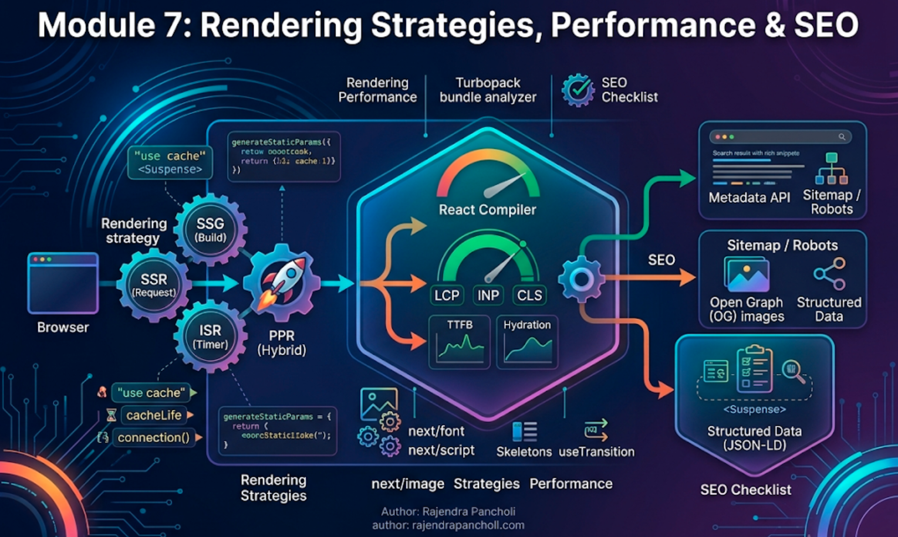
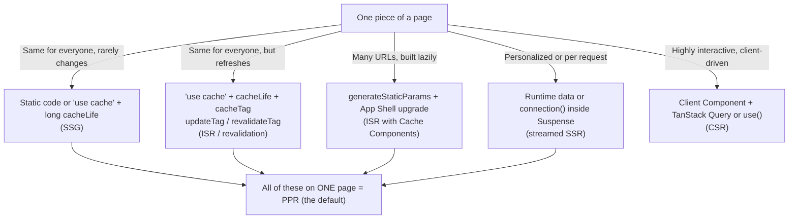

# Module 7: Rendering Strategies, Performance & SEO



## Words you will meet in this module

| Word                          | Simple meaning                                                                                |
| ----------------------------- | --------------------------------------------------------------------------------------------- |
| **Rendering strategy**        | When and where HTML is produced: at build time, per request, in the browser, or a mix.        |
| **LCP**                       | Largest Contentful Paint: how fast the main content appears. Target ≤ 2.5 s.                  |
| **INP**                       | Interaction to Next Paint: how quickly the page reacts to clicks and typing. Target ≤ 200 ms. |
| **CLS**                       | Cumulative Layout Shift: how much the page jumps around while loading. Target ≤ 0.1.          |
| **TTFB**                      | Time To First Byte: how long until the server's first response byte arrives.                  |
| **Hydration**                 | React attaching event handlers to server-rendered HTML. Costs JavaScript time on the client.  |
| **Metadata API**              | Next.js's way of generating `<title>`, `<meta>` and social tags from code.                    |
| **Open Graph (OG)**           | Tags that control how a link looks when shared (title, description, image).                   |
| **Structured data (JSON-LD)** | Machine-readable facts about a page that search engines can show as rich results.             |
| **Sitemap / robots**          | Files that tell search engines which URLs exist and which to skip.                            |
| **RUM**                       | Real User Monitoring: performance measured on actual visitors' devices.                       |
| **Tree-shaking**              | Dropping unused code from bundles so you do not ship it.                                      |

## 7.1: Rendering Strategies in Next.js 16.4

### The old vocabulary, the new model

You will hear these terms in interviews and older docs:

| Term                                      | Classic meaning                                                           |
| ----------------------------------------- | ------------------------------------------------------------------------- |
| **CSR** (client-side)                     | The browser builds the page with JavaScript (your Part 1 SPA)             |
| **SSR** (server-side)                     | The server builds HTML **per request**                                    |
| **SSG** (static generation)               | HTML is built **once at build time** and served as a file                 |
| **ISR** (incremental static regeneration) | Static pages that are refreshed in the background or built on first visit |
| **PPR** (partial prerendering)            | Part static, part dynamic, in one page                                    |

With **Cache Components** (Module 3) you no longer pick one of these **per route** with a config flag. You describe each **piece** of a page, and Next.js produces the right mix:

| You want...                                                         | In Next.js 16.4 you write...                                                                              | Classic name       |
| ------------------------------------------------------------------- | --------------------------------------------------------------------------------------------------------- | ------------------ |
| A page that is the same for everyone and rarely changes             | Static code, or `"use cache"` with a long `cacheLife`                                                     | SSG                |
| A catalog of pages for many URLs, built lazily                      | `generateStaticParams` for known values, the App Shell + upgrade for the rest (ISR with Cache Components) | ISR                |
| Content that is the same for everyone but refreshes                 | `"use cache"` + `cacheLife` + `cacheTag`, invalidated with `updateTag` / `revalidateTag`                  | ISR / revalidation |
| Personalized or per-request content                                 | Runtime data (`cookies()`, …) or `connection()` inside `<Suspense>`                                       | SSR (streamed)     |
| A fast shell with personal parts streaming in                       | All of the above on **one** page. This is the default                                                     | **PPR**            |
| Highly interactive client-driven data (live feeds, infinite scroll) | A Client Component with TanStack Query (Part 1) or `use()` with a server promise                          | CSR                |
| A fully static site with **no server at all**                       | `output: "export"` (see the limits below)                                                                 | Static export      |



### Matching TaskFlow's routes to strategies

| Route                         | Content                                 | Strategy                                                                                            |
| ----------------------------- | --------------------------------------- | --------------------------------------------------------------------------------------------------- |
| `/` (landing), `/pricing`     | Same for everyone, SEO-critical         | **Static** shell, popular content cached. Maximize speed and crawlability                           |
| `/templates/[slug]`           | Public, many pages, occasionally edited | `generateStaticParams` for top templates + ISR for the rest + `revalidateTag` on edits              |
| `/projects`, `/projects/[id]` | Private, per user, interactive          | Static shell (navigation, layout) + **streamed** personal regions + `"use cache"` keyed by `userId` |
| `/projects/[id]` live updates | Real-time                               | A Client Component with SSE (Module 5) layered on the server-rendered page                          |
| `/api/webhooks/*`             | Machine endpoints                       | Route Handlers, dynamic                                                                             |
| `/login`, `/register`         | Same for everyone but not SEO content   | Static shell + client form                                                                          |

SEO matters for the **public** routes. The private app benefits from speed but not from crawlability, so do not contort it for SEO.

### Static export: when there is no server

```ts
// next.config.ts
const nextConfig: NextConfig = { output: 'export' }; // `next build` emits a plain `out/` folder of static files
```

You can host `out/` on any static host (S3, GitHub Pages, a CDN). The trade-off is that **everything that needs a server is unavailable**: Server Functions, request-time rendering, Route Handlers that read the request, `proxy.ts`, on-demand revalidation and the default image optimizer (you need a custom loader). Use it for brochure sites and documentation. TaskFlow's authenticated app cannot be a static export.

### What `next build` tells you

`next build` prints a **route table** with a symbol per route and a legend underneath (static, partially prerendered, or dynamic). **Read it after every significant change.** If a route you expected to be mostly static shows up as fully dynamic, a runtime read has probably sprung up too high in the tree. Fix it by pushing the dynamic access down (Module 3).

#### Interview traps

- "SSR vs. SSG vs. ISR?" SSR renders per request. SSG renders once at build time. ISR serves static output that is refreshed (on a timer, on demand, or built on first visit). In Next.js 16 these are not route-level switches but results of how you cache and stream individual pieces.
- "What is PPR in Next.js?" A route with a static shell served instantly plus dynamic regions streamed per request. It is the default behavior with Cache Components.
- "Can you use Server Functions in a static export?" No. `output: "export"` has no server, so features that need one are not available.

## 7.2: Core Web Vitals and What Moves Them

Google measures real-user experience with three Core Web Vitals. They affect search ranking and, more importantly, whether people stay.

| Metric  | Measures                      | Good target | Typical Next.js causes of a bad score                                                              |
| ------- | ----------------------------- | ----------- | -------------------------------------------------------------------------------------------------- |
| **LCP** | When the main content appears | ≤ 2.5 s     | Slow server response, no static shell, huge hero image, unoptimized fonts, render-blocking scripts |
| **INP** | Responsiveness to input       | ≤ 200 ms    | Too much client JavaScript, heavy hydration, long event handlers, large client re-renders          |
| **CLS** | Layout stability              | ≤ 0.1       | Images without dimensions, late-loading fonts, content that pops in without a reserved space       |

### The levers, by metric

**LCP: get the main content to the screen sooner**

| Lever                                       | How                                                                       |
| ------------------------------------------- | ------------------------------------------------------------------------- |
| Serve a **static shell** from a CDN         | Cache Components + PPR (Module 3). The first bytes arrive in milliseconds |
| **Preload** the LCP image                   | `<Image preload … />` on the one above-the-fold image                     |
| Right-size and compress images              | `next/image` with correct `sizes` and modern formats                      |
| Fast fonts                                  | `next/font` (self-hosted, no layout shift, no third-party request)        |
| Keep render-blocking scripts out of the way | `next/script` with a suitable `strategy`                                  |
| Fast server work                            | Cached reads, parallel fetching, no waterfalls (Module 3)                 |

**INP: keep the main thread free**

| Lever                     | How                                                                                          |
| ------------------------- | -------------------------------------------------------------------------------------------- |
| **Ship less JavaScript**  | Server Components by default, small client islands, lazy-load heavy widgets (Module 2)       |
| Cheaper hydration         | Fewer and smaller client components. Suspense boundaries let React hydrate in priority order |
| Keep handlers short       | Do heavy work in a Server Function or `startTransition`; avoid long synchronous loops        |
| Fewer wasteful re-renders | The React Compiler (Topic 7.4), `useTransition`, `useDeferredValue` (Part 1, Module 5)       |

**CLS: reserve space before things arrive**

| Lever                                                   | How                                                 |
| ------------------------------------------------------- | --------------------------------------------------- |
| Image width and height (or `fill` in a sized container) | `next/image` reserves the space                     |
| Skeletons the **same size** as the content              | `loading.tsx` and `<Suspense>` fallbacks (Module 3) |
| Avoid inserting content above existing content          | Banners, cookie notices and ads need reserved space |
| Font display strategy                                   | `next/font` handles size-adjusted fallbacks         |

### Why server-first helps all three

The server sends **real HTML** immediately (LCP), ships **less JavaScript** because Server Components send none (INP), and streams content into **pre-reserved regions** (CLS). The model from Module 2 is also a performance model.

#### Interview traps

- "How does Next.js improve LCP compared with a Vite SPA?" The server sends rendered HTML (often a static shell from a CDN) instead of an empty page that needs JavaScript and API calls first, plus built-in image and font optimization.
- "What typically causes poor INP in a Next.js app?" Too much client JavaScript and heavy hydration (a `"use client"` boundary too high), or long synchronous event handlers.

## 7.3: Images, Fonts and Scripts

### `next/image`

```tsx
import Image from "next/image";
import hero from "@/public/hero.jpg";                           // a static import: size and blur placeholder are automatic

// 1. A static import: dimensions known, optional blur placeholder
<Image src={hero} alt="Team planning on a board" preload placeholder="blur" sizes="100vw" />

// 2. A remote image: dimensions required, host must be allowed
<Image src="https://cdn.example.com/avatars/42.jpg" alt="Asha" width={64} height={64} />

// 3. Unknown size inside a sized container: fill + sizes
<div className="relative aspect-video">
  <Image src={post.cover} alt="" fill sizes="(min-width: 1024px) 50vw, 100vw" className="object-cover" />
</div>
```

| Prop / setting                   | Why it matters                                                                                                                                      |
| -------------------------------- | --------------------------------------------------------------------------------------------------------------------------------------------------- |
| `alt`                            | Required. Describe the image, or use `alt=""` for purely decorative ones                                                                            |
| `width` and `height` (or `fill`) | Reserves space, preventing layout shift                                                                                                             |
| **`sizes`**                      | Tells the browser how wide the image will be so it downloads the **right** variant. Without it, large screens' variants are fetched for small slots |
| **`preload`**                    | Preloads the image. Use on **one** LCP image per page. (It replaces the deprecated `priority`)                                                      |
| `loading` (default `lazy`)       | Below-the-fold images load only when needed                                                                                                         |
| `placeholder="blur"`             | A tiny blurred preview while loading                                                                                                                |
| `quality`                        | Must be listed in `images.qualities` (default `[75]`)                                                                                               |
| `images.remotePatterns` (config) | An **allowlist** of external hosts. Keep it narrow: an open pattern lets anyone use your server as an image proxy                                   |

```ts
// next.config.ts
images: {
  remotePatterns: [{ protocol: "https", hostname: "cdn.example.com", pathname: "/avatars/**" }],
},
```

Next.js serves images in modern formats, resized per device, and caches them (the default minimum cache lifetime is 4 hours). Image optimization costs CPU. On a self-hosted server install `sharp` and watch resource usage, or use a CDN-based loader.

### `next/font`

```tsx
// app/layout.tsx
import { Inter } from 'next/font/google';
import localFont from 'next/font/local';

const inter = Inter({
  subsets: ['latin'],
  display: 'swap',
  variable: '--font-inter',
});
const brand = localFont({
  src: './fonts/Brand.woff2',
  display: 'swap',
  variable: '--font-brand',
});

export default function RootLayout({
  children,
}: {
  children: React.ReactNode;
}) {
  return (
    <html lang="en" className={`${inter.variable} ${brand.variable}`}>
      <body>{children}</body>
    </html>
  );
}
```

Fonts are **downloaded at build time and self-hosted** with your site: no request to Google at runtime (better privacy and speed), and a size-adjusted fallback font reduces layout shift. Load only the weights and subsets you use. Never `@import` a font stylesheet from a CDN in CSS: it blocks rendering.

### `next/script` and third-party code

Analytics, chat widgets and ad scripts are among the biggest performance and privacy costs.

```tsx
import Script from "next/script";

<Script src="https://analytics.example.com/a.js" strategy="afterInteractive" />   // after the page becomes interactive (the default)
<Script src="https://widget.example.com/chat.js" strategy="lazyOnload" />          // when the browser is idle
```

| Strategy            | Loads                          | Use for                                                       |
| ------------------- | ------------------------------ | ------------------------------------------------------------- |
| `beforeInteractive` | Before the page is interactive | Scripts that must run first (consent managers, bot detection) |
| `afterInteractive`  | Soon after hydration (default) | Analytics, tag managers                                       |
| `lazyOnload`        | When the browser is idle       | Chat widgets, low-priority embeds                             |

The `@next/third-parties` package provides optimized components for common services (Google Analytics, Tag Manager, YouTube embeds, maps). Audit third-party scripts regularly: each one is code you do not control running on every page.

#### Interview traps

- "Why does `next/image` need `sizes`?" So the browser can choose the correct image variant before layout is known. Without it, the browser may download a much larger image than the slot needs.
- "When do you use `preload` on an image?" On the single above-the-fold LCP image. Preloading many images defeats the purpose.
- "Why restrict `remotePatterns`?" The image optimizer fetches and transforms remote URLs on your server. An overly broad pattern lets attackers use it for abuse or SSRF-style probing.
- "What does `next/font` do for performance and privacy?" It self-hosts fonts (no runtime third-party request) and reduces layout shift with size-adjusted fallbacks.

## 7.4: Bundle Size and the React Compiler

### Find out what you ship

Next.js 16.1 added a **Turbopack Bundle Analyzer** (experimental) that works with the default bundler:

```bash
npx next experimental-analyze              # opens an interactive treemap of client and server modules
npx next experimental-analyze --output     # writes the report to .next/diagnostics/analyze (to diff before and after)
```

It shows **import chains**: which of your files pulled a large dependency into the client bundle, which is exactly what you need when a `"use client"` boundary sits too high. (The older `@next/bundle-analyzer` plugin is for webpack builds and needs `next build --webpack`.)

### How to shrink bundles

| Technique                               | Detail                                                                                                                                                                 |
| --------------------------------------- | ---------------------------------------------------------------------------------------------------------------------------------------------------------------------- |
| **Move code to the server**             | Markdown, date formatting, validation and syntax highlighting belong in Server Components                                                                              |
| Lower `"use client"` boundaries         | A big client page splits into a server shell and small islands (Module 2)                                                                                              |
| **Lazy-load** rarely used UI            | `next/dynamic` or `React.lazy` for modals, editors and charts below the fold                                                                                           |
| Import only what you use                | Prefer `import { debounce } from "lodash-es"` over whole-library imports                                                                                               |
| Beware **barrel files** and icon packs  | Packages with thousands of re-exports can drag in far more than you use. Next.js has an `optimizePackageImports` option for common packages (see the config reference) |
| Replace heavy libraries                 | A tiny date library instead of a huge one. Native `Intl` instead of a formatting package                                                                               |
| Avoid duplicate dependency versions     | Check the analyzer for two copies of the same library                                                                                                                  |
| Keep server-only code out of the client | `import "server-only"` makes accidental imports a build error                                                                                                          |

### The React Compiler

The **React Compiler** (stable 1.0, covered in [Part 1, Module 5](reactjs/rendering-performance-and-suspense#55-react-compiler-10-memoization-without-the-hooks)) automatically memoizes your components so you do not hand-write `useMemo`, `useCallback` and `memo`. Next.js 16 has built-in support, and `create-next-app` offers it as an option. Enable it in the config and install the plugin:

```bash
npm install -D babel-plugin-react-compiler
```

```ts
// next.config.ts
const nextConfig: NextConfig = {
  cacheComponents: true,
  partialPrefetching: true,
  reactCompiler: true, // opt in
};
```

Things to know:

- It mainly improves **Client Components** (fewer wasted re-renders), which helps **INP**. Server Components do not re-render on the client, so there is little to optimize there.
- It relies on the **Rules of React** (pure components, no mutation of props or state, rules of hooks). Code that breaks them is skipped. Use the linter to find violations.
- Compilation adds some **build time**, because components are processed by the compiler. Measure it on your project.
- You can opt a component out with the `"use no memo"` directive while debugging.

#### Interview traps

- "How do you find out why your client bundle is large?" Run the Turbopack bundle analyzer and follow the import chain of the big modules back to the `"use client"` file that pulled them in.
- "Does the React Compiler help Server Components?" Barely. Its benefit is fewer unnecessary re-renders on the client, so it mainly improves Client Components and INP.

## 7.5: Perceived Performance: Streaming, Skeletons and Navigation Feedback

Users judge speed by what they **see and feel**, not by milliseconds in a trace.

### Make waiting visible and calm

| Technique                                                              | Effect                                                |
| ---------------------------------------------------------------------- | ----------------------------------------------------- |
| **Skeletons** shaped like the content                                  | No layout shift, a sense of progress                  |
| Several small `<Suspense>` boundaries                                  | Content appears piece by piece instead of all at once |
| `loading.tsx` per route segment                                        | Instant feedback on navigation                        |
| Prefetching (App Shell by default, `prefetch={true}` for likely links) | The next page is ready before the click (Module 3)    |
| Optimistic UI for quick actions                                        | The screen reacts immediately (Module 4)              |
| `useTransition` for non-urgent updates                                 | The old UI stays interactive while new UI renders     |

### Show that a link is working: `useLinkStatus`

When a navigation is waiting on the server, give the user feedback right on the link:

```tsx
'use client';
import Link, { useLinkStatus } from 'next/link';

function Pending() {
  const { pending } = useLinkStatus(); // must be rendered INSIDE a <Link>
  return pending ? (
    <span aria-hidden className="animate-pulse">
      …
    </span>
  ) : null;
}

export function ProjectLink({ id, name }: { id: number; name: string }) {
  return (
    <Link href={`/projects/${id}`}>
      {name} <Pending />
    </Link>
  );
}
```

### View transitions

React 19.3, which ships with Next.js 16.4, made **`<ViewTransition>`** stable. It lets the browser animate between states (for example a shared element moving between a list and a detail page). Treat it as progressive polish: keep animations short, respect `prefers-reduced-motion`, and check the Next.js docs for how to enable view transitions for navigations in your version.

### Be careful with over-prefetching

`prefetch={true}` costs a server invocation per link. Do not set it on a table with 500 links. Prefetch what people are likely to click, and let the default App Shell prefetch cover the rest.

## 7.6: SEO: Metadata, Sitemaps, Open Graph and Structured Data

SEO matters for your **public** pages. The fundamentals are mostly _good HTML and a fast page_, and Next.js removes the busywork.

### The Metadata API

Static metadata (in a layout or page):

```tsx
// app/layout.tsx
import type { Metadata } from 'next';
import { env } from '@/lib/env';

export const metadata: Metadata = {
  metadataBase: new URL(env.APP_ORIGIN), // resolves relative URLs below
  title: {
    default: 'TaskFlow: plan work with your team',
    template: '%s | TaskFlow',
  },
  description:
    'TaskFlow helps teams plan projects, track tasks and ship on time.',
  openGraph: {
    type: 'website',
    siteName: 'TaskFlow',
    title: 'TaskFlow',
    description: 'Plan work with your team.',
  },
  twitter: { card: 'summary_large_image' },
};
```

Dynamic metadata (per page, from data):

```tsx
// app/(marketing)/templates/[slug]/page.tsx
import type { Metadata } from 'next';
import { getTemplate } from '@/lib/data/templates'; // a cached function: it can sit in the static shell

export async function generateMetadata({
  params,
}: PageProps<'/templates/[slug]'>): Promise<Metadata> {
  const { slug } = await params;
  const template = await getTemplate(slug);
  if (!template)
    return { title: 'Template not found', robots: { index: false } };

  return {
    title: template.name, // → "Sprint planning | TaskFlow"
    description: template.summary,
    alternates: { canonical: `/templates/${slug}` }, // avoids duplicate-content issues
    openGraph: {
      title: template.name,
      description: template.summary,
      type: 'article',
    },
  };
}
```

How it behaves with Cache Components: dynamic metadata **streams in after the static shell**. Crawlers and link-preview bots that cannot handle that are detected by their user agent and served a **fully rendered** page with metadata in the `<head>` (Module 3). Two practical consequences: **make metadata read from cached functions** (as above) so it joins the static shell where possible, and remember that **whatever data it needs must be available at request time**, not only at build time.

Mark **private** areas as not indexable:

```tsx
// app/(app)/layout.tsx
export const metadata: Metadata = { robots: { index: false, follow: false } };
```

### `sitemap.ts` and `robots.ts`

```ts
// app/sitemap.ts
import type { MetadataRoute } from 'next';
import { listTemplates } from '@/lib/data/templates';

export default async function sitemap(): Promise<MetadataRoute.Sitemap> {
  const templates = await listTemplates();
  return [
    {
      url: 'https://taskflow.example.com/',
      lastModified: new Date('2026-01-01'),
      changeFrequency: 'monthly',
      priority: 1,
    },
    {
      url: 'https://taskflow.example.com/pricing',
      lastModified: new Date('2026-01-01'),
    },
    ...templates.map((t) => ({
      url: `https://taskflow.example.com/templates/${t.slug}`,
      lastModified: t.updatedAt, // from data. Avoid new Date() here: it is non-deterministic under Cache Components
    })),
  ];
}
```

```ts
// app/robots.ts
import type { MetadataRoute } from 'next';

export default function robots(): MetadataRoute.Robots {
  return {
    rules: [
      {
        userAgent: '*',
        allow: '/',
        disallow: ['/projects', '/settings', '/api/'],
      },
    ],
    sitemap: 'https://taskflow.example.com/sitemap.xml',
  };
}
```

`robots.txt` is a **request to well-behaved crawlers, not a security control**. Anything that must stay private needs authentication, not a `Disallow` line (which can even advertise the path).

### Open Graph images (generated)

```tsx
// app/(marketing)/templates/[slug]/opengraph-image.tsx
import { ImageResponse } from 'next/og';
import { getTemplate } from '@/lib/data/templates';

export const alt = 'TaskFlow template';
export const size = { width: 1200, height: 630 };
export const contentType = 'image/png';

export default async function Image({
  params,
}: {
  params: Promise<{ slug: string }>;
}) {
  const { slug } = await params;
  const template = await getTemplate(slug);

  return new ImageResponse(
    <div
      style={{
        width: '100%',
        height: '100%',
        display: 'flex',
        flexDirection: 'column',
        justifyContent: 'center',
        padding: 80,
        background: '#0f172a',
        color: 'white',
      }}
    >
      <div style={{ fontSize: 28, opacity: 0.7 }}>TaskFlow template</div>
      <div style={{ fontSize: 84, fontWeight: 700 }}>
        {template?.name ?? 'Template'}
      </div>
    </div>,
    { ...size },
  );
}
```

Each shared link now has a branded preview image, generated from your own data. `ImageResponse` supports a **subset of CSS** (flexbox, not full layout), so keep the design simple.

### Structured data (JSON-LD)

```tsx
export default async function TemplatePage({
  params,
}: PageProps<'/templates/[slug]'>) {
  const { slug } = await params;
  const template = await getTemplate(slug);
  const jsonLd = {
    '@context': 'https://schema.org',
    '@type': 'HowTo',
    name: template?.name,
    description: template?.summary,
  };

  return (
    <>
      <script
        type="application/ld+json"
        dangerouslySetInnerHTML={{
          __html: JSON.stringify(jsonLd).replace(/</g, '\\u003c'),
        }} // escape "<" to prevent script injection
      />
      {/* page content */}
    </>
  );
}
```

Always escape `<` when injecting JSON into a script tag, so a value like `</script><script>…` cannot break out (the XSS point from Part 1, Module 7).

### An SEO checklist for public pages

| Item                                                         | Why                                                                                                              |
| ------------------------------------------------------------ | ---------------------------------------------------------------------------------------------------------------- |
| A unique `<title>` and meta description per page             | Search results and shared links                                                                                  |
| One `<h1>`, logical headings, semantic HTML                  | Understanding and accessibility                                                                                  |
| `alternates.canonical`                                       | Prevents duplicate-content dilution (filters, tracking parameters)                                               |
| `sitemap.xml` and `robots.txt`                               | Discovery and crawl control                                                                                      |
| **Correct HTTP status codes**                                | A missing page must return **404**, not 200. Verify with `curl -I` (and recall the streaming caveat in Module 3) |
| Fast pages with good Core Web Vitals                         | A ranking factor and a conversion factor                                                                         |
| `noindex` for private or thin pages                          | Keeps junk out of the index                                                                                      |
| Open Graph and Twitter tags                                  | How links look when shared                                                                                       |
| Structured data where it fits                                | Rich results                                                                                                     |
| `hreflang` / `alternates.languages` for multi-language sites | Correct language targeting                                                                                       |
| Meaningful internal links with descriptive text              | Crawling and context                                                                                             |

### Internationalization in one paragraph

The App Router approach: put a locale segment in the route (`app/[lang]/…`), detect or redirect the locale in `proxy.ts`, load a dictionary per locale **on the server** (so translations add no client JavaScript), and use `generateStaticParams` to prerender each locale. Libraries such as `next-intl` package these patterns. Add `alternates.languages` so search engines connect the translations.

#### Interview traps

- "How do you set the page title and description in the App Router?" Export `metadata` or `generateMetadata` from the layout or page. Use `title.template` in the root layout.
- "Is `robots.txt` a way to hide private pages?" No. It is advisory for polite crawlers and can advertise paths. Protect private content with authentication and use `noindex` metadata.
- "Why is a `404` status important for missing pages?" Search engines treat a `200` with a "not found" body as a soft 404 and may index it. Return a real `404` for content pages.
- "Why escape `<` in JSON-LD?" Because you inject it through `dangerouslySetInnerHTML`, and unescaped data could close the script tag and inject markup.

## 7.7: Measuring: Lighthouse, Real-User Monitoring and Build Output

You cannot improve what you do not measure, and **lab** numbers differ from **real-user** numbers.

| Tool                                      | Kind      | Use for                                                                              |
| ----------------------------------------- | --------- | ------------------------------------------------------------------------------------ |
| **Lighthouse** (Chrome DevTools)          | Lab       | A repeatable audit with fix suggestions. Run in a private window, in production mode |
| **Chrome DevTools: Performance, Network** | Lab       | Long tasks, waterfalls, payload sizes, what blocks the main thread                   |
| **PageSpeed Insights / CrUX**             | **Field** | Real users' LCP, INP and CLS over the last 28 days                                   |
| **`next build` route table**              | Build     | Which routes are static, partially prerendered or dynamic                            |
| **Turbopack bundle analyzer**             | Build     | What is in your JavaScript                                                           |
| **RUM** (your own or a vendor's)          | **Field** | Percentiles by page, device and country                                              |

Always test **`next build && next start`**, never `next dev`. The dev server compiles on demand, shows overlays and is much slower.

### Report Web Vitals from real users

```tsx
// components/web-vitals.tsx
'use client';
import { useReportWebVitals } from 'next/web-vitals';

export function WebVitals() {
  useReportWebVitals((metric) => {
    // metric: { name: "LCP" | "INP" | "CLS" | "TTFB" | "FCP", value, id, rating }
    navigator.sendBeacon('/api/vitals', JSON.stringify(metric)); // a tiny Route Handler stores it
  });
  return null;
}
```

Render `<WebVitals />` once in the root layout. For monitoring that must start as early as possible on the client, Next.js also supports an `instrumentation-client.ts` file. Look at **percentiles** (p75 for the official thresholds, p95/p99 for outliers), not averages, and segment by page and device class.

### A performance budget

Decide limits **before** you drift: for example, "landing page: LCP under 2.0 s on a mid-range phone; client JavaScript under 150 KB; no regression above 5% without a reason." Add a Lighthouse CI check to your pipeline (Module 8) so regressions fail the build instead of surprising users.

## 7.8: Common Performance Pitfalls in Next.js

| Pitfall                                                    | Symptom                                            | Fix                                                                                        |
| ---------------------------------------------------------- | -------------------------------------------------- | ------------------------------------------------------------------------------------------ |
| **`"use client"` on a layout or a big page**               | Huge JS bundle, slow INP, server-only modules fail | Move the directive to small interactive leaves (Module 2)                                  |
| **Reading `cookies()` or `params` at the top of a layout** | Route becomes a blocking route or fully dynamic    | Push the read down into a small component inside `<Suspense>` (Module 3)                   |
| **Sequential awaits**                                      | Slow server response, long TTFB                    | `Promise.all`, sibling Suspense boundaries (Module 3)                                      |
| **No caching of repeated reads**                           | Database load on every request                     | `"use cache"` + `cacheLife` + `cacheTag`, `React.cache` per request                        |
| **Passing huge props to Client Components**                | Big HTML and RSC payload, slow hydration           | Pass DTOs with only the needed fields. Paginate. Fetch less                                |
| **`` or CSS background for large images**             | Large downloads, layout shift                      | `next/image` with `sizes`, `preload` for the LCP image                                     |
| **Missing `sizes` on responsive images**                   | Oversized images on small screens                  | Provide `sizes` that match your layout                                                     |
| **Fonts via CSS `@import`**                                | Render blocking, flash of unstyled text            | `next/font`                                                                                |
| **Heavy third-party scripts loaded eagerly**               | Long main-thread tasks, bad INP                    | `next/script` with `lazyOnload`, drop unnecessary tags                                     |
| **Skeletons that do not match content size**               | Layout shift                                       | Match dimensions                                                                           |
| **`prefetch={true}` on hundreds of links**                 | Server load, wasted bandwidth                      | Use it only for likely clicks                                                              |
| **Client-side fetch waterfalls after hydration**           | Spinners after the page "loaded"                   | Fetch on the server, stream with Suspense, or start the fetch earlier and pass the promise |
| **Barrel-file and icon-pack imports**                      | Large bundles from a handful of icons              | Import specific modules, check the analyzer                                                |
| **Testing performance with `next dev`**                    | Misleading, slow numbers                           | `next build && next start`, test on a throttled mid-range device profile                   |
| **Averaging metrics**                                      | Hides the slow tail where unhappy users live       | Look at p75, p95 and p99                                                                   |

## Tricky Questions and Answers

#### Q1 [SDE-2]: A product page has LCP of 4.5 s on mobile. Walk through your investigation.

**Answer:** First measure in production mode with Lighthouse and field data, and identify the LCP element (usually the hero image or a heading). Then check, in order: **server response** (TTFB: is the shell static and cached, or is the route fully dynamic because of a runtime read near the top?), **the LCP resource** (is the image `preload`ed, correctly sized with `sizes`, in a modern format, not lazy-loaded?), **render blocking** (fonts via `next/font`, third-party scripts moved to `lazyOnload`), and **JavaScript weight** (analyzer: is a large client bundle delaying hydration and main-thread work?). Fix the biggest contributor first and re-measure, using throttled mobile settings.

#### Q2 [SDE-2]: INP is poor on a task board even though the server is fast. What would you look at?

**Answer:** INP measures main-thread responsiveness to interactions, so the cause is client-side: too much JavaScript hydrating (a `"use client"` boundary too high), large Client Component trees re-rendering on each interaction (use the React Profiler; consider the React Compiler or restructuring state), long synchronous handlers or heavy third-party scripts. Fix by lowering client boundaries, moving computation to the server, using `useTransition` / `useDeferredValue` for non-urgent updates, virtualizing long lists, and lazy-loading heavy widgets. Verify with the Performance panel's long tasks and field INP data.

#### Q3 [SDE-3]: Explain how one page can be static, cached and dynamic at once, and why that beats choosing SSG or SSR for the whole route.

**Answer:** With Cache Components, Next.js prerenders a route into a static shell that contains everything deterministic or cached (`"use cache"`), with `<Suspense>` fallbacks where request-time data is needed. The shell is served immediately (often from a CDN), and the dynamic regions stream in per request. A whole-route SSG would force personalized content to client-side fetching or stale data, and whole-route SSR would make every visitor wait for the slowest data. The mixed model gives fast first paint and fresh personal data, and the build tells you if you accidentally made too much dynamic.

#### Q4 [SDE-2]: Your sitemap or OG-image route throws a Cache Components error about using the current time. Why, and what do you do?

**Answer:** Metadata routes are prerendered like `GET` handlers. `new Date()` returns a different value on each call, so freezing it into the prerendered output would be misleading, and Cache Components flags it. Use a real timestamp from your data (`updatedAt`), a fixed value, or move the dynamic part behind a request-time boundary where it makes sense. For sitemaps, the content's own modified date is the correct value anyway.

#### Q5 [SDE-2]: Why would a link preview (Slack, X) show no title or image for your page, though the browser tab shows the right title?

**Answer:** The metadata is probably produced by dynamic `generateMetadata` that streams in after the shell, and the preview bot did not execute or wait for streamed content, or the Open Graph tags and image URL are missing, relative without `metadataBase`, or blocked by authentication. Fix by providing proper Open Graph metadata with `metadataBase` for absolute URLs, an `opengraph-image`, making metadata come from cached or static data so it is in the initial HTML, and testing with the platform's debugger (and `curl` with the bot's user agent). Next.js detects many known bots and renders them a fully resolved page, but your data must also be available at request time.

#### Q6 [SDE-3]: A teammate wants to make the whole authenticated app indexable "for SEO". What do you say?

**Answer:** Private, per-user pages cannot be indexed (crawlers are not logged in) and exposing them would be a security problem. SEO value comes from public, content-rich pages: marketing, docs, templates, a blog. Keep the app behind authentication with `noindex` metadata, make the public pages static or cached for speed and crawlability, add a sitemap and structured data to those, and do not use `robots.txt` as protection for private routes.

---

## Hands-On Lab: Make TaskFlow Fast and Findable

```
1. Run npm run build. Read the route table and its legend. Which routes are static, partially prerendered, dynamic?
   Move one runtime read deeper into a Suspense boundary and rebuild: did the classification improve?
2. Serve production: npm run build && npm run start. Run Lighthouse (mobile, throttled) on /, /pricing and
   a template page. Record LCP, INP/TBT and CLS as your baseline.
3. Landing page: add a hero with <Image preload sizes="100vw" placeholder="blur" /> and a self-hosted font via next/font.
   Re-run Lighthouse. What changed in LCP?
4. Break CLS on purpose: remove width/height from an image and add a late-loading banner. Measure CLS. Fix both.
5. Run npx next experimental-analyze. Find the largest client modules and their import chains. Move one heavy,
   non-interactive library to a Server Component, or lazy-load it with next/dynamic. Re-analyze and compare.
6. Turn on the React Compiler (reactCompiler: true + babel-plugin-react-compiler). Profile a client component list
   with the React DevTools Profiler before and after. Compare build time too.
7. Add a Metadata API setup: metadataBase, title template, descriptions per page, canonical URLs,
   robots noindex for the (app) group.
8. Create sitemap.ts (templates from your data, no new Date()), robots.ts and a generated opengraph-image.tsx
   for template pages. Visit /sitemap.xml, /robots.txt and /templates/<slug>/opengraph-image.
9. Add JSON-LD with the escaped "<". Validate it with a structured-data testing tool.
10. SEO status codes: curl -I https://localhost:3000/templates/does-not-exist. Do you get a real 404?
    If you get 200, apply the existence check from Module 3 before streaming begins.
11. Add useReportWebVitals posting to a Route Handler and log the numbers. Open the app on a throttled device profile.
12. Add useLinkStatus to your project links and verify the pending indicator appears on a slow route
    (add a 1.5 s delay to a query). Then prefetch={true} on one link and compare.
13. Write down a performance budget for / and add a Lighthouse CI step to your pipeline plan (Module 8).
```

Questions to answer for yourself:

- Which single change improved your LCP the most, and which improved INP the most?
- Which of your pages should be indexed, and what stops the others from being indexed?
- Where in your codebase would a developer accidentally make a whole route dynamic?

---

## Module 7 Cheat Sheet

| Concept                       | One-line interview answer                                                                           |
| ----------------------------- | --------------------------------------------------------------------------------------------------- |
| Strategies in 16.4            | Not route flags anymore: static + `use cache` + streamed dynamic pieces, mixed in one page (PPR).   |
| SSR / SSG / ISR               | Per request / at build time / static output refreshed or built on first visit.                      |
| Static export                 | `output: "export"` emits plain files. No Server Functions, no request-time rendering, no proxy.     |
| Build output                  | The route table and legend show static, partial or dynamic. Check it after changes.                 |
| Core Web Vitals               | LCP ≤ 2.5 s, INP ≤ 200 ms, CLS ≤ 0.1. Judge at p75 from field data.                                 |
| LCP levers                    | Static shell from a CDN, `preload` the hero, right-sized images, `next/font`, fast server reads.    |
| INP levers                    | Less client JS, lower `"use client"`, cheaper hydration, short handlers, transitions, the Compiler. |
| CLS levers                    | Image dimensions, same-size skeletons, font fallbacks, reserved space.                              |
| `next/image`                  | Set `alt`, dimensions or `fill`, **`sizes`**, `preload` for the LCP image, narrow `remotePatterns`. |
| `next/font`                   | Self-hosted at build time, no runtime third-party request, size-adjusted fallback.                  |
| `next/script`                 | `beforeInteractive`, `afterInteractive` (default), `lazyOnload`. Audit third-party scripts.         |
| Bundle analysis               | `npx next experimental-analyze` (Turbopack, 16.1+). `@next/bundle-analyzer` needs `--webpack`.      |
| Shrinking bundles             | Server Components, lower boundaries, lazy loading, targeted imports, replace heavy libraries.       |
| React Compiler                | `reactCompiler: true` + the plugin. Auto-memoizes client components. Needs the Rules of React.      |
| Perceived performance         | Skeletons, many small Suspense boundaries, prefetch, optimistic UI, `useLinkStatus`.                |
| Metadata API                  | `metadata` / `generateMetadata`, `title.template`, `metadataBase`, `alternates.canonical`.          |
| Metadata and Cache Components | Dynamic metadata streams after the shell. Bots get a full render. Read from cached data.            |
| `sitemap.ts` / `robots.ts`    | Typed route files. Avoid `new Date()`. `robots.txt` is advisory, not a security control.            |
| OG images                     | `opengraph-image.tsx` with `ImageResponse` from `next/og` (CSS subset).                             |
| JSON-LD                       | Inject with `dangerouslySetInnerHTML` and escape `<`.                                               |
| HTTP status for SEO           | Missing content must return a real 404. Verify with `curl -I`.                                      |
| Measuring                     | Test `build && start`. Lab (Lighthouse) plus field (CrUX, `useReportWebVitals`). Use percentiles.   |
