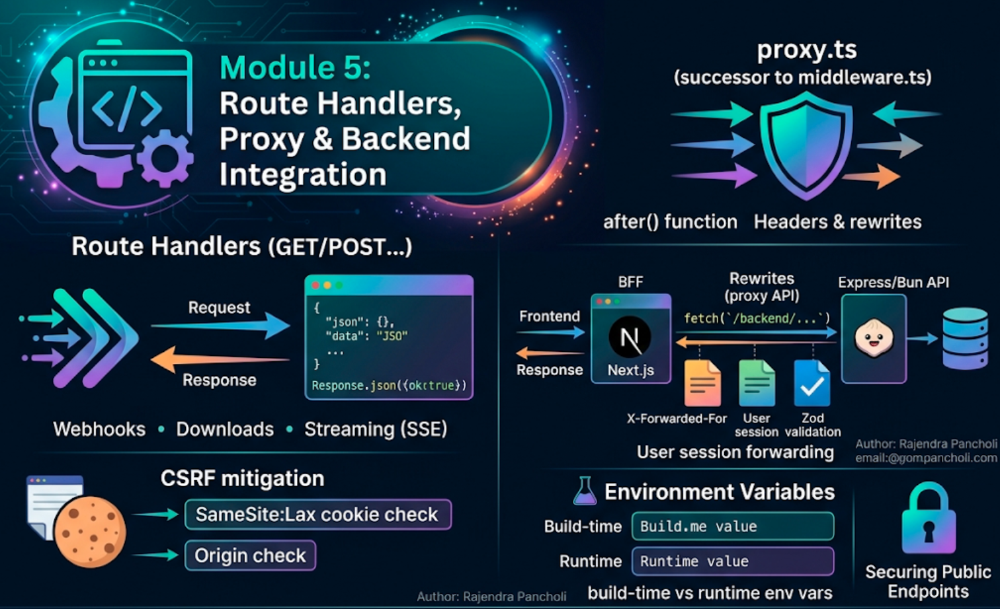
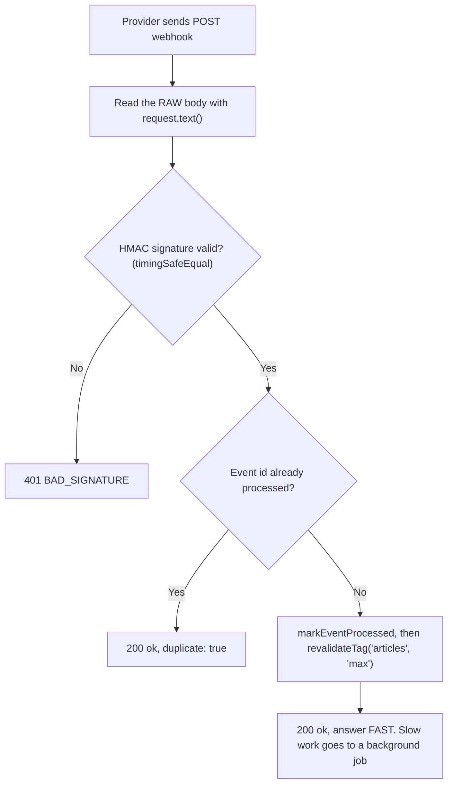
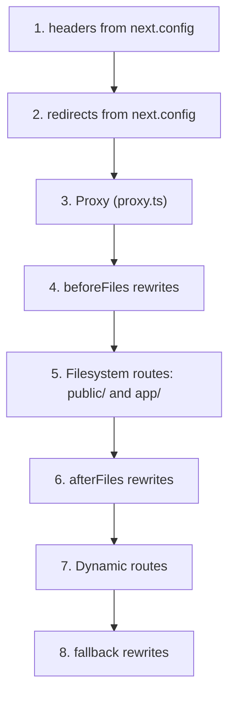
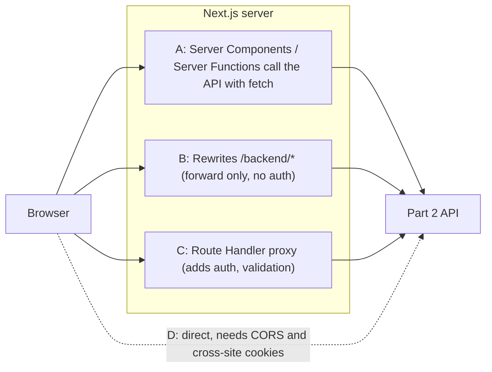
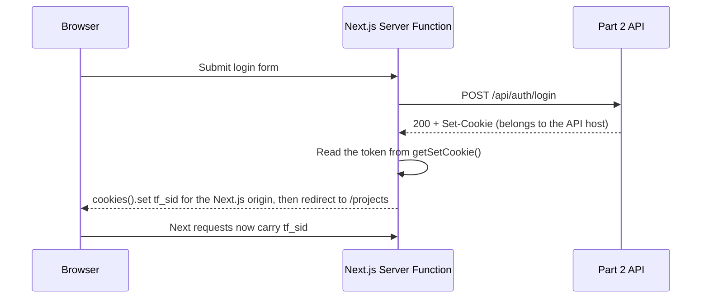

# Module 5: Route Handlers, Proxy & Backend Integration



## Words you will meet in this module

| Word                               | Simple meaning                                                                                        |
| ---------------------------------- | ----------------------------------------------------------------------------------------------------- |
| **Route Handler**                  | A `route.ts` file that handles HTTP requests for a URL, using the standard `Request` and `Response`.  |
| **`NextRequest` / `NextResponse`** | Next.js's extensions of `Request` and `Response` with helpers (cookies, `nextUrl`, redirects).        |
| **Proxy (`proxy.ts`)**             | Code that runs **before** a request reaches your routes. It replaced `middleware.ts` in Next.js 16.   |
| **Matcher**                        | A config that says which URL paths a proxy should run on.                                             |
| **BFF**                            | Backend-for-Frontend: a server layer built for **one** front end, sitting in front of other backends. |
| **Rewrite**                        | Serving a different destination's content under the **same URL**, invisibly to the browser.           |
| **Webhook**                        | An HTTP call another service makes to **your** endpoint when an event happens.                        |
| **`after()`**                      | A Next.js function that runs code **after** the response has been sent.                               |
| **SSE**                            | Server-Sent Events: a one-way, long-lived stream from server to browser.                              |
| **Build-time value**               | A value fixed when you run `next build` and baked into the output.                                    |
| **Runtime value**                  | A value read when the server handles a request.                                                       |
| **CSRF**                           | A malicious site makes the user's browser send an authenticated request they did not intend.          |

## 5.1: Route Handlers

[Module 4](nextjs/mutations-forms-and-server-functions) covered Server Functions for mutations from **your own UI**. Sometimes something else needs a **real HTTP endpoint**: a payment provider calling a webhook, a mobile app, a file download, a health check. For that, Next.js has **Route Handlers**: the equivalent of an Express route, written with the standard web `Request` and `Response`.

```ts
// app/api/health/route.ts   →   GET /api/health
export function GET() {
  return Response.json({ ok: true });
}
```

You name the exported functions after the HTTP methods: `GET`, `POST`, `PUT`, `PATCH`, `DELETE`, `HEAD`, `OPTIONS`.

```ts
// app/api/projects/[projectId]/tasks/route.ts
import { NextRequest } from 'next/server';

export async function GET(
  request: NextRequest,
  ctx: RouteContext<'/api/projects/[projectId]/tasks'>, // a global helper type Next.js generates
) {
  const { projectId } = await ctx.params; // params is a Promise, as everywhere in Next.js 16
  const status = request.nextUrl.searchParams.get('status'); // query string
  return Response.json({ projectId, status });
}

export async function POST(
  request: Request,
  ctx: RouteContext<'/api/projects/[projectId]/tasks'>,
) {
  const { projectId } = await ctx.params;
  const body = await request.json(); // also .text(), .formData(), .arrayBuffer()
  return Response.json({ projectId, received: body }, { status: 201 });
}
```

If you prefer not to use the helper, type the second argument by hand: `{ params }: { params: Promise<{ projectId: string }> }`.

### Rules of the road

| Rule                                                         | Detail                                                                                |
| ------------------------------------------------------------ | ------------------------------------------------------------------------------------- |
| `route.ts` and `page.tsx` **cannot live in the same folder** | A URL is either a page or an endpoint. `app/api/...` is the common home for endpoints |
| Route Handlers are **public HTTP endpoints**                 | Any client can call them. **You** must add authentication and authorization           |
| They **do not take part in layouts or client navigation**    | They are the lowest-level routing primitive                                           |
| Standard `Request` / `Response`                              | The same objects as in Hono and `Bun.serve` from Part 2, so the skills transfer       |
| Do not leak internals in error messages                      | Return a generic message and log the details on the server                            |

### Caching in Route Handlers (Cache Components)

With Cache Components on (the default), a **`GET` handler follows the same model as a page**:

- If it touches **no runtime data** (no `request`, `cookies()`, `headers()`, search params), Next.js **prerenders** it at build time and serves the static result.
- If it reads runtime data, it runs **per request**.
- You can cache a helper it calls with `"use cache"` and `cacheLife`.

Other methods (`POST`, `PUT`, `PATCH`, `DELETE`) are **never** cached. Practical consequences:

```ts
// Prerendered at build time: no runtime data, so it is effectively a static JSON file
export function GET() {
  return Response.json({ version: '1.4.0' });
}

// Per request: it reads the request
export async function GET(request: Request) {
  const q = new URL(request.url).searchParams.get('q');
  return Response.json(await search(q));
}
```

Be deliberate: if a handler **must** run on every request (a live stream, "current time"), make sure it reads request data or call `await connection()`. Otherwise Next.js may try to prerender it during the build.

### The same error shape as Part 2

Keep your JSON error responses consistent with [Part 2, Module 4](nodejs/http-servers-and-rest-apis#45-rest-api-design) so a client can treat both backends the same way:

```ts
// lib/http.ts
export function jsonError(
  status: number,
  code: string,
  message: string,
  details?: unknown,
) {
  return Response.json({ error: { code, message, details } }, { status });
}
```

#### Interview traps

- "Route Handler vs. Server Function?" Route Handlers are public HTTP endpoints for anything that is not your own React UI (webhooks, mobile apps, downloads, streaming). Server Functions are for mutations triggered from your UI.
- "Are Route Handlers cached?" Under Cache Components, a `GET` handler that reads no runtime data is prerendered like a page, and one that reads the request runs per request. Other methods are never cached.
- "Can `route.ts` sit next to `page.tsx`?" No. The same URL cannot be both a page and an endpoint.
- "Are Route Handlers protected by default?" No. They are public. Authenticate and authorize inside each one.

## 5.2: Route Handler Patterns: JSON APIs, Webhooks, Streaming

### Pattern 1: An authenticated, validated JSON endpoint

```ts
// app/api/projects/[projectId]/tasks/route.ts
import { NextRequest } from 'next/server';
import { z } from 'zod';
import { requireUserForApi } from '@/lib/dal'; // returns the user or throws an HTTP-friendly error
import { listTasksForUser, createTaskForUser } from '@/lib/data/tasks';
import { jsonError } from '@/lib/http';

const ListQuery = z.object({
  status: z.enum(['todo', 'doing', 'done']).optional(),
  limit: z.coerce.number().int().min(1).max(100).default(20),
  page: z.coerce.number().int().min(1).default(1),
});

export async function GET(
  request: NextRequest,
  ctx: RouteContext<'/api/projects/[projectId]/tasks'>,
) {
  const user = await requireUserForApi(); // 1. authenticate
  if (!user)
    return jsonError(401, 'UNAUTHENTICATED', 'Authentication required');

  const { projectId } = await ctx.params;
  const query = ListQuery.safeParse(
    Object.fromEntries(request.nextUrl.searchParams),
  ); // 2. validate
  if (!query.success)
    return jsonError(
      422,
      'VALIDATION_ERROR',
      'Invalid query',
      query.error.issues,
    );

  const result = await listTasksForUser(user.id, Number(projectId), query.data); // 3. authorize inside the query
  if (!result) return jsonError(404, 'NOT_FOUND', 'Project not found');

  return Response.json(result.items, {
    headers: { 'X-Total-Count': String(result.total) },
  });
}
```

The same six steps from Module 4's safe-action template apply: **authenticate, validate, authorize, act, minimal response**. The difference is only the transport.

### Pattern 2: CSRF protection for cookie-authenticated handlers

The built-in Origin check from Module 4 protects **Server Functions only**. A Route Handler that accepts `POST`, `PATCH` or `DELETE` **with cookie authentication** needs its own protection, the same one you built in Part 2:

```ts
// lib/csrf.ts
import { env } from '@/lib/env';

export function assertSameOrigin(request: Request): Response | null {
  if (['GET', 'HEAD', 'OPTIONS'].includes(request.method)) return null;
  const origin = request.headers.get('origin');
  if (origin && origin !== env.APP_ORIGIN) {
    return Response.json(
      {
        error: { code: 'BAD_ORIGIN', message: 'Cross-origin request blocked' },
      },
      { status: 403 },
    );
  }
  return null;
}

// in a handler:
const blocked = assertSameOrigin(request);
if (blocked) return blocked;
```

Combine it with `SameSite=Lax` cookies and JSON-only bodies (a cross-site form cannot send JSON). See [CSRF](vulnerabilities/csrf).

### Pattern 3: Webhooks

A **webhook** is another service calling **you** (Stripe, GitHub, your CMS). The reliable recipe is the same one from [Part 2, Module 7](nodejs/testing-real-time-and-background-jobs#77-background-jobs-and-queues):

```ts
// app/api/webhooks/cms/route.ts
import { createHmac, timingSafeEqual } from 'node:crypto';
import { revalidateTag } from 'next/cache';
import { env } from '@/lib/env';

export async function POST(request: Request) {
  const raw = await request.text(); // RAW body first: signatures cover the exact bytes
  const given = Buffer.from(request.headers.get('x-signature') ?? '', 'hex');
  const expected = createHmac('sha256', env.WEBHOOK_SECRET)
    .update(raw)
    .digest();

  if (given.length !== expected.length || !timingSafeEqual(given, expected)) {
    return Response.json({ error: { code: 'BAD_SIGNATURE' } }, { status: 401 });
  }

  const event = JSON.parse(raw) as { id: string; type: string; slug?: string };
  const firstTime = await markEventProcessed(event.id); // dedupe: providers retry and can send duplicates
  if (!firstTime) return Response.json({ ok: true, duplicate: true });

  if (event.type === 'article.updated') revalidateTag('articles', 'max'); // stale-while-revalidate
  return Response.json({ ok: true }); // answer FAST. Do slow work in a background job
}
```



Note `revalidateTag` works in Route Handlers (as in Module 3), while `updateTag` is only for Server Actions.

### Pattern 4: Downloads and other non-JSON responses

```ts
// app/api/projects/[projectId]/export/route.ts
export async function GET(
  request: Request,
  ctx: RouteContext<'/api/projects/[projectId]/export'>,
) {
  const user = await requireUserForApi();
  if (!user) return new Response('Unauthorized', { status: 401 });
  const { projectId } = await ctx.params;

  const csv = await buildCsv(user.id, Number(projectId));
  return new Response(csv, {
    headers: {
      'Content-Type': 'text/csv; charset=utf-8',
      'Content-Disposition': `attachment; filename="project-${projectId}.csv"`,
      'Cache-Control': 'private, no-store', // personal data: never shared caches
    },
  });
}
```

For big exports, return a **stream** (a `ReadableStream`) rather than building the whole string in memory, just as in [Part 2, Module 3](nodejs/core-modules-files-streams-and-events#34-streams-and-backpressure).

### Pattern 5: Server-Sent Events (live updates)

```ts
// app/api/projects/[projectId]/events/route.ts
import { requireUserForApi } from '@/lib/dal';
import { subscribe } from '@/lib/realtime'; // your pub/sub (Redis, as in Part 2)

export async function GET(
  request: Request,
  ctx: RouteContext<'/api/projects/[projectId]/events'>,
) {
  const user = await requireUserForApi(); // reads cookies, so this handler is dynamic
  if (!user) return new Response('Unauthorized', { status: 401 });
  const { projectId } = await ctx.params;
  // authorize: does this user own the project? (omitted)

  const encoder = new TextEncoder();
  const stream = new ReadableStream({
    start(controller) {
      controller.enqueue(encoder.encode('retry: 3000\n\n'));
      const heartbeat = setInterval(
        () => controller.enqueue(encoder.encode(': ping\n\n')),
        25_000,
      );
      const unsubscribe = subscribe(Number(projectId), (event, data) =>
        controller.enqueue(
          encoder.encode(`event: ${event}\ndata: ${JSON.stringify(data)}\n\n`),
        ),
      );

      request.signal.addEventListener('abort', () => {
        // the client left: clean up or you leak
        clearInterval(heartbeat);
        unsubscribe();
        controller.close();
      });
    },
  });

  return new Response(stream, {
    headers: {
      'Content-Type': 'text/event-stream',
      'Cache-Control': 'no-cache, no-transform',
      'X-Accel-Buffering': 'no',
    },
  });
}
```

Things to know about SSE on Next.js:

- It works on a **long-running Node.js server**. On **serverless** platforms, function time limits and connection costs make long-lived streams a poor fit.
- Buffering proxies and compression break streaming (Part 2, Module 7). Disable buffering on the route, and set `X-Accel-Buffering: no` behind nginx.
- Because the stream is per-user, the handler must be **dynamic**: reading the session cookie does that. A handler that read no request data could be prerendered at build time.
- The React side is the same `EventSource` effect you wrote in Part 2.

### CORS for public handlers

Same-origin requests from your own pages need no CORS. If **another website or app** must call a handler from a browser, send the headers yourself and answer the preflight:

```ts
const CORS = {
  'Access-Control-Allow-Origin': 'https://partner.example.com', // an exact origin. NEVER reflect any Origin with credentials
  'Access-Control-Allow-Methods': 'GET, POST, OPTIONS',
  'Access-Control-Allow-Headers': 'Content-Type, Authorization',
  Vary: 'Origin',
};

export function OPTIONS() {
  return new Response(null, { status: 204, headers: CORS }); // the preflight
}
export async function GET() {
  return Response.json({ ok: true }, { headers: CORS });
}
```

(The rules from [Part 2, Module 6](nodejs/authentication-and-security#67-http-hardening-helmet-cors-rate-limits-and-timeouts) apply unchanged.)

#### Interview traps

- "Why does a webhook handler fail signature checks after I call `request.json()`?" Signatures cover the **exact raw bytes**. Read `request.text()` first, verify, then `JSON.parse`.
- "Does the Server Function Origin check protect my Route Handlers?" No. It covers Server Functions only. Cookie-authenticated, state-changing Route Handlers need their own CSRF defense (`SameSite`, Origin check).
- "Why must an SSE handler read request data or call `connection()`?" With Cache Components, a `GET` handler that reads no runtime data is prerendered at build time. A live stream must be dynamic.
- "Is SSE a good fit for serverless Next.js?" Usually not. Long-lived connections run into function duration limits. Prefer a long-running server or a separate real-time service.

## 5.3: `proxy.ts`: Code That Runs Before Routes

### What it is

**Proxy** is a function that runs **before** a request is completed. It can **redirect**, **rewrite**, **modify headers or cookies**, or **respond directly**. In Next.js 15 and earlier this was called **`middleware.ts`**. Next.js 16 **renamed it to `proxy.ts`** to describe what it does (a network boundary in front of your app) and to stop people using it as a general middleware layer. Two practical differences:

| Topic         | `middleware.ts` (old)   | `proxy.ts` (Next.js 16)                                    |
| ------------- | ----------------------- | ---------------------------------------------------------- |
| File / export | `middleware` function   | **`proxy`** function (named, or the default export)        |
| Runtime       | Edge runtime by default | **Node.js** runtime. The `runtime` option is not available |
| Status        | Deprecated              | Current                                                    |

A codemod and an upgrade guide exist for the rename; follow the Next.js 16 upgrade documentation.

### Where it lives and how it looks

A single `proxy.ts` at the **project root** (or inside `src/`, next to `app/`):

```ts
// proxy.ts
import { NextResponse } from 'next/server';
import type { NextRequest } from 'next/server';

export function proxy(request: NextRequest) {
  const { pathname } = request.nextUrl;

  // an OPTIMISTIC check: is there a session cookie at all?
  const hasSession = request.cookies.has('tf_sid');

  if (pathname.startsWith('/projects') && !hasSession) {
    const url = new URL('/login', request.url);
    url.searchParams.set('next', pathname);
    return NextResponse.redirect(url);
  }

  const response = NextResponse.next(); // continue to the route
  response.headers.set('x-request-id', crypto.randomUUID());
  return response;
}

export const config = {
  matcher: [
    // everything EXCEPT API routes, Next.js internals and static files
    '/((?!api|_next/static|_next/image|favicon.ico|.*\\.(?:png|jpg|jpeg|svg|webp|ico)$).*)',
  ],
};
```

### The matcher is not optional in practice

Without a `matcher`, Proxy runs on **every request**, including `_next/static`, image optimization and everything in `public/`. Use a **negative match pattern** to exclude those, otherwise your redirects can accidentally block CSS, JavaScript and images. Matcher values must be **constants** (they are analyzed at build time).

```ts
export const config = {
  matcher: [
    '/dashboard/:path*', // a path pattern
    { source: '/api/:path*', has: [{ type: 'header', key: 'authorization' }] }, // with conditions
  ],
};
```

### Execution order

For a request, Next.js evaluates, in order: `headers` from `next.config`, `redirects` from `next.config`, **Proxy**, `beforeFiles` rewrites, filesystem routes (`public/`, `app/`), `afterFiles` rewrites, dynamic routes, and `fallback` rewrites.



### Good uses

| Use                                                         | Example                                                                 |
| ----------------------------------------------------------- | ----------------------------------------------------------------------- |
| **Optimistic** redirects (UX)                               | Send visitors without a session cookie to `/login` before rendering     |
| Redirects and rewrites based on request data                | Locale redirects, legacy URL redirects, A/B bucketing, maintenance mode |
| Adding or removing headers and cookies                      | Request IDs, simple security headers                                    |
| Fast, small checks that need no database                    | Bot or geo rules, simple allow/deny lists                               |
| Background work after the response with `event.waitUntil()` | Logging or analytics                                                    |

### What not to do in Proxy

| Do not...                                                   | Why                                                                                                                                          |
| ----------------------------------------------------------- | -------------------------------------------------------------------------------------------------------------------------------------------- |
| **Rely on it as your only authentication or authorization** | Proxy has been the subject of **multiple serious bypass advisories** (Module 6). Treat it as an optimization, never as the security boundary |
| Do slow work (database queries, heavy API calls)            | It sits in front of **every** matched request, including prefetches and RSC requests                                                         |
| Share modules or global state with your app                 | It is designed to be invoked separately, and in optimized deployments may run at the CDN                                                     |
| Assume it protects **Server Functions**                     | Server Functions are `POST` requests to the route where they are used. A matcher that excludes that path skips Proxy for them too            |

The last row matters most: **authorization must live in your Data Access Layer and in every Server Function and Route Handler**, as you built in Modules 3 and 4. Proxy can improve the experience (a fast redirect), but a request that bypasses it must still be refused.

#### Interview traps

- "Why was `middleware` renamed to `proxy` in Next.js 16?" To clarify its role as a boundary in front of the app, to move it to the Node.js runtime, and to discourage using it as a general-purpose middleware layer for logic that belongs in routes and the data layer.
- "Can you protect your app with Proxy alone?" No. Proxy checks are optimistic. Authorization belongs in the data layer, Server Functions and Route Handlers, because Proxy has had bypass vulnerabilities and may not run for every path (for example, one excluded by the matcher).
- "Why do I need a matcher?" Without one, Proxy runs on every request, including static assets and images, which can break the site or add needless latency.

## 5.4: Next.js as a Front Door to Your Part 2 API

You built a Node.js (or Bun) API in Part 2. You have several ways to use it from Next.js. Choose by **who needs to call it** and **where the cookie lives**.

| Pattern                                                                                     | Browser talks to...     | Good for                                                        | Watch out for                                                             |
| ------------------------------------------------------------------------------------------- | ----------------------- | --------------------------------------------------------------- | ------------------------------------------------------------------------- |
| **A. Server-side calls** (Server Components and Server Functions call the API with `fetch`) | Next.js only            | Reads and writes for pages. The API can be on a private network | Forward the session; handle errors and timeouts                           |
| **B. Rewrites** (`/backend/*` → the API)                                                    | Next.js, which forwards | Client-side calls (TanStack Query, `EventSource`) with no CORS  | The API sees Next.js as the client. Mind forwarded headers                |
| **C. Route Handler proxy** (a `route.ts` forwards, adds validation)                         | Next.js                 | Adding auth, validation or shaping before forwarding            | You are writing a small API again                                         |
| **D. Direct browser → API** on another domain                                               | The API                 | A public API used by several apps                               | CORS, cross-site cookies (`SameSite=None; Secure`), duplicated auth logic |



Patterns **A** and **B** are the most common. Both keep the browser talking to **one origin**, which makes cookies and CSRF simple.

### Pattern A: a server-only API client

```ts
// lib/api.ts
import 'server-only';
import { cookies } from 'next/headers';
import { notFound, redirect } from 'next/navigation';
import { z } from 'zod';
import { env } from '@/lib/env';

export class ApiError extends Error {
  constructor(
    public status: number,
    public code: string,
    message: string,
  ) {
    super(message);
  }
}

export async function api<T>(
  path: string,
  schema: z.ZodType<T>,
  init: RequestInit = {},
): Promise<T> {
  const cookie = (await cookies()).toString(); // forward the user's session to the API
  const res = await fetch(`${env.API_URL}${path}`, {
    ...init,
    headers: { 'content-type': 'application/json', ...init.headers, cookie },
    signal: AbortSignal.timeout(5_000), // never wait forever for another service
  });

  if (res.status === 401) redirect('/login');
  if (res.status === 404) notFound();
  if (!res.ok) {
    const body = await res.json().catch(() => null);
    throw new ApiError(
      res.status,
      body?.error?.code ?? 'UPSTREAM_ERROR',
      body?.error?.message ?? 'Upstream request failed',
    );
  }
  return schema.parse(await res.json()); // validate: do not trust the shape of another service
}
```

```ts
// lib/data/tasks.ts (the DAL function now calls the API instead of SQL; callers do not change)
import { api } from '@/lib/api';
import { TaskSchema } from '@/lib/schemas';
import { z } from 'zod';

export const getTasks = (projectId: number) =>
  api(`/api/projects/${projectId}/tasks`, z.array(TaskSchema));
```

Because `api()` reads **cookies**, these calls are **runtime data**, so they must sit under `<Suspense>` ([Module 3](nextjs/data-fetching-caching-and-streaming#34-runtime-data-random-values-and-timestamps)). To cache an API response, authorize first, then pass **stable values** (user id, project id) to a `"use cache"` function that calls a version of `api()` which receives its credentials as an argument (a service credential or a verified user id), not by reading cookies inside the cache.

### Passing the session cookie back to the browser

When a Server Function logs the user in **through your Part 2 API**, the API answers with `Set-Cookie`. That cookie belongs to the **API's** host. The browser will not attach it to requests to the Next.js host. Re-issue it from Next.js:



```ts
'use server';
import { cookies } from 'next/headers';

export async function loginAction(
  _prev: ActionState,
  formData: FormData,
): Promise<ActionState> {
  const res = await fetch(`${env.API_URL}/api/auth/login`, {
    method: 'POST',
    headers: { 'content-type': 'application/json' },
    body: JSON.stringify({
      email: formData.get('email'),
      password: formData.get('password'),
    }),
  });
  if (!res.ok) return { ok: false, message: 'Invalid email or password' };

  const raw = res.headers.getSetCookie()[0]; // "tf_sid=abc; Path=/; HttpOnly; ..."
  const token = raw?.split(';')[0].split('=')[1];
  if (!token) return { ok: false, message: 'Login failed' };

  (await cookies()).set('tf_sid', token, {
    // now the cookie belongs to the Next.js origin
    httpOnly: true,
    secure: process.env.NODE_ENV === 'production',
    sameSite: 'lax',
    path: '/',
    maxAge: 60 * 60 * 24 * 7,
  });
  redirect('/projects');
}
```

(In Module 6 you build the alternative: Next.js owns the session itself and talks to the same database.)

### Pattern B: rewrites (the simplest same-origin proxy)

```ts
// next.config.ts
import type { NextConfig } from 'next';

const nextConfig: NextConfig = {
  cacheComponents: true,
  partialPrefetching: true,
  async rewrites() {
    return [
      {
        source: '/backend/:path*',
        destination: `${process.env.API_URL}/:path*`,
      },
    ];
  },
};
export default nextConfig;
```

The browser calls `/backend/api/projects`, Next.js forwards it to the API, and cookies and CSRF behave as same-origin. This is ideal for TanStack Query and `EventSource` code on the client. Remember: rewrites do **no** authentication of their own, they simply forward, so the API remains responsible for authorization (as it should be).

### Choosing: direct database or the API?

| Choose the **database directly** (Module 3's DAL) when...     | Choose **the API** (this topic) when...                             |
| ------------------------------------------------------------- | ------------------------------------------------------------------- |
| One web app owns the data and the team owns both layers       | A mobile app or other clients also call the same rules              |
| You want the fewest moving parts and the lowest latency       | The API must remain the single owner of writes, validation and jobs |
| You are comfortable keeping security rules in the Next.js DAL | Different teams own the front end and the back end                  |

Both are legitimate. The key is to have **one place** that enforces authorization, not two that can disagree.

#### Interview traps

- "How do you call a separate backend from Next.js without CORS problems?" Call it **server-side** (Server Components, Server Functions) where CORS does not apply, or use **rewrites** so the browser talks to one origin.
- "Why can't the browser just keep the API's cookie?" The cookie is scoped to the API's host. Either make the API appear same-origin (rewrite) or re-issue the cookie from the Next.js server.
- "Should the Next.js server trust the JSON the API returns?" Validate it with a schema anyway. It protects you from bugs and version skew between two deployments.

## 5.5: Headers, Cookies, Redirects, Rewrites and Security Headers

### Reading and writing request data

```ts
import { cookies, headers } from 'next/headers';

const store = await cookies(); // async in Next.js 16
store.get('theme')?.value; // read
store.set('theme', 'dark', { httpOnly: true, sameSite: 'lax', path: '/' }); // write: ONLY in a Server Function or Route Handler
store.delete('theme');

const h = await headers(); // read-only, async
h.get('user-agent');
```

**You cannot set cookies while a Server Component renders**, because the response headers may already have been sent while streaming. Set them in a **Server Function** or **Route Handler** (setting or deleting a cookie in a Server Function also re-renders the current page). Both functions read **runtime data**, so components using them need `<Suspense>` (Module 3).

### `next.config.ts`: `headers`, `redirects`, `rewrites`

```ts
const nextConfig: NextConfig = {
  async headers() {
    return [
      {
        source: '/:path*',
        headers: [
          { key: 'X-Content-Type-Options', value: 'nosniff' },
          { key: 'Referrer-Policy', value: 'strict-origin-when-cross-origin' },
          {
            key: 'Permissions-Policy',
            value: 'camera=(), microphone=(), geolocation=()',
          },
          { key: 'X-Frame-Options', value: 'DENY' }, // or CSP frame-ancestors; see below
        ],
      },
    ];
  },
  async redirects() {
    return [
      {
        source: '/old-projects/:id',
        destination: '/projects/:id',
        permanent: true,
      },
    ];
  },
};
```

| Header                                    | Purpose                                                                 |
| ----------------------------------------- | ----------------------------------------------------------------------- |
| `X-Content-Type-Options: nosniff`         | Stops browsers from guessing content types                              |
| `Referrer-Policy`                         | Limits what URL information leaks to other sites                        |
| `Permissions-Policy`                      | Turns off browser features you do not use                               |
| `X-Frame-Options` / CSP `frame-ancestors` | Prevents clickjacking. See [Clickjacking](vulnerabilities/clickjacking) |
| `Strict-Transport-Security`               | Forces HTTPS. Usually set at your reverse proxy or hosting platform     |
| `Content-Security-Policy`                 | The strongest XSS mitigation, and the one with a **catch** (below)      |

> **A catch with CSP and Cache Components:** the most common strict CSP uses a **per-request nonce**, which requires rendering each page per request. That conflicts with prerendered static shells. Read the **Content Security Policy** guide in the Next.js docs for the currently recommended approach for your version, and consider hash-based or SRI-based policies where you want to keep static shells.

#### Interview traps

- "Where can you set a cookie in the App Router?" In Server Functions and Route Handlers (and Proxy). Not while a Server Component renders, because the headers may already be streaming.
- "`cookies()` makes my layout dynamic. Why?" It reads runtime data. Under Cache Components, wrap the component that reads it in `<Suspense>` and keep the rest static.

## 5.6: Environment Variables: Build Time vs. Runtime

### The files and their order

Next.js loads, in order of priority (first match wins): `.env.$(NODE_ENV).local`, `.env.local`, `.env.$(NODE_ENV)`, then `.env`. `.env.local` is **not loaded when `NODE_ENV` is `test`**. Real environment variables set by your host always win. Commit `.env` (non-secret defaults) and `.env.example`, and **never** commit `.env.local` or anything with secrets.

### Server-only vs. public

| Kind                   | Where it works         | When its value is fixed                                 |
| ---------------------- | ---------------------- | ------------------------------------------------------- |
| `DATABASE_URL`         | **Server code only**   | Read from `process.env` when that code **runs**         |
| `NEXT_PUBLIC_API_BASE` | Server **and** browser | **Inlined into the JavaScript at `next build`**. Public |

### The gotcha: build-time freezing

```tsx
// app/status/page.tsx : statically prerendered at build time
export default function Status() {
  return <p>Environment: {process.env.APP_ENV}</p>; // evaluated DURING THE BUILD and frozen into the HTML
}
```

A server-only variable read inside a component that is **prerendered** becomes part of the static output at **build time**. Change the variable on the server afterwards and the page does **not** change until the next build. This surprises people who build one Docker image and expect to configure it at start-up.

| If you need...                                       | Do this                                                                                                                      |
| ---------------------------------------------------- | ---------------------------------------------------------------------------------------------------------------------------- |
| A server-side secret read per request (database URL) | Read it in code that runs at request time (a DAL function, a Route Handler, a streamed component after `await connection()`) |
| A public value that differs per environment          | Build per environment, **or** serve it from a runtime config Route Handler the client fetches                                |
| One image for every environment                      | Keep **public** values out of the bundle; fetch runtime config; keep secrets server-side                                     |

### Validate once, import everywhere

```ts
// lib/env.ts
import 'server-only';
import { z } from 'zod';

const Server = z.object({
  DATABASE_URL: z.string().url(),
  REDIS_URL: z.string().url().default('redis://localhost:6379'),
  API_URL: z.string().url().default('http://localhost:3001'),
  APP_ORIGIN: z.string().url(),
  SESSION_SECRET: z.string().min(32),
  WEBHOOK_SECRET: z.string().min(32),
});

export const env = Server.parse(process.env); // fails fast at startup, in one place
```

```ts
// lib/public-env.ts : the ONLY file that reads NEXT_PUBLIC_ variables (safe to import in the browser)
export const publicEnv = {
  appName: process.env.NEXT_PUBLIC_APP_NAME ?? 'TaskFlow',
};
```

The official guidance is that **only the Data Access Layer should read `process.env`** for secrets. That keeps them from being scattered around the app. Never expose a secret by giving it a `NEXT_PUBLIC_` name, even "temporarily".

In Docker, `NEXT_PUBLIC_` values must be passed as **build arguments** because they are baked in at build time (Module 8).

#### Interview traps

- "What does `NEXT_PUBLIC_` do?" It inlines the variable's value into the client bundle at build time, making it public and fixed for that build.
- "I changed an env var in production but the page still shows the old value. Why?" The page was prerendered, so the value was read and frozen during `next build`. Read it at request time, or rebuild.
- "Where should secrets be read?" Only in server-only code, ideally just the Data Access Layer, validated once through a schema.

## 5.7: Background Work, Real-Time and Long-Lived Connections

### `after()`: do work after the response is sent

Some work should not delay the user: audit logs, analytics, sending a notification. `after()` schedules a callback to run **after** the response (or the prerender) finishes:

```ts
'use server';
import { after } from 'next/server';

export async function createTaskAction(
  _prev: ActionState,
  formData: FormData,
): Promise<ActionState> {
  const user = await requireUser();
  // ...validate, write the task...

  const userId = user.id; // read request data BEFORE after()
  after(async () => {
    await writeAuditLog({ userId, event: 'task.created', at: new Date() }); // runs once the response has been sent
  });

  updateTag(`tasks:project:${task.projectId}`);
  return { ok: true };
}
```

It works in Server Components, Server Functions, Route Handlers and Proxy. On serverless platforms it uses the platform's `waitUntil` so the work can finish. It is **not durable**: if the process dies, the work is lost. Use it for **best-effort** tasks. Anything that must happen (send the welcome email, charge a card) belongs in a **job queue**.

### Background jobs and scheduled work

| Need                                      | Use                                                                                                                                                                                                                                                             |
| ----------------------------------------- | --------------------------------------------------------------------------------------------------------------------------------------------------------------------------------------------------------------------------------------------------------------- |
| Reliable async work with retries          | A queue and worker process: **BullMQ**, **pg-boss**, or a cloud queue ([Part 2, Module 7](nodejs/testing-real-time-and-background-jobs#77-background-jobs-and-queues)). Enqueue from a Server Function; run the worker as a **separate Node.js or Bun process** |
| Scheduled jobs (nightly cleanup, reports) | The platform's cron (Vercel Cron, Kubernetes `CronJob`) calling a **protected Route Handler**, or your queue's scheduler                                                                                                                                        |
| Long-running tasks (video, large imports) | Never in a request handler or serverless function. Use a queue and a worker                                                                                                                                                                                     |

Protect cron endpoints: require a secret in a header and compare it with `timingSafeEqual`, because a Route Handler is a public URL.

### WebSockets and other long-lived connections

Route Handlers use the standard request/response model and do **not** provide a WebSocket upgrade API. If you need WebSockets, run them in a **separate service** (like the `ws` or `Bun.serve` servers from Part 2) and connect to it from the browser. For one-way live updates, **SSE** from a Route Handler (Topic 5.2) is often enough on a long-running server. Check the current docs for your version in case this changes.

| Real-time need                                     | Reasonable choice                                                           |
| -------------------------------------------------- | --------------------------------------------------------------------------- |
| Live task updates, notifications (server → client) | SSE Route Handler on a long-running server, or a managed real-time service  |
| Chat, collaborative editing (two-way)              | A separate WebSocket service (Part 2), or a managed provider                |
| "Refresh when someone else changed data"           | Polling with TanStack Query, or a webhook/SSE that calls `router.refresh()` |

#### Interview traps

- "What is `after()` for?" Running best-effort work (logs, analytics) after the response is sent so it does not slow the user. It is not durable, so use a queue for work that must complete.
- "Can you run WebSockets inside a Next.js Route Handler?" Route Handlers do not provide an upgrade API for it, so use a separate WebSocket service, or use SSE for one-way updates.
- "How do you run a nightly job in a Next.js app?" A scheduler (platform cron or queue scheduler) that triggers a protected handler or enqueues a job for a separate worker. Not a `setInterval` in the web server, which would run once per instance.

## Tricky Questions and Answers

#### Q1 [SDE-3]: All of `/projects/*` is protected by a check in `proxy.ts`. A security review says that is not enough. Why, and what do you change?

**Answer:** Proxy is an optimization layer, not a security boundary: Next.js has had multiple middleware/proxy bypass advisories, it only runs for paths the matcher includes, and Server Functions (`POST` requests to the page's route) are not protected by a matcher that excludes a path. Move the real checks into the **Data Access Layer**, so every read verifies the session and ownership, and into **every Server Function and Route Handler** (authenticate, validate, authorize). Keep the proxy only for the fast optimistic redirect. Then a bypass of the proxy still cannot expose data.

#### Q2 [SDE-2]: Your SSE route works in `next dev` but in production the build hangs, or clients get an empty prerendered response. Explain.

**Answer:** With Cache Components, a `GET` Route Handler that reads no runtime data is prerendered at build time, so a handler that just opens a stream with no request data may be executed during the build, or served as a static result. A live stream must be dynamic. Read the request (the session cookie for authentication does this naturally), or call `await connection()` first. Also disable proxy buffering and compression for that route, and expect long-lived connections to be a poor fit for serverless platforms.

#### Q3 [SDE-2]: Your webhook handler returns 401 "bad signature" for every real event, but your unit test with a hand-built body passes. What is the likely bug?

**Answer:** The handler parses the body with `request.json()` and then re-serializes it for the HMAC (or computes the HMAC over a different representation), so the bytes differ from what the provider signed. Read the **raw** body with `request.text()`, compute the HMAC over exactly those bytes, compare with `timingSafeEqual`, and only then `JSON.parse`. Also dedupe by event id since providers retry.

#### Q4 [SDE-3]: You put your Part 2 API behind Next.js (BFF). After login, the browser is not authenticated on the next request. Why, and what are two fixes?

**Answer:** The API's `Set-Cookie` is scoped to the API's host, so the browser stores it for that host (or not at all if it is a server-to-server call) and never sends it to the Next.js origin. Fix 1: make the browser talk only to Next.js and **re-issue the session cookie** from a Server Function (`cookies().set(...)`) using the token the API returned, and forward it to the API on server-side calls. Fix 2: use **rewrites** so the API is served under the Next.js origin and its cookie is stored for that origin. Either way keep the API responsible for authorization.

#### Q5 [SDE-2]: A feature flag read from `process.env` in a Server Component does not change after you update the environment on the server. Why?

**Answer:** The component is prerendered, so the value was read and frozen during `next build`. Environment changes at runtime do not affect already-generated static output. Read the flag at request time (for example in a dynamic region after `await connection()`, or in a Route Handler), or trigger a rebuild. Public `NEXT_PUBLIC_` values are inlined into client JavaScript at build time and have the same property.

#### Q6 [SDE-2]: When would you choose a Route Handler over a Server Function for a mutation?

**Answer:** When the caller is not your own React UI or needs a stable URL: a webhook from a third party, a mobile app, an OAuth callback, a public API, or anything that needs custom status codes, headers, streaming or non-JSON responses. For form submissions and buttons in your own pages, a Server Function is simpler and offers progressive enhancement and automatic UI refresh.

---

## Hands-On Lab: Endpoints, Proxy and a Backend Connection

```
1. Create GET /api/health (static JSON). Run npm run build and note whether it is prerendered.
   Add request.headers access and rebuild. Did its classification change?
2. Create /api/projects/[projectId]/tasks (GET with Zod query parsing, auth, X-Total-Count; POST to create).
   Use RouteContext. Test with curl, including 401, 404 and 422 responses in the Part 2 error shape.
3. Add assertSameOrigin to POST and test it with curl -H "Origin: https://evil.example".
4. Build /api/webhooks/cms: HMAC verification over the raw body, dedupe by event id (a Redis SET NX or a table),
   revalidateTag("articles", "max"). Send a valid and a tampered request. Replay the same event twice.
5. Add an SSE endpoint for a project. Open it in two tabs. What happens at build time if you remove
   the cookie read? Add an X-Accel-Buffering header and test behind nginx from your Part 2 Compose file.
6. Create proxy.ts that (a) redirects visitors without the session cookie from /projects to /login?next=...,
   (b) adds x-request-id. Use a negative matcher. Verify static assets are not touched
   (DevTools → Network). Then request a protected page with a fake cookie value: what does the proxy allow?
   Why is that not a problem if the DAL checks the session?
7. Prove the Server Function caveat: exclude /projects from the matcher and call a Server Function from a
   page under it. Does your DAL still refuse an unauthenticated call? (It must.)
8. BFF: run your Part 2 API (docker compose) and create lib/api.ts. Convert getTasks() to call it.
   Forward cookies. Handle 401 (redirect), 404 (notFound), timeouts. Validate the response with Zod.
9. Add the rewrite /backend/:path* to the API and use it from a Client Component with TanStack Query.
   Confirm cookies work and CORS is not needed.
10. Env gotcha: print process.env.BUILD_FLAG in a static server component, build with BUILD_FLAG=a, start with
    BUILD_FLAG=b. What do you see? Fix it with await connection() inside Suspense.
11. Add after() to a Server Function to write an audit log row. Kill the server right after submitting.
    Is the log guaranteed? What would you use instead for a must-happen email?
12. Add security headers in next.config.ts and check them with curl -I. Which would your reverse proxy own instead?
```

Questions to answer for yourself:

- Which of your endpoints would still be safe if `proxy.ts` were deleted?
- Which values in your app are fixed at build time, and which are read at request time?
- Where does your session cookie live, and which origin does the browser send it to?

---

## Module 5 Cheat Sheet

| Concept                      | One-line interview answer                                                                                                     |
| ---------------------------- | ----------------------------------------------------------------------------------------------------------------------------- |
| Route Handler                | A `route.ts` exporting `GET`/`POST`/... using web `Request`/`Response`. A public HTTP endpoint.                               |
| Page vs. route               | `route.ts` and `page.tsx` cannot share a folder.                                                                              |
| Caching of handlers          | With Cache Components, a `GET` that reads no runtime data is prerendered. Other methods never cached.                         |
| Handler template             | Authenticate → validate → authorize → act → minimal response, with the Part 2 error shape.                                    |
| CSRF in handlers             | The Server Function Origin check does not cover them. Add `SameSite` + an Origin check.                                       |
| Webhooks                     | Raw body, HMAC with `timingSafeEqual`, dedupe by event id, reply fast, do slow work in a job.                                 |
| SSE in Next.js               | Dynamic `GET` handler returning a `ReadableStream`. Clean up on abort. Poor fit for serverless.                               |
| `proxy.ts`                   | Renamed from `middleware.ts`. Node.js runtime. Runs before routes. Needs a matcher.                                           |
| Proxy limits                 | Optimistic only. Not a security boundary. No slow work. May not run for excluded paths or Server Functions.                   |
| Where to authorize           | The Data Access Layer, every Server Function, every Route Handler. Proxy is only a fast redirect.                             |
| BFF patterns                 | Server-side calls, rewrites, handler proxy, or direct-with-CORS. Prefer a single origin for the browser.                      |
| Calling your API server-side | Forward cookies, set timeouts, map 401/404, validate responses with Zod, handle errors.                                       |
| Session cookies via a BFF    | Re-issue from Next.js, or use rewrites, because the API's cookie is scoped to the API's host.                                 |
| Cookies                      | `await cookies()`. Set only in Server Functions and Route Handlers. Reading them is runtime data.                             |
| Security headers             | `next.config` `headers()`: nosniff, referrer policy, permissions policy, frame protection. CSP needs care with static shells. |
| Env var order                | `.env.$(NODE_ENV).local`, `.env.local`, `.env.$(NODE_ENV)`, `.env`. Real env wins.                                            |
| `NEXT_PUBLIC_`               | Inlined into client JS at build time. Public and fixed per build.                                                             |
| Build-time freezing          | A server env var read in a prerendered component is baked in at build. Read at request time instead.                          |
| `after()`                    | Best-effort work after the response. Not durable. Use a queue for must-happen work.                                           |
| Real-time                    | SSE for one-way on a long-running server. WebSockets in a separate service.                                                   |
