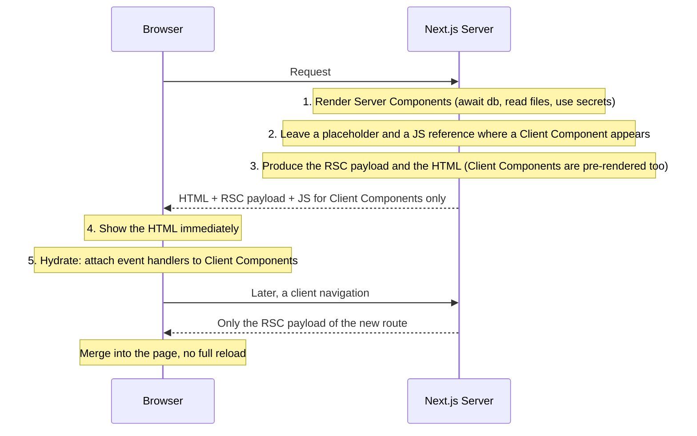
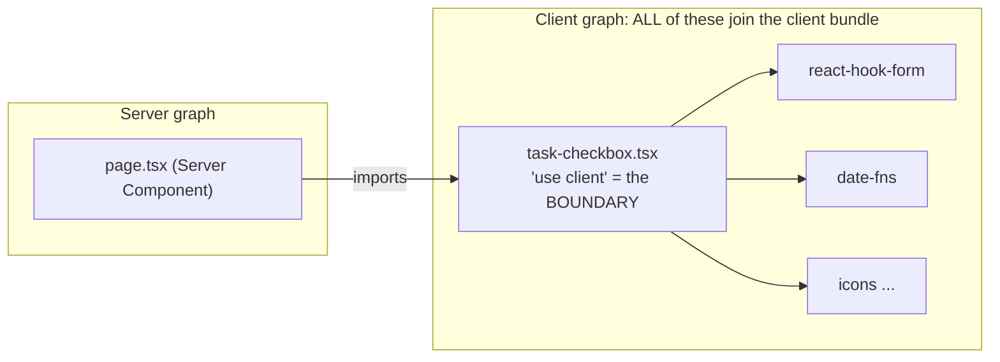
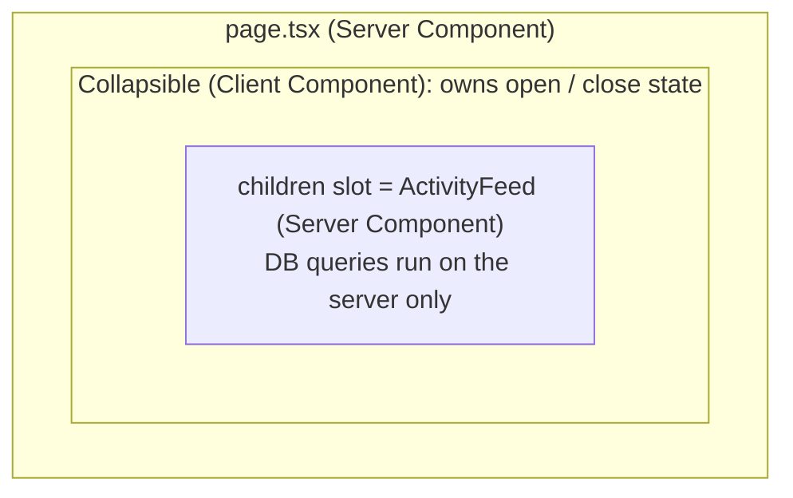
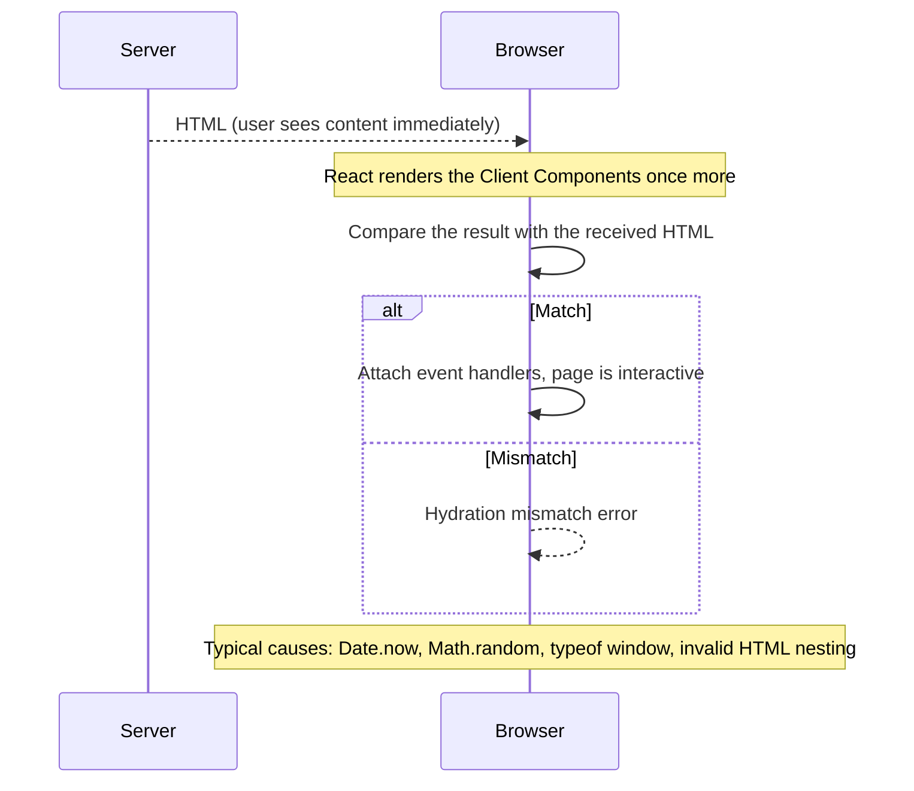

# Module 2: Server Components & Client Components


## Words you will meet in this module

| Word                        | Simple meaning                                                                                                                         |
| --------------------------- | -------------------------------------------------------------------------------------------------------------------------------------- |
| **Server Component (RSC)**  | A component that runs **only on the server**. It can `await` data. Its code is **never sent** to the browser.                          |
| **Client Component**        | A component in a file marked `"use client"`. It ships JavaScript, can use state, effects and events.                                   |
| **`"use client"` boundary** | The line between server code and client code. A file with the directive and everything it imports joins the client bundle.             |
| **RSC payload**             | A compact serialized description of the rendered server output, plus references to client components. Next.js sends it to the browser. |
| **SSR**                     | Server-side rendering: turning components into HTML on the server for the first paint.                                                 |
| **Hydration**               | React attaching event handlers to server-made HTML so it becomes interactive.                                                          |
| **Serializable**            | Data that can be converted to text and sent over the network (strings, numbers, plain objects...).                                     |
| **DTO**                     | Data Transfer Object: a small object containing only the fields you intend to expose.                                                  |
| **`server-only`**           | A tiny package that makes the build fail if a client file imports a server-only module.                                                |
| **Hydration mismatch**      | The HTML from the server differs from what the browser's first render produces. React reports an error.                                |

> **A note on the examples:** this module focuses on the **server/client split**, so data reads are shown in their simplest form. In a real Next.js 16 app with Cache Components, every uncached read sits under `<Suspense>` (a `loading.tsx` does this for you) or is cached with `"use cache"`. [Module 3](nextjs/data-fetching-caching-and-streaming) shows exactly how.

## 2.1: The Mental Model: Server First

In a Vite SPA ([Part 1](react)), **every** component was a Client Component: all of the code shipped to the browser and ran there. In the Next.js App Router, **components are Server Components by default**. They run on the server, and the browser receives only their **result**. You add `"use client"` to the few components that truly need the browser.



### Two common misconceptions

| Misconception                                | Truth                                                                                                                                 |
| -------------------------------------------- | ------------------------------------------------------------------------------------------------------------------------------------- |
| "Client Components only run in the browser." | They are **also rendered to HTML on the server** (SSR) for the first paint, then hydrated in the browser.                             |
| "Server Components are the same as SSR."     | SSR renders every component to HTML but still ships **all** their code to hydrate. Server Components ship **no code** for themselves. |

### What each kind can do

| Capability                                           | Server Component |  Client Component  |
| ---------------------------------------------------- | :--------------: | :----------------: |
| `async` / `await` directly in the component          |       Yes        |         No         |
| Query a database, read files, use secrets            |     **Yes**      |         No         |
| `useState`, `useReducer`, `useEffect`, `useRef`      |        No        |      **Yes**       |
| Event handlers (`onClick`, `onChange`)               |        No        |      **Yes**       |
| Browser APIs (`window`, `localStorage`, `navigator`) |        No        |      **Yes**       |
| React Context (`createContext` / `useContext`)       |        No        |      **Yes**       |
| `useRouter`, `usePathname`, `useSearchParams`        |        No        |      **Yes**       |
| Adds to the JavaScript the browser downloads         |      **No**      |        Yes         |
| Can import heavy libraries without bundle cost       |     **Yes**      | No (cost per byte) |

### The one rule

> **Start every component on the server. Add `"use client"` only to the smallest piece that needs state, effects, event handlers or browser APIs.**

That keeps the JavaScript the user downloads proportional to the **interactivity** on the page, not to the page's size.

#### Interview traps

- "Is a Client Component rendered only in the browser?" No. It is pre-rendered to HTML on the server and then hydrated in the browser.
- "Are Server Components the same as SSR?" No. SSR produces HTML but still ships component code for hydration. Server Components never ship their own code, and they can run `async` data access directly.
- "How does the browser get Server Component output?" As the **RSC payload**: a serialized tree. On first load it travels alongside the HTML. On client navigations it is fetched on its own.

## 2.2: Server Components

### An async component that reads data

```tsx
// app/(app)/projects/page.tsx
import Link from 'next/link';
import { listProjects } from '@/lib/data/projects'; // a server-only module, see below

export default async function ProjectsPage() {
  const projects = await listProjects(); // runs on the server, no API round trip

  return (
    <ul>
      {projects.map((p) => (
        <li key={p.id}>
          <Link href={`/projects/${p.id}`}>{p.name}</Link>
        </li>
      ))}
    </ul>
  );
}
```

Compare with the Vite version from Part 1: no `useEffect`, no `useState` for loading and error, no `fetch("/api/projects")`, no loading flicker after the page appears. The component simply **awaits** and returns UI.

### Things a Server Component can safely do

```tsx
import { readFile } from 'node:fs/promises';
import { marked } from 'marked'; // a heavy library: ZERO bytes sent to the browser
import { db } from '@/lib/db';

export default async function ChangelogPage() {
  const md = await readFile('CHANGELOG.md', 'utf8'); // read a file
  const html = marked.parse(md); // heavy work stays on the server
  const stats = await db.query('SELECT count(*) FROM tasks'); // talk to the database directly
  const apiKey = process.env.INTERNAL_API_KEY; // secrets are fine here
  // ...
}
```

This is the biggest practical win of Server Components: **heavy dependencies and secrets stay on the server**, and the user never pays for them.

### Things a Server Component cannot do

```tsx
export default function Bad() {
  const [count, setCount] = useState(0); // ERROR: hooks with state need a Client Component
  useEffect(() => {}, []); // ERROR
  return <button onClick={() => {}}>Go</button>; // ERROR: event handlers
}
```

The error message tells you exactly what to do: "You're importing a component that needs `useState`. This React Hook only works in a Client Component. Add the `"use client"` directive to the top of the file."

### `server-only`: make leaks a build error

Some modules must **never** reach the browser: database clients, session logic, anything touching secrets. Mark them:

```bash
npm install server-only
```

```ts
// lib/db.ts
import 'server-only'; // build fails if a Client Component imports this (directly or indirectly)
import pg from 'pg';
export const pool = new pg.Pool({ connectionString: process.env.DATABASE_URL });
```

A companion package, `client-only`, does the reverse for code that must only run in the browser. These two imports turn a runtime security accident into a **compile-time error**.

### Logging and errors

`console.log` inside a Server Component prints to the **terminal running Next.js**, not to the browser console. (Dev mode forwards server logs to the browser console for convenience, which can mislead you about where code ran.) Errors thrown here are caught by the nearest `error.tsx`, and in production the browser gets only a redacted message plus a `digest` to look up in the server logs.

#### Interview traps

- "Where does `console.log` in a Server Component appear?" In the server's terminal or logs. The browser never executes that code.
- "How do you stop a database module from being imported into client code?" `import "server-only"` at the top of the module, so the build fails if it ends up in a client bundle.
- "Why is a heavy library in a Server Component 'free'?" Its code runs only on the server. The browser receives the rendered result, not the library.

## 2.3: Client Components and the `"use client"` Boundary

### Making a Client Component

Put the directive on the **first line** of the file:

```tsx
// components/task-checkbox.tsx
'use client';

import { useState } from 'react';

export function TaskCheckbox({
  initialDone,
  label,
}: {
  initialDone: boolean;
  label: string;
}) {
  const [done, setDone] = useState(initialDone);

  return (
    <label>
      <input
        type="checkbox"
        checked={done}
        onChange={(e) => setDone(e.target.checked)}
      />
      {label}
    </label>
  );
}
```

```tsx
// app/(app)/projects/[projectId]/page.tsx   (a Server Component using it)
import { TaskCheckbox } from '@/components/task-checkbox';

<TaskCheckbox initialDone={task.done} label={task.title} />;
```

### What `"use client"` really means

It does **not** mean "this component runs only in the browser". It marks a **boundary in the module graph**:



- The file with the directive, **and every module it imports**, become part of the JavaScript sent to the browser.
- You do **not** need to repeat the directive in files imported by a Client Component. They are already on the client side.
- Importing a Client Component **into a Server Component** is exactly how you use it.

So place `"use client"` as **low in the tree as possible**: on the small interactive piece, not on a whole page or layout. A `"use client"` on `app/layout.tsx` would pull your entire app into the client graph and discard the benefits of the model.

### What needs to be a Client Component

| You need...                            | Example                                                     |
| -------------------------------------- | ----------------------------------------------------------- |
| State or effects                       | A toggle, a controlled input, a timer, a data-polling hook  |
| Event handlers                         | `onClick`, `onChange`, `onSubmit` with client logic         |
| Browser-only APIs                      | `localStorage`, `window.matchMedia`, geolocation, clipboard |
| Context (providers and consumers)      | Theme, a query client, a toast system                       |
| Client navigation hooks                | `useRouter`, `usePathname`, `useSearchParams`               |
| Libraries built on the above           | Charts, maps, drag and drop, rich-text editors, animation   |
| Custom hooks that use any of the above | `useDebounce`, `useLocalStorage` (Part 1, Module 3)         |

### Props crossing the boundary must be serializable

When a Server Component renders a Client Component, the props are **serialized** into the RSC payload and sent over the network. So they must be data, not behavior.

| Allowed                                                          | Not allowed                                                       |
| ---------------------------------------------------------------- | ----------------------------------------------------------------- |
| Strings, numbers, booleans, `null`, `undefined`, `BigInt`        | Plain functions and closures (inline event handlers)              |
| Arrays and plain objects of the above                            | Class instances with methods, database model objects with methods |
| `Date`, `Map`, `Set`, typed arrays                               | DOM nodes, Symbols                                                |
| **JSX elements and React nodes** (`children`)                    | Anything with a circular reference you cannot serialize           |
| **Promises** (read with `use()` in the client)                   |                                                                   |
| **Server Functions** (functions marked `"use server"`, Module 4) |                                                                   |

```tsx
// Server Component
<TaskCheckbox
  label={task.title}
  onChange={() => saveTask(task.id)} // ERROR: "Functions cannot be passed directly to Client Components
/> //  unless you explicitly expose it by marking it with 'use server'."
```

The fix is either to handle the event **inside** the Client Component (call a Server Function from there), or to pass a real Server Function. You will do that in Module 4.

### Props are visible to the user (a security point)

Everything you pass as a prop to a Client Component ends up in the HTML and the RSC payload sent to the browser, where anyone can read it with View Source or the Network tab.

```tsx
// DANGEROUS: passes the whole database row, including password_hash and internal fields
const user = await db.users.findById(id);
return <ProfileForm user={user} />;

// SAFE: build a DTO with only what the UI needs
const user = await getUser(id);
return <ProfileForm user={{ name: user.name, email: user.email }} />;
```

Make this a habit: your **data-access layer returns DTOs**, not raw rows (Module 6).

## 2.4: Composition Patterns

The art of the App Router is **interleaving** server and client components: server → client → server → client.

### Pattern 1: Pass Server Components as `children` (the "donut")

A Client Component **cannot import** a Server Component (the import would pull it into the client bundle). But it **can receive** one as `children`, because the server already rendered it.

```tsx
// components/collapsible.tsx
'use client';
import { useState } from 'react';

export function Collapsible({
  title,
  children,
}: {
  title: string;
  children: React.ReactNode;
}) {
  const [open, setOpen] = useState(false);
  return (
    <section>
      <button onClick={() => setOpen(!open)} aria-expanded={open}>
        {title}
      </button>
      {open && <div>{children}</div>}
    </section>
  );
}
```

```tsx
// app/(app)/projects/[projectId]/page.tsx (Server Component)
import { Collapsible } from '@/components/collapsible';
import { ActivityFeed } from './activity-feed'; // an async Server Component that queries the DB

<Collapsible title="Activity">
  <ActivityFeed projectId={projectId} />{' '}
  {/* rendered on the server, placed by the client */}
</Collapsible>;
```

The client component owns the **interactivity** (open and close). The server owns the **content**. `ActivityFeed` and its database queries never reach the browser.

The same idea works with any **prop that holds JSX**: `header={<Header />}`, `sidebar={<Sidebar />}`. It is the "composition over inheritance" principle from [Part 1, Module 1](reactjs/getting-started-jsx-and-components#15-components-and-props) applied across the network.



### Pattern 2: Providers that wrap the app

Context only works in Client Components, but your root layout is a Server Component. The solution: a small **client provider** that renders `{children}`.

```tsx
// components/providers.tsx
'use client';
import { QueryClient, QueryClientProvider } from '@tanstack/react-query';
import { useState } from 'react';
import { ThemeProvider } from 'next-themes';

export function Providers({ children }: { children: React.ReactNode }) {
  const [queryClient] = useState(() => new QueryClient()); // one per browser session, not per render
  return (
    <ThemeProvider attribute="class">
      <QueryClientProvider client={queryClient}>{children}</QueryClientProvider>
    </ThemeProvider>
  );
}
```

```tsx
// app/layout.tsx (Server Component)
import { Providers } from '@/components/providers';

export default function RootLayout({
  children,
}: {
  children: React.ReactNode;
}) {
  return (
    <html lang="en" suppressHydrationWarning>
      <body>
        <Providers>{children}</Providers>{' '}
        {/* children are still Server Components */}
      </body>
    </html>
  );
}
```

Because `children` arrive as already-rendered output, wrapping them in a client provider **does not turn them into Client Components**. Render providers as **deep** in the tree as you can, so more of the page stays purely server-rendered.

### Pattern 3: Wrap third-party components that lack the directive

Many UI libraries use hooks but forget `"use client"`. Re-export them from a wrapper:

```tsx
// components/ui/chart.tsx
'use client';
export { LineChart, Line, XAxis, YAxis } from 'recharts';
```

Now Server Components can import `@/components/ui/chart`.

### Pattern 4: Stream server data into a Client Component with `use()`

Start a fetch on the server, **do not await it**, and hand the Promise to a Client Component. It reads it with React's `use()` inside a `<Suspense>`:

```tsx
// page.tsx (Server Component)
import { Suspense } from 'react';
import { getTasks } from '@/lib/data/tasks';
import { TaskList } from './task-list';

export default function Page({ params }: PageProps<'/projects/[projectId]'>) {
  const tasksPromise = getTasks(params); // started on the server, NOT awaited
  return (
    <Suspense fallback={<p>Loading tasks…</p>}>
      <TaskList tasksPromise={tasksPromise} />
    </Suspense>
  );
}
```

```tsx
// task-list.tsx
'use client';
import { use } from 'react';
import type { Task } from '@/lib/types';

export function TaskList({ tasksPromise }: { tasksPromise: Promise<Task[]> }) {
  const tasks = use(tasksPromise); // suspends until the server resolves it
  // ...client-side state, sorting, optimistic updates...
  return (
    <ul>
      {tasks.map((t) => (
        <li key={t.id}>{t.title}</li>
      ))}
    </ul>
  );
}
```

Remember the trap from [Part 1, Module 6](reactjs/routing-data-fetching-and-actions#63-react-19-actions-useactionstate-useoptimistic-and-use): a **new Promise created during a client render** causes an infinite suspend loop. Here the promise is created **on the server** and passed down once, which is exactly the safe pattern.

### Which pattern when?

| Situation                                                          | Use                                                                 |
| ------------------------------------------------------------------ | ------------------------------------------------------------------- |
| Interactive wrapper around server content (accordion, modal, tabs) | **Pattern 1:** server content as `children`                         |
| Theme, query client, toasts, any context                           | **Pattern 2:** a client Provider in the layout, as deep as possible |
| A library component that needs hooks                               | **Pattern 3:** a client wrapper file                                |
| A client list that needs server data and then local interaction    | **Pattern 4:** pass a Promise, or pass the resolved data as props   |
| Plain content with no interactivity                                | Keep it a Server Component. No directive                            |

#### Interview traps

- "Can a Client Component render a Server Component?" It cannot **import** one. It can render one that is passed in as **`children`** or another JSX prop, because the server has already rendered it.
- "Does wrapping `{children}` in a client Provider make the whole app client-side?" No. The children are rendered by the server and passed through. Only the provider's own code is client code.
- "Why can't I pass an `onClick` handler from a Server Component?" Functions are not serializable. The handler must live in a Client Component, or be a Server Function.

## 2.5: Sharing Data and Environment Variables

### No shared React state between Server Components

Server Components render once per request. They have no state and **no context**. If three components all need "the current user", each one can ask for it, and you make the repeated asks cheap with **`React.cache`**, which memoizes a function **for the duration of one render pass**:

```ts
// lib/data/user.ts
import 'server-only';
import { cache } from 'react';

export const getCurrentUser = cache(async () => {
  const session = await readSession(); // cookies() etc.
  return session ? await db.users.findById(session.userId) : null;
});
```

Call `getCurrentUser()` in the layout, the page and a sidebar: the database is queried **once** for that request. (`fetch` GET calls with the same URL and options are also de-duplicated within a render. `React.cache` covers everything that is not `fetch`: SQL, ORMs, SDKs.)

Do not confuse the two layers of memoization:

| Mechanism         | Scope                                | Purpose                                               |
| ----------------- | ------------------------------------ | ----------------------------------------------------- |
| `React.cache(fn)` | **One request** (one render)         | Avoid asking twice within the same render             |
| `"use cache"`     | **Across requests**, with a lifetime | Avoid doing the work again for later users (Module 3) |

### Never keep per-user data in module scope

On the server, **module-level variables are shared by every request** handled by that process. This is a classic cross-user data leak:

```ts
// DANGEROUS
let currentUser: User | null = null; // shared by ALL concurrent requests
export async function loadUser() {
  currentUser = await fetchUser();
}
export function getUser() {
  return currentUser;
} // can return ANOTHER user's data
```

Per-request data belongs in **function arguments, `React.cache`, or request-scoped APIs** such as `cookies()`, never in module variables. (This is the same reason your Part 2 API kept sessions in the database, not in process memory.)

### Environment variables

| Kind                    | Rule                                                                                 |
| ----------------------- | ------------------------------------------------------------------------------------ |
| Normal (`DATABASE_URL`) | Available only in **server** code. If a Client Component reads it, it is `undefined` |
| **`NEXT_PUBLIC_*`**     | **Inlined into the client bundle at build time.** Public. Visible to every visitor   |
| Where they live         | `.env`, `.env.local` (not committed), `.env.production`, and the host's environment  |

```ts
// lib/env.ts
import 'server-only';
import { z } from 'zod';

const Env = z.object({
  DATABASE_URL: z.string().url(),
  SESSION_SECRET: z.string().min(32),
  REDIS_URL: z.string().url().default('redis://localhost:6379'),
});

export const env = Env.parse(process.env); // fails at startup if anything is missing
```

Two warnings:

1. **Never** put a secret in a `NEXT_PUBLIC_` variable. It is baked into JavaScript that anyone can download.
2. `NEXT_PUBLIC_` values are replaced **when you build**. Changing them later in the environment of a running server has no effect on already-built client code, so you need a rebuild (or a runtime configuration endpoint).

### Experimental: tainting

React offers `experimental_taintObjectReference` and `experimental_taintUniqueValue` to mark objects or values (a password hash, a token) so React **refuses to serialize** them into a Client Component. It is experimental, so treat it as an extra seatbelt on top of DTOs, not a replacement.

#### Interview traps

- "How do three Server Components get the same user without three queries?" Wrap the loader in `React.cache`, which memoizes per request.
- "`React.cache` vs. `use cache`?" `React.cache` is per-request memoization. `"use cache"` stores results across requests with a lifetime.
- "Why is a module-level `let` dangerous on the server?" It is shared across all requests in the process, so one user's data can leak into another user's response.
- "How are env vars exposed to the browser?" Only those prefixed `NEXT_PUBLIC_`, inlined at build time. Everything else is server-only.

## 2.6: Hydration and Common Errors

### What hydration is

The server sends HTML so the user sees content immediately. The browser then runs React on that HTML ("hydration"): React renders the Client Components **once more in the browser** and **checks that the result matches the HTML it received**, then attaches event handlers. If the two differ, React reports a **hydration mismatch**.



### The usual causes and fixes

| Cause                                                   | Example                                                                     | Fix                                                                                 |
| ------------------------------------------------------- | --------------------------------------------------------------------------- | ----------------------------------------------------------------------------------- |
| Values that differ between server and client            | `new Date().toLocaleString()`, `Math.random()`, `Date.now()`                | Render them after mount (state set in an effect), or pass the value from the server |
| Different time zone or locale                           | Server formats in UTC, browser in IST                                       | Format on the client after mount, or format with an explicit `timeZone`             |
| Branching on `typeof window`                            | `typeof window !== "undefined" ? <A /> : <B />`                             | Use an effect, or mark the subtree browser-only (below)                             |
| Invalid HTML nesting                                    | `<p><div>…</div></p>`, `<a>` inside `<a>`, `<table>` without `<tbody>` rows | Fix the markup                                                                      |
| Browser extensions or injected scripts changing the DOM | Translation or password-manager extensions                                  | `suppressHydrationWarning` on the affected element (sparingly)                      |

```tsx
'use client';
import { useEffect, useState } from 'react';

export function LocalTime({ iso }: { iso: string }) {
  const [text, setText] = useState<string | null>(null);
  useEffect(() => {
    setText(new Date(iso).toLocaleString()); // runs only in the browser, after hydration
  }, [iso]);
  return <time dateTime={iso}>{text ?? iso}</time>; // server and first client render match
}
```

### React 19.3: marking a subtree as browser-only

React 19.3 added **`browser()`** (in `react-dom`). Reading it with `use()` inside a `<Suspense>` boundary marks that subtree as **browser-only**: it is skipped during server rendering and rendered in the browser, **without** reporting a recoverable error.

```tsx
'use client';
import { Suspense, use } from 'react';
import { browser } from 'react-dom';

function Clock() {
  use(browser()); // resolves only in the browser
  return <time>{new Date().toLocaleTimeString()}</time>;
}

export function ClientOnlyClock() {
  return (
    <Suspense fallback={<time>--:--:--</time>}>
      <Clock />
    </Suspense>
  );
}
```

This replaces the old "mounted flag in an effect" trick for pieces that truly need the browser. For whole components that must skip server rendering (maps, charts), `next/dynamic` with `ssr: false` also works, but only **inside a Client Component** in the App Router.

### Other errors you will see

| Message (shortened)                                               | Meaning and fix                                                                                 |
| ----------------------------------------------------------------- | ----------------------------------------------------------------------------------------------- |
| "You're importing a component that needs `useState`…"             | A hook in a Server Component. Add `"use client"` to that file or move the logic                 |
| "Functions cannot be passed directly to Client Components…"       | A non-serializable prop. Handle the event inside the client component or use a Server Function  |
| "`window` is not defined"                                         | Browser-only code ran on the server. Move it into an effect or an event handler                 |
| "Objects are not valid as a React child"                          | You rendered an object (for example a `Date` or a database row) instead of text                 |
| "async/await is not yet supported in Client Components"           | You made a Client Component `async`. Fetch in a Server Component and pass props, or use `use()` |
| Build error from `server-only`                                    | A client file imported a server-only module. Restructure so the server does that work           |
| "Hydration failed because the server rendered HTML didn't match…" | See the table above                                                                             |

#### Interview traps

- "What causes a hydration mismatch?" The HTML rendered on the server differs from the browser's first client render: time, randomness, locale, `typeof window` branches, invalid HTML nesting, or extensions altering the DOM.
- "Is `suppressHydrationWarning` a fix?" It silences the warning for one element's text or attributes. Use it only for values that **must** differ (like a timestamp). It does not fix real structural mismatches.
- "Can a Client Component be `async`?" No. Do the async work in a Server Component, or pass a promise and read it with `use()`.

## 2.7: Keeping the Client Bundle Small

### Where does your JavaScript come from?

The code the browser downloads is: the **React runtime and Next.js client router**, plus **every Client Component and everything those components import**. A Server Component adds nothing. The way to a fast page is therefore to **shrink the client graph**.

### Techniques

| Technique                                          | How                                                                                                                 |
| -------------------------------------------------- | ------------------------------------------------------------------------------------------------------------------- |
| Push `"use client"` **down** to the leaves         | Split a big interactive page into a server shell with small client islands                                          |
| Keep heavy libraries on the server                 | Markdown, syntax highlighting, date formatting, validation, PDF generation                                          |
| Pass **children** instead of importing server code | Pattern 1 (the donut)                                                                                               |
| Lazy-load rarely used client code                  | `next/dynamic` or `React.lazy` for modals, editors, charts below the fold                                           |
| Import only what you use                           | `import { debounce } from "lodash-es"`, not the whole library                                                       |
| Prefer platform features                           | A native `<dialog>`, `<details>`, CSS animations, `Intl` formatting                                                 |
| Measure                                            | The **Turbopack bundle analyzer** (see the package-bundling guide for the current command), the browser Network tab |

```tsx
import dynamic from 'next/dynamic';

const RichEditor = dynamic(() => import('@/components/rich-editor'), {
  loading: () => <p>Loading editor…</p>, // this file must itself be "use client"
});
```

### A before-and-after

```
 BEFORE: one big Client Component page             AFTER: server shell + small islands
 ───────────────────────────────────               ───────────────────────────────────
 "use client"                                      page.tsx  (server): fetches, renders markup
   page imports: markdown lib (60 KB),               ├─ <Markdown content=…/>   server: 0 KB shipped
   date lib (70 KB), chart lib (150 KB),             ├─ <ChartIsland data=…/>   client: only the chart lib
   form lib (40 KB), all the markup                  └─ <LikeButton/>           client: a few hundred bytes
 → every byte downloads and runs in the browser    → the user downloads only what is interactive
```

#### Interview traps

- "How do Server Components reduce bundle size?" Their code (and their dependencies) is never sent to the browser. Only their output is.
- "Where should `'use client'` go?" On the smallest interactive component, not on a layout or page, because everything the file imports joins the client bundle.

## Tricky Questions and Answers

#### Q1 [SDE-2]: A developer adds `"use client"` to `app/layout.tsx` "to make a context provider work". What are the consequences, and what is the right fix?

**Answer:** The layout and every module it imports become Client Components, so everything under it loses the Server Component benefits: more JavaScript, no direct server data access in that subtree, and secrets or database modules start causing build errors. The correct fix is to keep the layout a Server Component and extract the provider into its own `"use client"` component that renders `{children}`. The children are still server-rendered and pass through unchanged.

#### Q2 [SDE-2]: You pass `<Button onClick={() => doSomething()} />` from a Server Component and get "Functions cannot be passed directly to Client Components". Explain, and give two fixes.

**Answer:** Props from a Server Component to a Client Component are serialized and sent over the network, and an inline function is code with a closure, which cannot be serialized. Fix 1: define the click handler **inside** a Client Component (the server passes only data). Fix 2: if the action should run on the server, pass a **Server Function** (a function marked `"use server"`), which the framework exposes as a reference the client can call.

#### Q3 [SDE-3]: After deploying, users occasionally see another user's name in the page header. The code keeps `let cachedUser` at module level in a server utility. Explain the bug and the fix.

**Answer:** Module-level variables on the server live as long as the process and are shared by all concurrent requests. If request A writes `cachedUser` and request B reads it before A finishes, B renders A's user. Fix: remove the module state. Derive the user from the request (the session cookie) inside a function, and use `React.cache` to memoize it for **one** request. For cross-request caching of non-personal data use `"use cache"`, and never cache personal data in a shared cache.

#### Q4 [SDE-2]: A timestamp component produces "Text content did not match" warnings. The server is in UTC and users are in India. How do you fix it properly?

**Answer:** The server rendered the time in UTC, and the browser's first render used the user's locale, so the HTML differs. Either render the time as an ISO string on the server and format it **after mount** on the client, or format both sides with an explicit `timeZone` and locale so they produce identical text, or mark the subtree browser-only with `use(browser())` inside `<Suspense>` (React 19.3). `suppressHydrationWarning` on the `<time>` element is acceptable for this one case, but it should not be the default fix.

#### Q5 [SDE-3]: When can Server Components make an app slower, and how do you notice?

**Answer:** They move work to the server, so a route can slow down through sequential awaits (server-side waterfalls), expensive uncached queries on every request, or very large RSC payloads caused by passing big props to client components. You also pay server compute and latency for every request that is not cached. Notice with server timing and traces, the Network tab (payload size), and the dev overlay's blocking-route insights. Fix with parallel fetching, `"use cache"`, `<Suspense>` streaming, and smaller DTOs (Module 3).

---

## Hands-On Lab: Draw the Boundary Correctly

```
1. In taskflow-web, make the project page a Server Component that reads tasks from a
   mock module lib/data/tasks.ts. Start the file with: import "server-only";
2. Create components/task-checkbox.tsx ("use client", local useState). Render one per task.
   Open the page, click a checkbox. Does the state persist when you navigate away and back?
   (It should not. Why?)
3. Create components/collapsible.tsx ("use client") and wrap an async server component
   <ActivityFeed /> inside it using the children pattern. In DevTools → Network,
   check whether the code for ActivityFeed was downloaded. (It must not be.)
4. Add components/providers.tsx with a theme provider and use it in the root layout.
   Confirm your pages are still Server Components (log something and see where it prints).
5. DTO audit. Return a full user object (with a fake passwordHash) from your data module
   and pass it to a Client Component. Open View Source (Ctrl+U) and search for
   "passwordHash". Find it? Now introduce a DTO and search again.
6. Try to break things on purpose:
     a. Import lib/data/tasks.ts (with server-only) into a Client Component. Read the build error.
     b. Pass an onClick function from a Server Component to a Client Component. Read the error.
     c. Add useState to a Server Component. Read the error.
     d. Make a Client Component async. Read the error.
7. Hydration. Create <LocalTime iso={...}/> using new Date().toLocaleString() directly in render
   and watch the warning. Fix it three ways: effect + state, suppressHydrationWarning on <time>,
   and use(browser()) inside Suspense.
8. Use React.cache for getCurrentUser() and call it from the layout, the page and a nested
   component. Add a console.log inside it. How many times does it print per request?
   Now remove cache() and compare.
9. Use dynamic() to lazy-load a heavy Client Component (a fake chart). Check the Network tab:
   is its chunk downloaded only when rendered?
10. Run npm run build. Do any of your files surprise you by being client-side?
```

Questions to answer for yourself:

- Which components in your app truly needed `"use client"`, and which did you add it to "just in case"?
- What would break if you moved `"use client"` up into the page file?
- What data can a visitor see in the page source that they should not?

---

## Module 2 Cheat Sheet

| Concept                       | One-line interview answer                                                                                                |
| ----------------------------- | ------------------------------------------------------------------------------------------------------------------------ |
| Default component type        | **Server Component.** Runs on the server only. Ships no JS for itself. Can `await` data.                                 |
| `"use client"`                | Marks the module-graph boundary. That file and everything it imports join the client bundle.                             |
| Client Components and SSR     | They are also pre-rendered to HTML on the server, then hydrated.                                                         |
| RSC payload                   | Serialized server output plus client-component references. Fetched alone on client navigations.                          |
| Server can / cannot           | Can: await, DB, files, secrets, heavy libs. Cannot: state, effects, handlers, browser APIs, context.                     |
| Client needs                  | State, effects, events, browser APIs, context, router hooks, hook-based libraries.                                       |
| Placement rule                | Push `"use client"` to the smallest interactive leaf.                                                                    |
| Serializable props            | Primitives, plain objects/arrays, Date/Map/Set, JSX, Promises, Server Functions. Not plain functions or class instances. |
| Props are public              | Anything passed to a client component is visible in the page. Pass DTOs, not raw rows.                                   |
| Children pattern              | Server content passed as `children` to a client wrapper. Client cannot **import** server components.                     |
| Providers                     | A client Provider component in a server layout, as deep as possible.                                                     |
| Promise streaming             | Create the promise on the server, pass it down, read with `use()` inside `<Suspense>`.                                   |
| `server-only`                 | Turns an accidental client import of server code into a build error.                                                     |
| `React.cache`                 | Per-request memoization. `"use cache"` is cross-request caching.                                                         |
| Module-level state            | Shared across all requests on the server. Never store per-user data there.                                               |
| Env vars                      | Server-only unless `NEXT_PUBLIC_` (inlined at build, public). Validate with a schema.                                    |
| Hydration mismatch            | Server HTML ≠ first client render. Time, randomness, locale, `window` branches, invalid nesting.                         |
| `use(browser())` (React 19.3) | Inside `<Suspense>`, marks a subtree browser-only without a recoverable error.                                           |
| Async Client Component        | Not allowed. Fetch in a Server Component, pass props or a Promise.                                                       |
| Bundle size                   | Server Components cost zero client JS. Shrink the client graph, lazy-load, measure with the analyzer.                    |
