# Module 8: Testing, Deployment & Capstone (Next.js 16)

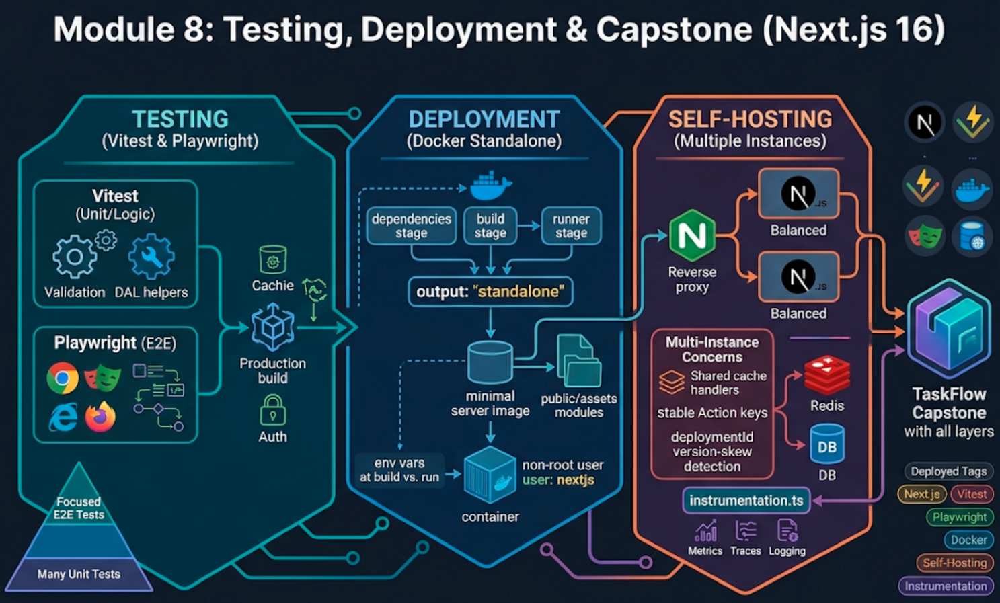

## Words you will meet in this module

| Word                  | Simple meaning                                                                                    |
| --------------------- | ------------------------------------------------------------------------------------------------- |
| **E2E test**          | A test that drives a real browser through your running app like a user would.                     |
| **Playwright**        | A browser automation and testing tool used for E2E tests.                                         |
| **Standalone output** | `output: "standalone"`: a self-contained server bundle with only the files needed to run the app. |
| **Version skew**      | An old browser page talking to a newer server (or the reverse) during a deployment.               |
| **`deploymentId`**    | A value that identifies one deployment so Next.js can detect and handle version skew.             |
| **Cache handler**     | A pluggable store (for example Redis) where Next.js keeps cached results shared across instances. |
| **Reverse proxy**     | A server (nginx, a load balancer) in front of the app that handles TLS, limits and routing.       |
| **Instrumentation**   | Code that runs at server startup (and on errors) to set up tracing, logging and monitoring.       |
| **Codemod**           | A script that automatically rewrites your code for a new framework version.                       |
| **Adapter**           | A platform integration that implements Next.js deployment (stable API since Next.js 16.2).        |
| **BFF**               | Backend-for-Frontend. Next.js in front of other backends (Module 5).                              |
| **Smoke test**        | A tiny post-deploy check that the app is up and its key paths work.                               |

## 8.1: A Testing Strategy for Next.js

### What the official guidance says

The Next.js testing guide offers four tools (Jest, Vitest, Playwright, Cypress) and one important caveat: **`async` Server Components are new to the React ecosystem, so some tools do not fully support them. For `async` components, use End-to-End tests instead of unit tests.** In practice that shapes a clear strategy.

| Layer                                                        | Tool                           | Test                                                                                               | How many                   |
| ------------------------------------------------------------ | ------------------------------ | -------------------------------------------------------------------------------------------------- | -------------------------- |
| **Pure logic**                                               | Vitest                         | Validation schemas, reducers, formatters, DAL helpers with a real test database (Part 2, Module 7) | Many                       |
| **Client Components** and **synchronous** Server Components  | Vitest + React Testing Library | Rendering, interaction, accessibility roles                                                        | Many                       |
| **Server Function logic**                                    | Vitest                         | Call the function directly with a `FormData`, mocking `next/cache` and the DAL                     | Several                    |
| **`async` Server Components, pages, routing, caching, auth** | **Playwright (E2E)**           | Whole user flows against a **production build** with a real database                               | A focused set              |
| **Security and permissions**                                 | Playwright + database tests    | **Negative tests**: user B cannot access user A's data                                             | One per protected resource |

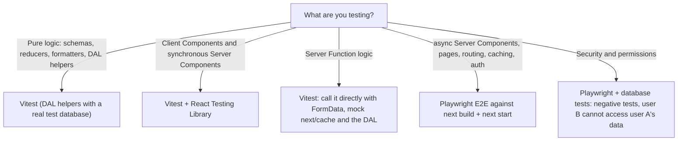

Keep the pyramid shape: lots of fast unit tests, fewer E2E tests, but make sure the **critical journeys and every authorization rule** have an E2E or integration test, because those are where Next.js-specific behavior (caching, streaming, proxy, Server Functions) can break.

### Vitest setup (per the official guide)

```bash
npm install -D vitest @vitejs/plugin-react jsdom @testing-library/react @testing-library/dom vite-tsconfig-paths
```

```ts
// vitest.config.mts
import { defineConfig } from 'vitest/config';
import react from '@vitejs/plugin-react';
import tsconfigPaths from 'vite-tsconfig-paths';

export default defineConfig({
  plugins: [tsconfigPaths(), react()], // tsconfigPaths understands the "@/..." alias
  test: { environment: 'jsdom', setupFiles: ['./vitest.setup.ts'] },
});
```

```ts
// vitest.setup.ts
import { vi } from 'vitest';
vi.mock('server-only', () => ({})); // lets tests import server-only modules
```

Add `"test": "vitest"` to your scripts. (Part 1, Module 7 covers Vitest and React Testing Library in depth.)

### A Client Component test

```tsx
// components/task-checkbox.test.tsx
import { render, screen } from '@testing-library/react';
import userEvent from '@testing-library/user-event';
import { expect, test } from 'vitest';
import { TaskCheckbox } from './task-checkbox';

test('toggles locally when clicked', async () => {
  const user = userEvent.setup();
  render(<TaskCheckbox initialDone={false} label="Buy milk" />);

  const box = screen.getByRole('checkbox', { name: 'Buy milk' });
  expect(box).not.toBeChecked();
  await user.click(box);
  expect(box).toBeChecked();
});
```

For components that call `useRouter` or `usePathname`, mock the module:

```tsx
vi.mock('next/navigation', () => ({
  usePathname: () => '/projects',
  useRouter: () => ({ push: vi.fn() }),
}));
```

### Testing a Server Function's logic

A Server Function is just an `async` function, so test it directly and replace its framework and database dependencies:

```ts
// app/(app)/projects/[projectId]/actions.test.ts
import { beforeEach, expect, test, vi } from 'vitest';

vi.mock('next/cache', () => ({ updateTag: vi.fn() }));
vi.mock('@/lib/dal', () => ({
  requireUser: vi.fn(async () => ({ id: 1, role: 'member' })),
}));
vi.mock('@/lib/data/tasks', () => ({
  createTaskForUser: vi.fn(async () => ({ id: 5, projectId: 7 })),
}));

import { updateTag } from 'next/cache';
import { createTaskAction } from './actions';

beforeEach(() => vi.clearAllMocks());

test('rejects an empty title and does not touch the cache', async () => {
  const fd = new FormData();
  fd.set('projectId', '7');
  fd.set('title', '   ');

  const result = await createTaskAction({ ok: true }, fd);

  expect(result.ok).toBe(false);
  if (!result.ok)
    expect(result.fieldErrors?.title?.[0]).toBe('Please enter a title');
  expect(updateTag).not.toHaveBeenCalled();
});

test("creates a task and invalidates the project's tag", async () => {
  const fd = new FormData();
  fd.set('projectId', '7');
  fd.set('title', 'Buy milk');

  const result = await createTaskAction({ ok: true }, fd);

  expect(result.ok).toBe(true);
  expect(updateTag).toHaveBeenCalledWith('tasks:project:7');
});
```

Two cautions. `redirect()` and `notFound()` **throw** by design, so a test that expects a redirect asserts that the call rejects with Next.js's redirect error (or mocks `next/navigation`). And **never mock the database when the point is to test SQL or ownership rules**: use a real test Postgres as in [Part 2, Module 7](backend-in-nodejs-and-bunjs/testing-real-time-and-background-jobs#73-integration-tests-against-http-and-a-real-database).

#### Interview traps

- "How do you test an `async` Server Component?" With an end-to-end test against a real build, because most unit-test tools cannot render `async` Server Components yet. Unit-test the data functions and pure logic beneath it separately.
- "Why mock `next/cache` when unit testing a Server Function?" Those functions need the Next.js runtime (the request store). The test is about your logic, such as validation and which tags you invalidate, so the framework call is replaced with a spy.

## 8.2: End-to-End Tests with Playwright

### Why test the production build

`next dev` compiles on demand and behaves differently from production, particularly for **caching, prerendering, streaming and prefetching**, the very features Cache Components relies on. **Run E2E tests against `next build && next start`.**

```bash
npm init playwright@latest        # or: npm install -D @playwright/test && npx playwright install --with-deps chromium
npm install -D @axe-core/playwright
```

```ts
// playwright.config.ts
import { defineConfig, devices } from '@playwright/test';

export default defineConfig({
  testDir: './e2e',
  workers: 1, // tests share one database. Isolate per worker if you want parallelism
  retries: process.env.CI ? 2 : 0,
  reporter: [['list'], ['html', { open: 'never' }]],
  use: { baseURL: 'http://localhost:3000', trace: 'on-first-retry' },
  webServer: {
    command: 'npm run build && npm run start', // a PRODUCTION server
    url: 'http://localhost:3000/api/health',
    reuseExistingServer: !process.env.CI,
    timeout: 180_000,
  },
  projects: [{ name: 'chromium', use: { ...devices['Desktop Chrome'] } }],
});
```

Start from a **clean, migrated test database** (a separate `taskflow_test` database, never development or production data) and use unique values (`Date.now()` in emails) so tests do not collide.

### Page helpers

```ts
// e2e/helpers.ts
import { expect, type Page } from '@playwright/test';

export const uniqueEmail = (prefix: string) =>
  `${prefix}-${Date.now()}-${Math.floor(Math.random() * 1e6)}@example.com`;

export async function register(page: Page, email: string, name = 'Test User') {
  await page.goto('/register');
  await page.getByLabel('Name').fill(name);
  await page.getByLabel('Email').fill(email);
  await page.getByLabel('Password').fill('correct horse battery staple');
  await page.getByRole('button', { name: 'Create account' }).click();
  await expect(page).toHaveURL(/\/projects/);
}

export async function createProject(page: Page, name: string): Promise<string> {
  await page.getByRole('button', { name: 'New project' }).click();
  await page.getByLabel('Project name').fill(name);
  await page.getByRole('button', { name: 'Create' }).click();
  await expect(page.getByRole('heading', { name })).toBeVisible();
  return new URL(page.url()).pathname; // e.g. /projects/12
}
```

### The tests that matter

```ts
// e2e/tasks.spec.ts
import { test, expect } from '@playwright/test';
import AxeBuilder from '@axe-core/playwright';
import { register, createProject, uniqueEmail } from './helpers';

test('a signed-in user can create a project and add and complete a task', async ({
  page,
}) => {
  await register(page, uniqueEmail('alice'));
  await createProject(page, 'Website redesign');

  await page.getByLabel('Title').fill('Write copy');
  await page.getByRole('button', { name: 'Add task' }).click();
  await expect(
    page.getByRole('checkbox', { name: 'Write copy' }),
  ).toBeVisible(); // updateTag made the list fresh

  await page.getByRole('checkbox', { name: 'Write copy' }).check();
  await expect(
    page.getByRole('checkbox', { name: 'Write copy' }),
  ).toBeChecked();
});

test('validation errors appear next to the field and keep what the user typed', async ({
  page,
}) => {
  await register(page, uniqueEmail('val'));
  await createProject(page, 'Validation');
  await page.getByRole('button', { name: 'Add task' }).click(); // empty title
  await expect(page.getByRole('alert')).toContainText('Please enter a title');
});

test("user B cannot see or change user A's project (BOLA)", async ({
  browser,
}) => {
  const a = await browser.newContext();
  const pageA = await a.newPage();
  await register(pageA, uniqueEmail('a'));
  const privatePath = await createProject(pageA, 'Secret roadmap');

  const b = await browser.newContext(); // a separate browser profile = a separate session
  const pageB = await b.newPage();
  await register(pageB, uniqueEmail('b'));
  await pageB.goto(privatePath);

  await expect(pageB.getByText('We could not find that project')).toBeVisible(); // the not-found UI
  await expect(pageB.getByText('Secret roadmap')).toHaveCount(0); // and none of A's data
});

test('unauthenticated visitors are sent to the login page', async ({
  page,
}) => {
  await page.goto('/projects');
  await expect(page).toHaveURL(/\/login/);
});

test('the home page has no accessibility violations', async ({ page }) => {
  await page.goto('/');
  const results = await new AxeBuilder({ page }).analyze();
  expect(results.violations).toEqual([]);
});

test('SEO basics on a public page', async ({ page }) => {
  await page.goto('/pricing');
  await expect(page).toHaveTitle(/Pricing \| TaskFlow/);
  await expect(page.locator('link[rel="canonical"]')).toHaveAttribute(
    'href',
    /\/pricing$/,
  );
});

test.describe('without JavaScript', () => {
  test.use({ javaScriptEnabled: false });
  test('the login form still works (progressive enhancement)', async ({
    page,
  }) => {
    await page.goto('/login');
    await page.getByLabel('Email').fill('nobody@example.com');
    await page.getByLabel('Password').fill('wrong password 123');
    await page.getByRole('button', { name: 'Sign in' }).click();
    await expect(page.getByRole('alert')).toContainText(
      'Invalid email or password',
    );
  });
});
```

Notes on these tests:

- The BOLA test asserts the **visible not-found UI and the absence of A's data** rather than the HTTP status, because a `notFound()` raised inside a streamed region cannot change the status that was already sent with the shell (Module 3). For **public content pages** where a real `404` matters for SEO, also assert `response.status()` with `page.goto`'s response.
- The no-JS test proves that your Server Function forms work through a plain form POST.
- Use **role and label locators** (`getByRole`, `getByLabel`). They double as accessibility checks and survive markup changes.
- Capture **traces** (`trace: "on-first-retry"`) so failures in CI are debuggable.

### Test authorization exhaustively

For **every** protected resource, add a pair of tests: **user B tries to read** it and **user B tries to change** it (through the UI, or by replaying the request in the browser context). This is the single most valuable test category in the whole suite: it catches the day someone refactors a query and drops an ownership condition (Module 6).

### Other checks worth automating

| Check                                 | Tool                                                             |
| ------------------------------------- | ---------------------------------------------------------------- |
| Accessibility                         | `@axe-core/playwright` on key pages                              |
| Performance regressions               | Lighthouse CI against a production build with budgets (Module 7) |
| Dependency vulnerabilities            | `npm audit`, Dependabot or Renovate                              |
| Broken links and 404s on public pages | A crawl or a Playwright loop over the sitemap                    |
| Visual changes                        | Playwright screenshots (optional, high maintenance)              |

#### Interview traps

- "Why run Playwright against `next build && next start`?" Production behavior (prerendering, caching, streaming, prefetching) differs from `next dev`. Testing dev would miss the bugs users will hit.
- "How do you simulate two users in Playwright?" Create two **browser contexts**, each with its own cookies and session, and drive them in the same test.
- "What would you assert for a not-found resource that streams in?" The visible not-found content and the absence of private data. The status line was already sent with the shell.

## 8.3: Building for Production

### What `next build` does

`next build` compiles with Turbopack, **prerenders** the static shell of every route, and writes the output to `.next/`. It prints a route table with a legend (static, partially prerendered, dynamic). A build that succeeds is your first quality gate: Cache Components turns many rendering mistakes into **build errors**.

### The build needs your data

Everything that lands in a **static shell** is computed **at build time**. That includes `"use cache"` functions called from the shell, `generateStaticParams`, and metadata routes. So if those read from your database or an API, **the build must be able to reach it**.

| Situation                                    | What happens                                                          | Options                                                                                                           |
| -------------------------------------------- | --------------------------------------------------------------------- | ----------------------------------------------------------------------------------------------------------------- |
| The shell reads cached data from Postgres    | The build queries Postgres. If it cannot connect, **the build fails** | Provide a **disposable build/CI database** with representative data (a service container)                         |
| `generateStaticParams` fetches a list        | Runs at build time                                                    | Same. Or return a small fixed list and rely on the App Shell + upgrade for the rest                               |
| You want a build with **no database at all** | Nothing in the static shell may query                                 | Keep personal and database-backed reads in `<Suspense>` dynamic regions. Cache nothing that needs the DB at build |

The reverse also holds (Module 3): **data sources available at build time must also be available at request time**, or crawlers served a dynamic render can fail.

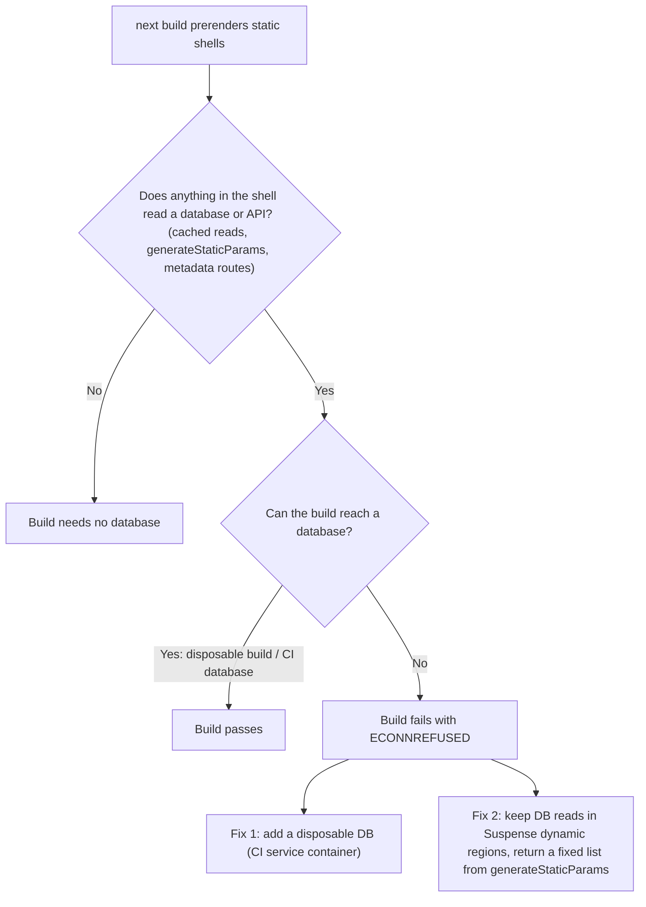

> **Build arguments are not secret.** Values passed with `docker build --build-arg` are recorded in the image history. Use a **throwaway** database URL (or BuildKit `--mount=type=secret`) for builds, and give the **running** container its real `DATABASE_URL` through the environment.

### Standalone output

```ts
// next.config.ts
const nextConfig: NextConfig = {
  cacheComponents: true,
  partialPrefetching: true,
  output: 'standalone', // trace dependencies and emit a minimal server
};
```

`next build` now creates `.next/standalone/` containing `server.js` and **only** the `node_modules` your code actually imports. It does **not** copy `public/` or `.next/static/`, so your Docker image must copy them next to it (below). The result is a much smaller image than copying the whole project.

### Environment variables at build vs. run

| Variable                             | When it matters                                                                    |
| ------------------------------------ | ---------------------------------------------------------------------------------- |
| `NEXT_PUBLIC_*`                      | **Build time.** Passed as build arguments. Baked into the client JavaScript        |
| `DATABASE_URL`, secrets              | **Run time**, read per request in server code (Module 5)                           |
| `NEXT_SERVER_ACTIONS_ENCRYPTION_KEY` | **Build time** (embedded in the output). Must be stable (Topic 8.5)                |
| `NEXT_DEPLOYMENT_ID`                 | Build time. Identifies this deployment                                             |
| `NEXT_TELEMETRY_DISABLED=1`          | Opt out of anonymous telemetry in CI and containers                                |
| `PORT`, `HOSTNAME`                   | Run time. The standalone server reads them (`HOSTNAME=0.0.0.0` inside a container) |

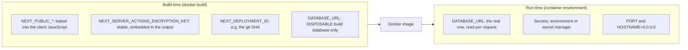

## 8.4: Docker for Next.js

This connects to the [Docker Full Tutorial](devops/docker/docker-full-tutorial) and to Part 2's [Docker section](backend-in-nodejs-and-bunjs/production-deployment-and-capstone#86-docker-for-nodejs-and-bun). A multi-stage build keeps the final image small and free of build tools.

```dockerfile
# syntax=docker/dockerfile:1

# 1. dependencies
FROM node:24-alpine AS deps
RUN apk add --no-cache libc6-compat
WORKDIR /app
COPY package.json package-lock.json ./
RUN npm ci

# 2. build
FROM node:24-alpine AS builder
WORKDIR /app
COPY --from=deps /app/node_modules ./node_modules
COPY . .

ARG NEXT_PUBLIC_APP_NAME
ARG NEXT_SERVER_ACTIONS_ENCRYPTION_KEY        # stable key: same value for every build of this app (provide from CI secrets)
ARG NEXT_DEPLOYMENT_ID                        # e.g. the git commit SHA
ARG DATABASE_URL                              # a DISPOSABLE build database, NOT production
ENV NEXT_PUBLIC_APP_NAME=$NEXT_PUBLIC_APP_NAME \
    NEXT_SERVER_ACTIONS_ENCRYPTION_KEY=$NEXT_SERVER_ACTIONS_ENCRYPTION_KEY \
    NEXT_DEPLOYMENT_ID=$NEXT_DEPLOYMENT_ID \
    DATABASE_URL=$DATABASE_URL \
    NEXT_TELEMETRY_DISABLED=1
RUN npm run build

# 3. runtime
FROM node:24-alpine AS runner
WORKDIR /app
ENV NODE_ENV=production NEXT_TELEMETRY_DISABLED=1 PORT=3000 HOSTNAME=0.0.0.0

RUN addgroup --system --gid 1001 nodejs && adduser --system --uid 1001 nextjs

COPY --from=builder /app/public ./public
COPY --from=builder --chown=nextjs:nodejs /app/.next/standalone ./
COPY --from=builder --chown=nextjs:nodejs /app/.next/static ./.next/static

USER nextjs                                    # never run as root
EXPOSE 3000
HEALTHCHECK --interval=30s --timeout=3s --start-period=20s \
  CMD node -e "fetch('http://127.0.0.1:3000/api/health').then(r=>process.exit(r.ok?0:1)).catch(()=>process.exit(1))"
CMD ["node", "server.js"]                      # exec form: SIGTERM reaches Node
```

```
# .dockerignore
node_modules
.next
.git
.env*
e2e
*.md
Dockerfile
docker-compose*.yml
```

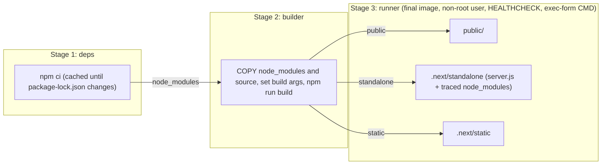

Why it looks like this: dependencies are installed in their own stage so Docker **caches** them until `package-lock.json` changes; the `runner` stage contains **only** the standalone server, static assets and `public/`; it runs as a **non-root** user; `HOSTNAME=0.0.0.0` makes the server reachable from outside the container; and `CMD ["node", "server.js"]` in **exec form** lets `SIGTERM` reach the process. Use the Active LTS Node.js image you have tested (24 or 26 as of late 2026).

### Health and readiness endpoints

```ts
// app/api/health/route.ts : liveness: "is the process answering HTTP?"
export function GET() {
  return Response.json({ ok: true });
}
```

```ts
// app/api/ready/route.ts : readiness: "can this instance serve users right now?"
import { connection } from 'next/server';
import { pool } from '@/lib/db';

export async function GET() {
  await connection(); // never prerender: evaluate on every request
  try {
    await pool.query('SELECT 1');
    return Response.json({ ready: true });
  } catch {
    return Response.json({ ready: false }, { status: 503 });
  }
}
```

A statically prerendered handler cannot tell you whether the database is reachable, which is why readiness must be **dynamic**. As in [Part 2, Module 8](backend-in-nodejs-and-bunjs/production-deployment-and-capstone#83-health-checks-and-graceful-shutdown), keep dependency checks in **readiness**, never in liveness.

### Graceful shutdown

When the container is stopped, send **`SIGTERM`** and wait. The Next.js server finishes in-flight work and waits for pending `after()` callbacks before exiting. If you need your own cleanup (closing the Postgres pool, flushing logs), set `NEXT_MANUAL_SIG_HANDLE=true` and handle `SIGTERM` and `SIGINT` yourself (for example in `instrumentation.ts`). Give the platform a grace period longer than your slowest request.

### Compose: the whole stack

```yaml
# docker-compose.yml
services:
  proxy:
    image: nginx:alpine
    ports: ['8080:80']
    volumes: ['./nginx.conf:/etc/nginx/conf.d/default.conf:ro']
    depends_on: [web]

  web:
    build:
      context: .
      args:
        NEXT_PUBLIC_APP_NAME: TaskFlow
        NEXT_DEPLOYMENT_ID: local
        NEXT_SERVER_ACTIONS_ENCRYPTION_KEY: ${ACTIONS_KEY} # from your shell or .env: openssl rand -base64 32
        DATABASE_URL: postgres://app:secret@db:5432/taskflow_build # a disposable build database
    environment:
      DATABASE_URL: postgres://app:secret@db:5432/taskflow
      REDIS_URL: redis://redis:6379
      APP_ORIGIN: http://localhost:8080
      SESSION_SECRET: change-me-change-me-change-me-12345678
    depends_on:
      db: { condition: service_healthy }

  db:
    image: postgres:17-alpine
    environment:
      { POSTGRES_USER: app, POSTGRES_PASSWORD: secret, POSTGRES_DB: taskflow }
    volumes: [pgdata:/var/lib/postgresql/data]
    healthcheck:
      test: ['CMD-SHELL', 'pg_isready -U app -d taskflow']
      interval: 5s
      timeout: 3s
      retries: 10

  redis:
    image: redis:7-alpine

volumes:
  pgdata: {}
```

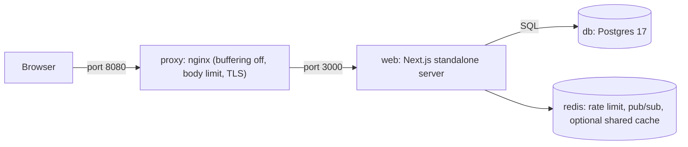

Run migrations as a **separate one-off step** before starting a new version (Part 2, Module 5), using expand/contract changes so the old and new versions can run together during a rollout.

#### Interview traps

- "Why does `docker build` fail with database connection errors?" Cache Components prerenders static shells at build time, so cached reads and `generateStaticParams` run during `next build`. Provide a reachable disposable database, or keep database reads in dynamic Suspense regions.
- "What does `output: 'standalone'` copy, and what must you copy yourself?" It copies `server.js` plus the traced minimal `node_modules`. You must copy `public/` and `.next/static/` into the image yourself.
- "Why `HOSTNAME=0.0.0.0` in a container?" So the server listens on all interfaces and is reachable from outside the container.
- "Why is a statically prerendered health route misleading for readiness?" It is served from the build output and would return OK even when the database is down. Make the readiness route dynamic.

## 8.5: Self-Hosting in Production

The official self-hosting guide recommends a **reverse proxy** such as nginx in front of the Next.js server, to handle malformed requests, slow-connection attacks, payload size limits, rate limiting and TLS, instead of exposing `next start` directly to the internet.

### nginx for Next.js

```nginx
# nginx.conf
upstream web {
  server web:3000;
  keepalive 32;
}

server {
  listen 80;
  client_max_body_size 2m;                          # keep this in line with serverActions.bodySizeLimit

  location / {
    proxy_pass http://web;
    proxy_http_version 1.1;
    proxy_set_header Host $host;
    proxy_set_header X-Forwarded-For $proxy_add_x_forwarded_for;
    proxy_set_header X-Forwarded-Proto $scheme;
    proxy_set_header X-Forwarded-Host $host;
    proxy_set_header Connection "";
    proxy_buffering off;                            # REQUIRED for streaming (Suspense, RSC) and SSE
    proxy_read_timeout 60s;
  }
}
```

Streaming needs **response buffering turned off**, otherwise nginx holds back the shell and the stream arrives in one lump at the end, defeating Suspense. The Next.js docs show setting the `X-Accel-Buffering: no` header from `next.config` as an alternative:

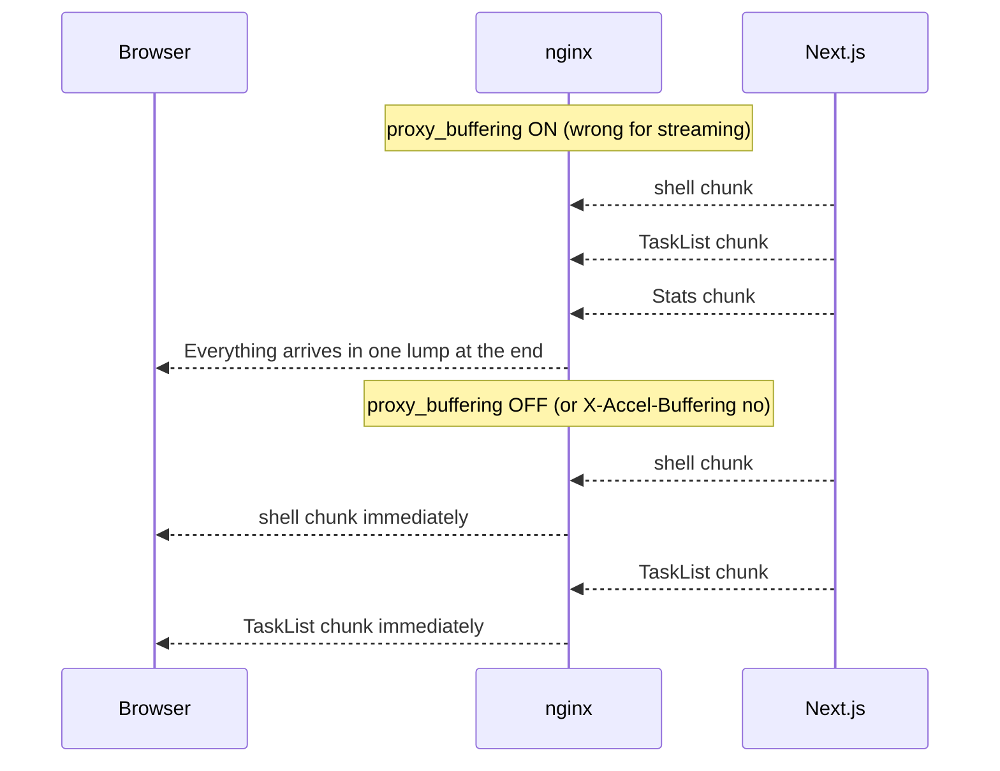

```ts
async headers() {
  return [{ source: "/:path*{/}?", headers: [{ key: "X-Accel-Buffering", value: "no" }] }];
},
```

Also remember `allowedOrigins` for Server Functions when the public host differs from what the app sees (Module 4), and put real client IPs in `X-Forwarded-For` (and trust only your own proxy, Part 2, Module 6).

### Running more than one instance

A single instance behind a proxy works with the defaults. As soon as you run **several instances**, use **ephemeral compute**, or place a **CDN** in front, a few things must be configured deliberately. The official guide lists these.

| Concern                                          | The problem                                                                                                                                                                                                                                                | The fix                                                                                                                                                                                                 |
| ------------------------------------------------ | ---------------------------------------------------------------------------------------------------------------------------------------------------------------------------------------------------------------------------------------------------------- | ------------------------------------------------------------------------------------------------------------------------------------------------------------------------------------------------------- |
| **Server Function encryption key**               | Closure variables are encrypted with a key that is **unique per build** by default. Instances built separately (or an old and a new version during a rollout) cannot decrypt each other's payloads and users hit **"Failed to find Server Action"** errors | Set one **stable** `NEXT_SERVER_ACTIONS_ENCRYPTION_KEY` (base64, 16, 24 or 32 bytes: `openssl rand -base64 32`) **at build time** for every build, kept as a CI secret                                  |
| **Version skew**                                 | During a rolling deploy, an old browser tab requests JavaScript or CSS that no longer exists, or calls a server that expects newer code                                                                                                                    | Set a **`deploymentId`** (for example the git SHA, via `deploymentId` in config or `NEXT_DEPLOYMENT_ID`). Next.js adds `?dpl=…` to assets and navigations so mismatches are detected and handled        |
| **Cache consistency**                            | `"use cache"` and ISR results live in **each instance's memory or local disk**. `updateTag` on one instance does not invalidate the others (Module 3)                                                                                                      | Configure shared **cache handlers**: `cacheHandlers` for `"use cache"` backends, and `cacheHandler` for the ISR/data cache, backed by Redis or similar. See the multi-instance cache coordination guide |
| **Image optimization**                           | Resizing costs CPU on each instance, and caches are per instance                                                                                                                                                                                           | Install `sharp`, size your instances, or use a CDN-based image loader                                                                                                                                   |
| **Streaming through proxies and load balancers** | Buffering breaks Suspense                                                                                                                                                                                                                                  | Disable buffering (above). Check your load balancer's behavior for long-lived responses                                                                                                                 |
| **CDN caching**                                  | RSC and HTML responses can vary by request headers. A CDN that ignores cache-key variability can serve the wrong variant                                                                                                                                   | Follow the **CDN caching** guide: respect `Cache-Control` and `Vary`, and cache static assets aggressively but dynamic responses carefully                                                              |
| **Static assets**                                | Serving `_next/static` from the app wastes capacity                                                                                                                                                                                                        | Serve them from a CDN (`assetPrefix`). They are content-hashed and safe to cache forever                                                                                                                |

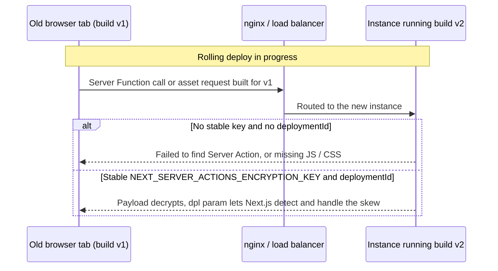

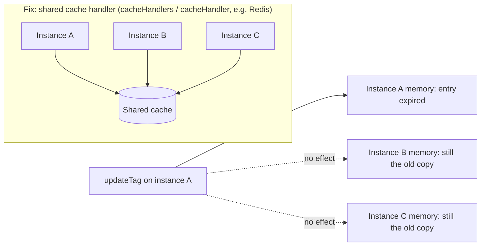

```ts
// next.config.ts (self-hosting, multiple instances)
const nextConfig: NextConfig = {
  cacheComponents: true,
  partialPrefetching: true,
  output: 'standalone',
  deploymentId: process.env.NEXT_DEPLOYMENT_ID, // e.g. the commit SHA, set at build time
  // cacheHandlers: { default: ..., remote: ... },     // point at a shared (e.g. Redis-backed) handler. See the cacheHandlers reference
};
```

If operating this sounds like a lot, it is: it is the real cost of self-hosting a framework with an integrated cache. Platforms that run Next.js for you (or the Adapters API implementations) take over exactly these concerns.

### Operational basics

| Topic                    | Practice                                                                                                                                                      |
| ------------------------ | ------------------------------------------------------------------------------------------------------------------------------------------------------------- |
| **Resource sizing**      | Next.js server rendering and image optimization use CPU and memory. Load test (Part 2, Module 8) and set container limits and `--max-old-space-size` sensibly |
| **Connections**          | Each instance has its own Postgres pool. Total connections = pool size × instances (Part 2, Module 5)                                                         |
| **Logging**              | Write structured logs to stdout. Correlate client errors with server logs via the error **digest**                                                            |
| **Secrets**              | Environment or a secret manager at runtime. Never in the image                                                                                                |
| **Rolling deploys**      | Readiness probes + graceful shutdown + backward-compatible migrations + `deploymentId`                                                                        |
| **Backups and restores** | Managed Postgres with point-in-time recovery. Practice restoring                                                                                              |

#### Interview traps

- "After a rolling deploy some users see 'Failed to find Server Action'. Why?" Different builds used different generated encryption keys, or old pages call a server running new code. Fix with a stable `NEXT_SERVER_ACTIONS_ENCRYPTION_KEY` set at build time and a `deploymentId` for version-skew handling.
- "Streaming works locally but arrives all at once in production. Why?" A proxy is buffering the response. Turn off buffering (`proxy_buffering off` or `X-Accel-Buffering: no`).
- "Why is invalidation inconsistent across instances?" The default caches are per instance. Configure shared cache handlers.
- "Why put nginx in front of `next start`?" It absorbs slow and malformed requests, enforces body-size limits and rate limits, terminates TLS and serves static assets efficiently, leaving the Node.js process to render.

## 8.6: Choosing a Deployment Target

| Option                                 | Examples                                                            | Strengths                                                                       | Trade-offs                                                                                                                                                |
| -------------------------------------- | ------------------------------------------------------------------- | ------------------------------------------------------------------------------- | --------------------------------------------------------------------------------------------------------------------------------------------------------- |
| **Vercel** (the framework's home)      | Zero-config deploys, previews per pull request                      | The caching, PPR and image features work with no setup. Managed CDN and scaling | Cost model at scale, platform coupling                                                                                                                    |
| **Containers on managed services**     | Cloud Run, ECS/Fargate, Azure Container Apps, Fly.io                | Standard Docker, portable, long-running Node process (SSE works)                | You configure shared caches, keys, proxies and scaling                                                                                                    |
| **Kubernetes**                         | EKS, GKE, AKS ([K8s tutorial](devops/k8s/kubernetes-full-tutorial)) | Maximum control and many services together                                      | The most operational work                                                                                                                                 |
| **A VM** with systemd/PM2 + nginx      | A VPS, EC2 ([Linux for DevOps](devops/linux-for-devops))            | Cheap and simple for one instance                                               | You own patching, scaling and recovery                                                                                                                    |
| **Other platforms via adapters**       | Netlify, Cloudflare (through OpenNext-style adapters), AWS tooling  | Use the platform you already have                                               | Feature parity varies. The **Adapter API is stable since 16.2**, but most adapters are Docker or Node.js based, and not all use a CDN's full capabilities |
| **Static export** (`output: "export"`) | S3, GitHub Pages, any CDN                                           | The simplest and cheapest hosting                                               | No server features at all (Topic 7.1)                                                                                                                     |

### Things to weigh

- **Feature parity:** Some capabilities (PPR delivery from a CDN, shared caches, streaming) depend on the platform. Check what your target supports **before** committing.
- **Serverless limits:** long-lived connections (SSE), long tasks and database connection counts behave differently (Module 5 and Part 2, Module 5).
- **Data locality:** run your Next.js instances **near your database**. A server-rendered page that makes five queries across an ocean is slow.
- **Lock-in vs. operations:** a managed platform buys time and costs control. Containers buy control and cost operational effort.

### The delivery pipeline

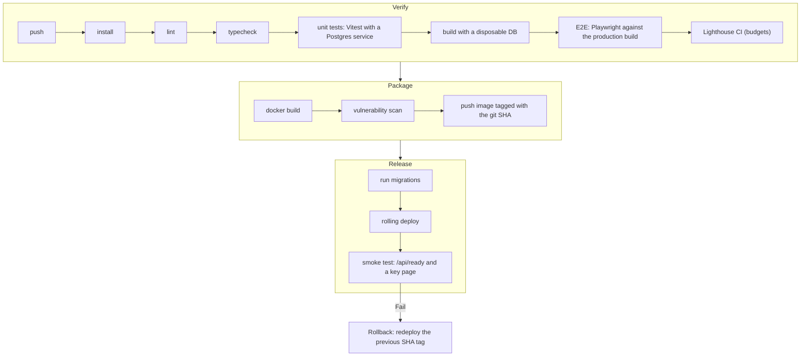

Tag images with the **git SHA** (also your `deploymentId`), so rolling back means redeploying the previous tag. See [CI/CD Pipelines](devops/ci-cd-pipelines), [Caching and CDN](system-design/caching-and-cdn) and [Load Balancing](system-design/load-balancing).

## 8.7: Observability: Seeing What Your App Is Doing

Everything from [Part 2, Module 8](backend-in-nodejs-and-bunjs/production-deployment-and-capstone#85-observability-logs-metrics-traces-and-errors) applies: structured logs, RED metrics, traces, error tracking, alerts. Next.js adds hooks to wire them in.

### `instrumentation.ts`

A file at the project root (or `src/`) whose `register()` function runs **once when the server starts**, and whose optional `onRequestError()` runs when a request fails:

```ts
// instrumentation.ts
export async function register() {
  if (process.env.NEXT_RUNTIME === 'nodejs') {
    await import('./instrumentation-node'); // load Node-only setup (OpenTelemetry, Sentry, pino) here
  }
}

export async function onRequestError(
  err: unknown,
  request: { path: string; method: string },
  context: { routerKind: string; routePath: string; routeType: string },
) {
  const { logger } = await import('./lib/logger');
  logger.error(
    {
      err,
      path: request.path,
      method: request.method,
      route: context.routePath,
      type: context.routeType,
    },
    'request failed',
  );
}
```

(See the instrumentation reference for the exact current signatures, and your tracing or error-tracking vendor's Next.js integration. OpenTelemetry has first-class support.)

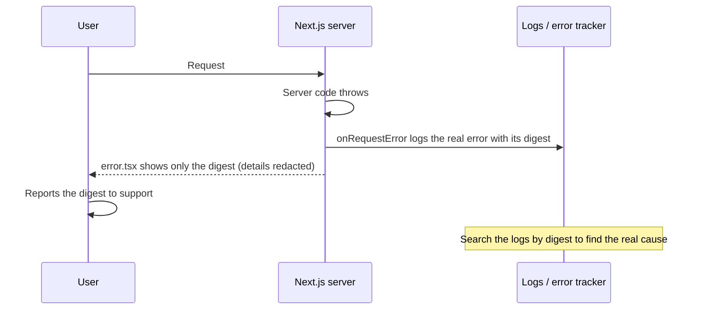

### What to watch

| Signal                                            | Why                                                                                                  |
| ------------------------------------------------- | ---------------------------------------------------------------------------------------------------- |
| **Error rate** and the error **digest**           | A production error shows users only a `digest`. Search the server logs for it to find the real cause |
| **p95/p99 server latency per route**              | Spots slow database reads and missing caches                                                         |
| **Cache hit rates** (`use cache`, ISR)            | A low hit rate means your tags or lifetimes are wrong                                                |
| **Web Vitals from real users**                    | LCP, INP, CLS by page and device (Module 7)                                                          |
| **Event loop delay, memory, CPU**                 | Node health signals (Part 2, Module 2)                                                               |
| **DB pool usage** and slow queries                | Pool exhaustion and N+1 problems (Part 2, Module 5)                                                  |
| **Failed Server Function calls and auth denials** | A burst can be an attack or a bug                                                                    |
| **Version and deployment ID**                     | Correlate errors with a release                                                                      |

Log only on the **server runtime** (`nodejs`) for libraries such as pino, and never log secrets, cookies, tokens or full request bodies.

## 8.8: Upgrading Next.js Safely

Next.js moves quickly, and security fixes arrive as patch releases, so upgrading must be a **routine**, not an event.

| Practice                                                                                         | Why                                                                                                  |
| ------------------------------------------------------------------------------------------------ | ---------------------------------------------------------------------------------------------------- |
| **Patch immediately** for security releases                                                      | Several 2025 and 2026 advisories had no WAF mitigation (Module 6)                                    |
| Upgrade **one minor at a time**, read the release notes                                          | Breaking changes (like async `params` in 15/16, `proxy.ts`) are documented                           |
| Use the **codemods**: `npx @next/codemod@latest`, and the upgrade guide / `next upgrade` command | They rewrite many breaking patterns automatically (check `npx next upgrade --help` for your version) |
| Upgrade `react` and `react-dom` with it                                                          | They are tied to the framework's supported versions                                                  |
| Keep **Node.js** on a supported LTS                                                              | Next.js 16 needs 20.9+, and Node 20 itself is end-of-life                                            |
| Let the **E2E suite and the build** be the safety net                                            | Cache Components turns many problems into build errors                                               |
| Automate with Dependabot/Renovate and a green-CI merge rule                                      | Small, frequent upgrades are easier than one huge jump                                               |
| Stay on stable releases, not canary, in production                                               | Canary builds change without notice                                                                  |

When you inherit an older app, plan the path explicitly: Pages Router → App Router (they can coexist and be migrated route by route), the older caching model → Cache Components (Module 3, Topic 3.8), `middleware` → `proxy`, and synchronous request APIs → async ones.

## 8.9: Choosing Next.js, and When Not To

| If you are building...                                                | Good choice                                                   | Why                                                                       |
| --------------------------------------------------------------------- | ------------------------------------------------------------- | ------------------------------------------------------------------------- |
| A product with **public, SEO-sensitive pages and a logged-in app**    | **Next.js**                                                   | Static shells, metadata, server rendering and the app in one codebase     |
| A full-stack TypeScript web app with a small team                     | **Next.js**                                                   | Server Components, Server Functions and Route Handlers cut layers         |
| An **internal dashboard** behind login, no SEO                        | **Vite + React SPA** (Part 1) + your API (Part 2)             | Simpler mental model, static hosting, nothing to keep patched on a server |
| A **content-heavy** site (docs, blog, marketing)                      | **Astro**, or Next.js with static generation                  | Minimal JavaScript by default                                             |
| Full-stack React with **web-standard loaders and actions**            | **React Router framework mode**                               | A different, lighter full-stack model                                     |
| **Several clients** (web, iOS, Android, partners) sharing one backend | A dedicated API (Part 2) with any front end                   | One set of business rules and one security perimeter                      |
| **Real-time, long-lived connections** at the core                     | A dedicated real-time service (Part 2) with a thin web client | Frameworks built around request/response are a poor home for WebSockets   |
| Simple CRUD with minimal interactivity                                | Server-rendered templates or a small framework                | React may be more than you need                                           |

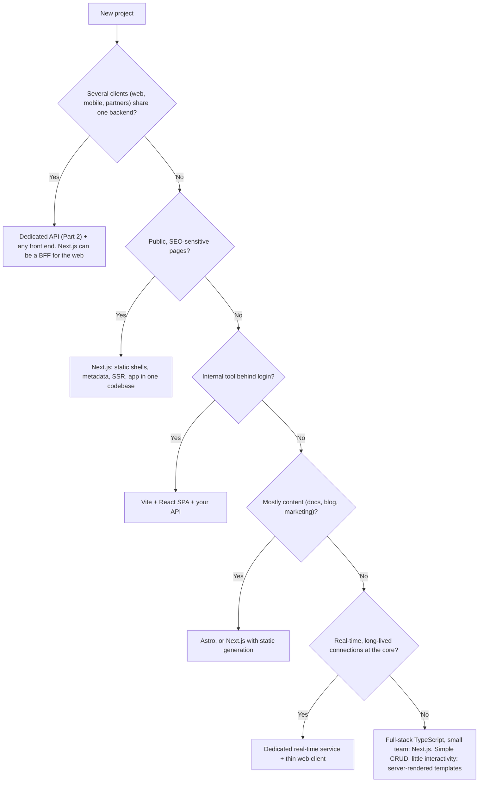

### Honest costs of Next.js

- **A large, fast-moving surface:** the caching model alone changed three times in recent years. Budget time to stay current.
- **A security surface that has needed urgent patching** (Module 6). You need a process for fast upgrades.
- **Self-hosting complexity** for multiple instances (Topic 8.5), which a managed platform hides at a price.
- **Lock-in pull:** the smoothest experience is on the framework's home platform. Portability takes deliberate design.
- **Debugging across the server/client boundary** is a new skill.

None of these rules Next.js out. They are the price of an integrated framework, and for many products the integration is worth it. Choose it because you need **server rendering, SEO, and a full-stack TypeScript workflow**, not because it is popular.

#### Interview traps

- "When would you pick a Vite SPA over Next.js?" For authenticated internal tools with no SEO needs, where simplicity, static hosting and a separate API are more valuable than server rendering.
- "When would you keep a separate Node.js API behind Next.js?" When multiple clients share the same business rules, when the backend needs independent scaling or ownership, or for long-lived connections and heavy background work.
- "What are the main operational risks of self-hosting Next.js?" Multi-instance cache consistency, Server Function key and version skew, proxy buffering breaking streaming, image-optimization CPU, and the need to patch quickly.

## Tricky Questions and Answers

#### Q1 [SDE-2]: Why do the official docs recommend E2E tests for `async` Server Components, and how do you still get fast feedback?

**Answer:** Most unit-test renderers (React Testing Library with jsdom) cannot render `async` Server Components, because those components need the server runtime and streaming. So test them through a real browser against a real build. For fast feedback, push logic out of components into pure functions and DAL functions that you unit test directly (with a real test database for SQL), unit-test Client Components and synchronous Server Components with Vitest, and keep E2E for the key journeys and the authorization matrix.

#### Q2 [SDE-3]: `next build` passes on your laptop but fails in Docker with `ECONNREFUSED` to Postgres. Explain and give two solutions.

**Answer:** With Cache Components the build prerenders static shells, which executes cached data reads and `generateStaticParams`. On your laptop the database is running, but the Docker build stage has no database. Solution 1: give the build a reachable **disposable database** (a CI service container or `docker build --network`) via a throwaway `DATABASE_URL` build argument (not a production secret, since build args are visible in image history). Solution 2: restructure so nothing in the static shell queries the database: keep database-backed reads in `<Suspense>` dynamic regions and avoid build-time `generateStaticParams` queries (return a fixed list).

#### Q3 [SDE-3]: After each rolling deploy, some users see "Failed to find Server Action" until they refresh. Diagnose.

**Answer:** Server Function closure variables and action identifiers are tied to a build. By default each build generates a new encryption key, so a page loaded from the old version (or a request routed to an instance running the other version) cannot be decrypted or matched. Set a stable `NEXT_SERVER_ACTIONS_ENCRYPTION_KEY` at build time for every build, set a `deploymentId` (commit SHA) so Next.js can detect version skew and handle assets and navigations, and use rolling updates with readiness probes so old and new versions overlap safely.

#### Q4 [SDE-2]: Pages feel slower in production than in `next dev`: skeletons appear and then everything arrives at once. What is likely wrong?

**Answer:** A reverse proxy or load balancer is buffering the response, so the streamed chunks (shell, then dynamic regions) are delivered together at the end. Turn off buffering for the app (`proxy_buffering off`, or send `X-Accel-Buffering: no`), check the load balancer's response-buffering settings, and verify with `curl -N` that chunks arrive incrementally.

#### Q5 [SDE-3]: You must run six instances. What do you configure so users get consistent behavior?

**Answer:** One stable `NEXT_SERVER_ACTIONS_ENCRYPTION_KEY` and a `deploymentId` for every build; shared cache handlers (`cacheHandlers` / `cacheHandler`, for example Redis-backed) so `"use cache"` and ISR results and tag invalidations are consistent across instances (or accept short lifetimes); a reverse proxy with buffering off, body limits and rate limits; correct `X-Forwarded-*` headers and `allowedOrigins` for Server Functions; a connection pooler and a pool size that keeps total Postgres connections within limits; readiness probes, graceful shutdown and backward-compatible migrations for rolling deploys; and a CDN for static assets.

#### Q6 [SDE-2]: How would you decide between building TaskFlow with Next.js or keeping the Vite SPA plus the Part 2 API?

**Answer:** If TaskFlow has public, SEO-relevant pages (landing, templates) and a team that wants one TypeScript codebase, Next.js gives static shells, metadata and fewer layers. If TaskFlow is purely an authenticated tool, or a mobile app will share the same backend, the SPA plus API is simpler and keeps one security perimeter. Many teams combine them: Next.js for the web front end, calling the shared Part 2 API (BFF), so the mobile client and the web share one source of business rules.

---

## Capstone Lab: Build TaskFlow (Next.js Edition)

This is the final project of the whole path. You will rebuild TaskFlow as a **full-stack Next.js 16.4 app** that uses the **same PostgreSQL schema and migrations** from Part 2, applies everything from Modules 1 to 7, and ships in containers behind nginx. It is the Part 1 React app and the Part 2 API, unified.

### Requirements

| Area                   | Requirement                                                                                                                               | Module |
| ---------------------- | ----------------------------------------------------------------------------------------------------------------------------------------- | ------ |
| Routing and layouts    | Route groups `(marketing)`, `(auth)`, `(app)`. `loading`, `error`, `not-found`. Typed `params` (awaited)                                  | 1      |
| Components             | Server-first. Client islands for forms, checkboxes, theme. DTOs only. `server-only` on data modules                                       | 2      |
| Data                   | DAL with ownership-scoped SQL. `"use cache"` + `cacheLife` + `cacheTag`. Streamed personal regions. ISR for public templates              | 3      |
| Mutations              | Create/rename/delete project, create/toggle/delete task: Zod, `useActionState`, `updateTag`, **optimistic toggle** with version conflicts | 4      |
| Backend                | `/api/health`, `/api/ready`, a signed webhook with `revalidateTag`, an SSE endpoint, `proxy.ts` (optimistic only), validated env          | 5      |
| Security               | Database sessions in `HttpOnly` cookies, rotation, rate-limited login, safe redirects, security headers, patched Next.js                  | 6      |
| Performance and SEO    | Preloaded hero, `next/font`, analyzer pass, metadata, sitemap, robots, OG images, JSON-LD, Web Vitals                                     | 7      |
| Quality                | 15+ Vitest tests (schemas, actions, components). 10+ Playwright tests incl. **BOLA negatives, no-JS, a11y**                               | 8      |
| Delivery               | Standalone Docker image, Compose (web + db + redis + nginx), stable encryption key, `deploymentId`, CI pipeline                           | 8      |
| Integration (optional) | Replace one DAL module with calls to your **Part 2 API** (BFF) and compare                                                                | 5      |

### Structure

```
taskflow-web/
├── app/
│   ├── layout.tsx                      root layout, fonts, metadataBase, <WebVitals/>
│   ├── (marketing)/    layout.tsx  page.tsx  pricing/page.tsx  templates/[slug]/{page.tsx,opengraph-image.tsx}
│   ├── (auth)/         login/{page.tsx,login-form.tsx,actions.ts}   register/...
│   ├── (app)/          layout.tsx  (shell + <Suspense> user menu)
│   │   └── projects/   page.tsx  loading.tsx  error.tsx
│   │       └── [projectId]/  page.tsx  loading.tsx  not-found.tsx  actions.ts  task-list.tsx  new-task-form.tsx
│   ├── api/            health/route.ts  ready/route.ts  webhooks/cms/route.ts  projects/[projectId]/events/route.ts
│   ├── sitemap.ts  robots.ts  not-found.tsx  global-error.tsx
├── components/         task-checkbox.tsx  collapsible.tsx  providers.tsx  nav-link.tsx  web-vitals.tsx
├── lib/
│   ├── db.ts  env.ts  session.ts  dal.ts  password.ts  rate-limit.ts  auth-helpers.ts  http.ts  csrf.ts
│   ├── actions/helpers.ts
│   └── data/           projects.ts  tasks.ts  templates.ts
├── migrations/         (shared with Part 2)    scripts/migrate.ts
├── e2e/                helpers.ts  tasks.spec.ts  security.spec.ts  seo.spec.ts
├── proxy.ts   instrumentation.ts   next.config.ts   vitest.config.mts   playwright.config.ts
├── Dockerfile   docker-compose.yml   nginx.conf   .dockerignore   .env.example
└── .github/workflows/ci.yml
```

### Key pieces to start from

```tsx
// app/(app)/layout.tsx : the shell is static. Personal bits stream
import { Suspense } from 'react';
import { NavLink } from '@/components/nav-link';
import { UserMenu } from './user-menu';

export const metadata = { robots: { index: false, follow: false } };

export default function AppLayout({ children }: { children: React.ReactNode }) {
  return (
    <div className="grid min-h-screen grid-cols-[220px_1fr]">
      <aside>
        <NavLink href="/projects">Projects</NavLink>
        <NavLink href="/settings">Settings</NavLink>
      </aside>
      <div>
        <header>
          <Suspense fallback={<span aria-busy="true">…</span>}>
            <UserMenu />{' '}
            {/* reads the session: streamed, in its own boundary */}
          </Suspense>
        </header>
        <main>{children}</main>{' '}
        {/* each page authorizes for itself. NEVER rely on this layout */}
      </div>
    </div>
  );
}
```

```tsx
// app/(app)/projects/[projectId]/page.tsx : static header, cached tasks, streamed stats
import { Suspense } from 'react';
import { notFound } from 'next/navigation';
import { cacheLife, cacheTag } from 'next/cache';
import { requireUser } from '@/lib/dal';
import { getProjectForUser } from '@/lib/data/projects';
import { getTasksForUser } from '@/lib/data/tasks';

export default function ProjectPage({
  params,
}: PageProps<'/projects/[projectId]'>) {
  return (
    <Suspense fallback={<ProjectSkeleton />}>
      <ProjectView params={params} />
    </Suspense>
  );
}

async function ProjectView({
  params,
}: Pick<PageProps<'/projects/[projectId]'>, 'params'>) {
  const { projectId } = await params;
  const user = await requireUser(); // authenticate (runtime data, inside the boundary)
  const project = await getProjectForUser(user.id, Number(projectId)); // authorize in the query
  if (!project) notFound();

  return (
    <>
      <h1>{project.name}</h1>
      <CachedTaskList userId={user.id} projectId={project.id} />{' '}
      {/* authorized first, then cached by key */}
      <Suspense fallback={<StatsSkeleton />}>
        <ProjectStats userId={user.id} projectId={project.id} />
      </Suspense>
    </>
  );
}

async function CachedTaskList({
  userId,
  projectId,
}: {
  userId: number;
  projectId: number;
}) {
  'use cache';
  cacheLife('minutes');
  cacheTag(`tasks:project:${projectId}`);
  const tasks = await getTasksForUser(userId, projectId);
  return <TaskList tasks={tasks} />; // a Client Component (optimistic toggle)
}
```

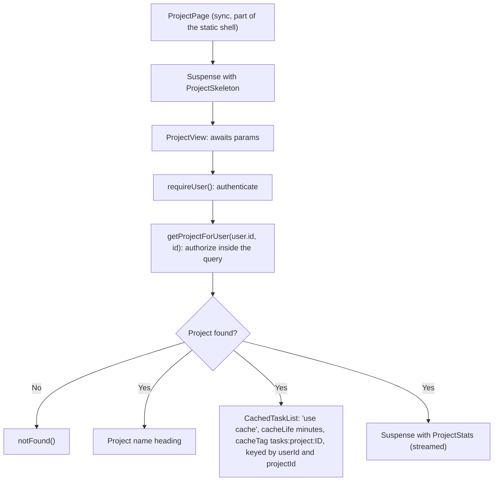

```ts
// proxy.ts : optimistic only
import { NextResponse, type NextRequest } from 'next/server';

export function proxy(request: NextRequest) {
  if (
    request.nextUrl.pathname.startsWith('/projects') &&
    !request.cookies.has('tf_sid')
  ) {
    const url = new URL('/login', request.url);
    url.searchParams.set('next', request.nextUrl.pathname);
    return NextResponse.redirect(url);
  }
  return NextResponse.next();
}

export const config = {
  matcher: [
    '/((?!api|_next/static|_next/image|favicon.ico|.*\\.(?:png|jpg|svg|webp|ico)$).*)',
  ],
};
```

### Milestones

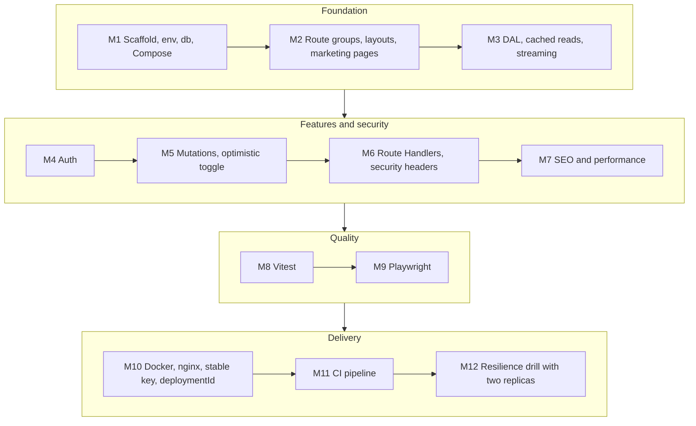

### Self-review questions

- If `proxy.ts` and every layout check were deleted, which data could a logged-out user or another user still reach? (The answer must be none.)
- Which parts of each page are static, cached or dynamic, and can you justify each choice?
- What happens to a user's open tab during a deployment, and what did you configure to make it safe?
- Where does a build-time database read happen in your project, and what does the CI build connect to?
- What would you change if a mobile app had to use the same business rules tomorrow?

---

## Where to Go From Here

You have now built and shipped the same product in three layers:

| Part | What you built                                                                                   | The skills that carry forward                                                               |
| ---- | ------------------------------------------------------------------------------------------------ | ------------------------------------------------------------------------------------------- |
| 1    | [**React**](react): a client-side TaskFlow with state, effects, routing and server-state caching | Components, hooks, rendering, `use`, Actions, testing, TypeScript                           |
| 2    | [**Node.js and Bun**](nodejs): a secure, tested, observable API on PostgreSQL                    | The event loop, HTTP, SQL, sessions, authorization, queues, Docker, operations              |
| 3    | **Next.js** (this series): the whole product as one full-stack app                               | Server Components, caching and streaming, Server Functions, security in depth, self-hosting |

Good next steps, each linked to topics already on this blog:

- **System design:** [System Design](system-design/databases), [Caching and CDN](system-design/caching-and-cdn), [Load Balancing](system-design/load-balancing), [Observability and Deployment](system-design/observability-and-deployment), [Event-Driven Architecture](system-design/event-driven).
- **DevOps:** [CI/CD Pipelines](devops/ci-cd-pipelines), [Kubernetes](devops/k8s/kubernetes-full-tutorial), [Monitoring and Logging](devops/monitoring-and-logging).
- **Security:** the [vulnerabilities series](vulnerabilities/csrf) (CSRF, JWT, clickjacking, prototype pollution) pairs directly with Module 6.
- **Databases:** [SQL query patterns](database/sql-advanced-query-patterns-tutorial) and the [DBMS handbook](database/database-management-systems-interview-handbook).
- **Projects:** add teams and roles, notifications through a queue, full-text search with Postgres, file attachments with presigned URLs, an AI-assisted feature, or a mobile client that reuses your API.

The best way to retain this is to build. Ship TaskFlow, put it behind a real domain, break it on purpose, and fix it.

---

## Module 8 Cheat Sheet

| Concept                           | One-line interview answer                                                                                                   |
| --------------------------------- | --------------------------------------------------------------------------------------------------------------------------- |
| Testing `async` Server Components | Use E2E tests. Most unit-test tools cannot render them. Unit-test the logic beneath them.                                   |
| Vitest setup                      | `vitest`, `@vitejs/plugin-react`, `jsdom`, Testing Library, `vite-tsconfig-paths`. Mock `server-only`.                      |
| Testing Server Functions          | Call them directly with a `FormData`; mock `next/cache` and the DAL. `redirect` and `notFound` throw.                       |
| Playwright target                 | Always `next build && next start`. Dev mode hides caching and streaming behavior.                                           |
| Two users in a test               | Two browser contexts, each with its own session. Write BOLA negative tests for every resource.                              |
| Streamed not-found                | Assert the not-found UI and the absence of data. The status was already sent with the shell.                                |
| Build needs data                  | Static shells run cached reads and `generateStaticParams` at build time. Provide a disposable DB or keep reads dynamic.     |
| `output: "standalone"`            | Minimal server in `.next/standalone`. Copy `public/` and `.next/static` yourself.                                           |
| Dockerfile essentials             | Multi-stage, `npm ci`, non-root user, `HOSTNAME=0.0.0.0`, exec-form `CMD ["node","server.js"]`.                             |
| Build args                        | Visible in image history. Use disposable values. Runtime secrets come from the environment.                                 |
| Health vs. readiness              | Liveness is cheap. Readiness checks dependencies and must be dynamic (`connection()`).                                      |
| Graceful shutdown                 | `SIGTERM` lets Next.js finish requests and `after()` work. `NEXT_MANUAL_SIG_HANDLE` for custom cleanup.                     |
| Reverse proxy                     | nginx in front: TLS, limits, rate limiting. `proxy_buffering off` (or `X-Accel-Buffering: no`) for streaming.               |
| Encryption key                    | Stable `NEXT_SERVER_ACTIONS_ENCRYPTION_KEY` (base64 16/24/32 bytes) set at **build** time for all builds.                   |
| Version skew                      | `deploymentId` (commit SHA) so Next.js can detect and handle old tabs during rollouts.                                      |
| Multi-instance caches             | Per-instance by default. Use `cacheHandlers` / `cacheHandler` with a shared store, or short lifetimes.                      |
| Deployment options                | Vercel, containers, Kubernetes, a VM, adapters (stable API since 16.2), static export.                                      |
| Pipeline                          | lint, typecheck, unit, build, E2E, Lighthouse CI, image scan, migrate, rolling deploy, smoke test.                          |
| `instrumentation.ts`              | `register()` at startup (tracing, logging), `onRequestError()` for failures. Correlate by digest.                           |
| Upgrading                         | Patch security releases immediately, one minor at a time, codemods, update React and Node together, rely on build and E2E.  |
| Choosing Next.js                  | For public SEO pages plus an app and full-stack TypeScript. Prefer a SPA + API for internal tools or multi-client backends. |
