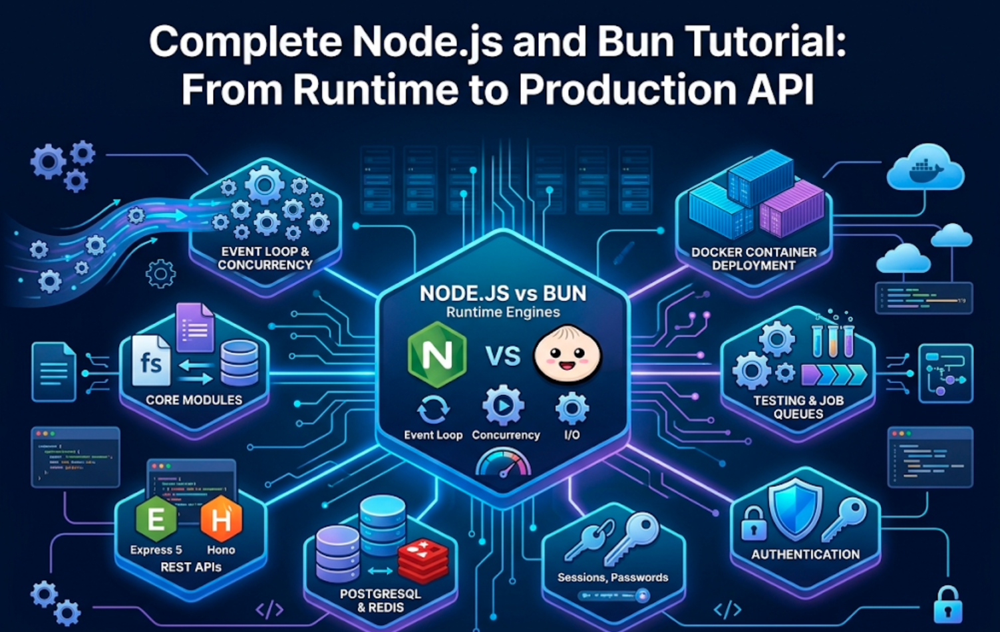
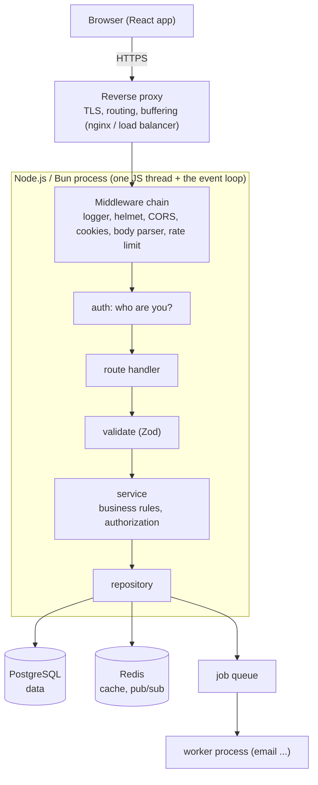
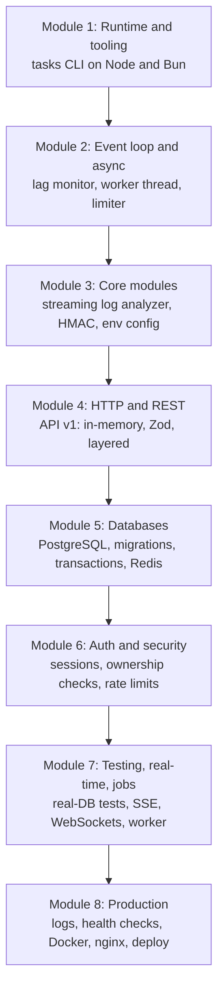
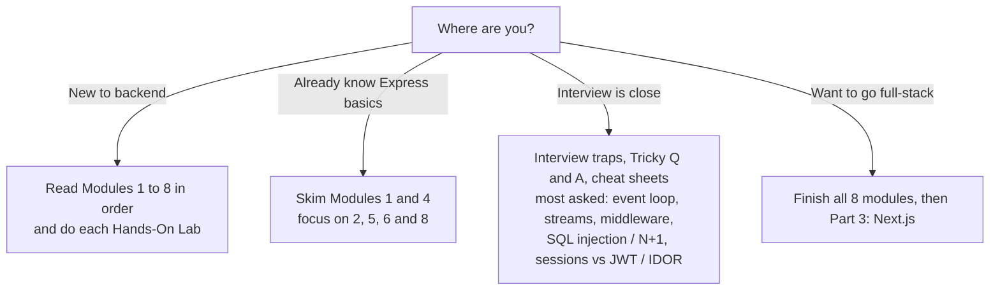
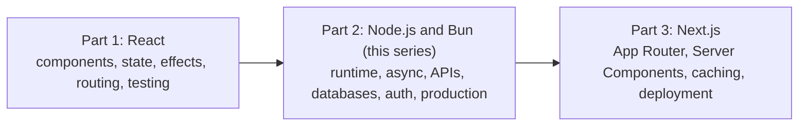

# Complete Node.js and Bun Tutorial: From Runtime to Production API

This is **Part 2** of the full-stack path. [Part 1](reactjs) taught React. This part teaches the backend side of JavaScript: how Node.js and Bun actually work, how to build and secure an API, how to store data, and how to ship and operate it.

The language is simple. You can start with basic JavaScript and no backend experience. Each topic begins with a plain-words idea, then goes step by step into how things really work, and ends with the traps and questions that appear in backend and full-stack interviews.

Every example runs on **Node.js** (the baseline that every host supports). Wherever **Bun** differs, a short **Bun note** shows the difference. Most code is identical, because both runtimes implement the same web-standard APIs.

> **Where this series fits:** **Part 1:** React in depth. **Part 2 (this series):** Node.js and Bun. **Part 3:** Next.js, where React and a server come together. This part ends with a production-style API for the **TaskFlow** app you built in Part 1.

## The tutorial at a glance

| #   | Module                                             | What it answers                                                                                                 | Read more                                                     |
| --- | -------------------------------------------------- | --------------------------------------------------------------------------------------------------------------- | ------------------------------------------------------------- |
| 1   | **Runtime Fundamentals & Tooling**                 | What are Node.js and Bun, which version do I use, how do modules, `package.json` and the built-in globals work? | [Open Module 1](nodejs/runtime-fundamentals-and-tooling)      |
| 2   | **The Event Loop, Async & Concurrency**            | Why is Node fast at I/O, what is the event loop, and how do I avoid blocking it?                                | [Open Module 2](nodejs/event-loop-async-and-concurrency)      |
| 3   | **Core Modules: Files, Streams, Buffers & Events** | How do I work with files, bytes, events and huge data without running out of memory?                            | [Open Module 3](nodejs/core-modules-files-streams-and-events) |
| 4   | **HTTP Servers & REST APIs**                       | How do I build a clean, validated REST API with Express 5, Hono or `Bun.serve`?                                 | [Open Module 4](nodejs/http-servers-and-rest-apis)            |
| 5   | **Databases & the Data Layer**                     | How do I use PostgreSQL safely, write migrations, avoid N+1 and race conditions, and add Redis caching?         | [Open Module 5](nodejs/databases-and-the-data-layer)          |
| 6   | **Authentication & Security**                      | How do I store passwords, run sessions, stop IDOR and injection, and harden an API?                             | [Open Module 6](nodejs/authentication-and-security)           |
| 7   | **Testing, Real-Time & Background Jobs**           | How do I test with a real database, push live updates, and run reliable background jobs?                        | [Open Module 7](nodejs/testing-real-time-and-background-jobs) |
| 8   | **Production, Deployment & Capstone**              | How do I log, monitor, shut down gracefully, containerize and deploy, and how do I choose between Node and Bun? | [Open Module 8](nodejs/production-deployment-and-capstone)    |

## Node.js and Bun in one minute (basic definitions)

| Term                    | Simple meaning                                                                                | Example                                       |
| ----------------------- | --------------------------------------------------------------------------------------------- | --------------------------------------------- |
| **Runtime**             | A program that runs JavaScript outside the browser and gives it files, network and processes. | Node.js, Bun, Deno                            |
| **V8 / JavaScriptCore** | The JavaScript engines inside Node (V8) and Bun (JavaScriptCore).                             | Chrome and Safari use the same engines        |
| **Event loop**          | The loop that runs callbacks when their work is done, letting one thread serve many requests. | Waiting for a database without freezing       |
| **Non-blocking I/O**    | Start slow work, keep going, get the result later.                                            | `await readFile(...)`                         |
| **Module**              | A file that exports things for other files to import.                                         | `import { readFile } from "node:fs/promises"` |
| **npm**                 | The package registry and package manager.                                                     | `npm install express`                         |
| **Middleware**          | A function that runs before or around your route handler.                                     | Logging, auth, error handling                 |
| **REST API**            | URLs name resources and HTTP methods are the actions.                                         | `GET /api/tasks`, `POST /api/tasks`           |
| **Migration**           | A versioned script that changes the database schema.                                          | `002_users_and_sessions.sql`                  |
| **Session**             | Server-side record that a browser is logged in. The cookie holds only a random ID.            | `Set-Cookie: tf_sid=...; HttpOnly`            |
| **Stream**              | Data processed in small chunks over time instead of all at once.                              | Serving a 2 GB file with tiny memory          |
| **Job queue**           | A durable list of tasks that separate worker processes run.                                   | Sending welcome emails                        |
| **Graceful shutdown**   | Finish current requests, close connections, then exit.                                        | Deploys with zero dropped requests            |

## The big picture: how a request travels through your backend

[Module 2](nodejs/event-loop-async-and-concurrency) explains the box in the middle, [Module 4](nodejs/http-servers-and-rest-apis) the layers, [Module 5](nodejs/databases-and-the-data-layer) the data stores, [Module 6](nodejs/authentication-and-security) the security layers, and [Module 8](nodejs/production-deployment-and-capstone) the proxy, logging and deployment.

## Node.js vs. Bun at a glance

| Question        | Node.js                                           | Bun                                                   |
| --------------- | ------------------------------------------------- | ----------------------------------------------------- |
| Engine          | V8                                                | JavaScriptCore                                        |
| Maturity        | Since 2009. The industry standard                 | 1.0 in 2023. Newer and fast-moving                    |
| Package manager | `npm` (or pnpm / yarn)                            | Built in: `bun install`                               |
| Test runner     | `node:test` (built in)                            | `bun test` (built in)                                 |
| TypeScript      | Native `.ts` by type stripping (no type checking) | Runs `.ts` and `.tsx` directly                        |
| `.env` files    | `--env-file=.env`                                 | Loaded automatically                                  |
| HTTP server     | `node:http`, Express, Hono, Fastify               | `Bun.serve`, Hono, Express                            |
| Best fit        | Long-lived production services                    | Tooling, scripts, tests, verified greenfield services |

[Module 8, Topic 8.8](nodejs/production-deployment-and-capstone#88-nodejs-vs-bun-how-to-choose) gives a neutral decision guide.

### The same commands in both

| Task                        | Node.js / npm          | Bun                             |
| --------------------------- | ---------------------- | ------------------------------- |
| Run a file                  | `node file.ts`         | `bun file.ts`                   |
| Restart on change           | `node --watch file.ts` | `bun --watch file.ts`           |
| Install dependencies        | `npm install`          | `bun install`                   |
| Add a package               | `npm install express`  | `bun add express`               |
| Clean install from lockfile | `npm ci`               | `bun install --frozen-lockfile` |
| Run a package binary        | `npx tsx script.ts`    | `bunx tsx script.ts`            |
| Run tests                   | `node --test`          | `bun test`                      |
| Run a script                | `npm run dev`          | `bun run dev`                   |

## Versions this series assumes

| Tool           | Version / note                                                                                                |
| -------------- | ------------------------------------------------------------------------------------------------------------- |
| **Node.js**    | **26 is Active LTS** (since October 28, 2026). 24 is supported LTS. 22 is maintenance. **20 is end-of-life.** |
| **Bun**        | 1.4.x                                                                                                         |
| **Express**    | 5 (Node.js 18+)                                                                                               |
| **TypeScript** | Run natively via type stripping. Keep `tsc --noEmit` for checking                                             |
| **PostgreSQL** | Any supported version (examples use 17). Driver: `pg`                                                         |
| **Redis**      | 7. Libraries: `redis`, BullMQ                                                                                 |
| **Zod**        | Schema validation at every boundary                                                                           |

> Runtime and tool versions move quickly. The **concepts** here (the event loop, streams, HTTP semantics, SQL, sessions) are stable. When a command fails, check the official docs for the tool's current recommendation.

## What you should know before you start

You need basic JavaScript (functions, arrays, objects, `async` / `await`) and the ideas from [Part 1](reactjs), especially modules, promises and `fetch`. If a row is unfamiliar, spend an evening on it first. [Module 1](nodejs/runtime-fundamentals-and-tooling) and your [C++ to Java and JS](cpp-to-java-and-js) post cover the JavaScript side.

| Skill                                        | Why it matters here                                                                             |
| -------------------------------------------- | ----------------------------------------------------------------------------------------------- |
| Promises and `async` / `await`               | Everything in Node is asynchronous                                                              |
| Closures and callbacks                       | The event loop and middleware are built on them                                                 |
| HTTP basics (methods, status codes, headers) | You are building the server side of those requests                                              |
| A terminal and Git                           | You will run commands constantly. See [Git and Version Control](devops/git-and-version-control) |
| Basic SQL (`SELECT`, `INSERT`, `JOIN`)       | Module 5. See [SQL query patterns](database/sql-advanced-query-patterns-tutorial)               |

## The project that ties it together: TaskFlow API

You build **one API** across the series. The React TaskFlow capstone from Part 1 talks to it.

| Module | TaskFlow API gains...                                                                       |
| ------ | ------------------------------------------------------------------------------------------- |
| 1      | A `tasks` command-line tool that runs on Node and Bun                                       |
| 2      | An event-loop lag monitor, a worker thread and a concurrency limiter                        |
| 3      | A streaming log analyzer, HMAC signing and validated environment config                     |
| 4      | **API v1**: in-memory REST endpoints, Zod validation, layered structure, connected to React |
| 5      | **PostgreSQL**: migrations, transactions, optimistic locking, Redis caching                 |
| 6      | **Auth**: register, login, sessions, ownership checks, rate limits, hardening               |
| 7      | **Tests** with a real database, **live updates** (SSE and WebSockets), a **job worker**     |
| 8      | **Production**: logs, metrics, health checks, graceful shutdown, Docker, nginx, deployment  |

## Suggested reading paths

**If you are new to backend development:** read Modules 1 → 8 in order. Type every example. Do the **Hands-On Lab** at the end of each module before moving on.

**If you already know Express basics:** skim Modules 1 and 4. Spend your time on Module 2 (the event loop), Module 5 (transactions and concurrency), Module 6 (authorization) and Module 8 (shutdown and operations).

**If an interview is close:** read **Interview traps** and **Tricky questions and answers** in every module, then the cheat sheets. The most-asked topics are the event loop and ordering ([Module 2](nodejs/event-loop-async-and-concurrency)), streams and backpressure ([Module 3](nodejs/core-modules-files-streams-and-events)), middleware ([Module 4](nodejs/http-servers-and-rest-apis)), SQL injection, N+1 and race conditions ([Module 5](nodejs/databases-and-the-data-layer)), and sessions vs. JWT with IDOR ([Module 6](nodejs/authentication-and-security)).

**If you want to go full-stack:** finish all eight modules, then continue to Next.js (Part 3).

## Quick finder: "Where do I read about...?"

| If you want to understand...                      | Go to                                                                                                                                |
| ------------------------------------------------- | ------------------------------------------------------------------------------------------------------------------------------------ |
| What Node.js and Bun are                          | [Module 1, Topic 1.1](nodejs/runtime-fundamentals-and-tooling#11-what-are-nodejs-and-bun)                                            |
| Node LTS versions and installing                  | [Module 1, Topic 1.2](nodejs/runtime-fundamentals-and-tooling#12-installing-and-choosing-a-version)                                  |
| Running TypeScript, `--watch`, `--env-file`       | [Module 1, Topic 1.3](nodejs/runtime-fundamentals-and-tooling#13-running-code-watch-mode-env-files-and-typescript)                   |
| CommonJS vs. ES modules                           | [Module 1, Topic 1.4](nodejs/runtime-fundamentals-and-tooling#14-modules-commonjs-and-es-modules)                                    |
| `package.json`, lockfiles, supply-chain safety    | [Module 1, Topic 1.5](nodejs/runtime-fundamentals-and-tooling#15-packagejson-npm-and-the-lockfile)                                   |
| Built-in `fetch` and packages you can drop        | [Module 1, Topic 1.6](nodejs/runtime-fundamentals-and-tooling#16-globals-and-built-in-web-apis)                                      |
| Blocking vs. non-blocking                         | [Module 2, Topic 2.1](nodejs/event-loop-async-and-concurrency#21-blocking-vs-non-blocking)                                           |
| Event loop phases and the thread pool             | [Module 2, Topic 2.2](nodejs/event-loop-async-and-concurrency#22-the-event-loop-in-detail)                                           |
| `nextTick` vs. Promise vs. `setImmediate`         | [Module 2, Topic 2.3](nodejs/event-loop-async-and-concurrency#23-ordering-puzzles-nexttick-promises-timers)                          |
| `Promise.all`, bounded concurrency, timeouts      | [Module 2, Topic 2.4](nodejs/event-loop-async-and-concurrency#24-async-patterns-callbacks-promises-async--await)                     |
| Unhandled rejections and crashing safely          | [Module 2, Topic 2.5](nodejs/event-loop-async-and-concurrency#25-error-handling-that-does-not-crash-production)                      |
| Worker threads, cluster, child processes          | [Module 2, Topic 2.6](nodejs/event-loop-async-and-concurrency#26-never-block-the-loop-worker-threads-and-child-processes)            |
| `fs`, `path` and path traversal                   | [Module 3, Topic 3.1](nodejs/core-modules-files-streams-and-events#31-files-and-paths)                                               |
| `EventEmitter`                                    | [Module 3, Topic 3.3](nodejs/core-modules-files-streams-and-events#33-eventemitter)                                                  |
| Streams, `pipeline`, backpressure                 | [Module 3, Topic 3.4](nodejs/core-modules-files-streams-and-events#34-streams-and-backpressure)                                      |
| `crypto`, HMAC, `child_process`, env validation   | [Module 3, Topic 3.5](nodejs/core-modules-files-streams-and-events#35-other-built-ins-crypto-util-childprocess-os-and-configuration) |
| Raw `node:http`                                   | [Module 4, Topic 4.2](nodejs/http-servers-and-rest-apis#42-a-raw-http-server-and-why-frameworks-exist)                               |
| Express 5, middleware, error handling             | [Module 4, Topic 4.3](nodejs/http-servers-and-rest-apis#43-express-5)                                                                |
| Hono and `Bun.serve`                              | [Module 4, Topic 4.4](nodejs/http-servers-and-rest-apis#44-hono-and-bunserve-web-standard-servers)                                   |
| REST design, status codes, pagination             | [Module 4, Topic 4.5](nodejs/http-servers-and-rest-apis#45-rest-api-design)                                                          |
| Validation with Zod                               | [Module 4, Topic 4.6](nodejs/http-servers-and-rest-apis#46-validation-with-zod)                                                      |
| Routes, services, repositories                    | [Module 4, Topic 4.7](nodejs/http-servers-and-rest-apis#47-project-structure-routes-services-repositories)                           |
| PostgreSQL with `pg` and `Bun.sql`, SQL injection | [Module 5, Topic 5.3](nodejs/databases-and-the-data-layer#53-postgresql-from-node-and-bun)                                           |
| Migrations and expand/contract                    | [Module 5, Topic 5.5](nodejs/databases-and-the-data-layer#55-migrations)                                                             |
| Raw SQL vs. query builders vs. ORMs               | [Module 5, Topic 5.6](nodejs/databases-and-the-data-layer#56-raw-sql-query-builders-and-orms)                                        |
| Transactions and repositories                     | [Module 5, Topic 5.7](nodejs/databases-and-the-data-layer#57-the-repository-layer-with-transactions)                                 |
| N+1, indexes, pool sizing, lost updates           | [Module 5, Topic 5.8](nodejs/databases-and-the-data-layer#58-n1-indexes-pool-sizing-and-concurrency)                                 |
| Redis and cache-aside                             | [Module 5, Topic 5.9](nodejs/databases-and-the-data-layer#59-redis-and-caching)                                                      |
| Password hashing                                  | [Module 6, Topic 6.2](nodejs/authentication-and-security#62-password-storage)                                                        |
| Sessions vs. JWT                                  | [Module 6, Topic 6.3](nodejs/authentication-and-security#63-sessions-vs-jwt)                                                         |
| Session auth implementation                       | [Module 6, Topic 6.4](nodejs/authentication-and-security#64-implementing-session-auth-in-express-with-postgres)                      |
| IDOR / BOLA and roles                             | [Module 6, Topic 6.5](nodejs/authentication-and-security#65-authorization-broken-access-control)                                     |
| SSRF, injection, uploads                          | [Module 6, Topic 6.6](nodejs/authentication-and-security#66-input-threats-beyond-sql)                                                |
| Helmet, CORS, rate limiting, timeouts             | [Module 6, Topic 6.7](nodejs/authentication-and-security#67-http-hardening-helmet-cors-rate-limits-and-timeouts)                     |
| OAuth / OIDC                                      | [Module 6, Topic 6.9](nodejs/authentication-and-security#69-oauth-20-and-oidc-sign-in-with-google)                                   |
| `node:test`, `bun test`                           | [Module 7, Topic 7.1](nodejs/testing-real-time-and-background-jobs#71-testing-with-nodetest-bun-test-and-vitest)                     |
| Integration tests with a real database            | [Module 7, Topic 7.3](nodejs/testing-real-time-and-background-jobs#73-integration-tests-against-http-and-a-real-database)            |
| Server-Sent Events                                | [Module 7, Topic 7.5](nodejs/testing-real-time-and-background-jobs#75-server-sent-events-sse)                                        |
| WebSockets and scaling them                       | [Module 7, Topic 7.6](nodejs/testing-real-time-and-background-jobs#76-websockets)                                                    |
| Background jobs, BullMQ, webhooks                 | [Module 7, Topic 7.7](nodejs/testing-real-time-and-background-jobs#77-background-jobs-and-queues)                                    |
| Structured logging with pino                      | [Module 8, Topic 8.2](nodejs/production-deployment-and-capstone#82-structured-logging)                                               |
| Health checks and graceful shutdown               | [Module 8, Topic 8.3](nodejs/production-deployment-and-capstone#83-health-checks-and-graceful-shutdown)                              |
| Profiling and memory leaks                        | [Module 8, Topic 8.4](nodejs/production-deployment-and-capstone#84-performance-measure-then-fix)                                     |
| Metrics, tracing, alerting                        | [Module 8, Topic 8.5](nodejs/production-deployment-and-capstone#85-observability-logs-metrics-traces-and-errors)                     |
| Dockerfile and Compose for Node and Bun           | [Module 8, Topic 8.6](nodejs/production-deployment-and-capstone#86-docker-for-nodejs-and-bun)                                        |
| Deployment options and zero-downtime releases     | [Module 8, Topic 8.7](nodejs/production-deployment-and-capstone#87-deploying-the-api)                                                |
| Node.js or Bun?                                   | [Module 8, Topic 8.8](nodejs/production-deployment-and-capstone#88-nodejs-vs-bun-how-to-choose)                                      |
| From an API to Next.js                            | [Module 8, Topic 8.9](nodejs/production-deployment-and-capstone#89-from-an-api-to-nextjs)                                            |
| The full project to build                         | [Module 8, Capstone](nodejs/production-deployment-and-capstone#capstone-lab-build-the-taskflow-api-production-ready)                 |

## Tools you will use

| Tool                               | What it does                                                                                                             |
| ---------------------------------- | ------------------------------------------------------------------------------------------------------------------------ |
| `node` and `npm` (or `bun`)        | The runtime and package manager                                                                                          |
| fnm / nvm                          | Switch Node versions per project                                                                                         |
| Express 5, Hono                    | Web frameworks                                                                                                           |
| Zod                                | Validation and types from one schema                                                                                     |
| PostgreSQL + `pg`, Redis + `redis` | Data and cache                                                                                                           |
| Docker and Docker Compose          | Run Postgres, Redis and your API the same way everywhere. See [Docker Full Tutorial](devops/docker/docker-full-tutorial) |
| `curl`, `autocannon`               | Call and load-test your API                                                                                              |
| Postman or Bruno                   | Explore APIs visually                                                                                                    |
| `node --test` / `bun test`, Vitest | Testing                                                                                                                  |
| pino, `prom-client`                | Logs and metrics                                                                                                         |
| Chrome DevTools (`node --inspect`) | Debugging and profiling Node                                                                                             |
| BullMQ                             | Background job queue                                                                                                     |

## How each module is organized

Every module follows the same pattern, so you always know where to look.

1. **Words you will meet:** a short glossary. Read it first.
2. **Numbered topics (1.1, 1.2, ...):** the idea in plain words, then how it really works, then code.
3. **Interview traps:** the wrong answers people give, and the better ones.
4. **Tricky questions and answers:** tagged `[SDE-1]`, `[SDE-2]` or `[SDE-3]` so you know the expected depth.
5. **Hands-On Lab:** a build you do yourself, extending the TaskFlow project.
6. **Cheat sheet:** one-line answers for a final review.

## What comes next: Part 3, Next.js

| Part | Series                         | What you will learn                                                                            | Builds on     |
| ---- | ------------------------------ | ---------------------------------------------------------------------------------------------- | ------------- |
| 1    | [**ReactJS**](reactjs)           | Components, state, effects, rendering, routing, data, testing.                                 | JavaScript    |
| 2    | **Node.js and Bun** (this one) | The runtime, async model, APIs, databases, auth, testing, real-time, production.               | Part 1 + HTTP |
| 3    | **Next.js**                    | The React framework: App Router, Server Components, Server Actions, caching, auth, deployment. | Parts 1 and 2 |

Why this order? [Module 8, Topic 8.9](nodejs/production-deployment-and-capstone#89-from-an-api-to-nextjs) maps every piece you built (routing, data fetching, forms, API handlers, middleware) to its Next.js counterpart. You will understand **why** Next.js works the way it does, because you built the plain version of each part first.

Related reading from this blog: [DNS, HTTP and TLS](computer-networks/dns-http-and-tls-the-application-layer) (what every request really does), [Authentication and Security](system-design/auth-and-security), [Caching and CDN](system-design/caching-and-cdn), [Rate Limiting](system-design/rate-limiting), [Monitoring and Logging](devops/monitoring-and-logging), and [Socket.IO](socketio/introduction-to-socketio).
