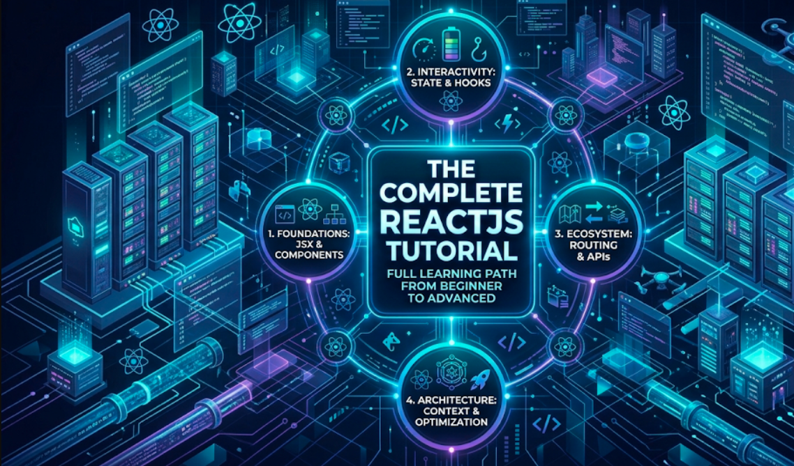
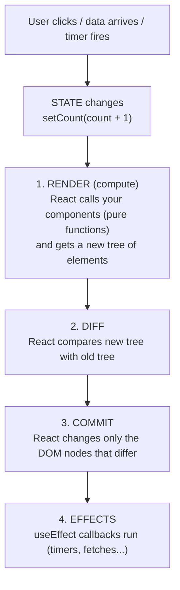

# Complete ReactJS Tutorial: From Zero to Production-Ready



This tutorial is written in simple language. You can start with basic JavaScript and no React experience. Each topic begins with a plain-words idea, then goes step by step into how things really work, and ends with the traps and questions that appear in frontend and full-stack interviews.

It targets **React 19.2**, the current stable line at the time of writing. Every example uses modern React: function components, hooks, the new `use` API, form Actions, and the React Compiler. Old class-component patterns appear only where you still meet them in real codebases or interviews.

> **Where this series fits:** this is Part 1 of a three-part full-stack path. **Part 1 (this series):** React in depth. **Part 2:** Node.js and Bun, step by step. **Part 3:** Next.js, where React, a server and a router come together. Finish React first. Parts 2 and 3 build directly on it.

## The tutorial at a glance

| #   | Module                                        | What it answers                                                                                            | Read more                                                       |
| --- | --------------------------------------------- | ---------------------------------------------------------------------------------------------------------- | --------------------------------------------------------------- |
| 1   | **Getting Started, JSX & Components**         | What is React, how do I set up a project, what is JSX, and how do components, props, lists and keys work?  | [Open Module 1](reactjs/getting-started-jsx-and-components)       |
| 2   | **State, Events & Forms**                     | How does a component remember things, why is state a snapshot, and how do I build forms the right way?     | [Open Module 2](reactjs/state-events-and-forms)                   |
| 3   | **Effects, Refs & Custom Hooks**              | How do I talk to the outside world, when do I _not_ need an effect, and how do I write my own hooks?       | [Open Module 3](reactjs/effects-refs-and-custom-hooks)            |
| 4   | **Reducers, Context & App-Wide State**        | How do I manage complex state, avoid prop drilling, and choose between Context, Zustand and Redux Toolkit? | [Open Module 4](reactjs/reducers-context-and-app-state)           |
| 5   | **How React Renders & Performance**           | What happens on every render, what is reconciliation, and how do memo, the Compiler and Suspense help?     | [Open Module 5](reactjs/rendering-performance-and-suspense)       |
| 6   | **Routing, Data Fetching & React 19 Actions** | How do I build multi-page apps, fetch server data with caching, and use Actions and optimistic updates?    | [Open Module 6](reactjs/routing-data-fetching-and-actions)        |
| 7   | **Testing, TypeScript, Security & Capstone**  | How do I test, type, secure, structure and deploy a React app, and what comes after the single-page app?   | [Open Module 7](reactjs/testing-typescript-security-and-capstone) |

## React in one minute (basic definitions)

| Term            | Simple meaning                                                                     | Example                                       |
| --------------- | ---------------------------------------------------------------------------------- | --------------------------------------------- |
| **React**       | A JavaScript library for building user interfaces from small reusable pieces.      | The Facebook, Netflix and Airbnb web UIs.     |
| **Component**   | A function that takes inputs (props) and returns a description of UI (JSX).        | `function Button({ label }) { ... }`          |
| **JSX**         | HTML-like syntax inside JavaScript. A compiler turns it into plain function calls. | `<h1 className="title">Hi</h1>`               |
| **Props**       | Read-only inputs passed from a parent component to a child.                        | `<Avatar size={48} />`                        |
| **State**       | Data a component remembers between renders. Changing it makes React re-render.     | `const [count, setCount] = useState(0)`       |
| **Hook**        | A function starting with `use` that lets a component use React features.           | `useState`, `useEffect`, `useRef`             |
| **Render**      | React calling your component function to find out what the UI should look like.    | Happens on first load and after every update. |
| **Commit**      | React applying the changes it found to the real DOM.                               | Updating one text node, not the whole page.   |
| **Virtual DOM** | A lightweight tree of JS objects describing the UI, used to work out what changed. | The output of all your components.            |
| **Effect**      | Code that synchronises your component with something _outside_ React.              | A timer, a subscription, a chart library.     |
| **Context**     | A way to pass data deeply without threading props through every level.             | Current theme, logged-in user.                |
| **SPA**         | Single-page application: one HTML page, and JavaScript draws all the screens.      | A Vite + React app.                           |
| **SSR / RSC**   | Rendering React on the server (Server-Side Rendering / React Server Components).   | Next.js apps. Covered in Part 3.              |

## The big picture: UI is a function of state

The single most important idea in React fits on one line:

```
UI = f(state, props)
```

You do not tell the browser _how_ to change the screen. You describe _what the screen should look like_ for the current data, and React works out the changes.



[Module 1](reactjs/getting-started-jsx-and-components) shows the "describe, don't command" style. [Module 2](reactjs/state-events-and-forms) adds state. [Module 5](reactjs/rendering-performance-and-suspense) explains this pipeline in full detail.

## What you should know before you start

You do **not** need to know any React. You do need basic JavaScript. If a row below is unfamiliar, spend an evening on it first. [Module 1, Topic 1.2](reactjs/getting-started-jsx-and-components#12-the-javascript-you-need-before-react) has a quick refresher, and your [C++ to Java and JS](cpp-to-java-and-js) post covers JavaScript syntax from a different angle.

| Skill                                              | Why React needs it                                              |
| -------------------------------------------------- | --------------------------------------------------------------- |
| `let` / `const`, arrow functions, template strings | Every component and handler uses them.                          |
| Destructuring and spread (`...`)                   | Props and immutable state updates are built on them.            |
| `map`, `filter`, `reduce`                          | Lists are rendered with `map`. State is updated with all three. |
| ES modules (`import` / `export`)                   | Every file is a module.                                         |
| Promises and `async` / `await`                     | Data fetching.                                                  |
| Closures                                           | The #1 source of "stale state" bugs.                            |
| HTML and CSS basics                                | JSX is HTML-like, and you still style with CSS.                 |

## Versions this series assumes

| Tool               | Version / note                                                                                       |
| ------------------ | ---------------------------------------------------------------------------------------------------- |
| **React**          | 19.2 (stable). Adds `<Activity>` and `useEffectEvent`. React Compiler 1.0 is stable.                 |
| **Node.js**        | 20.19+ or 22.12+ (needed by Vite 8). Use the current LTS.                                            |
| **Vite**           | The standard way to start a client-side React app. Create React App was deprecated in February 2025. |
| **React Router**   | v7. Everything imports from `react-router`.                                                          |
| **TanStack Query** | v5. Object-style API: `useQuery({ queryKey, queryFn })`.                                             |
| **Vitest + RTL**   | Vitest for the test runner, React Testing Library for components.                                    |

> Tool versions move fast. When a command or import in this series fails, check the official docs for the tool's current recommendation. The _concepts_ (state, effects, rendering) are stable. The _setup commands_ are what change.

## Suggested reading paths

**If you are new to React:** read Modules 1 → 7 in order. Type every example. Do the **Hands-On Lab** at the end of each module before moving on.

**If you already know React basics:** skim Modules 1 and 2. Spend your time on Module 3 ("You might not need an effect"), Module 5 (rendering) and Module 6 (React 19 Actions). Those are where experienced developers still have gaps.

**If an interview is close:** read **Interview traps** and **Tricky questions and answers** in every module, then the cheat sheets. The most-asked topics are keys and reconciliation ([Module 5](reactjs/rendering-performance-and-suspense)), `useEffect` ([Module 3](reactjs/effects-refs-and-custom-hooks)), state snapshots ([Module 2](reactjs/state-events-and-forms)) and `useMemo` / `useCallback` ([Module 5](reactjs/rendering-performance-and-suspense)).

**If you want to go full-stack:** finish all seven modules, then continue to Node.js / Bun and Next.js (see the roadmap below).

## Quick finder: "Where do I read about...?"

| If you want to understand...                      | Go to                                                                                                                           |
| ------------------------------------------------- | ------------------------------------------------------------------------------------------------------------------------------- |
| Project setup with Vite                           | [Module 1, Topic 1.3](reactjs/getting-started-jsx-and-components#13-setting-up-a-project-with-vite)                               |
| JSX rules, props, children                        | [Module 1, Topics 1.4–1.5](reactjs/getting-started-jsx-and-components#14-jsx-html-like-syntax-inside-javascript)                  |
| Lists and the `key` prop                          | [Module 1, Topic 1.6](reactjs/getting-started-jsx-and-components#16-conditional-rendering-lists-and-keys)                         |
| `useState`, stale state, updater functions        | [Module 2, Topic 2.2](reactjs/state-events-and-forms#22-usestate-and-why-state-is-a-snapshot)                                     |
| Updating objects and arrays immutably             | [Module 2, Topic 2.3](reactjs/state-events-and-forms#23-immutability-updating-objects-and-arrays)                                 |
| Controlled vs uncontrolled inputs, forms          | [Module 2, Topic 2.6](reactjs/state-events-and-forms#26-forms-controlled-and-uncontrolled-inputs)                                 |
| `useEffect`, cleanup, dependency array            | [Module 3, Topic 3.2](reactjs/effects-refs-and-custom-hooks#32-useeffect-anatomy-setup-cleanup-dependencies)                      |
| Fetching in an effect (and race conditions)       | [Module 3, Topic 3.3](reactjs/effects-refs-and-custom-hooks#33-fetching-data-in-an-effect-and-its-traps)                          |
| `useRef`, DOM access, `ref` as a prop             | [Module 3, Topic 3.6](reactjs/effects-refs-and-custom-hooks#36-refs-escaping-react-to-touch-the-dom)                              |
| Writing a custom hook                             | [Module 3, Topic 3.7](reactjs/effects-refs-and-custom-hooks#37-custom-hooks-reusing-logic)                                        |
| `useReducer`                                      | [Module 4, Topic 4.1](reactjs/reducers-context-and-app-state#41-usereducer-state-with-rules)                                      |
| Context, prop drilling, provider pattern          | [Module 4, Topic 4.2](reactjs/reducers-context-and-app-state#42-context-skipping-the-middle-components)                           |
| Zustand and Redux Toolkit                         | [Module 4, Topic 4.5](reactjs/reducers-context-and-app-state#45-external-state-libraries-zustand-and-redux-toolkit)               |
| Render phase, commit phase, reconciliation, Fiber | [Module 5, Topics 5.1–5.2](reactjs/rendering-performance-and-suspense#51-the-render-pipeline-trigger-render-commit)               |
| `memo`, `useMemo`, `useCallback`, React Compiler  | [Module 5, Topics 5.4–5.5](reactjs/rendering-performance-and-suspense#54-the-optimisation-toolbox)                                |
| `useTransition`, `Suspense`, `lazy`, `<Activity>` | [Module 5, Topics 5.6–5.7](reactjs/rendering-performance-and-suspense#56-concurrent-rendering-usetransition-and-usedeferredvalue) |
| React Router v7                                   | [Module 6, Topic 6.1](reactjs/routing-data-fetching-and-actions#61-client-side-routing-with-react-router-v7)                      |
| TanStack Query (server state)                     | [Module 6, Topic 6.2](reactjs/routing-data-fetching-and-actions#62-server-state-with-tanstack-query)                              |
| `useActionState`, `useOptimistic`, `use`          | [Module 6, Topic 6.3](reactjs/routing-data-fetching-and-actions#63-react-19-actions-useactionstate-useoptimistic-and-use)         |
| TypeScript with React                             | [Module 7, Topic 7.1](reactjs/testing-typescript-security-and-capstone#71-typescript-with-react)                                  |
| Testing components                                | [Module 7, Topic 7.2](reactjs/testing-typescript-security-and-capstone#72-testing-with-vitest-and-react-testing-library)          |
| XSS, token storage, `VITE_` secrets               | [Module 7, Topic 7.4](reactjs/testing-typescript-security-and-capstone#74-security-for-react-apps)                                |
| Deploying (static hosting, Docker + nginx)        | [Module 7, Topic 7.6](reactjs/testing-typescript-security-and-capstone#76-build-and-deploy)                                       |
| Server Components and why Next.js exists          | [Module 7, Topic 7.7](reactjs/testing-typescript-security-and-capstone#77-beyond-the-spa-ssr-ssg-and-server-components)           |
| A full project to build                           | [Module 7, Capstone](reactjs/testing-typescript-security-and-capstone#capstone-lab-build-taskflow)                                |

## Tools you will use

| Tool                                    | What it does                                                                    |
| --------------------------------------- | ------------------------------------------------------------------------------- |
| `node` / `npm` (or `bun`, `pnpm`)       | Runs the build tools and installs packages.                                     |
| Vite                                    | Dev server with instant updates, and the production bundler.                    |
| React DevTools (browser extension)      | Shows the component tree, props, state and the Profiler.                        |
| ESLint + `eslint-plugin-react-hooks`    | Catches hook mistakes and (with the Compiler rules) unsafe patterns.            |
| Prettier                                | Formats code automatically.                                                     |
| Vitest + React Testing Library          | Runs component tests.                                                           |
| Browser DevTools (Network, Performance) | Debugs requests and measures real performance.                                  |
| Git                                     | Version control. See [Git and Version Control](devops/git-and-version-control). |

## How each module is organised

Every module follows the same pattern, so you always know where to look.

1. **Words you will meet:** a short glossary. Read it first.
2. **Numbered topics (1.1, 1.2, ...):** the idea in plain words, then how it really works, then code.
3. **Interview traps:** the wrong answers people give, and the better ones.
4. **Tricky questions and answers:** tagged `[SDE-1]`, `[SDE-2]` or `[SDE-3]` so you know the expected depth.
5. **Hands-On Lab:** a small build to do yourself.
6. **Cheat sheet:** one-line answers for a final review.

## What comes next: the full-stack roadmap

| Part | Series                 | What you will learn                                                                                          | Builds on     |
| ---- | ---------------------- | ------------------------------------------------------------------------------------------------------------ | ------------- |
| 1    | **ReactJS** (this one) | Components, state, effects, rendering, routing, data, testing.                                               | JavaScript    |
| 2    | **Node.js and Bun**    | The runtime behind your tooling: modules, the event loop, HTTP servers, Express/Hono, databases, auth, APIs. | Part 1 + HTTP |
| 3    | **Next.js**            | The React framework: file-based routing, Server Components, Server Actions, caching, auth, deployment.       | Parts 1 and 2 |

Why this order? Module 7 ends by showing the limits of a client-only React app (SEO, first-load speed, data waterfalls). Next.js exists to fix exactly those. You will understand _why_ it works the way it does because you built the plain version first. Node.js and Bun come between them because Next.js runs on a server, and you should know what that server runtime is doing.

Related reading from this blog: [HTTP and TLS](computer-networks/dns-http-and-tls-the-application-layer) (what every `fetch` really does), [Caching and CDN](system-design/caching-and-cdn) (how your built files are served fast), and [Socket.IO](socketio/introduction-to-socketio) (adding real-time features to a React front end).
