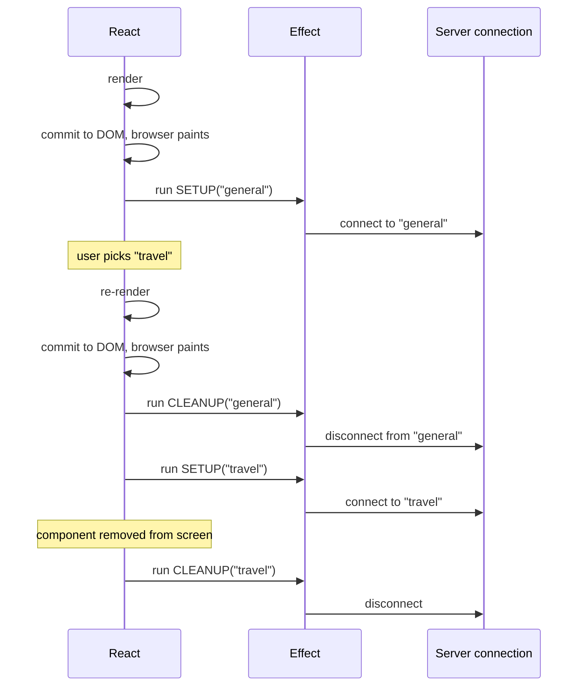

# Module 3: Effects, Refs & Custom Hooks


## Words you will meet in this module

| Word                 | Simple meaning                                                                                                   |
| -------------------- | ---------------------------------------------------------------------------------------------------------------- |
| **Side effect**      | Anything a component does besides computing JSX: network calls, timers, changing the page title.                 |
| **Effect**           | Code in `useEffect` that **synchronizes** your component with a system outside React.                            |
| **Setup / cleanup**  | The effect's body (connect, subscribe) and the function it returns (disconnect, unsubscribe).                    |
| **Dependency array** | The list of reactive values an effect reads. When one changes, the effect re-runs.                               |
| **Reactive value**   | A prop, a state value, or anything calculated from them inside the component.                                    |
| **Stale closure**    | A function that still holds old values from an earlier render.                                                   |
| **Race condition**   | Two async operations finish in the "wrong" order and the older result overwrites the newer one.                  |
| **Ref**              | A box (`{ current: ... }`) that survives re-renders. Changing it does **not** cause a re-render.                 |
| **Effect Event**     | A function (`useEffectEvent`) that reads the latest props and state but is not a dependency.                     |
| **Custom hook**      | Your own function, named `useSomething`, that reuses stateful logic between components.                          |
| **Rules of Hooks**   | Call hooks only at the top level of a component or another hook, never in loops, conditions or nested functions. |

## 3.1 Rendering vs. Side Effects

Module 1 said that render must be **pure**. But real apps must do impure things: fetch data, start timers, listen to the window, talk to a chart library, change `document.title`. Where do they go?

| Type of code                                                                                  | Where it goes              |
| --------------------------------------------------------------------------------------------- | -------------------------- |
| Calculate JSX from props and state                                                            | Render (the function body) |
| Do something **because the user did something** (click, submit)                               | **Event handler**          |
| Do something **because the component is on the screen** (keep in sync with an outside system) | **`useEffect`**            |

That last row is the whole purpose of `useEffect`: **synchronize with something outside React**. If there is no outside system involved, you probably do not need an effect (Topic 3.4).

## 3.2 `useEffect` Anatomy: Setup, Cleanup, Dependencies

### The shape

```jsx
useEffect(() => {
  // SETUP: runs after the component is on the screen
  const connection = createConnection(roomId);
  connection.connect();

  return () => {
    // CLEANUP: runs before the next setup, and when the component is removed
    connection.disconnect();
  };
}, [roomId]); // DEPENDENCIES: re-run when roomId changes
```

### Three forms of the dependency array

| Written as              | Runs                                                              | Typical use                       |
| ----------------------- | ----------------------------------------------------------------- | --------------------------------- |
| `useEffect(fn)`         | After **every** render                                            | Rare                              |
| `useEffect(fn, [])`     | After the **first** render only (and cleanup on removal)          | One-time setup: a global listener |
| `useEffect(fn, [a, b])` | After first render, and after any render where `a` or `b` changed | Syncing with props or state       |

### The timeline



The cleanup always closes **the effect it came from**, using the values from that render. This pairing is what keeps effects correct.

### The dependency array is not a choice

The dependency array **describes what your effect reads**. It is not a performance knob. Rule: **list every reactive value used inside the effect**. The `eslint-plugin-react-hooks` rule `exhaustive-deps` checks it for you. Do not silence it. If the deps feel wrong, the _effect_ is probably wrong (see Topics 3.4 and 3.5).

Not reactive (do not list): values defined **outside** the component, imports, the `setState` function (it is stable), and refs' `.current`.

### Common effects, done right

**Event listener:**

```jsx
useEffect(() => {
  function onResize() {
    setWidth(window.innerWidth);
  }
  window.addEventListener('resize', onResize);
  return () => window.removeEventListener('resize', onResize); // always clean up
}, []);
```

**Timer (use the updater form to avoid a stale closure):**

```jsx
function Clock() {
  const [seconds, setSeconds] = useState(0);

  useEffect(() => {
    const id = setInterval(() => setSeconds((s) => s + 1), 1000); // s, not `seconds`
    return () => clearInterval(id);
  }, []); // no dependency on `seconds` needed

  return <p>{seconds}s</p>;
}
```

If you wrote `setSeconds(seconds + 1)`, the closure would capture `seconds = 0` forever (a **stale closure**) and the timer would stick at 1.

**Updating something outside React:**

```jsx
useEffect(() => {
  document.title = `${unread} new messages`;
}, [unread]);
```

### StrictMode: why your effect runs twice in development

In development, `<StrictMode>` runs this sequence on mount: **setup → cleanup → setup**. It is a deliberate stress test: "can your component survive being unmounted and mounted again?" If your effect has proper cleanup, the extra cycle is invisible. If it does not, you see a bug, for example two connections or duplicated subscriptions.

```
 Dev (StrictMode):   setup → cleanup → setup
 Production:         setup
```

> Do **not** "fix" the double run by using a ref flag to skip the second call or by removing StrictMode. That hides the bug. Fix it by writing the **cleanup** that undoes the setup.

#### Interview traps

- "When does `useEffect` run?" **After** React commits the render to the DOM (and normally after the browser paints). Never during render.
- "What does the cleanup function do and when does it run?" It undoes the setup. It runs **before the effect re-runs** (with the old values) and when the component unmounts.
- "What happens with `[]` if the effect uses a prop?" It uses the **first render's** value forever (stale closure). The array must list everything the effect reads.
- "Why does my effect run twice?" StrictMode in development. It is a check, not a bug in React. Production runs once.
- "`useEffect` vs. `useLayoutEffect`?" `useLayoutEffect` runs **synchronously after DOM changes but before the browser paints**. Use it only to measure or adjust layout without a flicker. It blocks painting, so avoid it otherwise.

#### Tricky questions and answers

###### Q1 [SDE-2]: What does this component print over time?

```jsx
function Counter() {
  const [count, setCount] = useState(0);
  useEffect(() => {
    const id = setInterval(() => console.log(count), 1000);
    return () => clearInterval(id);
  }, []);
  return <button onClick={() => setCount(count + 1)}>{count}</button>;
}
```

**Answer:** It always prints `0`, no matter how many times you click. The effect ran once with `[]`, so its interval callback closed over `count = 0` from the first render. Fixes: add `count` to the dependencies (the interval is recreated on each change), or if you need the _latest_ value without re-subscribing, use `useEffectEvent` (Topic 3.5) or a ref.

###### Q2 [SDE-3]: Why does React run cleanup _before_ the next setup, rather than after?

**Answer:** So that the previous synchronization is fully torn down before the new one begins. For `roomId` changing from A to B, you must leave room A before joining room B, otherwise there is a moment where you are subscribed to both. Cleanup also receives the old render's values (a closure), so it knows exactly what to undo.

## 3.3 Fetching Data in an Effect (and Its Traps)

### The naive version

```jsx
function UserProfile({ userId }) {
  const [user, setUser] = useState(null);

  useEffect(() => {
    fetch(`/api/users/${userId}`)
      .then((res) => res.json())
      .then((data) => setUser(data));
  }, [userId]);

  if (!user) return <p>Loading...</p>;
  return <h2>{user.name}</h2>;
}
```

It looks fine and has a **race condition**. If `userId` goes `1 → 2` quickly and the request for `1` is slow, the response for `1` can arrive **after** the response for `2` and overwrite it. The screen shows user 1 while the page says user 2.

```
 request(1) ───────────────────────────────►  (slow) arrives last
 request(2) ─────────────►  arrives first
                                  screen: user 2 ... then flips to user 1  (WRONG)
```

### The fix: ignore stale responses and abort

```jsx
function UserProfile({ userId }) {
  const [state, setState] = useState({
    status: 'loading',
    user: null,
    error: null,
  });

  useEffect(() => {
    const controller = new AbortController();

    async function load() {
      try {
        setState({ status: 'loading', user: null, error: null });
        const res = await fetch(`/api/users/${userId}`, {
          signal: controller.signal,
        });
        if (!res.ok) throw new Error(`HTTP ${res.status}`);
        const user = await res.json();
        setState({ status: 'success', user, error: null });
      } catch (error) {
        if (error.name === 'AbortError') return; // expected on cleanup
        setState({ status: 'error', user: null, error });
      }
    }

    load();
    return () => controller.abort(); // cancel when userId changes
  }, [userId]);

  if (state.status === 'loading') return <p>Loading...</p>;
  if (state.status === 'error')
    return <p role="alert">Failed: {state.error.message}</p>;
  return <h2>{state.user.name}</h2>;
}
```

Three details to note: a single `status` value instead of three booleans (Module 2, principle #2), `res.ok` is checked because `fetch` does **not** reject on HTTP 404 or 500, and `AbortController` cancels the old request in the cleanup.

(An older alternative is an `ignore` flag set to `true` in the cleanup. It prevents the stale `setState` but does not cancel the network request.)

### What an effect still does not give you

Even the fixed version has no **caching**, no **deduplication** (two components asking for the same data make two requests), no **retry**, no **background refresh**, and the request starts only **after** the component renders, which creates **waterfalls** (parent loads, then child loads). This is why production apps use a data library or framework. Module 6 covers **TanStack Query**, and Part 3 (Next.js) shows server-side fetching.

#### Interview traps

- "Does `fetch` throw on a 404?" No. It only rejects on network failure. Check `res.ok`.
- "Can I make the effect callback `async`?" No. An effect must return nothing or a cleanup function, and an `async` function returns a Promise. Define an `async` function inside and call it.
- "Why is fetching in `useEffect` considered a last resort?" Race conditions, no cache, waterfalls, and extra loading flicker. Prefer a library or a framework's data loading.

## 3.4 You Might Not Need an Effect

Many effects in real code are **mistakes**: they run extra renders and cause bugs. Before writing `useEffect`, check this list. This topic is asked in senior interviews.

| You want to...                                         | Wrong (effect)                                   | Right                                                    |
| ------------------------------------------------------ | ------------------------------------------------ | -------------------------------------------------------- |
| Calculate a value from props or state                  | `useEffect(() => setFull(first + last), [...])`  | `const full = first + " " + last` in render              |
| Filter or sort a list                                  | Effect that sets `filtered` state                | `const visible = items.filter(...)` in render            |
| React to a **user action** (click, submit)             | State flag + effect that watches it              | Do the work **in the event handler**                     |
| Reset all state when a prop changes                    | Effect that calls `setX(initial)` for each field | Give the component a **`key`** (Module 2)                |
| Tell a parent something changed                        | Effect calling `onChange(value)`                 | Call `onChange` **in the same handler** that sets state  |
| Chain updates (A changes B changes C)                  | A chain of effects, each setting state           | Compute everything in one handler or in render           |
| Subscribe to an external store (browser API, library)  | Manual `useEffect` + `useState`                  | `useSyncExternalStore` (Topic 3.7)                       |
| Fetch data                                             | Raw `useEffect` + `fetch`                        | A data library (TanStack Query) or framework             |
| Send an analytics event because the user did something | Effect                                           | Event handler                                            |
| Run code **once at app start** (e.g. init a library)   | `useEffect(..., [])` in a component              | Module-level code, or `if (!didInit)` guard at top level |

### Example: the derived-state effect (very common bug)

```jsx
// BAD: two renders on every change, and one of them shows a wrong total
function Cart({ items }) {
  const [total, setTotal] = useState(0);
  useEffect(() => {
    setTotal(items.reduce((s, i) => s + i.price, 0));
  }, [items]);
  return <p>{total}</p>;
}

// GOOD
function Cart({ items }) {
  const total = items.reduce((s, i) => s + i.price, 0);
  return <p>{total}</p>;
}
```

### Example: handle the user's action in the handler

```jsx
// BAD: the form submit sets a flag, an effect notices the flag and POSTs
// GOOD:
function handleSubmit(e) {
  e.preventDefault();
  post('/api/register', form); // the cause is the submit event, so do it here
}
```

**The test:** ask "_why_ does this code need to run?" If the answer is "because the user clicked/typed/submitted", it belongs in a **handler**. If it is "because the component is displayed and must stay in sync with an outside system", it belongs in an **effect**.

#### Interview traps

- "Is `useEffect` for 'running code when state changes'?" Not in general. It is for **synchronizing with external systems**. Reacting to state with more state is almost always a derivation that belongs in render.
- "What's wrong with `useEffect(() => setX(f(y)), [y])`?" It causes an extra render, shows a stale value for one frame, and creates two sources of truth. Compute `f(y)` during render.

## 3.5 Stale Closures and `useEffectEvent`

### The dilemma

Sometimes an effect needs to **read** a value but should **not re-run** when that value changes.

```jsx
function ChatRoom({ roomId, theme }) {
  useEffect(() => {
    const connection = createConnection(roomId);
    connection.on('connected', () => showToast('Connected!', theme));
    connection.connect();
    return () => connection.disconnect();
  }, [roomId, theme]); // theme is read, so the linter demands it...
} // ...but now changing the theme reconnects to the chat room!
```

You do not want a reconnect when the _theme_ changes. Leaving `theme` out of the array would be a stale closure bug.

### The React 19.2 solution: `useEffectEvent`

`useEffectEvent` (stable in React 19.2) splits "reactive" logic from "event-like" logic. The function it returns always sees the **latest** props and state, but it is **not** a dependency.

```jsx
import { useEffect, useEffectEvent } from 'react';

function ChatRoom({ roomId, theme }) {
  const onConnected = useEffectEvent(() => {
    showToast('Connected!', theme); // always the latest theme
  });

  useEffect(() => {
    const connection = createConnection(roomId);
    connection.on('connected', () => onConnected());
    connection.connect();
    return () => connection.disconnect();
  }, [roomId]); // only roomId: reconnect only when the room changes
}
```

**Rules for Effect Events:**

- Call them **only from inside effects** (or other Effect Events).
- Do **not** pass them to other components or hooks, and do **not** put them in dependency arrays.
- Use them for "event-like" reactions (show a toast, log something). Do **not** use them to hide a dependency that _should_ trigger the effect.

Before React 19.2, people used a ref that was updated on every render to get the same effect. `useEffectEvent` is the supported version of that trick.

#### Interview traps

- "How do you read the latest value in an effect without re-running it?" `useEffectEvent` (React 19.2+). Before that, a ref holding the latest value.
- "Should I disable `exhaustive-deps` when the effect re-runs too often?" No. Restructure: derive less, split the effect, or use an Effect Event.
- "Object and function dependencies cause infinite loops. Why?" A new object or function is created on every render, so `Object.is` sees a "change" each time. Move it outside the component, inside the effect, or depend on primitive fields instead.

## 3.6 Refs: Escaping React to Touch the DOM

### The idea in plain words

A **ref** is a plain box, `{ current: value }`, that React keeps for you across renders. Changing `ref.current` does **not** re-render the component. Use refs for things that are _not_ part of the displayed output.

```jsx
import { useRef } from 'react';

const ref = useRef(0);
ref.current = ref.current + 1; // no re-render, and the value persists
```

### State vs. ref

| Question                     | `useState`               | `useRef`                                                                          |
| ---------------------------- | ------------------------ | --------------------------------------------------------------------------------- |
| Change triggers a re-render? | **Yes**                  | **No**                                                                            |
| Safe to read during render?  | Yes                      | **No** (do not read or write `.current` during render, except for initialization) |
| Value updated                | On the next render       | Immediately                                                                       |
| Use for                      | Anything shown on screen | Timer IDs, previous values, DOM nodes, "is mounted" flags                         |

### Use 1: Reaching a DOM node

```jsx
function SearchBox() {
  const inputRef = useRef(null);

  return (
    <>
      <input ref={inputRef} placeholder="Search..." />
      <button onClick={() => inputRef.current.focus()}>Focus</button>
    </>
  );
}
```

React sets `inputRef.current` to the real DOM node after the commit. Typical reasons: `focus()`, `scrollIntoView()`, measuring size, playing a `<video>`, connecting a non-React library (maps, charts).

### Use 2: Remembering a value without rendering

```jsx
function Stopwatch() {
  const [elapsed, setElapsed] = useState(0);
  const intervalRef = useRef(null); // the ID must survive renders, but is not shown

  function start() {
    intervalRef.current = setInterval(() => setElapsed((e) => e + 1), 1000);
  }
  function stop() {
    clearInterval(intervalRef.current);
  }
  return (
    <>
      <p>{elapsed}s</p>
      <button onClick={start}>Start</button>
      <button onClick={stop}>Stop</button>
    </>
  );
}
```

### React 19: `ref` is just a prop (no more `forwardRef`)

In React 19, function components receive `ref` as a **normal prop**. You no longer need `forwardRef`.

```jsx
// React 19
function FancyInput({ placeholder, ref }) {
  return <input className="fancy" placeholder={placeholder} ref={ref} />;
}

function Form() {
  const inputRef = useRef(null);
  return <FancyInput ref={inputRef} placeholder="Name" />;
}
```

`forwardRef` still works in React 19 but is no longer needed for new code. Older libraries and interviews still use it, so know both.

### Ref callbacks can return cleanup (React 19)

```jsx
<div
  ref={(node) => {
    const observer = new ResizeObserver(() => console.log(node.offsetWidth));
    observer.observe(node);
    return () => observer.disconnect(); // runs when the node is removed
  }}
/>
```

### `useImperativeHandle` (rare)

Lets a child expose a _limited_ set of methods to a parent through a ref (for example `focus()` and `clear()`), instead of the whole DOM node. Use it sparingly. Props and state are the normal way.

### `useLayoutEffect` vs. `useEffect`

| Hook              | Runs                                              | Use when                                                                                  |
| ----------------- | ------------------------------------------------- | ----------------------------------------------------------------------------------------- |
| `useEffect`       | After paint, asynchronously                       | Almost everything                                                                         |
| `useLayoutEffect` | After DOM update, **before paint**, synchronously | Measuring a DOM node and adjusting layout (tooltips, popovers) to avoid a visible flicker |

### Rules for refs

- Do **not** read or write `ref.current` **during render**. It breaks purity. Do it in handlers and effects.
- Do not use a ref to avoid state when the value _should_ appear on screen.

#### Interview traps

- "Why doesn't changing `ref.current` re-render?" By design. A ref is an escape hatch for values outside the render output. Use state if it affects what you display.
- "`useRef` vs. a module-level variable?" A module variable is shared by **all instances** and all renders. A ref is **per component instance**.
- "How do you pass a ref to a child in React 19?" As a normal prop named `ref`. In React 18 and earlier, you needed `forwardRef`.

## 3.7 Custom Hooks: Reusing Logic

### The Rules of Hooks (and why they exist)

1. Call hooks **only at the top level** of a component or custom hook. Not inside `if`, loops, nested functions, or after an early `return`.
2. Call hooks **only from React functions** (components and custom hooks).

**Why?** React identifies each hook by its **call order**. It has no names to match, only "the 1st `useState`, the 2nd `useState`, the 1st `useEffect`." If the order can change between renders (a hook inside an `if`), React connects the wrong stored value to the wrong hook.

```jsx
function Bad({ isLoggedIn }) {
  if (isLoggedIn) {
    const [name, setName] = useState(''); // WRONG: sometimes call #1, sometimes missing
  }
  const [theme, setTheme] = useState('light');
}
```

### What is a custom hook?

A **custom hook** is a function whose name starts with `use` and that calls other hooks. It shares **logic**, not **state**: each component that calls it gets its **own** independent state.

### Example 1: `useLocalStorage`

```jsx
import { useState, useEffect } from 'react';

export function useLocalStorage(key, initialValue) {
  const [value, setValue] = useState(() => {
    try {
      const raw = localStorage.getItem(key);
      return raw !== null ? JSON.parse(raw) : initialValue;
    } catch {
      return initialValue;
    }
  });

  useEffect(() => {
    try {
      localStorage.setItem(key, JSON.stringify(value));
    } catch {
      /* storage full or blocked */
    }
  }, [key, value]);

  return [value, setValue];
}

// usage
const [theme, setTheme] = useLocalStorage('theme', 'light');
```

### Example 2: `useDebounce`

```jsx
export function useDebounce(value, delay = 300) {
  const [debounced, setDebounced] = useState(value);

  useEffect(() => {
    const id = setTimeout(() => setDebounced(value), delay);
    return () => clearTimeout(id); // each keystroke cancels the previous timer
  }, [value, delay]);

  return debounced;
}
```

### Example 3: `useFetch` (combining Topic 3.3)

```jsx
export function useFetch(url) {
  const [state, setState] = useState({
    status: 'loading',
    data: null,
    error: null,
  });

  useEffect(() => {
    const controller = new AbortController();
    setState({ status: 'loading', data: null, error: null });

    fetch(url, { signal: controller.signal })
      .then((res) => {
        if (!res.ok) throw new Error(`HTTP ${res.status}`);
        return res.json();
      })
      .then((data) => setState({ status: 'success', data, error: null }))
      .catch((error) => {
        if (error.name !== 'AbortError')
          setState({ status: 'error', data: null, error });
      });

    return () => controller.abort();
  }, [url]);

  return state;
}
```

### Example 4: `useOnlineStatus` with `useSyncExternalStore`

When you need to read a value that lives **outside React** (browser API, a store) and re-render when it changes, `useSyncExternalStore` is the correct tool. It avoids the "tearing" problems that a hand-written effect can have during concurrent rendering.

```jsx
import { useSyncExternalStore } from 'react';

function subscribe(callback) {
  window.addEventListener('online', callback);
  window.addEventListener('offline', callback);
  return () => {
    window.removeEventListener('online', callback);
    window.removeEventListener('offline', callback);
  };
}

export function useOnlineStatus() {
  return useSyncExternalStore(
    subscribe,
    () => navigator.onLine, // client snapshot
    () => true, // server snapshot (for server rendering)
  );
}
```

State libraries like Zustand and Redux are built on this hook (Module 4).

### Guidelines for good custom hooks

| Do                                                                 | Do not                                                     |
| ------------------------------------------------------------------ | ---------------------------------------------------------- |
| Name it `useX`, and let the name say what it does                  | Create lifecycle-style wrappers like `useMount(fn)`        |
| Extract when **logic** is repeated or a component is too long      | Extract a hook that is just one `useState` with no meaning |
| Return what the caller needs (array for 2 values, object for more) | Return everything you have                                 |
| Keep each hook focused on one job                                  | Build one giant `useEverything`                            |

#### Interview traps

- "Do two components using the same custom hook share state?" No. Each call creates its own state. Hooks share **logic**. To share state, use Context or an external store (Module 4).
- "Why must a custom hook start with `use`?" So linters and React can recognize it and enforce the Rules of Hooks inside it.
- "Why can't hooks be called conditionally?" React tracks them by call order, so the order must be identical on every render.

#### Tricky questions and answers

###### Q3 [SDE-2]: Your `useFetch(url)` is called with `useFetch({ page, limit })` (an object built inline) and fires in an infinite loop. Why?

**Answer:** The object is created fresh on every render, so `Object.is(prev, next)` is false every time. The effect depends on it, so it re-runs after every render. Each run sets state, which re-renders and creates a new object again. Pass **primitives** (`page`, `limit`) or build a stable URL string, or memoize the object. A data library with serialized query keys avoids the problem entirely.

###### Q4 [SDE-3]: Implement "run once on mount" safely, considering StrictMode.

**Answer:** First ask whether it is truly "once per app load" (for example SDK initialization). If so, run it at **module level**, outside any component, or behind a top-level guard flag. If it is "connect when this component shows," then it is **not** a once-only operation: write setup **and** cleanup, and make it idempotent. StrictMode's setup → cleanup → setup is a test of exactly that. Never skip the second run with a ref flag. That hides the missing cleanup.

###### Q5 [SDE-2]: When would you choose `useRef` over `useState` for a timer ID?

**Answer:** The ID is needed to `clearInterval` later, but showing it on the screen is meaningless, and changing it should not re-render. A ref holds it across renders at no render cost. If it were state, setting it would trigger a pointless re-render.

## Hands-On Lab: Search-As-You-Type with Debounce

```
1. Create a SearchProducts component with a controlled input (state: query).
2. Write useDebounce (Topic 3.7) and use: const debounced = useDebounce(query, 400)
3. Write an effect that fetches
   https://dummyjson.com/products/search?q=<debounced>
   - Only when `debounced` is not empty
   - With AbortController, and cleanup that aborts
   - A single `status` state: "idle" | "loading" | "success" | "error"
   - Check res.ok
4. Render: loading text, error message, empty state ("No results"), and the list.
   Use product.id as the key.
5. Add a ref to the input and focus it when the component mounts (useEffect + ref),
   and when the user clicks a "Clear" button.
6. Extract the fetch logic into useFetch(url) and refactor the component to use it.
7. Open the Network tab. Type "phone" quickly. How many requests were sent
   with and without the debounce? Are old ones cancelled?
```

Questions to answer for yourself:

- With StrictMode on, how many network calls do you see for the first fetch in dev? Why is that harmless here?
- Remove the abort. Type fast and try to cause a wrong result. Can you reproduce the race condition? (Throttle the network in DevTools to make it easier.)
- Which parts of this component are derived values rather than state?

## Module 3 Cheat Sheet

| Concept                  | One-line interview answer                                                                         |
| ------------------------ | ------------------------------------------------------------------------------------------------- |
| Effect                   | Synchronizes a component with an **external** system. Runs after commit.                          |
| Dependency array         | Lists every reactive value the effect reads. Not a performance toggle.                            |
| `[]` vs. none vs. `[a]`  | Mount only / every render / when `a` changes.                                                     |
| Cleanup                  | Undoes setup. Runs before the next setup and on unmount, with the old render's values.            |
| StrictMode in dev        | Setup → cleanup → setup, to prove your effect is resilient. Fix the cleanup, not the symptom.     |
| Stale closure            | A function holding old values. Fix with correct deps, updater functions, or `useEffectEvent`.     |
| Race condition in fetch  | Older response overwrites newer. Fix with `AbortController` (or an ignore flag) in cleanup.       |
| `fetch` and errors       | Does not throw on 404/500. Check `res.ok`.                                                        |
| Do not use an effect for | Derived data, user-action logic, resetting state (use `key`), notifying parents, chained updates. |
| `useEffectEvent`         | (React 19.2) Reads latest props and state from an effect without being a dependency.              |
| `useRef`                 | Mutable box that persists and does **not** re-render. For DOM nodes, timer IDs, previous values.  |
| `ref` in React 19        | A normal prop on function components. `forwardRef` is no longer needed.                           |
| `useLayoutEffect`        | Runs before paint. Only for measuring and adjusting layout to avoid flicker.                      |
| Rules of Hooks           | Top level only, in components or custom hooks. React identifies hooks by call order.              |
| Custom hook              | A `useX` function that reuses **logic**. Each caller gets its own state.                          |
| `useSyncExternalStore`   | The right way to subscribe to an external store or browser API. No tearing.                       |

---

## Browse Series

| #   | Module                                        | Read more                                                       |
| --- | --------------------------------------------- | --------------------------------------------------------------- |
| 1   | **Getting Started, JSX & Components**         | [Open Module 1](reactjs/getting-started-jsx-and-components)       |
| 2   | **State, Events & Forms**                     | [Open Module 2](reactjs/state-events-and-forms)                   |
| 3   | **Reducers, Context & App-Wide State**        | [Open Module 4](reactjs/reducers-context-and-app-state)           |
| 4   | **How React Renders & Performance**           | [Open Module 5](reactjs/rendering-performance-and-suspense)       |
| 5   | **Routing, Data Fetching & React 19 Actions** | [Open Module 6](reactjs/routing-data-fetching-and-actions)        |
| 6   | **Testing, TypeScript, Security & Capstone**  | [Open Module 7](reactjs/testing-typescript-security-and-capstone) |
