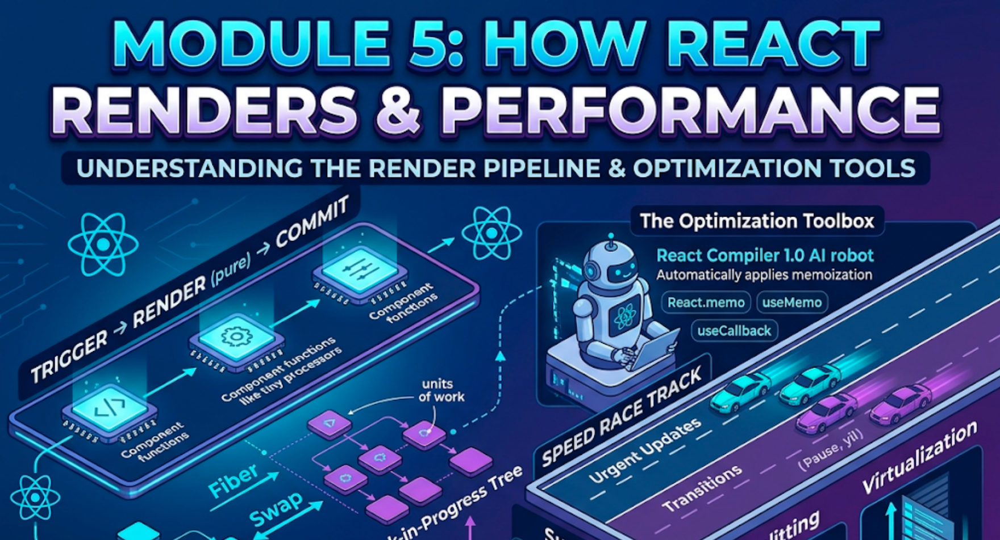

# Module 5: How React Renders & Performance



## Words you will meet in this module

| Word                     | Simple meaning                                                                                  |
| ------------------------ | ----------------------------------------------------------------------------------------------- |
| **Render phase**         | React calls your components to work out what the UI should look like. Pure. No DOM changes yet. |
| **Commit phase**         | React applies the calculated changes to the real DOM. Synchronous.                              |
| **Reconciliation**       | The process of comparing the new element tree with the old one to find the minimum changes.     |
| **Fiber**                | React's internal data structure: one "unit of work" per component, linked into a tree.          |
| **Concurrent rendering** | React can start a render, pause it, work on something more urgent, and resume or discard it.    |
| **Referential equality** | Two values are "equal" if they are the **same object in memory** (`Object.is`).                 |
| **Memoization**          | Remembering a result so you can skip recalculating it when the inputs have not changed.         |
| **Transition**           | An update marked as non-urgent, so typing and clicking stay responsive.                         |
| **Suspense**             | A boundary that shows a fallback while something inside is still loading.                       |
| **Code splitting**       | Cutting your bundle into pieces and loading each only when needed.                              |
| **Virtualization**       | Rendering only the rows visible on screen in a very long list.                                  |
| **Core Web Vitals**      | Google's user-experience metrics: LCP (loading), INP (responsiveness), CLS (visual stability).  |

## 5.1 The Render Pipeline: Trigger, Render, Commit

### The restaurant analogy

React works like a restaurant. **Trigger** is the order being placed. **Render** is the kitchen preparing the dish (React calls your components). **Commit** is the waiter putting the dish on the table (React updates the real DOM). The kitchen can prepare a dish and then change its mind; the waiter always delivers in one go.

### Step 1: Trigger

A render is triggered in two ways:

1. **Initial render:** `createRoot(domNode).render(<App />)`.
2. **Re-render:** a state update (`setState`, `dispatch`) in a component, or a parent re-render.

### Step 2: Render (calculate)

React calls your component functions, top-down, and collects the JSX they return. On re-render it starts from the component whose state changed, and **recursively renders every child**. This phase must be **pure** (Module 1, Topic 1.7). Nothing is written to the screen yet.

### Step 3: Commit (apply)

React now touches the real DOM:

- **Initial render:** creates all the DOM nodes (`appendChild`).
- **Re-render:** changes **only the DOM nodes that differ** between the old and new trees.

Then, in order: refs are attached, `useLayoutEffect` callbacks run, the browser **paints**, and then `useEffect` callbacks run.

```
 TRIGGER            RENDER (pure)              COMMIT (mutates DOM)           AFTER
 ───────            ─────────────              ────────────────────           ─────
 setState()  ──►  call components      ──►   update changed DOM nodes  ──►  useLayoutEffect
 or parent        build new element          attach / detach refs            browser paints
 re-render        tree, compare to old                                       useEffect
```

### Key facts

| Fact                                                | Consequence                                                                              |
| --------------------------------------------------- | ---------------------------------------------------------------------------------------- |
| **Rendering is not the same as updating the DOM**   | A component can render (run its function) and cause **zero** DOM changes. That is cheap. |
| Render always produces a **new** element tree       | React diffs it against the previous one.                                                 |
| Updates in one event are **batched**                | One render for many `setState` calls.                                                    |
| Render may run **more than once** or be thrown away | Why it must be pure.                                                                     |
| Commit is **synchronous** and cannot be interrupted | The DOM is never left half-updated.                                                      |

#### Interview traps

- "Does a re-render mean the DOM is updated?" No. Render calculates. Commit updates, and only for differences. A re-render with an identical output touches nothing.
- "Does `setState` re-render the component immediately?" It **schedules** a re-render. Multiple calls in one event are batched.
- "In which phase do effects run?" After commit (and, for `useEffect`, normally after paint). Never during render.

## 5.2 Reconciliation, Keys and Fiber

### Reconciliation: how React finds what changed

Comparing two arbitrary trees optimally is expensive (roughly O(n³)). React uses **two heuristics** that make it O(n):

1. **Elements of different types produce different trees.** If `<div>` becomes `<section>`, or `<Counter>` becomes `<Profile>`, React **destroys** the old subtree (state lost) and builds the new one.
2. **`key` identifies children across renders** in a list.

At each position React compares old and new element:

| Old → New at same position          | What React does                                                       |
| ----------------------------------- | --------------------------------------------------------------------- |
| Same **type** (`<div>` → `<div>`)   | Keep the DOM node. Update changed props. **Recurse into children.**   |
| Same component type                 | Keep the instance (**state preserved**). Re-render with new props.    |
| Different type                      | **Unmount** the old subtree (state and DOM destroyed). Mount the new. |
| List child with the same key        | Same item: update it, and move its DOM node if the order changed.     |
| List child with a new / missing key | Mount new / unmount old.                                              |

### Why keys matter: a visual walk-through

List of `[A, B, C]` with an uncontrolled input in each row. The user types "x" into row B, then deletes row A.

```
 key = INDEX                                  key = ID
 ───────────                                  ────────
 Before:  0:A   1:B("x")  2:C                 Before:  a:A   b:B("x")  c:C
 After:   0:B   1:C                           After:   b:B   c:C

 React compares by key:                       React compares by key:
  key 0: was A, now B  → reuse A's DOM         key a: gone      → remove A's DOM
         (keeps A's typed text!)               key b: still here → keep B's DOM ✔ ("x" stays)
  key 1: was B, now C  → reuse B's DOM         key c: still here → keep C's DOM ✔
         (so "x" now sits in C's row ✘)
  key 2: gone → remove last DOM
```

With index keys React thinks "the item at slot 0 changed its data" rather than "A was removed." State and DOM nodes stick to the **slot**, not the **item**. With ID keys, they stick to the item.

**Changing a key on purpose resets a component:** `<Form key={userId} />` throws away and recreates `Form` when `userId` changes.

### Fiber and concurrent rendering (the architecture)

Before React 16, rendering was a deep recursive call that could not be stopped, which froze the page on big updates. **Fiber** (React 16+) rewrote the engine.

- A **fiber** is a plain object for one component: its type, props, state, pointers to parent, first child and next sibling, and the effects to apply.
- The work is a **linked list of fibers** that React can walk **one at a time**. After each unit, it can check "is something more urgent waiting?"
- React keeps **two trees**: the **current** tree (what is on screen) and a **work-in-progress** tree it builds in the background. When the work-in-progress is finished, React **swaps** them (that is the commit).

Because the render phase just builds a work-in-progress tree and nothing visible changes, React can **pause**, **resume**, **restart** or **abandon** it. This is **concurrent rendering**. It is what makes `useTransition`, `useDeferredValue` and Suspense possible (Topics 5.6 and 5.7).

```
 current tree  ──(on screen)

 work-in-progress tree ──(building in background; can pause or throw away)
        │
        └── finished ──► COMMIT: swap trees, apply DOM changes in one go
```

> Concurrent rendering is **opt-in per update**. A normal `setState` is still urgent and renders without yielding. Only updates marked as transitions, or deferred values, are interruptible.

#### Interview traps

- "How does React know what changed?" It builds a new element tree, diffs it against the previous one using type and key heuristics, and commits only the differences.
- "What is the virtual DOM, really?" It is the tree of elements (and internally of fibers). It is a _description_, not a faster DOM.
- "Why does changing the component type reset state?" A different type at the same position means a different component. React unmounts the old one, so its state is destroyed.

## 5.3 When Do Components Re-render?

A component re-renders when:

1. **Its own state changes** (`setState`, `dispatch`).
2. **Its parent re-renders** (even if the props it passes are identical).
3. **A context it reads changes** (Module 4).

A change in **props alone** is not a trigger. Props only change _because_ a parent re-rendered.

### The surprise: the parent re-renders its children

```jsx
function Parent() {
  const [count, setCount] = useState(0);
  return (
    <>
      <button onClick={() => setCount(count + 1)}>{count}</button>
      <ExpensiveChild /> {/* re-renders on EVERY click, even with no props */}
    </>
  );
}
```

`ExpensiveChild` takes no props, yet it re-renders. When `Parent` renders, it creates a new `<ExpensiveChild />` element, and React renders it. Skipping this is what `memo` (Topic 5.4) is for.

### What does NOT trigger a re-render

- Mutating a variable, a ref (`ref.current = ...`), or state in place.
- A child's state changing (it re-renders the child, not its parent).
- Props changing without a parent render.

### Measure before you worry

Re-rendering is usually cheap. React is fast at calling functions and diffing small trees. You have a problem only when:

- A render is **slow** (heavy calculation, thousands of elements), or
- Something **visible lags**: typing feels slow, scrolling janks.

Find out **with a tool**:

| Tool                                                           | What it shows                                                      |
| -------------------------------------------------------------- | ------------------------------------------------------------------ |
| React DevTools → **Profiler**                                  | Which components rendered, why, and how long each took.            |
| DevTools settings → "Highlight updates when components render" | Flashes a border around components as they re-render.              |
| Chrome DevTools → **Performance** tab                          | Real main-thread cost. React 19.2 adds React-specific tracks here. |
| `console.time` / `performance.now()`                           | Quick timing of a single calculation.                              |

## 5.4 The Optimization Toolbox

Apply in this order. Each step is cheaper and safer than the next.

### Step 1: Fix the structure first (free, no hooks)

**a) Move state down.** Keep state in the smallest component that needs it.

```jsx
// SLOW: typing re-renders the expensive tree
function Page() {
  const [text, setText] = useState('');
  return (
    <>
      <input value={text} onChange={(e) => setText(e.target.value)} />
      <ExpensiveTree />
    </>
  );
}

// FAST: the state now lives in a tiny component
function Page() {
  return (
    <>
      <SearchInput /> {/* owns `text` */}
      <ExpensiveTree /> {/* never re-renders from typing */}
    </>
  );
}
```

**b) Lift content up (children pattern).** Elements passed as `children` are created by a _higher_ component. If the wrapper re-renders because of its own state, the `children` element is the **same object** as before, and React skips it.

```jsx
function ColorWrapper({ children }) {
  const [color, setColor] = useState('red');
  return (
    <div style={{ color }}>
      <input value={color} onChange={(e) => setColor(e.target.value)} />
      {children} {/* same reference: not re-rendered when color changes */}
    </div>
  );
}

<ColorWrapper>
  <ExpensiveTree />
</ColorWrapper>;
```

### Step 2: `React.memo`: skip a component if props are equal

```jsx
import { memo } from 'react';

const ProductRow = memo(function ProductRow({ product, onSelect }) {
  console.log('render', product.id);
  return <li onClick={() => onSelect(product.id)}>{product.name}</li>;
});
```

`memo` compares each prop with `Object.is`. If **all** props are referentially equal to last time, React **skips rendering** that component.

### Step 3: Referential equality: why `memo` often "doesn't work"

```jsx
function Parent() {
  const [n, setN] = useState(0);
  const handleSelect = (id) => console.log(id); // NEW function every render
  const style = { color: 'red' }; // NEW object every render
  return <ProductRow product={p} onSelect={handleSelect} style={style} />;
  // memo sees onSelect and style as "changed" every time: no skipping
}
```

Functions and objects created in the component body are **new** on every render. To keep them stable for a memoized child:

```jsx
const handleSelect = useCallback((id) => console.log(id), []); // same function between renders
const style = useMemo(() => ({ color: 'red' }), []); // same object between renders
```

| Hook / API              | Remembers              | Use when                                                                                                       |
| ----------------------- | ---------------------- | -------------------------------------------------------------------------------------------------------------- |
| `memo(Component)`       | A component's render   | The component is expensive and often receives the **same** props                                               |
| `useMemo(fn, deps)`     | A **calculated value** | The calculation is genuinely slow, **or** the value is passed to a `memo` child / used in an effect dependency |
| `useCallback(fn, deps)` | A **function**         | The function is passed to a `memo` child, or is an effect dependency                                           |

`useCallback(fn, deps)` is just `useMemo(() => fn, deps)`.

### When memoization is pointless (and costs you)

- The child is **not** wrapped in `memo`. `useCallback` on a prop to a non-memo child does nothing useful.
- The calculation is cheap (a few ms or less). Memoization has its own cost: storing the value and comparing dependencies.
- The dependencies change on **every** render anyway.
- You memoize _everything_ "just in case." This clutters code and hides real problems.

```jsx
// Worth it: a genuinely heavy calculation (filter + sort 20,000 rows)
const visible = useMemo(
  () => rows.filter((r) => r.name.includes(query)).sort(byDate),
  [rows, query],
);
```

Rule of thumb: measure first. If a calculation takes more than about 1 ms and you re-run it often with the same inputs, consider `useMemo`. Otherwise do not.

### The `key` trick for expensive resets

Sometimes the cheapest fix for "this component got into a bad state" is to remount it with a new `key`, instead of writing sync logic.

#### Interview traps

- "Does `useMemo` guarantee the value is cached?" No. It is a **performance hint**. React may discard cached values (for example to free memory), so your code must still be correct if the function re-runs.
- "Why does `React.memo` not help when I pass an inline arrow function?" A new function reference each render fails the `Object.is` check. Stabilize with `useCallback` or avoid the prop.
- "Is `useCallback` a performance optimization by itself?" No. It only pays off when the _receiver_ (a `memo` component or an effect dependency) compares by reference.
- "What does `memo` do about context?" Nothing. A memoized component still re-renders when a context it reads changes.

#### Tricky questions and answers

###### Q1 [SDE-2]: A list of 5,000 `<Row>` components lags when you type in a search box above it. Walk through your debugging and fixes.

**Answer:** (1) Profile with the React DevTools Profiler to confirm that all rows re-render on each keystroke. (2) The input state lives in the same component as the list, so every keystroke re-renders every row. Fix #1: **move the input state down** or **debounce / defer** the value used for filtering (`useDeferredValue`). (3) Wrap `Row` in `memo` and make sure its props are stable (stable `key`, `useCallback` for handlers). (4) If the DOM itself is heavy, **virtualize** the list so only visible rows exist. (5) Enable the **React Compiler** to auto-memoize. Verify each step with the Profiler.

###### Q2 [SDE-2]: `memo(Child)` still re-renders. List the possible reasons.

**Answer:** (a) A prop is a new object, array or function each render. (b) `children` is passed as JSX, which is a new element each render. (c) The component reads a context that changed. (d) It has its own state changing. (e) A prop genuinely changed. Check in the Profiler, which can show "why did this render."

## 5.5 React Compiler 1.0: Memoization Without the Hooks

### The idea in plain words

The **React Compiler** is a build-time tool that reads your components and automatically adds the memoization you would otherwise write by hand with `memo`, `useMemo` and `useCallback`. It reached **stable 1.0** and is recommended for new apps.

```jsx
// You write this:
function ProductList({ products, query }) {
  const visible = products.filter((p) => p.name.includes(query));
  return (
    <ul>
      {visible.map((p) => (
        <Row key={p.id} product={p} />
      ))}
    </ul>
  );
}
// The compiler memoizes `visible` and the JSX for you, only recomputing when
// `products` or `query` actually change. No useMemo in your source.
```

It can even memoize things hooks cannot, such as values computed after an early `return`.

### Enabling it in a Vite project

```bash
npm install -D babel-plugin-react-compiler
```

```js
// vite.config.js
import { defineConfig } from 'vite';
import react from '@vitejs/plugin-react';

export default defineConfig({
  plugins: [
    react({
      babel: { plugins: ['babel-plugin-react-compiler'] },
    }),
  ],
});
```

> The exact Vite setup has changed between plugin versions. Follow the **React Compiler installation page on react.dev** for the current recipe. Frameworks like Next.js expose it as a simple config option.

### What the compiler needs from you: the Rules of React

The compiler assumes your code follows the rules from Modules 1 to 3. If a component breaks them, it **skips** that component (silently, unless you use the linter).

| Rule                                                     | You already know it as |
| -------------------------------------------------------- | ---------------------- |
| Components and hooks are **pure**                        | Module 1, Topic 1.7    |
| Never **mutate** props, state, or values passed to hooks | Module 2, Topic 2.3    |
| Rules of Hooks (top level, same order)                   | Module 3, Topic 3.7    |
| Do not read or write `ref.current` **during render**     | Module 3, Topic 3.6    |

Use `eslint-plugin-react-hooks` (its recent versions include compiler-powered rules). Fix violations rather than ignoring them.

### Escape hatches and guidance

- `"use no memo";` as the first line of a function **opts that component out**, useful when debugging.
- You can still use `useMemo` and `useCallback` by hand. They are sometimes **needed for precise control**, for example to guarantee a stable dependency of an effect.
- You can adopt it **gradually**: enable it for a directory or for specific files first.
- For an **existing** app, a safe first step is to enable the linter, fix violations, then turn on the compiler.

### Impact on how you write code

| Before the compiler                            | With the compiler                                       |
| ---------------------------------------------- | ------------------------------------------------------- |
| Wrap handlers in `useCallback` "just in case"  | Write plain functions                                   |
| Wrap values in `useMemo` for stable references | Write plain expressions                                 |
| Wrap children in `memo`                        | Usually unnecessary                                     |
| Know _where_ to memoize                        | Know the **Rules of React**, and measure the exceptions |

You still need to understand referential equality, renders and keys. The compiler automates memoization. It does not fix an architecture with too much state at the top.

#### Interview traps

- "Does the React Compiler make `useMemo` obsolete?" For most code, yes: you rarely write it. It stays useful as an explicit escape hatch (stable effect deps, expensive values you want guaranteed).
- "How does it know when to recompute?" It analyzes data flow at build time and memoizes each value by the inputs it reads, like automatic, fine-grained `useMemo`.
- "What happens if my component mutates props?" The compiler cannot safely optimize it and skips it. The linter points to the violation.

## 5.6 Concurrent Rendering: `useTransition` and `useDeferredValue`

### The problem

Typing into a box that filters 10,000 rows. Each keystroke triggers a heavy render. The input feels frozen, because the slow render blocks the urgent update (showing the typed letter).

### The idea: urgent vs. non-urgent updates

| Urgent                     | Non-urgent (transition)                              |
| -------------------------- | ---------------------------------------------------- |
| Typing, clicking, pressing | Showing filtered results, switching tabs, navigating |
| Must respond instantly     | Can lag slightly, and may be **interrupted**         |

### `useTransition`: mark a state update as non-urgent

```jsx
import { useState, useTransition } from 'react';

function Tabs() {
  const [tab, setTab] = useState('home');
  const [isPending, startTransition] = useTransition();

  function selectTab(next) {
    startTransition(() => {
      setTab(next); // this update is a transition: interruptible
    });
  }

  return (
    <>
      <button onClick={() => selectTab('posts')}>Posts</button>
      {isPending && <span>Loading...</span>}
      <TabContent tab={tab} /> {/* the slow one */}
    </>
  );
}
```

React renders the new tab in the **background**. If the user clicks another tab meanwhile, React **abandons** the old render and starts the new one. The old UI stays interactive instead of freezing, and `isPending` lets you show a gentle indicator.

### `useDeferredValue`: use an older value while the new one catches up

Use it when you do not control where the state is set (a prop, or a controlled input).

```jsx
import { useState, useDeferredValue, memo } from 'react';

function SearchPage() {
  const [query, setQuery] = useState('');
  const deferredQuery = useDeferredValue(query); // lags behind `query`
  const isStale = query !== deferredQuery;

  return (
    <>
      <input value={query} onChange={(e) => setQuery(e.target.value)} />{' '}
      {/* instant */}
      <div style={{ opacity: isStale ? 0.6 : 1 }}>
        <SlowList query={deferredQuery} /> {/* catches up */}
      </div>
    </>
  );
}

const SlowList = memo(function SlowList({ query }) {
  /* heavy render */
});
```

`SlowList` must be wrapped in `memo` (or compiler-optimized). Otherwise it re-renders during the urgent pass too, and the deferral gains nothing.

### Debounce vs. transition vs. deferred value

| Tool                    | What it does                                          | Good for                                                          |
| ----------------------- | ----------------------------------------------------- | ----------------------------------------------------------------- |
| **Debounce** (Module 3) | Waits until the user stops, then runs once            | **Network requests** (fewer calls)                                |
| **`useTransition`**     | Renders a state update at low priority, interruptible | You own the `setState`; UI work (tabs, navigation)                |
| **`useDeferredValue`**  | Renders with an old value first, then the new one     | You receive the value (prop/input) and heavy render depends on it |

Transitions and deferral reduce **render blocking**. They do not reduce network calls. Use both ideas together if needed.

#### Interview traps

- "`useTransition` vs. debounce?" Debounce delays _when_ code runs. A transition changes _priority_ and makes rendering interruptible. They solve different problems.
- "Does `startTransition` make slow code fast?" No. The work still happens. The UI just stays responsive meanwhile, and stale renders are dropped.
- "Can a transition show the new data faster?" No, but it prevents the old UI from being replaced by a Suspense fallback while new content loads (with Suspense, the old content stays on screen).

## 5.7 Suspense, Code Splitting, Error Boundaries and `<Activity>`

### Code splitting with `lazy`

By default Vite bundles all your code into one big file. Users download code for pages they never visit. **Code splitting** loads parts on demand.

```jsx
import { lazy, Suspense } from 'react';

const AdminPanel = lazy(() => import('./AdminPanel.jsx')); // top-level, never inside a component

function App({ isAdmin }) {
  return (
    <Suspense fallback={<p>Loading admin tools...</p>}>
      {isAdmin && <AdminPanel />}
    </Suspense>
  );
}
```

`import()` returns a promise, and Vite emits `AdminPanel` as a **separate JS file** downloaded when first rendered. The module needs a `default` export.

The best split points are **routes** (Module 6) and heavy, rarely used features (rich text editor, charts, PDF export).

### `Suspense`: declare the loading state

`<Suspense fallback={...}>` shows the fallback while **any component inside "suspends"**. A component suspends when it is:

- a `lazy` component whose code has not loaded,
- reading a promise with `use(promise)` (Module 6),
- using a Suspense-enabled data library (TanStack Query's `useSuspenseQuery`, framework loaders).

```jsx
<Suspense fallback={<PageSkeleton />}>
  <Header />
  <Suspense fallback={<CommentsSkeleton />}>
    {' '}
    {/* nested: only this part shows a skeleton */}
    <Comments />
  </Suspense>
</Suspense>
```

Place boundaries where a **partial loading state makes sense** (a section, a card), not around every tiny component. Nested boundaries let the page appear progressively. Combined with `useTransition`, navigating keeps the **old screen visible** until the new one is ready, instead of flashing a fallback.

### Error boundaries

A render error anywhere in the tree would otherwise unmount the **whole app** (blank white screen). An **error boundary** catches errors in its subtree and shows a fallback.

```bash
npm install react-error-boundary
```

```jsx
import { ErrorBoundary } from 'react-error-boundary';

<ErrorBoundary
  fallbackRender={({ error, resetErrorBoundary }) => (
    <div role="alert">
      <p>Something went wrong: {error.message}</p>
      <button onClick={resetErrorBoundary}>Try again</button>
    </div>
  )}
  onError={(error, info) => reportToMonitoring(error, info)}
>
  <Dashboard />
</ErrorBoundary>;
```

Error boundaries are still written as **class components** in React itself (`getDerivedStateFromError`, `componentDidCatch`). The library wraps that for you.

**They do not catch:** errors in **event handlers**, in **async code** (`setTimeout`, promises), or on the server. Use `try / catch` there. In React 19 you can also pass `onCaughtError` and `onUncaughtError` to `createRoot` for central error reporting.

### `<Activity>` (React 19.2): hide UI without losing its state

Conditional rendering (`{show && <Tab />}`) **destroys** state when hidden. Hiding with CSS keeps state but keeps effects running and the tree interactive for screen readers. `<Activity>` does it properly.

```jsx
import { Activity } from 'react';

function Tabs({ active }) {
  return (
    <>
      <Activity mode={active === 'inbox' ? 'visible' : 'hidden'}>
        <Inbox /> {/* state preserved when hidden */}
      </Activity>
      <Activity mode={active === 'drafts' ? 'visible' : 'hidden'}>
        <Drafts />
      </Activity>
    </>
  );
}
```

When `mode="hidden"`: the DOM is hidden, **effects are cleaned up** (so no background subscriptions), React **keeps the state**, and updates are processed at low priority. It can also **pre-render** a likely next screen in the background. Use it for tab panels, wizards and back navigation where users expect to find things as they left them.

| Approach            | State when hidden | Effects when hidden | Cost when hidden          |
| ------------------- | ----------------- | ------------------- | ------------------------- |
| `{show && <X />}`   | **Lost**          | Cleaned up          | None (not mounted)        |
| CSS `display: none` | Kept              | **Still running**   | Full re-renders continue  |
| `<Activity hidden>` | **Kept**          | Cleaned up          | Low-priority updates only |

#### Interview traps

- "Why use `lazy`?" To split the bundle so the initial page loads less JavaScript. It needs `Suspense` above it.
- "Where do you put Suspense boundaries?" Around meaningful chunks of UI that can load independently. Nested, to reveal the page progressively.
- "Do error boundaries catch errors in event handlers?" No. Use `try / catch` there. They catch render, lifecycle and constructor errors in their subtree.

## 5.8 Big Lists, Assets and the Bundle

### Virtualize long lists

Rendering 10,000 DOM nodes is slow no matter how well you memoize. **Virtualization** renders only the visible rows (plus a few extra) and swaps them as you scroll.

```jsx
import { useVirtualizer } from '@tanstack/react-virtual';

function VirtualList({ items }) {
  const parentRef = useRef(null);
  const rowVirtualizer = useVirtualizer({
    count: items.length,
    getScrollElement: () => parentRef.current,
    estimateSize: () => 40,
  });

  return (
    <div ref={parentRef} style={{ height: 400, overflow: 'auto' }}>
      <div
        style={{ height: rowVirtualizer.getTotalSize(), position: 'relative' }}
      >
        {rowVirtualizer.getVirtualItems().map((v) => (
          <div
            key={v.key}
            style={{
              position: 'absolute',
              top: 0,
              transform: `translateY(${v.start}px)`,
              height: v.size,
            }}
          >
            {items[v.index].name}
          </div>
        ))}
      </div>
    </div>
  );
}
```

Alternatives: `react-window`, or **pagination** and **infinite scroll** to avoid huge lists at all.

### Quick wins checklist

| Area            | Action                                                                                                                                                                     |
| --------------- | -------------------------------------------------------------------------------------------------------------------------------------------------------------------------- |
| **Bundle size** | Analyze with `rollup-plugin-visualizer`. Split routes with `lazy`. Replace heavy libraries (e.g. use `date-fns` or `dayjs` instead of `moment`). Import only what you use. |
| **Images**      | Set `width` and `height` (prevents layout shift), `loading="lazy"` below the fold, modern formats (WebP / AVIF), correctly sized files.                                    |
| **Fonts**       | Self-host, `font-display: swap`, subset.                                                                                                                                   |
| **Network**     | Cache and dedupe requests (TanStack Query), compress with gzip/Brotli, serve from a CDN ([Caching and CDN](system-design/caching-and-cdn)).                                |
| **State**       | Keep state local, avoid one giant context, use selectors in stores.                                                                                                        |
| **Renders**     | Move state down, children pattern, React Compiler, `memo` where measured.                                                                                                  |
| **Inputs**      | `useDeferredValue` / transitions for heavy results, debounce for network calls.                                                                                            |

### Core Web Vitals in one table

| Metric  | Measures                            | Good target | Common React fixes                                               |
| ------- | ----------------------------------- | ----------- | ---------------------------------------------------------------- |
| **LCP** | How fast the main content appears   | ≤ 2.5 s     | Smaller bundle, preload hero image, server rendering             |
| **INP** | How fast the page responds to input | ≤ 200 ms    | Transitions, split heavy event-handler work, less main-thread JS |
| **CLS** | How much the layout jumps           | ≤ 0.1       | Reserve space for images and async content                       |

Single-page apps have a natural weakness in LCP, because the browser downloads JavaScript before anything shows. That is a key reason for server rendering in Part 3 (Next.js).

#### Tricky questions and answers

###### Q3 [SDE-2]: You navigate between two tabs and the content flashes a spinner each time, even though it loads in 100 ms. How do you improve it?

**Answer:** The tab change is an urgent update that causes the new content to suspend, so the nearest `Suspense` boundary swaps to its fallback. Mark the navigation as a **transition** (`startTransition(() => setTab(next))`). React then keeps the **old content on screen** until the new content is ready, and you can show a subtle `isPending` indicator. For heavier tabs where state must survive, use `<Activity>`.

###### Q4 [SDE-3]: Explain why React can render a component without updating the DOM, and why that matters for features like transitions.

**Answer:** Render only builds a new element and fiber tree in memory, the work-in-progress tree. Nothing visible changes until commit, which applies the diff to the DOM synchronously. Because render has no visible side effects (it is pure), React can start it, pause to handle a more urgent update such as a keystroke, resume it later or throw it away entirely. Transitions rely on exactly that: the low-priority render is a draft that may be abandoned, and only the final accepted tree is committed.

###### Q5 [SDE-2]: Is it a bug that a parent's state change re-renders all of its children?

**Answer:** No. It is the default and usually cheap. Re-render means "call the function and diff the output," and unchanged output means no DOM work. Optimize only when profiling shows a real cost, in this order: restructure (move state down, children pattern), then `memo` with stable props, then compiler or `useMemo`, then virtualization for sheer DOM size.

---

## Hands-On Lab: Make a Slow Page Fast

```
1. Create a new Vite app. Generate 5,000 items:
   Array.from({ length: 5000 }, (_, i) => ({ id: i, name: "Item " + i }))
2. Build <SearchPage>: a controlled input plus a list that filters items by
   name. Make each <Row> deliberately slow:
     function Row({ item }) { const t = performance.now();
       while (performance.now() - t < 0.2) {}   // ~0.2 ms of busy work each
       return <li>{item.name}</li>; }
   Type quickly. Feel the lag.
3. Open React DevTools Profiler, record while typing, and find out what rendered.
4. Fix #1: move the input state into its own component (structure).
5. Fix #2: keep one component, wrap Row in memo, and use useDeferredValue(query).
   Compare the feel and the Profiler flamegraph.
6. Fix #3: virtualize the list with @tanstack/react-virtual.
7. Fix #4: enable the React Compiler and delete your manual memo / useCallback.
   Does the behavior stay the same?
8. Split a heavy component with lazy + Suspense. Check the Network tab: is it a
   separate file that loads only when needed?
9. Wrap a risky component in an ErrorBoundary. Throw an error in render
   and in an onClick handler. Which one is caught? Why?
```

Questions to answer for yourself:

- Which fix gave the biggest gain per line of code changed?
- With `useDeferredValue` but _without_ `memo` on the list, does the UI still lag? Why?
- What changes in the Profiler once the compiler is on?

## Module 5 Cheat Sheet

| Concept                   | One-line interview answer                                                                                                           |
| ------------------------- | ----------------------------------------------------------------------------------------------------------------------------------- |
| Render pipeline           | Trigger → Render (pure, calculate) → Commit (DOM changes) → effects.                                                                |
| Render vs. DOM update     | Rendering calls your function. Only the **diff** is committed. Many renders touch no DOM.                                           |
| What triggers a re-render | Own state change, parent re-render, or a changed context. Not props alone.                                                          |
| Reconciliation            | Diff new vs. old tree by **type** and **key**. Different type → unmount. Same type → update.                                        |
| Keys                      | Tie state and DOM to an **item's identity**. Index keys tie them to a slot. A new key resets a component.                           |
| Fiber                     | Per-component work units in a linked tree, with current and work-in-progress trees. Enables interruptible rendering.                |
| Concurrent rendering      | Render can pause, resume or be discarded. Commit is atomic and synchronous.                                                         |
| Optimization order        | Move state down → children pattern → `memo` + stable props → compiler / `useMemo` → virtualize.                                     |
| `memo`                    | Skips re-render if all props are `Object.is`-equal. New objects and functions break it.                                             |
| `useMemo` / `useCallback` | Cache a value / function between renders. A hint, not a guarantee. Worth it only for heavy work or `memo` children and effect deps. |
| React Compiler 1.0        | Build-time auto-memoization. Needs the Rules of React. Opt out with `"use no memo"`.                                                |
| `useTransition`           | Marks your `setState` as non-urgent and interruptible. Gives `isPending`.                                                           |
| `useDeferredValue`        | Gives a lagging copy of a value. Pair with `memo` on the slow child.                                                                |
| `lazy` + `Suspense`       | Load code on demand. Suspense shows the fallback while something suspends.                                                          |
| Error boundary            | Catches render errors in its subtree. Not event handlers or async code.                                                             |
| `<Activity>` (19.2)       | Hides UI but **keeps state** and cleans up effects. Better than conditional render or CSS hiding for tabs.                          |
| Big lists                 | Virtualize (`@tanstack/react-virtual`) or paginate. Memoization cannot fix a huge DOM.                                              |
| Measure first             | React DevTools Profiler and Chrome Performance. Do not optimize by guessing.                                                        |

---

## Browse Series

| #   | Module                                        | Read more                                                       |
| --- | --------------------------------------------- | --------------------------------------------------------------- |
| 1   | **Getting Started, JSX & Components**         | [Open Module 1](reactjs/getting-started-jsx-and-components)       |
| 2   | **State, Events & Forms**                     | [Open Module 2](reactjs/state-events-and-forms)                   |
| 3   | **Effects, Refs & Custom Hooks**              | [Open Module 3](reactjs/effects-refs-and-custom-hooks)            |
| 4   | **Reducers, Context & App-Wide State**        | [Open Module 4](reactjs/reducers-context-and-app-state)           |
| 5   | **Routing, Data Fetching & React 19 Actions** | [Open Module 6](reactjs/routing-data-fetching-and-actions)        |
| 6   | **Testing, TypeScript, Security & Capstone**  | [Open Module 7](reactjs/testing-typescript-security-and-capstone) |
