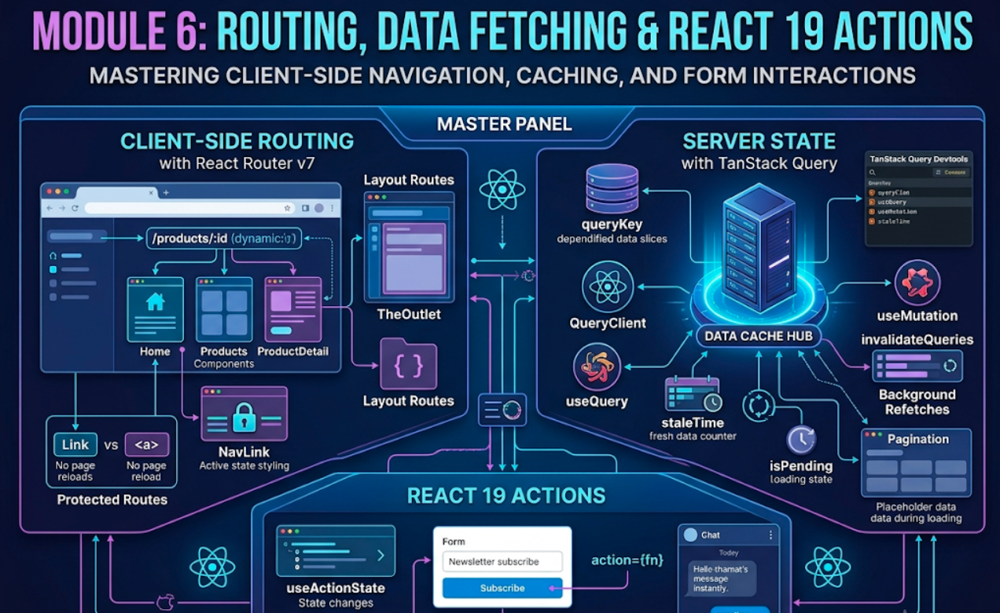

# Module 6: Routing, Data Fetching & React 19 Actions



## Words you will meet in this module

| Word                    | Simple meaning                                                                                       |
| ----------------------- | ---------------------------------------------------------------------------------------------------- |
| **Client-side routing** | Changing the page the user sees by swapping components in JavaScript, with no full page reload.      |
| **Route**               | A rule that maps a URL pattern (`/products/:id`) to a component.                                     |
| **Outlet**              | A placeholder in a layout where the matching child route is rendered.                                |
| **URL params**          | The dynamic parts of a path: `/products/42` has `id = 42`.                                           |
| **Search params**       | The query string: `?page=2&sort=price`. Good for filters and pagination.                             |
| **Query (TanStack)**    | A cached read of server data, identified by a **query key**.                                         |
| **Mutation**            | A write to the server (create, update, delete).                                                      |
| **Stale**               | Cached data that _may_ be out of date and will be refetched in the background.                       |
| **Invalidate**          | Mark cached data stale so it is refetched.                                                           |
| **Action (React 19)**   | An async function used in a transition or a `<form action>`. React tracks its pending state for you. |
| **Optimistic update**   | Showing the expected result immediately, before the server confirms.                                 |
| **CORS**                | A browser rule about which websites may call which servers.                                          |

## 6.1 Client-Side Routing with React Router v7

### The idea in plain words

A normal website loads a **new HTML page** for every URL. A **single-page app (SPA)** loads one HTML page. A router watches the URL (using the browser's History API), decides which component should be on screen, and swaps it **without a reload**. Back and forward buttons still work, and every screen still has its own shareable URL.

React Router v7 works in three modes: **declarative** (`<BrowserRouter>` + `<Routes>`), **data** (`createBrowserRouter` + `<RouterProvider>`, with loaders and actions), and **framework** (a Vite plugin that adds server rendering). This module uses **data mode**, the best fit for a Vite SPA. All imports come from `react-router`.

```bash
npm install react-router
```

### Setting up routes

```jsx
// src/main.jsx
import { createRoot } from 'react-dom/client';
import { createBrowserRouter } from 'react-router';
import { RouterProvider } from 'react-router/dom';

import RootLayout from './layouts/RootLayout.jsx';
import Home from './pages/Home.jsx';
import Products from './pages/Products.jsx';
import ProductDetail from './pages/ProductDetail.jsx';
import NotFound from './pages/NotFound.jsx';

const router = createBrowserRouter([
  {
    path: '/',
    Component: RootLayout,
    children: [
      { index: true, Component: Home }, // matches "/"
      { path: 'products', Component: Products }, // "/products"
      { path: 'products/:id', Component: ProductDetail }, // "/products/42"
      { path: '*', Component: NotFound }, // anything else (404)
    ],
  },
]);

createRoot(document.getElementById('root')).render(
  <RouterProvider router={router} />,
);
```

`RouterProvider` is imported from `react-router/dom`, which wires up the DOM-specific `flushSync` for you.

### Layout routes and `<Outlet />`

```jsx
// src/layouts/RootLayout.jsx
import { NavLink, Outlet } from 'react-router';

export default function RootLayout() {
  return (
    <>
      <nav>
        <NavLink to="/" end>
          Home
        </NavLink>
        <NavLink
          to="/products"
          className={({ isActive }) => (isActive ? 'active' : '')}
        >
          Products
        </NavLink>
      </nav>
      <main>
        <Outlet /> {/* the matched child route renders here */}
      </main>
    </>
  );
}
```

```
 URL: /products/42

 RootLayout   ← always rendered (navbar stays, no remount)
   └─ <Outlet />  →  ProductDetail
```

Nested routes mean the shared parts of the UI **do not remount** when you navigate between children.

### `Link`, `NavLink`, and why not `<a>`

| Element                  | Behavior                                                            |
| ------------------------ | ------------------------------------------------------------------- |
| `<a href="/products">`   | **Full page reload**. The whole app restarts and state is lost.     |
| `<Link to="/products">`  | Client-side navigation. No reload. State above it is preserved.     |
| `<NavLink>`              | Like `Link`, plus an `isActive` state for styling the current page. |
| `<a href="https://...">` | Right choice for **external** sites.                                |

### Reading the URL: params, search params, navigation

```jsx
import {
  useParams,
  useSearchParams,
  useNavigate,
  useLocation,
} from 'react-router';

function ProductDetail() {
  const { id } = useParams(); // from /products/:id
  return <h1>Product {id}</h1>;
}

function Products() {
  const [searchParams, setSearchParams] = useSearchParams();
  const page = Number(searchParams.get('page') ?? 1);
  const sort = searchParams.get('sort') ?? 'name';

  return (
    <>
      <button onClick={() => setSearchParams({ page: page + 1, sort })}>
        Next page
      </button>
      <p>
        Page {page}, sorted by {sort}
      </p>
    </>
  );
}

function SaveButton() {
  const navigate = useNavigate();
  async function handleSave() {
    await save();
    navigate('/products', { replace: true }); // replace: do not add a history entry
  }
  return <button onClick={handleSave}>Save</button>;
}
```

**Put filters, sort order, page number and selected IDs in the URL**, not in `useState`. Then links can be shared, refresh keeps your place, and Back works as users expect (Module 4, Topic 4.4).

### Protected routes with a layout route

```jsx
import { Navigate, Outlet, useLocation } from "react-router";

function RequireAuth() {
  const { user, isPending } = useAuth();          // from Module 4 or the query in Topic 6.4
  const location = useLocation();

  if (isPending) return <p>Checking session...</p>;
  if (!user) return <Navigate to="/login" replace state={{ from: location }} />;
  return <Outlet />;                               // render the protected children
}

// in the route config:
{
  Component: RequireAuth,
  children: [
    { path: "dashboard", Component: Dashboard },
    { path: "settings",  Component: Settings },
  ],
}
```

After login, read `location.state.from` and `navigate(from)` to send the user back to where they were headed.

> **Security reminder:** hiding a route in the browser is **UX, not security**. Anyone can read your JavaScript. The **server** must check authorization on every API call (Part 2).

### Lazy routes (code splitting by page)

```jsx
{
  path: "admin",
  lazy: async () => {
    const { default: Admin } = await import("./pages/Admin.jsx");
    return { Component: Admin };                  // the file is downloaded on first visit
  },
}
```

### Error pages

```jsx
{
  path: "/",
  Component: RootLayout,
  errorElement: <RouteError />,                    // shown when a route throws
  children: [ /* ... */ ],
}

import { useRouteError, isRouteErrorResponse } from "react-router";
function RouteError() {
  const error = useRouteError();
  return <p role="alert">{isRouteErrorResponse(error) ? error.statusText : "Something went wrong"}</p>;
}
```

### Loaders and actions (a short preview)

Data mode can also fetch data **before** rendering a route (`loader` + `useLoaderData`) and handle form submissions (`action` + `<Form>`). This removes loading waterfalls and is the basis of how Remix and framework mode work. In this series we use **TanStack Query** for data (next topic), which is more common in SPAs. React Router's loaders are an equally valid choice, and you will see them again in Part 3's framework concepts.

### Router choice

| Need                                          | Choice                                          |
| --------------------------------------------- | ----------------------------------------------- |
| SPA, simple routes                            | React Router (declarative or data mode)         |
| SPA with route-level data loading and actions | React Router data mode                          |
| File-based routes, SSR, server components     | Next.js (Part 3) or React Router framework mode |
| Type-safe routing, heavy search-param typing  | TanStack Router                                 |

#### Interview traps

- "How does a SPA change pages without reloading?" The router intercepts navigation, updates the URL with the History API (`pushState`), and renders the matching component. The server is not asked for a new HTML page.
- "What breaks on refresh in a SPA?" Deep links like `/products/42` are not real files. The **server must serve `index.html` for all unknown paths** (the "SPA fallback"). Otherwise refresh gives a 404. Vite's dev server does this for you. Production hosts need a rule (Module 7, Topic 7.6).
- "`Link` vs. `<a>`?" `Link` does client-side navigation. `<a>` reloads the page.
- "Where do you keep the current page number?" In the URL search params, not component state.

## 6.2 Server State with TanStack Query

### Why not just `useEffect` + `fetch`?

Module 3 showed what a hand-written fetch needs: loading and error state, abort, race handling. Real apps also need **caching**, **deduplication** (ten components, one request), **background refresh**, **retries**, **pagination**, and **invalidation after writes**. **TanStack Query** (v5) provides all of that. It treats data from servers as a **cache that you borrow**, not as state you own.

```bash
npm install @tanstack/react-query
npm install -D @tanstack/react-query-devtools
```

### Setup

```jsx
// src/main.jsx
import { QueryClient, QueryClientProvider } from '@tanstack/react-query';
import { ReactQueryDevtools } from '@tanstack/react-query-devtools';

const queryClient = new QueryClient({
  defaultOptions: { queries: { staleTime: 60_000, retry: 1 } },
});

createRoot(document.getElementById('root')).render(
  <QueryClientProvider client={queryClient}>
    <RouterProvider router={router} />
    <ReactQueryDevtools initialIsOpen={false} />
  </QueryClientProvider>,
);
```

### A small fetch helper (shared by all queries)

```js
// src/lib/api.js
const BASE = import.meta.env.VITE_API_URL ?? '/api';

export async function api(path, { method = 'GET', body, signal } = {}) {
  const res = await fetch(`${BASE}${path}`, {
    method,
    signal,
    credentials: 'include', // send cookies
    headers: body ? { 'Content-Type': 'application/json' } : undefined,
    body: body ? JSON.stringify(body) : undefined,
  });
  if (!res.ok) {
    // fetch does NOT throw on 4xx/5xx
    const error = new Error(
      (await res.text().catch(() => '')) || res.statusText,
    );
    error.status = res.status;
    throw error;
  }
  return res.status === 204 ? null : res.json();
}
```

### Reading data: `useQuery`

```jsx
import { useQuery } from '@tanstack/react-query';
import { api } from '../lib/api';

function useProducts(category) {
  return useQuery({
    queryKey: ['products', { category }], // cache key AND dependency list
    queryFn: ({ signal }) => api(`/products?category=${category}`, { signal }),
  });
}

function Products() {
  const [category, setCategory] = useState('all');
  const { data, isPending, isError, error, isFetching } = useProducts(category);

  if (isPending) return <Skeleton />; // first load, no data yet
  if (isError) return <p role="alert">Failed: {error.message}</p>;

  return (
    <>
      {isFetching && <span>Refreshing...</span>} {/* background refetch */}
      <ul>
        {data.map((p) => (
          <li key={p.id}>{p.name}</li>
        ))}
      </ul>
    </>
  );
}
```

All in one hook: no `useEffect`, no race conditions (the old request is cancelled via `signal`), automatic caching. When `category` changes, the **query key changes**, and TanStack fetches (or serves from cache) the new data.

### The concepts you must know

| Concept              | Meaning                                                                                                                                               |
| -------------------- | ----------------------------------------------------------------------------------------------------------------------------------------------------- |
| **`queryKey`**       | An array that uniquely identifies the data. Like a dependency array: changing it means "different data." Include every variable the query depends on. |
| **`staleTime`**      | How long data counts as **fresh**. Fresh data is served with no refetch. Default `0` (always stale).                                                  |
| **`gcTime`**         | How long **unused** cached data is kept in memory before garbage collection. Default 5 minutes. (Named `cacheTime` before v5.)                        |
| **`isPending`**      | There is **no data yet** (first load). In v5 this replaced `isLoading` for "nothing to show."                                                         |
| **`isFetching`**     | A request is in flight, including **background refetches**.                                                                                           |
| **Refetch triggers** | Stale data is refetched on window focus, on reconnect, on mount of a new observer, and optionally on an interval.                                     |
| **Deduplication**    | Ten components using the same key cause **one** request.                                                                                              |
| **`enabled`**        | `useQuery({ ..., enabled: !!userId })` waits until a condition is true (dependent queries).                                                           |
| **Retry**            | Failed queries retry (default 3 times, with backoff) before reporting an error.                                                                       |

```
 component mounts → cache has data for key?
      ├─ yes, fresh  → return it. No request.
      ├─ yes, stale  → return it NOW, refetch in background, update when done.
      └─ no          → isPending = true, fetch, store, re-render.
```

### Pagination without flicker

```jsx
import { useQuery, keepPreviousData } from '@tanstack/react-query';

const { data, isPlaceholderData } = useQuery({
  queryKey: ['posts', page],
  queryFn: () => api(`/posts?_page=${page}&_limit=10`),
  placeholderData: keepPreviousData, // show the previous page while the next loads
});
```

### Writing data: `useMutation` and invalidation

```jsx
import { useMutation, useQueryClient } from '@tanstack/react-query';

function AddProduct() {
  const queryClient = useQueryClient();

  const addProduct = useMutation({
    mutationFn: (newProduct) =>
      api('/products', { method: 'POST', body: newProduct }),
    onSuccess: () => {
      queryClient.invalidateQueries({ queryKey: ['products'] }); // refetch every ["products", ...]
    },
  });

  return (
    <button
      disabled={addProduct.isPending}
      onClick={() => addProduct.mutate({ name: 'Pen', price: 10 })}
    >
      {addProduct.isPending ? 'Saving...' : 'Add'}
    </button>
  );
}
```

**Invalidate** after a write: the cache is marked stale and active queries refetch, so the list shows the new item. Matching is by **key prefix**, so `["products"]` also invalidates `["products", { category: "pens" }]`.

### Optimistic updates (the cache-based way)

```jsx
const toggleTodo = useMutation({
  mutationFn: (todo) =>
    api(`/todos/${todo.id}`, { method: 'PATCH', body: { done: !todo.done } }),

  onMutate: async (todo) => {
    await queryClient.cancelQueries({ queryKey: ['todos'] }); // stop in-flight refetches
    const previous = queryClient.getQueryData(['todos']); // snapshot for rollback
    queryClient.setQueryData(['todos'], (old) =>
      old.map((t) => (t.id === todo.id ? { ...t, done: !t.done } : t)),
    );
    return { previous };
  },
  onError: (err, todo, context) => {
    queryClient.setQueryData(['todos'], context.previous); // rollback
  },
  onSettled: () => queryClient.invalidateQueries({ queryKey: ['todos'] }), // re-sync with server
});
```

Pattern: **cancel, snapshot, update cache, roll back on error, re-sync on settle.** (Topic 6.3 shows the React 19 alternative for simple cases with `useOptimistic`.)

### Query keys: a convention that scales

```js
export const productKeys = {
  all: ['products'],
  list: (filters) => ['products', 'list', filters],
  detail: (id) => ['products', 'detail', id],
};
// invalidate everything about products: queryClient.invalidateQueries({ queryKey: productKeys.all })
```

### `useEffect` vs. TanStack Query

| Need                         | `useEffect` + `useState` | TanStack Query                         |
| ---------------------------- | ------------------------ | -------------------------------------- |
| Loading and error state      | Write it yourself        | Built in                               |
| Race conditions              | Write abort logic        | Handled                                |
| Cache and dedupe             | None                     | Built in                               |
| Refetch on focus / reconnect | None                     | Built in                               |
| Retry with backoff           | None                     | Built in                               |
| Pagination, infinite scroll  | Hard                     | `keepPreviousData`, `useInfiniteQuery` |
| Update after a write         | Manual refetch           | `invalidateQueries`                    |

#### Interview traps

- "What is a `queryKey` for?" It identifies the cached data and acts as the dependency list. Different key means different cache entry and a refetch. Every input to the request must be in the key.
- "`staleTime` vs. `gcTime`?" `staleTime`: how long data is **fresh** (no refetch). `gcTime`: how long **unused** data stays in memory before deletion.
- "`isPending` vs. `isFetching` vs. `isLoading`?" `isPending`: no data yet. `isFetching`: a request is running, even a background one. `isLoading` is `isPending && isFetching` (the first fetch is in progress).
- "Is TanStack Query a state management library?" It manages **server state** (async, cached, shared). It does not replace `useState` or Zustand for UI state.

#### Tricky questions and answers

###### Q1 [SDE-2]: After adding a product, the list does not update until a refresh. What is missing?

**Answer:** The mutation changed the server, but the cached `["products", ...]` query is still considered fresh (especially with a large `staleTime`). Call `queryClient.invalidateQueries({ queryKey: ["products"] })` in the mutation's `onSuccess` (or `onSettled`) so active product queries refetch. Alternatively write the server's response directly into the cache with `setQueryData`.

###### Q2 [SDE-3]: Two components on the same page call `useQuery({ queryKey: ["user", id], ... })`. How many requests are made and why?

**Answer:** One. Queries with the same key share a single cache entry and one in-flight request (deduplication). Both components subscribe to it and re-render when it updates. That is why you can call the same query hook freely in many components instead of lifting data to a parent and drilling it down.

## 6.3 React 19 Actions: `useActionState`, `useOptimistic` and `use`

### The idea in plain words

Forms and mutations all follow the same pattern: set a pending flag, call the server, catch errors, update the UI, reset the flag. People wrote this by hand in every form. React 19 builds it in. An **Action** is an **async function** that React runs inside a **transition**, so React tracks its **pending state**, **errors** and **optimistic updates** for you.

### `<form action={fn}>`

You can pass a **function** to a form's `action`. React calls it with the form's `FormData` and **resets uncontrolled fields** when it succeeds.

```jsx
function NewsletterForm() {
  async function subscribe(formData) {
    const email = formData.get('email');
    await api('/subscribe', { method: 'POST', body: { email } });
  }

  return (
    <form action={subscribe}>
      <input name="email" type="email" required />
      <button>Subscribe</button>
    </form>
  );
}
```

No `onSubmit`, no `preventDefault`, no `useState` for each field. (Controlled forms from Module 2 are still right when you need live validation.)

### `useActionState`: result, action, and pending in one hook

```jsx
import { useActionState } from 'react';

async function signupAction(previousState, formData) {
  const email = formData.get('email');
  if (!email.includes('@'))
    return { error: 'Enter a valid email', success: false };

  try {
    await api('/signup', { method: 'POST', body: { email } });
    return { error: null, success: true };
  } catch (err) {
    return { error: err.message, success: false };
  }
}

function Signup() {
  const [state, formAction, isPending] = useActionState(signupAction, {
    error: null,
    success: false,
  });

  return (
    <form action={formAction}>
      <input name="email" type="email" />
      <button disabled={isPending}>
        {isPending ? 'Creating...' : 'Sign up'}
      </button>
      {state.error && <p role="alert">{state.error}</p>}
      {state.success && <p>Check your inbox!</p>}
    </form>
  );
}
```

It returns `[state, formAction, isPending]`. The action receives the **previous state** first, then the `FormData`. Whatever the action returns becomes the new `state`.

> Note: in React 19 an **uncontrolled** form is cleared after its action finishes. If you want to keep the typed values after a **validation error**, return them in the state and use them as `defaultValue`, or use a controlled form.

### `useFormStatus`: pending state for child components

A submit button deep inside a form can read the form's status **without props**. It must be rendered **inside** the `<form>`.

```jsx
import { useFormStatus } from 'react-dom';

function SubmitButton({ children }) {
  const { pending } = useFormStatus();
  return (
    <button type="submit" disabled={pending}>
      {pending ? 'Saving...' : children}
    </button>
  );
}

<form action={saveAction}>
  <input name="title" />
  <SubmitButton>Save</SubmitButton>
</form>;
```

This lets you build a reusable design-system `<SubmitButton>` that works in every form.

### `useOptimistic`: show the result before the server answers

```jsx
import { useOptimistic, useState } from 'react';

function Chat() {
  const [messages, setMessages] = useState([{ id: 1, text: 'Hello' }]);

  const [optimisticMessages, addOptimistic] = useOptimistic(
    messages, // the real, confirmed state
    (current, newText) => [
      ...current,
      { id: 'temp-' + newText, text: newText, sending: true },
    ],
  );

  async function sendAction(formData) {
    const text = formData.get('text');
    addOptimistic(text); // appears instantly, marked "sending"
    const saved = await api('/messages', { method: 'POST', body: { text } });
    setMessages((prev) => [...prev, saved]); // confirmed. Temp item is replaced.
  }

  return (
    <>
      <ul>
        {optimisticMessages.map((m) => (
          <li key={m.id} style={{ opacity: m.sending ? 0.5 : 1 }}>
            {m.text}
          </li>
        ))}
      </ul>
      <form action={sendAction}>
        <input name="text" />
        <button>Send</button>
      </form>
    </>
  );
}
```

How it works: while the action is running, `optimisticMessages` shows your **temporary** version. When the action finishes (success or failure), React automatically **reverts to the real state** (`messages`). On success you have updated the real state, so the item stays. On failure the optimistic item **disappears**, which is a built-in rollback.

### `use`: read a promise (or context) in render

`use` reads a resource during render. For a **promise**, it **suspends** the component until the promise resolves, and the nearest `<Suspense>` shows its fallback. Unlike hooks, it may be called in loops and conditions.

```jsx
import { use, Suspense } from 'react';

const userCache = new Map();
function getUser(id) {
  // same id → same promise
  if (!userCache.has(id)) userCache.set(id, api(`/users/${id}`));
  return userCache.get(id);
}

function Profile({ id }) {
  const user = use(getUser(id)); // suspends until resolved
  return <h2>{user.name}</h2>;
}

<Suspense fallback={<p>Loading...</p>}>
  <Profile id={1} />
</Suspense>;
```

**Critical rule:** do **not create a new promise during render** in a client component (`use(fetch(...))`). A new promise on every render means React suspends forever. The promise must be **stable**: created in a cache like above, in a parent that is not re-rendering, or passed from a Server Component (Part 3). For most client-side apps, prefer **TanStack Query's** `useSuspenseQuery`, which manages the stable promise and cache for you.

`use` cannot be wrapped in `try / catch`. Handle rejection with an **error boundary** (Module 5).

### Actions and transitions

An Action is simply an async function passed to `startTransition` (or to `<form action>` or `useActionState`, which do it for you). React keeps the old UI interactive while it runs and exposes `isPending`:

```jsx
const [isPending, startTransition] = useTransition();

function handleSave() {
  startTransition(async () => {
    await api('/save', { method: 'POST', body: data }); // an Action
  });
}
```

### Where Server Functions fit

In a Vite SPA, all Actions run **in the browser** and call your API. React 19 also defines **Server Functions** (functions marked `"use server"`) that run on the server and can be passed to `<form action>`. They need a framework that supports Server Components. That is **Next.js in Part 3**, where `<form action={serverFunction}>` skips the API layer entirely.

### Which tool for which job?

| Situation                                      | Use                                            |
| ---------------------------------------------- | ---------------------------------------------- |
| Simple submit-and-show-result form             | `<form action>` + `useActionState`             |
| Reusable submit button with pending            | `useFormStatus`                                |
| Instant feedback for a likely-to-succeed write | `useOptimistic`                                |
| Server data shared across many components      | TanStack Query (`useQuery`, `useMutation`)     |
| Reading a stable promise during render         | `use` inside `Suspense`                        |
| Complex form (many fields, nested validation)  | React Hook Form + Zod, with TanStack mutations |

#### Interview traps

- "Does `use` follow the Rules of Hooks?" No. It is not a hook. It can be called conditionally and in loops, but only inside a component or hook.
- "What happens if an optimistic update fails?" When the action finishes, `useOptimistic` returns to the passed-in real state, so the optimistic change disappears. You should also show an error.
- "What is the first argument of a `useActionState` action?" The **previous state**. The `FormData` is the second.
- "Why must `useFormStatus` be inside the `<form>`?" It reads the status of the **parent** form. Called in the same component that renders the `<form>`, it sees no form above it.

#### Tricky question and answer

###### Q3 [SDE-3]: `use(fetch("/api/user").then(r => r.json()))` inside a client component keeps showing the fallback forever. Why?

**Answer:** Every render creates a **new promise**. When the promise resolves, React re-renders the component, which creates _another_ new promise, which suspends again, and so on. A promise read with `use` must be **referentially stable** across renders: put it in a cache keyed by the inputs, create it in an event handler or a parent that does not re-render, receive it from a Server Component, or use a Suspense-aware library like TanStack Query.

## 6.4 API Layer, Auth Flow and Dev Proxy

### Organize the API code

```
src/
├── lib/
│   └── api.js                 ← the fetch helper (Topic 6.2)
├── features/
│   └── products/
│       ├── productApi.js      ← functions: getProducts, createProduct (use api())
│       ├── productKeys.js     ← query key factory
│       ├── useProducts.js     ← useQuery hooks
│       └── ProductList.jsx    ← UI
```

Components never call `fetch` directly. They call **hooks**, which call **API functions**, which call the **one `api()` helper**. Headers, base URL, error shapes and auth are handled in one place.

### Where to keep the session (the safe pattern)

| Approach                                                                             | Safety                                                                                                              |
| ------------------------------------------------------------------------------------ | ------------------------------------------------------------------------------------------------------------------- |
| **`HttpOnly`, `Secure`, `SameSite` cookie set by the server**                        | **Best default.** JavaScript (and therefore XSS) cannot read it. Use `credentials: "include"`. Add CSRF protection. |
| Access token **in memory** (a variable / store), refresh token in an HttpOnly cookie | Good. Lost on refresh, then renewed via the cookie.                                                                 |
| Token in `localStorage` or `sessionStorage`                                          | **Risky.** Any XSS bug can steal it.                                                                                |

See [CSRF](vulnerabilities/csrf) and [JWT vulnerabilities](vulnerabilities/jwt) in this blog for the attacks behind these recommendations. Part 2 (Node.js / Bun) builds the server side of this flow.

### Auth state as a query

```jsx
// src/features/auth/useAuth.js
import { useQuery } from '@tanstack/react-query';
import { api } from '../../lib/api';

export function useAuth() {
  const { data: user, isPending } = useQuery({
    queryKey: ['me'],
    queryFn: () =>
      api('/me').catch((e) => (e.status === 401 ? null : Promise.reject(e))),
    staleTime: 5 * 60_000,
    retry: false,
  });
  return { user, isPending };
}
```

The server decides who the user is. The client asks `/me` and caches the answer. Login and logout are mutations that `invalidateQueries({ queryKey: ["me"] })` or set it directly.

### Handling `401` globally

Throw an error with `status` from `api()` (as above) and handle it in one place, for example in the `QueryClient`'s `QueryCache` `onError`, redirecting to `/login` or clearing `["me"]`. Never repeat that logic in each component.

### The Vite dev proxy (avoid CORS pain in development)

**CORS** is a **browser** rule: a page from `http://localhost:5173` may not read responses from `http://localhost:3000` unless the **server** sends the right `Access-Control-Allow-*` headers. See [DNS, HTTP and TLS](computer-networks/dns-http-and-tls-the-application-layer) for how the browser and server exchange headers. In development you can sidestep it by proxying through Vite:

```js
// vite.config.js
export default defineConfig({
  plugins: [react()],
  server: {
    proxy: {
      '/api': { target: 'http://localhost:3000', changeOrigin: true },
    },
  },
});
```

Now the browser calls `/api/...` on the same origin as the page, and Vite forwards it to your backend. In production, serve the API and the app from the **same origin** (a reverse proxy) or configure CORS on the server properly.

### Every request has four UI states

| State       | What to show                                                         |
| ----------- | -------------------------------------------------------------------- |
| **Loading** | A **skeleton** the same shape as the content (avoids layout jumps)   |
| **Error**   | A clear message and a **Retry** button (`refetch()`), plus reporting |
| **Empty**   | "No products yet" with a helpful next step. Not a blank screen       |
| **Success** | The data. If `isFetching`, a subtle refresh indicator                |

Handling all four is the difference between a demo and a product.

#### Interview traps

- "Where do you store a JWT in a React app?" Prefer an `HttpOnly` cookie set by the server so JavaScript cannot read it. If you must hold an access token in JavaScript, keep it in memory and keep it short-lived. `localStorage` exposes it to any XSS.
- "Why does my fetch work in Postman but fail in the browser?" CORS. Postman does not enforce it. The server must allow your origin, or you must use a same-origin proxy.
- "Does protecting a route in React secure the data?" No. It only controls what UI is shown. The server must authorize every request.

---

## Hands-On Lab: Build a Posts Explorer

Use the free fake API `https://jsonplaceholder.typicode.com`. Keep the code organized as in Topic 6.4.

```
1. Create a Vite app. Install react-router and @tanstack/react-query.
2. Routes (data mode):
     /                 Home
     /posts            list with pagination, driven by ?page=
     /posts/:id        detail with comments
     *                 NotFound
   Add a RootLayout with a NavLink navbar and <Outlet />.
3. /posts: useQuery with queryKey ["posts", page], keepPreviousData,
   Previous/Next buttons that call setSearchParams. Show skeleton,
   error with Retry, and empty states.
4. /posts/:id: two queries (post, comments). Make comments "dependent"
   with enabled, or run them in parallel. Navigate away and back:
   is the data instant? Why? (Open the Query Devtools.)
5. Add a "New comment" form using <form action>, useActionState and a
   SubmitButton with useFormStatus. (JSONPlaceholder accepts POSTs but does
   not store them, which is fine for practice.)
6. Add useOptimistic so the new comment appears instantly with "sending..."
7. Add a protected /favorites route using a RequireAuth layout route with a
   fake login (a Context or query), plus redirect back after login.
8. Make /admin a lazy route and confirm in the Network tab that its JS loads
   only on first visit.
9. Add a Vite proxy for /api to a local server (you will build one in Part 2).
```

Questions to answer for yourself:

- With `staleTime: 60_000`, what happens when you revisit `/posts?page=1` after 30 seconds? After 90 seconds?
- Which parts of this app are server state, URL state, and local UI state?
- What happens if you refresh `/posts/5` in `npm run preview`? Why does it work in dev and what must production hosting do?

## Module 6 Cheat Sheet

| Concept                    | One-line interview answer                                                                                 |
| -------------------------- | --------------------------------------------------------------------------------------------------------- |
| SPA routing                | The router updates the URL with the History API and swaps components. No page reload.                     |
| React Router v7 modes      | Declarative, data (`createBrowserRouter`), framework. All imports from `react-router`.                    |
| `Outlet`                   | Where a layout route renders its matched child.                                                           |
| `Link` / `NavLink`         | Client-side navigation. `<a>` reloads the page. `NavLink` adds an active state.                           |
| URL state                  | Page, filters, sort and selected IDs belong in the URL (`useSearchParams`, `useParams`).                  |
| Protected route            | A layout route that renders `<Outlet />` or `<Navigate>`. UX only. The server must enforce authorization. |
| SPA fallback               | Production servers must return `index.html` for unknown paths, or refresh on deep links gives 404.        |
| Server state               | Borrowed data that can be stale. Cache it with TanStack Query instead of `useState`.                      |
| `queryKey`                 | Cache identity and dependency list. Include every input of the request.                                   |
| `staleTime` / `gcTime`     | How long data is fresh / how long unused data stays cached.                                               |
| `isPending` / `isFetching` | No data yet / a request is running (including background refetch).                                        |
| Mutation flow              | `useMutation` then `invalidateQueries` (or `setQueryData`) to refresh affected queries.                   |
| Optimistic (TanStack)      | `onMutate` cancel, snapshot, update cache. `onError` roll back. `onSettled` invalidate.                   |
| React 19 Action            | An async function run in a transition. React tracks pending, errors, optimistic state.                    |
| `useActionState`           | `[state, formAction, isPending]`. The action gets `(previousState, formData)`.                            |
| `useFormStatus`            | `{ pending }` for the parent `<form>`. Must be rendered inside the form.                                  |
| `useOptimistic`            | Temporary state that reverts to the real state when the action ends.                                      |
| `use(promise)`             | Suspends until the promise resolves. The promise must be stable across renders.                           |
| Session storage            | Prefer HttpOnly cookies. Avoid tokens in `localStorage`.                                                  |
| CORS                       | A browser rule enforced via response headers. Fix it on the server or with a same-origin proxy.           |
| Four UI states             | Loading (skeleton), error (retry), empty (guidance), success.                                             |

---

## Browse Series

| #   | Module                                       | Read more                                                       |
| --- | -------------------------------------------- | --------------------------------------------------------------- |
| 1   | **Getting Started, JSX & Components**        | [Open Module 1](reactjs/getting-started-jsx-and-components)       |
| 2   | **State, Events & Forms**                    | [Open Module 2](reactjs/state-events-and-forms)                   |
| 3   | **Effects, Refs & Custom Hooks**             | [Open Module 3](reactjs/effects-refs-and-custom-hooks)            |
| 4   | **Reducers, Context & App-Wide State**       | [Open Module 4](reactjs/reducers-context-and-app-state)           |
| 5   | **How React Renders & Performance**          | [Open Module 5](reactjs/rendering-performance-and-suspense)       |
| 6   | **Testing, TypeScript, Security & Capstone** | [Open Module 7](reactjs/testing-typescript-security-and-capstone) |
