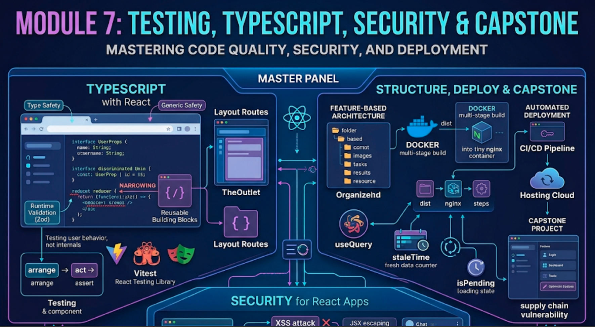

# Module 7: Testing, TypeScript, Security & Capstone



## Words you will meet in this module

| Word                         | Simple meaning                                                                                        |
| ---------------------------- | ----------------------------------------------------------------------------------------------------- |
| **TypeScript**               | JavaScript with types. Mistakes are caught while you type, not when users click.                      |
| **Discriminated union**      | A type made of several shapes, each with a literal tag field (`type: "added"`).                       |
| **Unit / integration / E2E** | Tests of one function / several parts together / the whole app in a real browser.                     |
| **React Testing Library**    | A testing tool that interacts with your UI the way a **user** does.                                   |
| **Mock**                     | A fake replacement for something real (network, timer) used in tests.                                 |
| **XSS**                      | Cross-Site Scripting: an attacker gets their JavaScript to run on your page.                          |
| **Sanitize**                 | Clean untrusted HTML so it cannot run scripts.                                                        |
| **CSP**                      | Content Security Policy: a browser rule that limits which scripts and resources a page may load.      |
| **CSR / SSR / SSG**          | Client-Side / Server-Side Rendering / Static Site Generation.                                         |
| **Server Component**         | A React component that runs **only on the server** and sends no JavaScript for itself to the browser. |
| **Hydration**                | React attaching event handlers to server-rendered HTML so it becomes interactive.                     |
| **Build artifact**           | The output of `npm run build`: plain static files in `dist/`.                                         |

## 7.1 TypeScript with React

### Why bother?

React passes data everywhere: props, state, context, API responses. TypeScript checks every connection. Rename a prop and every wrong usage lights up. A wrong event handler type, a missing field or a `null` you forgot to handle becomes a **red underline** instead of a production bug. Almost all new professional React code is TypeScript.

Start a project with `npm create vite@latest my-app -- --template react-ts`. Files become `.tsx` (TypeScript + JSX). Keep `"strict": true` in `tsconfig`.

### Typing props

```tsx
type ButtonProps = {
  label: string;
  variant?: "primary" | "ghost";           // optional, limited to two values
  onClick?: () => void;
  children?: React.ReactNode;              // anything renderable
};

function Button({ label, variant = "primary", onClick }: ButtonProps) {
  return <button className={`btn-${variant}`} onClick={onClick}>{label}</button>;
}

<Button label="Save" variant="ghost" />      // OK
<Button label="Save" variant="red" />        // ERROR: not "primary" | "ghost"
```

Writing `function Button(props: ButtonProps)` is the standard. `React.FC` is optional and no longer recommended.

### Extending native element props

```tsx
type InputProps = React.ComponentProps<'input'> & { label: string };

function Field({ label, id, ...rest }: InputProps) {
  return (
    <>
      <label htmlFor={id}>{label}</label>
      <input id={id} {...rest} /> // type, value, onChange, ref... all typed for
      free
    </>
  );
}
```

### State, refs and events

```tsx
type User = { id: number; name: string };

const [user, setUser] = useState<User | null>(null); // generic when the initial value can't infer it
const [count, setCount] = useState(0); // inferred as number

const inputRef = useRef<HTMLInputElement>(null);

function handleChange(e: React.ChangeEvent<HTMLInputElement>) {
  setName(e.target.value);
}
function handleSubmit(e: React.FormEvent<HTMLFormElement>) {
  e.preventDefault();
}

if (user) console.log(user.name); // narrowing: TS forces the null check
```

### `useReducer` with a discriminated union

```tsx
type Task = { id: number; text: string; done: boolean };

type Action =
  | { type: 'added'; id: number; text: string }
  | { type: 'toggled'; id: number }
  | { type: 'deleted'; id: number };

function tasksReducer(tasks: Task[], action: Action): Task[] {
  switch (action.type) {
    case 'added':
      return [...tasks, { id: action.id, text: action.text, done: false }];
    case 'toggled':
      return tasks.map((t) =>
        t.id === action.id ? { ...t, done: !t.done } : t,
      );
    case 'deleted':
      return tasks.filter((t) => t.id !== action.id);
  } // TS checks every case is handled
}

dispatch({ type: 'toggled' }); // ERROR: missing id
```

Inside each `case`, TypeScript **narrows** `action` to that one shape. `action.text` exists only for `"added"`.

### Typed context with a safe hook

```tsx
type AuthValue = {
  user: User | null;
  login: (u: User) => void;
  logout: () => void;
};

const AuthContext = createContext<AuthValue | null>(null);

export function useAuth(): AuthValue {
  const ctx = useContext(AuthContext);
  if (!ctx) throw new Error('useAuth must be used within <AuthProvider>');
  return ctx; // callers get AuthValue, never null
}
```

### Generic components

```tsx
type ListProps<T> = {
  items: T[];
  getKey: (item: T) => string | number;
  render: (item: T) => React.ReactNode;
};

function List<T>({ items, getKey, render }: ListProps<T>) {
  return (
    <ul>
      {items.map((i) => (
        <li key={getKey(i)}>{render(i)}</li>
      ))}
    </ul>
  );
}

<List items={users} getKey={(u) => u.id} render={(u) => u.name} />; // T inferred as User
```

### Types do not exist at runtime: validate API data

TypeScript types vanish when the code runs. `const data = (await res.json()) as User[]` is a **promise to the compiler, not a check**. If the server sends something else, the type is a lie. Validate untrusted data at the boundary with **Zod**:

```tsx
import { z } from 'zod';

const UserSchema = z.object({ id: z.number(), name: z.string() });
type User = z.infer<typeof UserSchema>; // one source of truth

const user = UserSchema.parse(await res.json()); // throws if the shape is wrong
```

#### Interview traps

- "`interface` vs. `type` for props?" Either works. `type` handles unions easily. Pick one convention per codebase.
- "Does TypeScript make my app safe at runtime?" No. It erases at build time. Validate external data (API, `localStorage`, URL) with a schema library.
- "Why is `useState<User | null>(null)` needed?" With just `null`, TypeScript infers the type as `null` and rejects `setUser(user)`.
- "`any` vs. `unknown`?" `any` turns checking off. `unknown` forces you to narrow before use. Prefer `unknown`.

## 7.2 Testing with Vitest and React Testing Library

### The testing pyramid

| Layer                       | Tests                                                             | Speed   | Count                | Tool                                 |
| --------------------------- | ----------------------------------------------------------------- | ------- | -------------------- | ------------------------------------ |
| **Unit**                    | Pure functions, reducers, custom hooks                            | Fastest | Many                 | Vitest                               |
| **Component / integration** | A component or feature with its children, with the network mocked | Fast    | Most valuable        | Vitest + React Testing Library + MSW |
| **End-to-end**              | The whole app in a real browser                                   | Slow    | A few critical flows | Playwright / Cypress                 |

### The philosophy of React Testing Library

> Test your software the way **users** use it, not how it is built.

Do not test internals ("did `setState` get called?", "is the state equal to 3?"). Test what the user **sees and does**: find the button by its **name**, click it, and check the **text on screen**. Then refactoring the internals does not break your tests.

### Setup

```bash
npm install -D vitest jsdom @testing-library/react @testing-library/user-event @testing-library/jest-dom
```

```js
// vite.config.js
import { defineConfig } from 'vitest/config';
import react from '@vitejs/plugin-react';

export default defineConfig({
  plugins: [react()],
  test: {
    environment: 'jsdom', // a fake browser DOM
    globals: true, // describe/it/expect global, enables RTL auto-cleanup
    setupFiles: './src/test/setup.js',
  },
});
```

```js
// src/test/setup.js
import '@testing-library/jest-dom/vitest'; // adds matchers like toBeInTheDocument()
```

Add `"test": "vitest"` to `package.json` scripts.

### Your first component test

```jsx
// Counter.test.jsx
import { render, screen } from '@testing-library/react';
import userEvent from '@testing-library/user-event';
import Counter from './Counter';

it('increments the count when clicked', async () => {
  const user = userEvent.setup();
  render(<Counter />);

  const button = screen.getByRole('button', { name: /clicked 0 times/i });
  await user.click(button);

  expect(
    screen.getByRole('button', { name: /clicked 1 times/i }),
  ).toBeInTheDocument();
});
```

Pattern: **Arrange** (render), **Act** (user interaction), **Assert** (what is on screen).

### Which query to use

| Query priority (best first)         | Use for                                                        |
| ----------------------------------- | -------------------------------------------------------------- |
| `getByRole("button", { name })`     | Almost everything. It also checks accessibility.               |
| `getByLabelText("Email")`           | Form fields.                                                   |
| `getByPlaceholderText`, `getByText` | When there is no better handle.                                |
| `getByTestId`                       | Last resort, when nothing user-visible identifies the element. |

| Variant    | Behavior                    | Use                                  |
| ---------- | --------------------------- | ------------------------------------ |
| `getBy…`   | Throws if not found         | Element must be there now            |
| `queryBy…` | Returns `null` if not found | Assert something is **absent**       |
| `findBy…`  | **Async**: waits up to ~1 s | Element appears **after** async work |

### Testing a form and async data (with a mocked network)

Use **MSW** (Mock Service Worker) to fake your API at the network level, so the component code is tested as it really runs.

```jsx
// src/test/server.js
import { setupServer } from 'msw/node';
import { http, HttpResponse } from 'msw';

export const server = setupServer(
  http.get('/api/products', () => HttpResponse.json([{ id: 1, name: 'Pen' }])),
);
```

```js
// src/test/setup.js
import '@testing-library/jest-dom/vitest';
import { server } from './server';

beforeAll(() => server.listen());
afterEach(() => server.resetHandlers());
afterAll(() => server.close());
```

```jsx
// Products.test.jsx
import { render, screen } from '@testing-library/react';
import { QueryClient, QueryClientProvider } from '@tanstack/react-query';
import Products from './Products';

function renderWithClient(ui) {
  const client = new QueryClient({
    defaultOptions: { queries: { retry: false } },
  }); // new client per test
  return render(
    <QueryClientProvider client={client}>{ui}</QueryClientProvider>,
  );
}

it('shows products from the API', async () => {
  renderWithClient(<Products />);

  expect(screen.getByText(/loading/i)).toBeInTheDocument(); // sync: first render
  expect(await screen.findByText('Pen')).toBeInTheDocument(); // async: waits for data
});

it('shows an error message when the API fails', async () => {
  server.use(
    http.get('/api/products', () => new HttpResponse(null, { status: 500 })),
  );
  renderWithClient(<Products />);
  expect(await screen.findByRole('alert')).toHaveTextContent(/failed/i);
});
```

Use a **fresh `QueryClient` per test** with `retry: false`, otherwise the cache leaks between tests and failures retry slowly.

### Testing reducers and hooks

```js
import { cartReducer } from './cartReducer';

it('adds a new item, then increments its quantity', () => {
  let state = cartReducer([], { type: 'added', product: { id: 1, price: 10 } });
  state = cartReducer(state, { type: 'added', product: { id: 1, price: 10 } });
  expect(state).toEqual([{ id: 1, price: 10, qty: 2 }]);
});
```

```jsx
import { renderHook, act } from '@testing-library/react';
import { useCounter } from './useCounter';

it('increments', () => {
  const { result } = renderHook(() => useCounter());
  act(() => result.current.increment());
  expect(result.current.count).toBe(1);
});
```

A pure reducer needs **no React at all**, which is a big argument for `useReducer` (Module 4).

### What to test (and what not)

| Test                                                           | Skip                                                           |
| -------------------------------------------------------------- | -------------------------------------------------------------- |
| Behavior: "when I click Add, the cart count shows 1"           | Internal state values, hook call counts                        |
| Edge cases: empty, error, long text, permission denied         | Third-party libraries (they have their own tests)              |
| Business logic in reducers and utils                           | Snapshot of a huge component tree (brittle, ignored in review) |
| The 3 to 5 critical user journeys end-to-end (login, checkout) | Exact class names and DOM structure                            |

#### Interview traps

- "Why `getByRole` over `getByTestId`?" It reflects how users and assistive technology find things, and it fails if your markup is inaccessible.
- "What is the `act` warning?" A state update happened outside React's knowledge. Use `await user.click(...)`, `findBy…` or `waitFor`, and RTL wraps `act` for you.
- "Mount vs. shallow rendering?" React Testing Library renders fully. Shallow rendering tests implementation details and is discouraged.
- "How do you test components that fetch?" Mock the **network** (MSW), not the fetching hook. Then the test covers the real code path.

## 7.3 Accessibility (a11y)

Accessibility is not optional polish: it is law in many places, it helps everyone (keyboard users, screen-reader users, anyone in bright sunlight), and it improves SEO. React makes it easy to get wrong, because `<div onClick>` _looks_ like a button.

| Rule                                                    | Wrong                                | Right                                                                            |
| ------------------------------------------------------- | ------------------------------------ | -------------------------------------------------------------------------------- |
| Use **semantic elements**                               | `<div onClick={...}>Save</div>`      | `<button onClick={...}>Save</button>` (focusable, keyboard-activated, announced) |
| Every input has a **label**                             | `<input placeholder="Email" />` only | `<label htmlFor="email">Email</label><input id="email" />`                       |
| Images have **alt** text (empty `alt=""` if decorative) | ``                | ``                                     |
| One logical **heading** order                           | Jumping `h1` → `h4` for size         | Use CSS for size, headings for structure                                         |
| Everything works with the **keyboard**                  | Hover-only menus                     | Tab order, visible focus ring, Esc closes modals                                 |
| Announce **dynamic changes**                            | Silent error text                    | `role="alert"` or `aria-live="polite"`                                           |
| **Manage focus** on route and modal changes             | Focus stays on the old link          | Move focus to the new heading or the dialog                                      |
| Sufficient **color contrast**                           | Light gray text on white             | Meet WCAG AA (4.5:1 for normal text)                                             |

ARIA attributes are a **last resort**: the first rule of ARIA is "use a native element instead." Add `eslint-plugin-jsx-a11y`, run Lighthouse or axe DevTools, and **tab through your own app** before shipping.

## 7.4 Security for React Apps

React gives you good defaults. Most real vulnerabilities come from **bypassing them**.

| Threat                                     | How it happens in React                                             | Defense                                                                                                                |
| ------------------------------------------ | ------------------------------------------------------------------- | ---------------------------------------------------------------------------------------------------------------------- |
| **XSS via HTML injection**                 | `dangerouslySetInnerHTML={{ __html: userHtml }}`                    | Avoid it. If you must render HTML, **sanitize** with DOMPurify first.                                                  |
| **XSS via URLs**                           | `<a href={userUrl}>` where `userUrl = "javascript:alert(1)"`        | Allow only `http:`, `https:` (and `mailto:`) by parsing with `new URL()`.                                              |
| **XSS via 3rd-party scripts**              | A compromised analytics or widget script runs with full page access | Minimize scripts, use Subresource Integrity, and set a **CSP**.                                                        |
| **Token theft**                            | JWT in `localStorage`, then XSS reads it                            | `HttpOnly` cookies, or an in-memory access token (Module 6, Topic 6.4).                                                |
| **CSRF**                                   | Cookie auth + a forged cross-site request                           | `SameSite` cookies and a CSRF token. See [CSRF](vulnerabilities/csrf).                                                 |
| **Secret leakage**                         | API secret in `VITE_*` env var                                      | **Anything in the front end is public.** Keep secrets on a server.                                                     |
| **Open redirect**                          | Login redirects to `?redirect=https://evil.com`                     | Only redirect to **same-origin relative paths**.                                                                       |
| **Clickjacking**                           | Your page embedded in a hidden iframe                               | Server header `Content-Security-Policy: frame-ancestors 'self'`. See [Clickjacking](vulnerabilities/clickjacking).     |
| **Vulnerable dependencies / supply chain** | A malicious or outdated npm package                                 | Commit the lockfile, `npm audit`, review new dependencies, enable automated update PRs, avoid unneeded packages.       |
| **Outdated React / framework**             | Known vulnerabilities in old versions                               | Keep `react`, `react-dom` and your framework patched. Serious Server Component advisories were published in late 2025. |

### What React already does for you

```jsx
const comment = '';
<p>{comment}</p>; // SAFE: rendered as literal text, not HTML
```

JSX escapes everything in `{}`. The danger is only when you opt out:

```jsx
// DANGEROUS with user data
<div dangerouslySetInnerHTML={{ __html: comment }} />;

// SAFER
import DOMPurify from 'dompurify';
<div dangerouslySetInnerHTML={{ __html: DOMPurify.sanitize(comment) }} />;
```

### Validating a URL before rendering it

```jsx
function safeHref(input) {
  try {
    const url = new URL(input, window.location.origin);
    return ['http:', 'https:', 'mailto:'].includes(url.protocol)
      ? url.href
      : '#';
  } catch {
    return '#';
  }
}
<a href={safeHref(user.website)} target="_blank" rel="noopener noreferrer">
  Website
</a>;
```

### The golden rule

**The front end is not a secure place.** Everything you ship, the JavaScript, the `VITE_` values, the hidden routes, is readable by any visitor. Authentication, authorization, validation and secrets belong on the **server**. Client checks only improve the experience.

#### Interview traps

- "Is React safe from XSS?" By default for normal `{}` rendering, yes, because of escaping. It is **not** safe if you use `dangerouslySetInnerHTML`, build `href` / `src` from user input, or load untrusted scripts.
- "Can I hide an API key with `VITE_`?" No. It is compiled into the bundle for every user. Use a backend that holds the key.
- "Where do you store auth tokens?" See Module 6, Topic 6.4: an `HttpOnly` cookie is the safest default.

## 7.5 Project Architecture That Scales

### Organize by feature, not by file type

```
src/
├── app/                      ← app wiring: router, providers, query client
│   ├── router.tsx
│   └── providers.tsx
├── features/                 ← one folder per business capability
│   ├── auth/
│   │   ├── LoginForm.tsx
│   │   ├── useAuth.ts
│   │   └── authApi.ts
│   └── tasks/
│       ├── components/       (TaskList.tsx, TaskItem.tsx)
│       ├── hooks/            (useTasks.ts, useToggleTask.ts)
│       ├── tasksApi.ts
│       ├── tasksReducer.ts
│       ├── types.ts
│       └── tasks.test.tsx
├── components/               ← shared, generic UI (Button, Modal, Spinner)
├── lib/                      ← api.ts, formatters, helpers (no React)
├── pages/                    ← thin route components that compose features
└── test/                     ← test setup and mock server
```

Everything for "tasks" lives together. Deleting a feature means deleting a folder. Compare with "all components in one folder, all hooks in another," which makes every change touch four directories.

### Guidelines

| Practice                                                                               | Why                                                        |
| -------------------------------------------------------------------------------------- | ---------------------------------------------------------- |
| **Co-locate** a component, its styles, its test                                        | Easy to find, move and delete                              |
| Features may import from `components/` and `lib/`, **not from each other's internals** | Prevents a tangled dependency web                          |
| Keep **logic in hooks**, **markup in components**                                      | Components stay readable. Logic is testable                |
| Path alias (`@/features/tasks`)                                                        | Avoids `../../../` chains                                  |
| Avoid giant "barrel" `index.ts` files that re-export everything                        | They slow builds and can defeat tree-shaking               |
| ESLint + Prettier + pre-commit hooks (Husky / lint-staged)                             | Consistent code with no review arguments                   |
| Error monitoring (Sentry or similar) and `ErrorBoundary`                               | You learn about production errors before users report them |

Path alias in Vite:

```js
// vite.config.js
import { fileURLToPath, URL } from 'node:url';
export default defineConfig({
  plugins: [react()],
  resolve: { alias: { '@': fileURLToPath(new URL('./src', import.meta.url)) } },
});
// tsconfig.app.json: "paths": { "@/*": ["./src/*"] }
```

### Component patterns worth knowing

| Pattern                           | Idea                                                                           | Use today                                             |
| --------------------------------- | ------------------------------------------------------------------------------ | ----------------------------------------------------- |
| **Custom hook**                   | Extract logic (`useTasks`)                                                     | The default for reusing logic                         |
| **Composition / slots**           | Pass JSX as `children` or props                                                | The default for flexible layouts                      |
| **Compound components**           | Related parts share state via context: `<Tabs><Tabs.List>…</Tabs.List></Tabs>` | Design systems (menus, tabs, accordions)              |
| **Controlled + uncontrolled**     | Support both `value` and `defaultValue`                                        | Reusable inputs and widgets                           |
| **Render props**                  | A prop is a function that returns JSX: `<List render={(i) => …} />`            | Occasionally, for headless components                 |
| **Higher-order components (HOC)** | A function that takes a component and returns a wrapped one                    | **Legacy.** Replaced by hooks. Know it for interviews |
| **Container / presentational**    | One component fetches, another displays                                        | Mostly replaced by hooks                              |

Compound component example:

```tsx
const TabsContext = createContext<{
  active: string;
  setActive: (id: string) => void;
} | null>(null);

function Tabs({
  defaultTab,
  children,
}: {
  defaultTab: string;
  children: React.ReactNode;
}) {
  const [active, setActive] = useState(defaultTab);
  return <TabsContext value={{ active, setActive }}>{children}</TabsContext>;
}

Tabs.Tab = function Tab({
  id,
  children,
}: {
  id: string;
  children: React.ReactNode;
}) {
  const ctx = useContext(TabsContext)!;
  return (
    <button aria-selected={ctx.active === id} onClick={() => ctx.setActive(id)}>
      {children}
    </button>
  );
};

Tabs.Panel = function Panel({
  id,
  children,
}: {
  id: string;
  children: React.ReactNode;
}) {
  const ctx = useContext(TabsContext)!;
  return ctx.active === id ? <div role="tabpanel">{children}</div> : null;
};

// <Tabs defaultTab="a"><Tabs.Tab id="a">A</Tabs.Tab><Tabs.Panel id="a">Content A</Tabs.Panel></Tabs>
```

## 7.6 Build and Deploy

### What `npm run build` produces

```
dist/
├── index.html
└── assets/
    ├── index-4f2a9c1b.js        ← your app, minified, with a content hash in the name
    ├── vendor-8d1e77aa.js
    ├── AdminPanel-91c0b2f3.js   ← lazy chunk
    └── index-5b3c7e21.css
```

A React SPA builds to **plain static files**. No Node server is needed to _run_ it. Any file host or CDN can serve it. File names contain a **content hash**, so each deploy gets new names and old ones can be cached for a very long time.

Run `npm run preview` to test the production build locally. Always do this before deploying, because it catches problems that the dev server hides.

### Three rules for hosting a SPA

1. **SPA fallback:** every unknown path must return `index.html`, so deep links like `/products/42` work on refresh.
2. **Cache:** `assets/*` (hashed) → `Cache-Control: public, max-age=31536000, immutable`. `index.html` → `no-cache` (so users always fetch the newest entry that points to the newest hashed files). See [Caching and CDN](system-design/caching-and-cdn).
3. **HTTPS and security headers** (CSP, `frame-ancestors`, `X-Content-Type-Options`).

### Quick hosting options

| Host                                | SPA fallback setting                                                         |
| ----------------------------------- | ---------------------------------------------------------------------------- |
| **Netlify**                         | `public/_redirects`: `/*  /index.html  200`                                  |
| **Vercel**                          | `vercel.json`: `{ "rewrites": [{ "source": "/(.*)", "destination": "/" }] }` |
| **Cloudflare Pages**                | SPA mode is the default when there is no 404 page                            |
| **S3 + CloudFront**                 | Custom error responses: 403 and 404 → `/index.html` with status 200          |
| **nginx** (own server or container) | `try_files $uri /index.html;`                                                |

### Docker: multi-stage build with nginx

This ties React to your DevOps skills ([Docker Full Tutorial](devops/docker/docker-full-tutorial)). Stage 1 builds with Node. Stage 2 serves only the static files, so the final image is tiny and contains no source code or Node.

```dockerfile
# ---------- Stage 1: build ----------
FROM node:22-alpine AS build
WORKDIR /app
COPY package*.json ./
RUN npm ci
COPY . .
RUN npm run build

# ---------- Stage 2: serve ----------
FROM nginx:alpine
COPY --from=build /app/dist /usr/share/nginx/html
COPY nginx.conf /etc/nginx/conf.d/default.conf
EXPOSE 80
```

```nginx
# nginx.conf
server {
  listen 80;
  root /usr/share/nginx/html;
  index index.html;

  location /assets/ {
    add_header Cache-Control "public, max-age=31536000, immutable";
    try_files $uri =404;
  }

  location / {
    add_header Cache-Control "no-cache";
    try_files $uri /index.html;          # the SPA fallback
  }
}
```

```bash
docker build -t taskflow-web .
docker run -p 8080:80 taskflow-web      # http://localhost:8080
```

### CI/CD in one pipeline

On every push: `npm ci` → `npm run lint` → `npm run test -- --run` → `npm run build` → deploy `dist/` (or push the Docker image). See [CI/CD Pipelines](devops/ci-cd-pipelines) for how to wire it up.

### Environment variables are **build-time**

`VITE_API_URL` is replaced **while building**. One build is tied to one environment. To use one image everywhere, either build per environment, or load a runtime `config.json` at startup and read it before rendering. Remember: none of it is secret.

#### Interview traps

- "Why do I get 404 on refresh in production but not in dev?" Production file hosts look for a real file at `/products/42`. Configure the SPA fallback to `index.html`.
- "Why content hashes in file names?" So you can cache assets forever. A changed file gets a new name, so users never get stale code, and unchanged files stay cached.
- "Why must `index.html` not be cached long?" It is the entry point that references the current hashed files. A stale `index.html` points to old files, which may have been deleted.

## 7.7 Beyond the SPA: SSR, SSG and Server Components

### Where a client-only SPA hurts

```
 Browser                             Server
   │── GET /products ───────────────►│
   │◄── index.html (empty <div>) ────│   1. blank page
   │── GET app.js ──────────────────►│
   │◄── 500 KB of JavaScript ────────│   2. download + parse + run
   │── GET /api/products ───────────►│   3. only NOW the data request starts
   │◄── JSON ────────────────────────│
   │  render ► user finally sees content
```

| Problem                   | Effect                                                                              |
| ------------------------- | ----------------------------------------------------------------------------------- |
| **Blank first paint**     | Slow **LCP**, poor on slow phones and networks                                      |
| **Request waterfall**     | JS loads, then data loads, then nested data loads                                   |
| **SEO and link previews** | Crawlers and social previews often do not run JavaScript, so they see an empty page |
| **Bundle growth**         | Every feature adds JavaScript that **every** user downloads                         |

### Rendering strategies

| Strategy                    | When HTML is made                    | Good for                                  | Trade-off                                |
| --------------------------- | ------------------------------------ | ----------------------------------------- | ---------------------------------------- |
| **CSR** (client-side)       | In the browser                       | Dashboards behind login, internal tools   | Blank first paint, weak SEO              |
| **SSR** (server-side)       | On the server, per request           | Personalized or frequently changing pages | Needs a server, adds latency per request |
| **SSG** (static generation) | At build time                        | Blogs, docs, marketing pages              | Rebuild to update                        |
| **ISR / revalidation**      | Static, refreshed in the background  | Catalogs, news                            | Brief staleness                          |
| **Streaming SSR**           | Server, sent in chunks with Suspense | Pages with slow parts                     | More complexity                          |

With SSR, the browser receives **real HTML** immediately. Then React **hydrates**: it attaches event handlers to that HTML so the page becomes interactive.

### React Server Components (RSC)

SSR still sends _all_ component code to the browser to hydrate. **Server Components** go further: a component marked as server-only **runs only on the server**. It can read a database or the file system directly with `await`, and **none of its code is sent to the browser**.

```jsx
// Server Component (the default in an RSC framework). No "use client".
async function ProductPage({ id }) {
  const product = await db.products.find(id); // runs on the server
  return (
    <article>
      <h1>{product.name}</h1>
      <AddToCartButton productId={product.id} /> {/* a Client Component */}
    </article>
  );
}
```

```jsx
'use client'; // marks a Client Component boundary
import { useState } from 'react';

export function AddToCartButton({ productId }) {
  const [added, setAdded] = useState(false); // state, effects, events: client only
  return (
    <button onClick={() => setAdded(true)}>{added ? 'Added' : 'Add'}</button>
  );
}
```

| Server Components                                | Client Components (`"use client"`)                            |
| ------------------------------------------------ | ------------------------------------------------------------- |
| Run on the server only                           | Run in the browser (and are pre-rendered on server)           |
| Can `await` data, access DB and secrets          | Can use `useState`, `useEffect`, event handlers, browser APIs |
| **Zero JavaScript** sent for them                | Their JavaScript is in the bundle                             |
| Cannot use hooks with state or browser APIs      | Cannot access server-only resources                           |
| Pass **serializable props** to client components | Can render server components only as `children`               |

**Server Functions** (`"use server"`) let a client component or a `<form action>` call a function that runs on the server, with no hand-written API endpoint. That is where the Actions from Module 6 connect to the server.

### What this means for you

Everything in Modules 1 to 6 still applies. **Components, props, state, hooks, effects, keys, Suspense** are exactly the same in a Client Component. Server Components add a new **location** for components: "does this run on the server or the client?" Frameworks implement all of this for you (routing, bundling, caching, the server itself). The main one is **Next.js**, which is Part 3 of this path. React Router's framework mode is another.

> **Security note:** Server Components and Server Functions move code onto a server, so server-side security matters again: validate every input, authorize every action, and keep React and your framework updated, because serious vulnerabilities in RSC implementations were disclosed in late 2025.

#### Interview traps

- "SSR vs. CSR?" SSR sends rendered HTML, so the first paint and SEO are better, then hydrates. CSR sends an empty shell and builds everything in the browser.
- "What is hydration?" React attaching event listeners to server-rendered HTML so it becomes interactive. If server and client output differ, you get a **hydration mismatch**.
- "Are Server Components the same as SSR?" No. SSR renders components to HTML on the server, but those components **also ship to the browser** to hydrate. Server Components **never** ship their code to the browser.
- "Can a Server Component use `useState`?" No. State and effects belong to Client Components.

## Tricky Questions and Answers

#### Q1 [SDE-2]: How do you decide between CSR and SSR for a new project?

**Answer:** Ask who needs the first paint and who needs to find the page. Public, content-driven or SEO-sensitive pages (shop, blog, landing) benefit from SSR or static generation: faster first paint, crawlable HTML, shareable previews. Authenticated dashboards where users are already engaged and SEO does not matter are fine as a CSR SPA, which is simpler and cheaper to host. Many real products are hybrid: a framework like Next.js lets you choose per route.

#### Q2 [SDE-3]: A teammate stores a user's role in `localStorage` and checks `if (role === "admin")` to show admin buttons. Is the app secure?

**Answer:** No. Anyone can edit `localStorage` in the console and set `role` to `"admin"`. Hiding buttons is only UX. The **server** must verify identity and permission on **every** admin API call (from a session cookie or a verified token) and reject unauthorized requests. The client may _reflect_ the role from a trusted server response, but it must never be the **enforcer**.

#### Q3 [SDE-2]: Your test passes locally and fails in CI with "not wrapped in act(...)" warnings and flaky timing. What do you check?

**Answer:** Usually an un-awaited async interaction or assertion. Use `await user.click(...)`, replace `getBy` with `await findBy` for content that appears asynchronously, and wait for the network to settle. Make sure each test has a fresh `QueryClient` with `retry: false`, that MSW handlers reset after each test, and that no real timers or network escape the test. Avoid fixed `setTimeout` waits.

#### Q4 [SDE-3]: You ship a new release and some users get a blank page with "Failed to fetch dynamically imported module." What happened?

**Answer:** Those users had the **old `index.html` cached**, or an open tab, which references old hashed chunk files. After the new deploy the old chunks no longer exist on the server, so lazy imports fail. Fixes: serve `index.html` with `no-cache`, keep a few previous builds' assets available for a while, catch the dynamic-import failure in an error boundary and prompt a **reload**, and use versioned deploys with atomic switching.

## Capstone Lab: Build TaskFlow

Time to combine everything. **TaskFlow** is a small team task manager. Build it as a TypeScript Vite app. It will later talk to a real API that you build in **Part 2 (Node.js / Bun)**, and you will rebuild its rendering in **Part 3 (Next.js)**.

### Requirements

| Area         | Requirement                                                                                     | Concepts from   |
| ------------ | ----------------------------------------------------------------------------------------------- | --------------- |
| Pages        | Login, Dashboard, Project list, Project detail (tasks), 404                                     | Module 6        |
| Routing      | Nested layout, protected routes, lazy-loaded Settings page, filters/sort/page in the **URL**    | Modules 5, 6    |
| Server data  | Projects and tasks via TanStack Query, with loading/error/empty states and pagination           | Module 6        |
| Mutations    | Create, edit, delete task. **Optimistic** status toggle with rollback                           | Module 6        |
| Forms        | "New task" form with `useActionState`, `useFormStatus` and validation (Zod)                     | Modules 2, 6, 7 |
| UI state     | Theme (Context), toast notifications (reducer + context), task drawer open/closed (local state) | Modules 2, 4    |
| Custom hooks | `useDebounce`, `useLocalStorage`, `useTasks`                                                    | Module 3        |
| Performance  | Debounced search, `useDeferredValue` on the list, React Compiler on, measured with Profiler     | Module 5        |
| Quality      | TypeScript strict, ESLint, a11y (keyboard, labels, `role="alert"`), 10+ tests                   | Module 7        |
| Delivery     | Docker multi-stage image, GitHub Actions pipeline: lint, test, build, image                     | Module 7        |

### Suggested structure

```
taskflow/
├── src/
│   ├── app/            router.tsx, providers.tsx
│   ├── features/
│   │   ├── auth/       useAuth.ts, LoginPage.tsx, RequireAuth.tsx
│   │   ├── projects/   projectsApi.ts, useProjects.ts, ProjectList.tsx
│   │   ├── tasks/      tasksApi.ts, useTasks.ts, useToggleTask.ts, TaskList.tsx,
│   │   │               NewTaskForm.tsx, types.ts, schemas.ts
│   │   └── toast/      toastReducer.ts, ToastProvider.tsx, useToast.ts
│   ├── components/     Button, Modal, Spinner, EmptyState, ErrorFallback
│   ├── lib/            api.ts, cn.ts
│   └── test/           setup.ts, server.ts (MSW handlers)
├── Dockerfile
├── nginx.conf
└── .github/workflows/ci.yml
```

### Key code to start from

**Types and schema (single source of truth):**

```ts
// features/tasks/schemas.ts
import { z } from 'zod';

export const TaskSchema = z.object({
  id: z.number(),
  projectId: z.number(),
  title: z.string().min(1),
  status: z.enum(['todo', 'doing', 'done']),
});
export type Task = z.infer<typeof TaskSchema>;

export const NewTaskSchema = TaskSchema.pick({ title: true, projectId: true });
```

**Query hooks:**

```ts
// features/tasks/useTasks.ts
export const taskKeys = {
  all: ['tasks'] as const,
  list: (projectId: number, filters: { status?: string; q?: string }) =>
    ['tasks', 'list', projectId, filters] as const,
};

export function useTasks(
  projectId: number,
  filters: { status?: string; q?: string },
) {
  return useQuery({
    queryKey: taskKeys.list(projectId, filters),
    queryFn: async ({ signal }) =>
      z
        .array(TaskSchema)
        .parse(
          await api(
            `/projects/${projectId}/tasks?${new URLSearchParams(filters as Record<string, string>)}`,
            { signal },
          ),
        ),
    placeholderData: keepPreviousData,
  });
}
```

**Optimistic toggle:**

```ts
// features/tasks/useToggleTask.ts
export function useToggleTask() {
  const qc = useQueryClient();
  return useMutation({
    mutationFn: (task: Task) =>
      api(`/tasks/${task.id}`, {
        method: 'PATCH',
        body: { status: task.status === 'done' ? 'todo' : 'done' },
      }),
    onMutate: async (task) => {
      await qc.cancelQueries({ queryKey: taskKeys.all });
      const snapshots = qc.getQueriesData<Task[]>({ queryKey: taskKeys.all });
      qc.setQueriesData<Task[]>({ queryKey: taskKeys.all }, (old) =>
        old?.map((t) =>
          t.id === task.id
            ? { ...t, status: t.status === 'done' ? 'todo' : 'done' }
            : t,
        ),
      );
      return { snapshots };
    },
    onError: (_e, _task, ctx) =>
      ctx?.snapshots.forEach(([key, data]) => qc.setQueryData(key, data)),
    onSettled: () => qc.invalidateQueries({ queryKey: taskKeys.all }),
  });
}
```

**Toast reducer (pure, tested without React):**

```ts
type Toast = { id: number; message: string; kind: 'success' | 'error' };
type ToastAction =
  | { type: 'shown'; toast: Toast }
  | { type: 'dismissed'; id: number };

export function toastReducer(toasts: Toast[], action: ToastAction): Toast[] {
  switch (action.type) {
    case 'shown':
      return [...toasts, action.toast];
    case 'dismissed':
      return toasts.filter((t) => t.id !== action.id);
  }
}
```

**Route config sketch:**

```tsx
export const router = createBrowserRouter([
  {
    path: '/',
    Component: RootLayout,
    errorElement: <RouteError />,
    children: [
      { path: 'login', Component: LoginPage },
      {
        Component: RequireAuth,
        children: [
          { index: true, Component: Dashboard },
          { path: 'projects', Component: ProjectList },
          { path: 'projects/:projectId', Component: ProjectDetail },
          {
            path: 'settings',
            lazy: async () => ({
              Component: (await import('@/pages/Settings')).default,
            }),
          },
        ],
      },
      { path: '*', Component: NotFound },
    ],
  },
]);
```

### Milestones (check each off)

```
 M1  Scaffold: Vite react-ts, ESLint, Prettier, path alias, folder structure
 M2  Routing: layout, 404, protected routes with a fake login, lazy Settings page
 M3  Data: projects + tasks via TanStack Query against a mock API (MSW in dev
          or json-server). Loading, error, empty and success states.
 M4  URL state: ?status=&q=&page= drives the task query. Back button works.
 M5  Mutations: create task with useActionState + Zod, delete, edit.
 M6  Optimistic toggle with rollback. Break the API on purpose and watch it revert.
 M7  Global UI: ThemeContext, toast reducer + provider, persisted theme (useLocalStorage)
 M8  Performance: debounce search, useDeferredValue, Profiler before/after,
          enable the Compiler, virtualize if the list exceeds ~500 rows
 M9  Quality: 10+ tests (reducer, form validation, list with MSW, optimistic
          rollback, protected route redirect). Keyboard-only walkthrough.
 M10 Ship: Dockerfile + nginx, SPA fallback, cache headers, CI workflow
```

### Self-review questions

- Which pieces of state are server state, URL state, global client state, local UI state? Is each in the right place?
- Which of your `useEffect`s can you delete? (Check Module 3, Topic 3.4.)
- Can you complete every flow with only the keyboard?
- Where could an attacker control data that reaches the DOM, a URL or a redirect?
- What would you gain if the dashboard rendered on the server? What would you lose?

---

## Where to Go Next

You now know React deeply enough to read any React codebase and to explain _why_ things work. The next two parts of this path build on it directly:

| Next                        | You will learn                                                                                                                                                                                      | Why it follows from here                                                              |
| --------------------------- | --------------------------------------------------------------------------------------------------------------------------------------------------------------------------------------------------- | ------------------------------------------------------------------------------------- |
| **Part 2: Node.js and Bun** | The JavaScript runtime outside the browser: modules, the event loop, streams, HTTP servers, Express and Hono, databases, authentication, validation, testing, and building the **API for TaskFlow** | TaskFlow needs a real backend. Vite itself, your tests and your CI all run on Node.   |
| **Part 3: Next.js**         | File-based routing, Server Components, Server Actions, data fetching and caching, rendering strategies, auth, deployment                                                                            | It implements Topic 7.7 for you: SSR, SSG, RSC and Server Functions in one framework. |

---

## Module 7 Cheat Sheet

| Concept                   | One-line interview answer                                                                                       |
| ------------------------- | --------------------------------------------------------------------------------------------------------------- |
| TypeScript in React       | Type props, state generics, events, reducers (discriminated unions), context (null-guarded hook).               |
| Types vs. runtime         | Types are erased at build. Validate external data (API, URL, storage) with Zod.                                 |
| `ComponentProps<"input">` | Reuses all native props of an element for your wrapper component.                                               |
| Testing philosophy        | Test behavior as a user sees it: `getByRole`, `userEvent`, assert on screen text.                               |
| Query variants            | `getBy` (must exist), `queryBy` (may be absent), `findBy` (appears async).                                      |
| Mock the network          | MSW at the network level. Fresh `QueryClient` per test with `retry: false`.                                     |
| Pure logic                | Reducers and utils are tested as plain functions with no React.                                                 |
| Accessibility basics      | Semantic elements, labels, alt text, keyboard support, focus management, `role="alert"`, contrast.              |
| XSS in React              | `{}` escapes by default. Danger: `dangerouslySetInnerHTML`, user-built URLs, untrusted scripts. Sanitize.       |
| Front end is public       | `VITE_` vars, JS, hidden routes are all readable. Secrets and authorization live on the server.                 |
| Token storage             | Prefer `HttpOnly` cookies. Avoid `localStorage` for tokens.                                                     |
| Project structure         | Feature folders, co-location, logic in hooks, alias imports, avoid giant barrel files.                          |
| HOC / render props        | Legacy-leaning patterns. Hooks and composition replaced most uses.                                              |
| Build output              | Static files in `dist/` with content-hashed names. Any CDN or file host can serve them.                         |
| SPA hosting rules         | Fallback to `index.html`, long cache for hashed assets, `no-cache` for `index.html`, HTTPS and headers.         |
| Env vars in Vite          | Replaced at **build time** and public. One build per environment, or load runtime config.                       |
| CSR / SSR / SSG           | Browser builds HTML / server builds HTML per request / build time builds HTML once.                             |
| Hydration                 | Attaching React to server-rendered HTML. Mismatches cause errors.                                               |
| Server Components         | Run only on the server, ship no JS, can `await` data. Client Components (`"use client"`) hold state and events. |
| Server Functions          | `"use server"` functions callable from the client or `<form action>`. Need a framework.                         |
| After this series         | Node.js / Bun for the backend (Part 2), then Next.js for full-stack React (Part 3).                             |

---

## Browse Series

| #   | Module                                        | Read more                                                 |
| --- | --------------------------------------------- | --------------------------------------------------------- |
| 1   | **Getting Started, JSX & Components**         | [Open Module 1](reactjs/getting-started-jsx-and-components) |
| 2   | **State, Events & Forms**                     | [Open Module 2](reactjs/state-events-and-forms)             |
| 3   | **Effects, Refs & Custom Hooks**              | [Open Module 3](reactjs/effects-refs-and-custom-hooks)      |
| 4   | **Reducers, Context & App-Wide State**        | [Open Module 4](reactjs/reducers-context-and-app-state)     |
| 5   | **How React Renders & Performance**           | [Open Module 5](reactjs/rendering-performance-and-suspense) |
| 6   | **Routing, Data Fetching & React 19 Actions** | [Open Module 6](reactjs/routing-data-fetching-and-actions)  |
